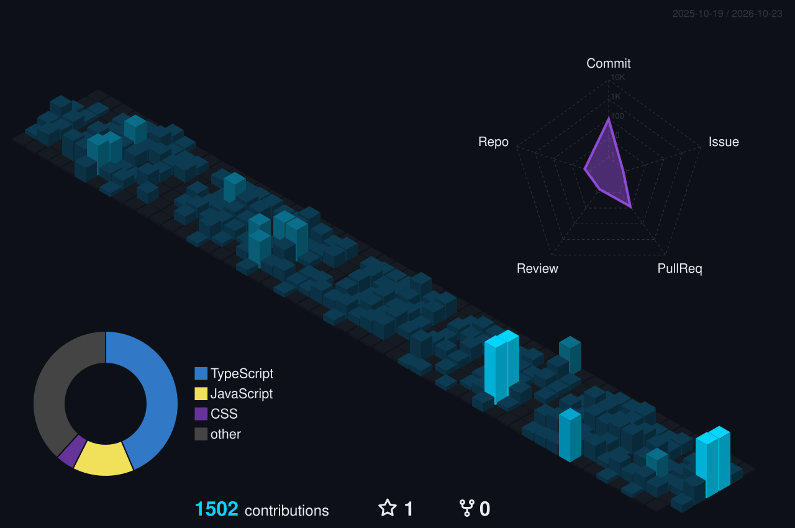
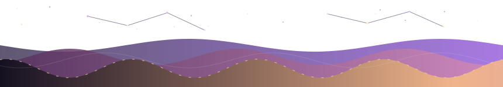

<!-- Eduardo Cornejo · Twilight Grove · generated by profile/build.mjs -->

<p align="center">
<a href="https://portfolio-livid-kappa-s1xb9fgcl6.vercel.app/"></a>
</p>

<p align="center">
<a href="https://git.io/typing-svg"></a>
</p>

<p align="center">
<a href="https://www.linkedin.com/in/luis-eduardo-cornejo-rinc%C3%B3n-1467b81b8/"></a>&nbsp;
&nbsp;
&nbsp;


</p>


<p align="center"></p>


<p align="center"></p>
<p align="center"></p>

<p align="center"></p>


<p align="center"></p>


<p align="center">
<a href="https://portfolio-livid-kappa-s1xb9fgcl6.vercel.app/"></a>
</p>
<p align="center"></p>


<p align="center"></p>

<p align="center"></p>
<p align="center"></p>


<p align="center"></p>


<p align="center"></p>

<picture>
  <source media="(prefers-color-scheme: dark)" srcset="./profile-3d-contrib/profile-cyber-night.svg" />
  <source media="(prefers-color-scheme: light)" srcset="./profile-3d-contrib/profile-cyber-night-static.svg" />
  
</picture>


<p align="center"></p>


<p align="center"></p>

```stl
solid edu_gitgraph
 facet normal -0.1744 -0.9592 -0.2225
  outer loop
   vertex -34.54 -0.95 -4.00
   vertex -34.48 -0.66 -5.30
   vertex -12.48 -4.66 -5.30
  endloop
 endfacet
 facet normal -0.1744 -0.9592 -0.2225
  outer loop
   vertex -34.54 -0.95 -4.00
   vertex -12.48 -4.66 -5.30
   vertex -12.54 -4.95 -4.00
  endloop
 endfacet
 facet normal -0.1399 -0.7692 -0.6235
  outer loop
   vertex -34.48 -0.66 -5.30
   vertex -34.33 0.16 -6.35
   vertex -12.33 -3.84 -6.35
  endloop
 endfacet
 facet normal -0.1399 -0.7692 -0.6235
  outer loop
   vertex -34.48 -0.66 -5.30
   vertex -12.33 -3.84 -6.35
   vertex -12.48 -4.66 -5.30
  endloop
 endfacet
 facet normal -0.0776 -0.4269 -0.9010
  outer loop
   vertex -34.33 0.16 -6.35
   vertex -34.12 1.34 -6.92
   vertex -12.12 -2.66 -6.92
  endloop
 endfacet
 facet normal -0.0776 -0.4269 -0.9010
  outer loop
   vertex -34.33 0.16 -6.35
   vertex -12.12 -2.66 -6.92
   vertex -12.33 -3.84 -6.35
  endloop
 endfacet
 facet normal 0.0000 0.0000 -1.0000
  outer loop
   vertex -34.12 1.34 -6.92
   vertex -33.88 2.66 -6.92
   vertex -11.88 -1.34 -6.92
  endloop
 endfacet
 facet normal 0.0000 0.0000 -1.0000
  outer loop
   vertex -34.12 1.34 -6.92
   vertex -11.88 -1.34 -6.92
   vertex -12.12 -2.66 -6.92
  endloop
 endfacet
 facet normal 0.0776 0.4269 -0.9010
  outer loop
   vertex -33.88 2.66 -6.92
   vertex -33.67 3.84 -6.35
   vertex -11.67 -0.16 -6.35
  endloop
 endfacet
 facet normal 0.0776 0.4269 -0.9010
  outer loop
   vertex -33.88 2.66 -6.92
   vertex -11.67 -0.16 -6.35
   vertex -11.88 -1.34 -6.92
  endloop
 endfacet
 facet normal 0.1399 0.7692 -0.6235
  outer loop
   vertex -33.67 3.84 -6.35
   vertex -33.52 4.66 -5.30
   vertex -11.52 0.66 -5.30
  endloop
 endfacet
 facet normal 0.1399 0.7692 -0.6235
  outer loop
   vertex -33.67 3.84 -6.35
   vertex -11.52 0.66 -5.30
   vertex -11.67 -0.16 -6.35
  endloop
 endfacet
 facet normal 0.1744 0.9592 -0.2225
  outer loop
   vertex -33.52 4.66 -5.30
   vertex -33.46 4.95 -4.00
   vertex -11.46 0.95 -4.00
  endloop
 endfacet
 facet normal 0.1744 0.9592 -0.2225
  outer loop
   vertex -33.52 4.66 -5.30
   vertex -11.46 0.95 -4.00
   vertex -11.52 0.66 -5.30
  endloop
 endfacet
 facet normal 0.1744 0.9592 0.2225
  outer loop
   vertex -33.46 4.95 -4.00
   vertex -33.52 4.66 -2.70
   vertex -11.52 0.66 -2.70
  endloop
 endfacet
 facet normal 0.1744 0.9592 0.2225
  outer loop
   vertex -33.46 4.95 -4.00
   vertex -11.52 0.66 -2.70
   vertex -11.46 0.95 -4.00
  endloop
 endfacet
 facet normal 0.1399 0.7692 0.6235
  outer loop
   vertex -33.52 4.66 -2.70
   vertex -33.67 3.84 -1.65
   vertex -11.67 -0.16 -1.65
  endloop
 endfacet
 facet normal 0.1399 0.7692 0.6235
  outer loop
   vertex -33.52 4.66 -2.70
   vertex -11.67 -0.16 -1.65
   vertex -11.52 0.66 -2.70
  endloop
 endfacet
 facet normal 0.0776 0.4269 0.9010
  outer loop
   vertex -33.67 3.84 -1.65
   vertex -33.88 2.66 -1.08
   vertex -11.88 -1.34 -1.08
  endloop
 endfacet
 facet normal 0.0776 0.4269 0.9010
  outer loop
   vertex -33.67 3.84 -1.65
   vertex -11.88 -1.34 -1.08
   vertex -11.67 -0.16 -1.65
  endloop
 endfacet
 facet normal 0.0000 0.0000 1.0000
  outer loop
   vertex -33.88 2.66 -1.08
   vertex -34.12 1.34 -1.08
   vertex -12.12 -2.66 -1.08
  endloop
 endfacet
 facet normal 0.0000 0.0000 1.0000
  outer loop
   vertex -33.88 2.66 -1.08
   vertex -12.12 -2.66 -1.08
   vertex -11.88 -1.34 -1.08
  endloop
 endfacet
 facet normal -0.0776 -0.4269 0.9010
  outer loop
   vertex -34.12 1.34 -1.08
   vertex -34.33 0.16 -1.65
   vertex -12.33 -3.84 -1.65
  endloop
 endfacet
 facet normal -0.0776 -0.4269 0.9010
  outer loop
   vertex -34.12 1.34 -1.08
   vertex -12.33 -3.84 -1.65
   vertex -12.12 -2.66 -1.08
  endloop
 endfacet
 facet normal -0.1399 -0.7692 0.6235
  outer loop
   vertex -34.33 0.16 -1.65
   vertex -34.48 -0.66 -2.70
   vertex -12.48 -4.66 -2.70
  endloop
 endfacet
 facet normal -0.1399 -0.7692 0.6235
  outer loop
   vertex -34.33 0.16 -1.65
   vertex -12.48 -4.66 -2.70
   vertex -12.33 -3.84 -1.65
  endloop
 endfacet
 facet normal -0.1744 -0.9592 0.2225
  outer loop
   vertex -34.48 -0.66 -2.70
   vertex -34.54 -0.95 -4.00
   vertex -12.54 -4.95 -4.00
  endloop
 endfacet
 facet normal -0.1744 -0.9592 0.2225
  outer loop
   vertex -34.48 -0.66 -2.70
   vertex -12.54 -4.95 -4.00
   vertex -12.48 -4.66 -2.70
  endloop
 endfacet
 facet normal 0.1744 -0.9592 -0.2225
  outer loop
   vertex -11.46 -4.95 -4.00
   vertex -11.52 -4.66 -5.30
   vertex 10.48 -0.66 -5.30
  endloop
 endfacet
 facet normal 0.1744 -0.9592 -0.2225
  outer loop
   vertex -11.46 -4.95 -4.00
   vertex 10.48 -0.66 -5.30
   vertex 10.54 -0.95 -4.00
  endloop
 endfacet
 facet normal 0.1399 -0.7692 -0.6235
  outer loop
   vertex -11.52 -4.66 -5.30
   vertex -11.67 -3.84 -6.35
   vertex 10.33 0.16 -6.35
  endloop
 endfacet
 facet normal 0.1399 -0.7692 -0.6235
  outer loop
   vertex -11.52 -4.66 -5.30
   vertex 10.33 0.16 -6.35
   vertex 10.48 -0.66 -5.30
  endloop
 endfacet
 facet normal 0.0776 -0.4269 -0.9010
  outer loop
   vertex -11.67 -3.84 -6.35
   vertex -11.88 -2.66 -6.92
   vertex 10.12 1.34 -6.92
  endloop
 endfacet
 facet normal 0.0776 -0.4269 -0.9010
  outer loop
   vertex -11.67 -3.84 -6.35
   vertex 10.12 1.34 -6.92
   vertex 10.33 0.16 -6.35
  endloop
 endfacet
 facet normal 0.0000 0.0000 -1.0000
  outer loop
   vertex -11.88 -2.66 -6.92
   vertex -12.12 -1.34 -6.92
   vertex 9.88 2.66 -6.92
  endloop
 endfacet
 facet normal 0.0000 0.0000 -1.0000
  outer loop
   vertex -11.88 -2.66 -6.92
   vertex 9.88 2.66 -6.92
   vertex 10.12 1.34 -6.92
  endloop
 endfacet
 facet normal -0.0776 0.4269 -0.9010
  outer loop
   vertex -12.12 -1.34 -6.92
   vertex -12.33 -0.16 -6.35
   vertex 9.67 3.84 -6.35
  endloop
 endfacet
 facet normal -0.0776 0.4269 -0.9010
  outer loop
   vertex -12.12 -1.34 -6.92
   vertex 9.67 3.84 -6.35
   vertex 9.88 2.66 -6.92
  endloop
 endfacet
 facet normal -0.1399 0.7692 -0.6235
  outer loop
   vertex -12.33 -0.16 -6.35
   vertex -12.48 0.66 -5.30
   vertex 9.52 4.66 -5.30
  endloop
 endfacet
 facet normal -0.1399 0.7692 -0.6235
  outer loop
   vertex -12.33 -0.16 -6.35
   vertex 9.52 4.66 -5.30
   vertex 9.67 3.84 -6.35
  endloop
 endfacet
 facet normal -0.1744 0.9592 -0.2225
  outer loop
   vertex -12.48 0.66 -5.30
   vertex -12.54 0.95 -4.00
   vertex 9.46 4.95 -4.00
  endloop
 endfacet
 facet normal -0.1744 0.9592 -0.2225
  outer loop
   vertex -12.48 0.66 -5.30
   vertex 9.46 4.95 -4.00
   vertex 9.52 4.66 -5.30
  endloop
 endfacet
 facet normal -0.1744 0.9592 0.2225
  outer loop
   vertex -12.54 0.95 -4.00
   vertex -12.48 0.66 -2.70
   vertex 9.52 4.66 -2.70
  endloop
 endfacet
 facet normal -0.1744 0.9592 0.2225
  outer loop
   vertex -12.54 0.95 -4.00
   vertex 9.52 4.66 -2.70
   vertex 9.46 4.95 -4.00
  endloop
 endfacet
 facet normal -0.1399 0.7692 0.6235
  outer loop
   vertex -12.48 0.66 -2.70
   vertex -12.33 -0.16 -1.65
   vertex 9.67 3.84 -1.65
  endloop
 endfacet
 facet normal -0.1399 0.7692 0.6235
  outer loop
   vertex -12.48 0.66 -2.70
   vertex 9.67 3.84 -1.65
   vertex 9.52 4.66 -2.70
  endloop
 endfacet
 facet normal -0.0776 0.4269 0.9010
  outer loop
   vertex -12.33 -0.16 -1.65
   vertex -12.12 -1.34 -1.08
   vertex 9.88 2.66 -1.08
  endloop
 endfacet
 facet normal -0.0776 0.4269 0.9010
  outer loop
   vertex -12.33 -0.16 -1.65
   vertex 9.88 2.66 -1.08
   vertex 9.67 3.84 -1.65
  endloop
 endfacet
 facet normal 0.0000 0.0000 1.0000
  outer loop
   vertex -12.12 -1.34 -1.08
   vertex -11.88 -2.66 -1.08
   vertex 10.12 1.34 -1.08
  endloop
 endfacet
 facet normal 0.0000 0.0000 1.0000
  outer loop
   vertex -12.12 -1.34 -1.08
   vertex 10.12 1.34 -1.08
   vertex 9.88 2.66 -1.08
  endloop
 endfacet
 facet normal 0.0776 -0.4269 0.9010
  outer loop
   vertex -11.88 -2.66 -1.08
   vertex -11.67 -3.84 -1.65
   vertex 10.33 0.16 -1.65
  endloop
 endfacet
 facet normal 0.0776 -0.4269 0.9010
  outer loop
   vertex -11.88 -2.66 -1.08
   vertex 10.33 0.16 -1.65
   vertex 10.12 1.34 -1.08
  endloop
 endfacet
 facet normal 0.1399 -0.7692 0.6235
  outer loop
   vertex -11.67 -3.84 -1.65
   vertex -11.52 -4.66 -2.70
   vertex 10.48 -0.66 -2.70
  endloop
 endfacet
 facet normal 0.1399 -0.7692 0.6235
  outer loop
   vertex -11.67 -3.84 -1.65
   vertex 10.48 -0.66 -2.70
   vertex 10.33 0.16 -1.65
  endloop
 endfacet
 facet normal 0.1744 -0.9592 0.2225
  outer loop
   vertex -11.52 -4.66 -2.70
   vertex -11.46 -4.95 -4.00
   vertex 10.54 -0.95 -4.00
  endloop
 endfacet
 facet normal 0.1744 -0.9592 0.2225
  outer loop
   vertex -11.52 -4.66 -2.70
   vertex 10.54 -0.95 -4.00
   vertex 10.48 -0.66 -2.70
  endloop
 endfacet
 facet normal -0.0626 -0.9731 -0.2218
  outer loop
   vertex 9.75 -0.99 -4.00
   vertex 9.88 -0.70 -5.30
   vertex 33.88 -2.70 -3.30
  endloop
 endfacet
 facet normal -0.0626 -0.9731 -0.2218
  outer loop
   vertex 9.75 -0.99 -4.00
   vertex 33.88 -2.70 -3.30
   vertex 33.75 -2.99 -2.00
  endloop
 endfacet
 facet normal -0.0135 -0.7834 -0.6214
  outer loop
   vertex 9.88 -0.70 -5.30
   vertex 10.04 0.12 -6.34
   vertex 34.04 -1.88 -4.34
  endloop
 endfacet
 facet normal -0.0135 -0.7834 -0.6214
  outer loop
   vertex 9.88 -0.70 -5.30
   vertex 34.04 -1.88 -4.34
   vertex 33.88 -2.70 -3.30
  endloop
 endfacet
 facet normal 0.0383 -0.4386 -0.8979
  outer loop
   vertex 10.04 0.12 -6.34
   vertex 10.19 1.31 -6.91
   vertex 34.19 -0.69 -4.91
  endloop
 endfacet
 facet normal 0.0383 -0.4386 -0.8979
  outer loop
   vertex 10.04 0.12 -6.34
   vertex 34.19 -0.69 -4.91
   vertex 34.04 -1.88 -4.34
  endloop
 endfacet
 facet normal 0.0825 -0.0069 -0.9966
  outer loop
   vertex 10.19 1.31 -6.91
   vertex 10.30 2.65 -6.91
   vertex 34.30 0.65 -4.91
  endloop
 endfacet
 facet normal 0.0825 -0.0069 -0.9966
  outer loop
   vertex 10.19 1.31 -6.91
   vertex 34.30 0.65 -4.91
   vertex 34.19 -0.69 -4.91
  endloop
 endfacet
 facet normal 0.1103 0.4262 -0.8979
  outer loop
   vertex 10.30 2.65 -6.91
   vertex 10.35 3.85 -6.34
   vertex 34.35 1.85 -4.34
  endloop
 endfacet
 facet normal 0.1103 0.4262 -0.8979
  outer loop
   vertex 10.30 2.65 -6.91
   vertex 34.35 1.85 -4.34
   vertex 34.30 0.65 -4.91
  endloop
 endfacet
 facet normal 0.1163 0.7748 -0.6214
  outer loop
   vertex 10.35 3.85 -6.34
   vertex 10.33 4.68 -5.30
   vertex 34.33 2.68 -3.30
  endloop
 endfacet
 facet normal 0.1163 0.7748 -0.6214
  outer loop
   vertex 10.35 3.85 -6.34
   vertex 34.33 2.68 -3.30
   vertex 34.35 1.85 -4.34
  endloop
 endfacet
 facet normal 0.0993 0.9700 -0.2218
  outer loop
   vertex 10.33 4.68 -5.30
   vertex 10.25 4.99 -4.00
   vertex 34.25 2.99 -2.00
  endloop
 endfacet
 facet normal 0.0993 0.9700 -0.2218
  outer loop
   vertex 10.33 4.68 -5.30
   vertex 34.25 2.99 -2.00
   vertex 34.33 2.68 -3.30
  endloop
 endfacet
 facet normal 0.0626 0.9731 0.2218
  outer loop
   vertex 10.25 4.99 -4.00
   vertex 10.12 4.70 -2.70
   vertex 34.12 2.70 -0.70
  endloop
 endfacet
 facet normal 0.0626 0.9731 0.2218
  outer loop
   vertex 10.25 4.99 -4.00
   vertex 34.12 2.70 -0.70
   vertex 34.25 2.99 -2.00
  endloop
 endfacet
 facet normal 0.0135 0.7834 0.6214
  outer loop
   vertex 10.12 4.70 -2.70
   vertex 9.96 3.88 -1.66
   vertex 33.96 1.88 0.34
  endloop
 endfacet
 facet normal 0.0135 0.7834 0.6214
  outer loop
   vertex 10.12 4.70 -2.70
   vertex 33.96 1.88 0.34
   vertex 34.12 2.70 -0.70
  endloop
 endfacet
 facet normal -0.0383 0.4386 0.8979
  outer loop
   vertex 9.96 3.88 -1.66
   vertex 9.81 2.69 -1.09
   vertex 33.81 0.69 0.91
  endloop
 endfacet
 facet normal -0.0383 0.4386 0.8979
  outer loop
   vertex 9.96 3.88 -1.66
   vertex 33.81 0.69 0.91
   vertex 33.96 1.88 0.34
  endloop
 endfacet
 facet normal -0.0825 0.0069 0.9966
  outer loop
   vertex 9.81 2.69 -1.09
   vertex 9.70 1.35 -1.09
   vertex 33.70 -0.65 0.91
  endloop
 endfacet
 facet normal -0.0825 0.0069 0.9966
  outer loop
   vertex 9.81 2.69 -1.09
   vertex 33.70 -0.65 0.91
   vertex 33.81 0.69 0.91
  endloop
 endfacet
 facet normal -0.1103 -0.4262 0.8979
  outer loop
   vertex 9.70 1.35 -1.09
   vertex 9.65 0.15 -1.66
   vertex 33.65 -1.85 0.34
  endloop
 endfacet
 facet normal -0.1103 -0.4262 0.8979
  outer loop
   vertex 9.70 1.35 -1.09
   vertex 33.65 -1.85 0.34
   vertex 33.70 -0.65 0.91
  endloop
 endfacet
 facet normal -0.1163 -0.7748 0.6214
  outer loop
   vertex 9.65 0.15 -1.66
   vertex 9.67 -0.68 -2.70
   vertex 33.67 -2.68 -0.70
  endloop
 endfacet
 facet normal -0.1163 -0.7748 0.6214
  outer loop
   vertex 9.65 0.15 -1.66
   vertex 33.67 -2.68 -0.70
   vertex 33.65 -1.85 0.34
  endloop
 endfacet
 facet normal -0.0993 -0.9700 0.2218
  outer loop
   vertex 9.67 -0.68 -2.70
   vertex 9.75 -0.99 -4.00
   vertex 33.75 -2.99 -2.00
  endloop
 endfacet
 facet normal -0.0993 -0.9700 0.2218
  outer loop
   vertex 9.67 -0.68 -2.70
   vertex 33.75 -2.99 -2.00
   vertex 33.67 -2.68 -0.70
  endloop
 endfacet
 facet normal 0.8131 -0.5657 -0.1375
  outer loop
   vertex -10.20 -3.80 -4.00
   vertex -9.76 -3.01 -4.68
   vertex 0.24 6.99 13.32
  endloop
 endfacet
 facet normal 0.8131 -0.5657 -0.1375
  outer loop
   vertex -10.20 -3.80 -4.00
   vertex 0.24 6.99 13.32
   vertex -0.20 6.20 14.00
  endloop
 endfacet
 facet normal 0.8995 -0.2062 -0.3852
  outer loop
   vertex -9.76 -3.01 -4.68
   vertex -9.77 -2.02 -5.23
   vertex 0.23 7.98 12.77
  endloop
 endfacet
 facet normal 0.8995 -0.2062 -0.3852
  outer loop
   vertex -9.76 -3.01 -4.68
   vertex 0.23 7.98 12.77
   vertex 0.24 6.99 13.32
  endloop
 endfacet
 facet normal 0.8078 0.1942 -0.5566
  outer loop
   vertex -9.77 -2.02 -5.23
   vertex -10.22 -1.02 -5.54
   vertex -0.22 8.98 12.46
  endloop
 endfacet
 facet normal 0.8078 0.1942 -0.5566
  outer loop
   vertex -9.77 -2.02 -5.23
   vertex -0.22 8.98 12.46
   vertex 0.23 7.98 12.77
  endloop
 endfacet
 facet normal 0.5560 0.5560 -0.6178
  outer loop
   vertex -10.22 -1.02 -5.54
   vertex -11.02 -0.22 -5.54
   vertex -1.02 9.78 12.46
  endloop
 endfacet
 facet normal 0.5560 0.5560 -0.6178
  outer loop
   vertex -10.22 -1.02 -5.54
   vertex -1.02 9.78 12.46
   vertex -0.22 8.98 12.46
  endloop
 endfacet
 facet normal 0.1942 0.8078 -0.5566
  outer loop
   vertex -11.02 -0.22 -5.54
   vertex -12.02 0.23 -5.23
   vertex -2.02 10.23 12.77
  endloop
 endfacet
 facet normal 0.1942 0.8078 -0.5566
  outer loop
   vertex -11.02 -0.22 -5.54
   vertex -2.02 10.23 12.77
   vertex -1.02 9.78 12.46
  endloop
 endfacet
 facet normal -0.2062 0.8995 -0.3852
  outer loop
   vertex -12.02 0.23 -5.23
   vertex -13.01 0.24 -4.68
   vertex -3.01 10.24 13.32
  endloop
 endfacet
 facet normal -0.2062 0.8995 -0.3852
  outer loop
   vertex -12.02 0.23 -5.23
   vertex -3.01 10.24 13.32
   vertex -2.02 10.23 12.77
  endloop
 endfacet
 facet normal -0.5657 0.8131 -0.1375
  outer loop
   vertex -13.01 0.24 -4.68
   vertex -13.80 -0.20 -4.00
   vertex -3.80 9.80 14.00
  endloop
 endfacet
 facet normal -0.5657 0.8131 -0.1375
  outer loop
   vertex -13.01 0.24 -4.68
   vertex -3.80 9.80 14.00
   vertex -3.01 10.24 13.32
  endloop
 endfacet
 facet normal -0.8131 0.5657 0.1375
  outer loop
   vertex -13.80 -0.20 -4.00
   vertex -14.24 -0.99 -3.32
   vertex -4.24 9.01 14.68
  endloop
 endfacet
 facet normal -0.8131 0.5657 0.1375
  outer loop
   vertex -13.80 -0.20 -4.00
   vertex -4.24 9.01 14.68
   vertex -3.80 9.80 14.00
  endloop
 endfacet
 facet normal -0.8995 0.2062 0.3852
  outer loop
   vertex -14.24 -0.99 -3.32
   vertex -14.23 -1.98 -2.77
   vertex -4.23 8.02 15.23
  endloop
 endfacet
 facet normal -0.8995 0.2062 0.3852
  outer loop
   vertex -14.24 -0.99 -3.32
   vertex -4.23 8.02 15.23
   vertex -4.24 9.01 14.68
  endloop
 endfacet
 facet normal -0.8078 -0.1942 0.5566
  outer loop
   vertex -14.23 -1.98 -2.77
   vertex -13.78 -2.98 -2.46
   vertex -3.78 7.02 15.54
  endloop
 endfacet
 facet normal -0.8078 -0.1942 0.5566
  outer loop
   vertex -14.23 -1.98 -2.77
   vertex -3.78 7.02 15.54
   vertex -4.23 8.02 15.23
  endloop
 endfacet
 facet normal -0.5560 -0.5560 0.6178
  outer loop
   vertex -13.78 -2.98 -2.46
   vertex -12.98 -3.78 -2.46
   vertex -2.98 6.22 15.54
  endloop
 endfacet
 facet normal -0.5560 -0.5560 0.6178
  outer loop
   vertex -13.78 -2.98 -2.46
   vertex -2.98 6.22 15.54
   vertex -3.78 7.02 15.54
  endloop
 endfacet
 facet normal -0.1942 -0.8078 0.5566
  outer loop
   vertex -12.98 -3.78 -2.46
   vertex -11.98 -4.23 -2.77
   vertex -1.98 5.77 15.23
  endloop
 endfacet
 facet normal -0.1942 -0.8078 0.5566
  outer loop
   vertex -12.98 -3.78 -2.46
   vertex -1.98 5.77 15.23
   vertex -2.98 6.22 15.54
  endloop
 endfacet
 facet normal 0.2062 -0.8995 0.3852
  outer loop
   vertex -11.98 -4.23 -2.77
   vertex -10.99 -4.24 -3.32
   vertex -0.99 5.76 14.68
  endloop
 endfacet
 facet normal 0.2062 -0.8995 0.3852
  outer loop
   vertex -11.98 -4.23 -2.77
   vertex -0.99 5.76 14.68
   vertex -1.98 5.77 15.23
  endloop
 endfacet
 facet normal 0.5657 -0.8131 0.1375
  outer loop
   vertex -10.99 -4.24 -3.32
   vertex -10.20 -3.80 -4.00
   vertex -0.20 6.20 14.00
  endloop
 endfacet
 facet normal 0.5657 -0.8131 0.1375
  outer loop
   vertex -10.99 -4.24 -3.32
   vertex -0.20 6.20 14.00
   vertex -0.99 5.76 14.68
  endloop
 endfacet
 facet normal -0.0683 -0.9727 -0.2216
  outer loop
   vertex -2.23 5.46 14.00
   vertex -2.11 5.70 12.90
   vertex 19.89 3.70 14.90
  endloop
 endfacet
 facet normal -0.0683 -0.9727 -0.2216
  outer loop
   vertex -2.23 5.46 14.00
   vertex 19.89 3.70 14.90
   vertex 19.77 3.46 16.00
  endloop
 endfacet
 facet normal -0.0148 -0.7837 -0.6210
  outer loop
   vertex -2.11 5.70 12.90
   vertex -1.96 6.40 12.01
   vertex 20.04 4.40 14.01
  endloop
 endfacet
 facet normal -0.0148 -0.7837 -0.6210
  outer loop
   vertex -2.11 5.70 12.90
   vertex 20.04 4.40 14.01
   vertex 19.89 3.70 14.90
  endloop
 endfacet
 facet normal 0.0416 -0.4395 -0.8973
  outer loop
   vertex -1.96 6.40 12.01
   vertex -1.83 7.41 11.52
   vertex 20.17 5.41 13.52
  endloop
 endfacet
 facet normal 0.0416 -0.4395 -0.8973
  outer loop
   vertex -1.96 6.40 12.01
   vertex 20.17 5.41 13.52
   vertex 20.04 4.40 14.01
  endloop
 endfacet
 facet normal 0.0898 -0.0082 -0.9959
  outer loop
   vertex -1.83 7.41 11.52
   vertex -1.73 8.54 11.52
   vertex 20.27 6.54 13.52
  endloop
 endfacet
 facet normal 0.0898 -0.0082 -0.9959
  outer loop
   vertex -1.83 7.41 11.52
   vertex 20.27 6.54 13.52
   vertex 20.17 5.41 13.52
  endloop
 endfacet
 facet normal 0.1202 0.4247 -0.8973
  outer loop
   vertex -1.73 8.54 11.52
   vertex -1.68 9.57 12.01
   vertex 20.32 7.57 14.01
  endloop
 endfacet
 facet normal 0.1202 0.4247 -0.8973
  outer loop
   vertex -1.73 8.54 11.52
   vertex 20.32 7.57 14.01
   vertex 20.27 6.54 13.52
  endloop
 endfacet
 facet normal 0.1268 0.7735 -0.6210
  outer loop
   vertex -1.68 9.57 12.01
   vertex -1.69 10.28 12.90
   vertex 20.31 8.28 14.90
  endloop
 endfacet
 facet normal 0.1268 0.7735 -0.6210
  outer loop
   vertex -1.68 9.57 12.01
   vertex 20.31 8.28 14.90
   vertex 20.32 7.57 14.01
  endloop
 endfacet
 facet normal 0.1082 0.9691 -0.2216
  outer loop
   vertex -1.69 10.28 12.90
   vertex -1.77 10.54 14.00
   vertex 20.23 8.54 16.00
  endloop
 endfacet
 facet normal 0.1082 0.9691 -0.2216
  outer loop
   vertex -1.69 10.28 12.90
   vertex 20.23 8.54 16.00
   vertex 20.31 8.28 14.90
  endloop
 endfacet
 facet normal 0.0683 0.9727 0.2216
  outer loop
   vertex -1.77 10.54 14.00
   vertex -1.89 10.30 15.10
   vertex 20.11 8.30 17.10
  endloop
 endfacet
 facet normal 0.0683 0.9727 0.2216
  outer loop
   vertex -1.77 10.54 14.00
   vertex 20.11 8.30 17.10
   vertex 20.23 8.54 16.00
  endloop
 endfacet
 facet normal 0.0148 0.7837 0.6210
  outer loop
   vertex -1.89 10.30 15.10
   vertex -2.04 9.60 15.99
   vertex 19.96 7.60 17.99
  endloop
 endfacet
 facet normal 0.0148 0.7837 0.6210
  outer loop
   vertex -1.89 10.30 15.10
   vertex 19.96 7.60 17.99
   vertex 20.11 8.30 17.10
  endloop
 endfacet
 facet normal -0.0416 0.4395 0.8973
  outer loop
   vertex -2.04 9.60 15.99
   vertex -2.17 8.59 16.48
   vertex 19.83 6.59 18.48
  endloop
 endfacet
 facet normal -0.0416 0.4395 0.8973
  outer loop
   vertex -2.04 9.60 15.99
   vertex 19.83 6.59 18.48
   vertex 19.96 7.60 17.99
  endloop
 endfacet
 facet normal -0.0898 0.0082 0.9959
  outer loop
   vertex -2.17 8.59 16.48
   vertex -2.27 7.46 16.48
   vertex 19.73 5.46 18.48
  endloop
 endfacet
 facet normal -0.0898 0.0082 0.9959
  outer loop
   vertex -2.17 8.59 16.48
   vertex 19.73 5.46 18.48
   vertex 19.83 6.59 18.48
  endloop
 endfacet
 facet normal -0.1202 -0.4247 0.8973
  outer loop
   vertex -2.27 7.46 16.48
   vertex -2.32 6.43 15.99
   vertex 19.68 4.43 17.99
  endloop
 endfacet
 facet normal -0.1202 -0.4247 0.8973
  outer loop
   vertex -2.27 7.46 16.48
   vertex 19.68 4.43 17.99
   vertex 19.73 5.46 18.48
  endloop
 endfacet
 facet normal -0.1268 -0.7735 0.6210
  outer loop
   vertex -2.32 6.43 15.99
   vertex -2.31 5.72 15.10
   vertex 19.69 3.72 17.10
  endloop
 endfacet
 facet normal -0.1268 -0.7735 0.6210
  outer loop
   vertex -2.32 6.43 15.99
   vertex 19.69 3.72 17.10
   vertex 19.68 4.43 17.99
  endloop
 endfacet
 facet normal -0.1082 -0.9691 0.2216
  outer loop
   vertex -2.31 5.72 15.10
   vertex -2.23 5.46 14.00
   vertex 19.77 3.46 16.00
  endloop
 endfacet
 facet normal -0.1082 -0.9691 0.2216
  outer loop
   vertex -2.31 5.72 15.10
   vertex 19.77 3.46 16.00
   vertex 19.69 3.72 17.10
  endloop
 endfacet
 facet normal -0.5402 -0.8292 -0.1437
  outer loop
   vertex 19.00 3.66 16.00
   vertex 18.32 4.22 15.29
   vertex 32.32 -1.78 -2.71
  endloop
 endfacet
 facet normal -0.5402 -0.8292 -0.1437
  outer loop
   vertex 19.00 3.66 16.00
   vertex 32.32 -1.78 -2.71
   vertex 33.00 -2.34 -2.00
  endloop
 endfacet
 facet normal -0.7454 -0.5311 -0.4028
  outer loop
   vertex 18.32 4.22 15.29
   vertex 17.97 5.14 14.71
   vertex 31.97 -0.86 -3.29
  endloop
 endfacet
 facet normal -0.7454 -0.5311 -0.4028
  outer loop
   vertex 18.32 4.22 15.29
   vertex 31.97 -0.86 -3.29
   vertex 32.32 -1.78 -2.71
  endloop
 endfacet
 facet normal -0.8031 -0.1279 -0.5820
  outer loop
   vertex 17.97 5.14 14.71
   vertex 18.03 6.23 14.39
   vertex 32.03 0.23 -3.61
  endloop
 endfacet
 facet normal -0.8031 -0.1279 -0.5820
  outer loop
   vertex 17.97 5.14 14.71
   vertex 32.03 0.23 -3.61
   vertex 31.97 -0.86 -3.29
  endloop
 endfacet
 facet normal -0.7016 0.3007 -0.6460
  outer loop
   vertex 18.03 6.23 14.39
   vertex 18.48 7.27 14.39
   vertex 32.48 1.27 -3.61
  endloop
 endfacet
 facet normal -0.7016 0.3007 -0.6460
  outer loop
   vertex 18.03 6.23 14.39
   vertex 32.48 1.27 -3.61
   vertex 32.03 0.23 -3.61
  endloop
 endfacet
 facet normal -0.4612 0.6697 -0.5820
  outer loop
   vertex 18.48 7.27 14.39
   vertex 19.23 8.06 14.71
   vertex 33.23 2.06 -3.29
  endloop
 endfacet
 facet normal -0.4612 0.6697 -0.5820
  outer loop
   vertex 18.48 7.27 14.39
   vertex 33.23 2.06 -3.29
   vertex 32.48 1.27 -3.61
  endloop
 endfacet
 facet normal -0.1295 0.9061 -0.4028
  outer loop
   vertex 19.23 8.06 14.71
   vertex 20.13 8.44 15.29
   vertex 34.13 2.44 -2.71
  endloop
 endfacet
 facet normal -0.1295 0.9061 -0.4028
  outer loop
   vertex 19.23 8.06 14.71
   vertex 34.13 2.44 -2.71
   vertex 33.23 2.06 -3.29
  endloop
 endfacet
 facet normal 0.2279 0.9630 -0.1437
  outer loop
   vertex 20.13 8.44 15.29
   vertex 21.00 8.34 16.00
   vertex 35.00 2.34 -2.00
  endloop
 endfacet
 facet normal 0.2279 0.9630 -0.1437
  outer loop
   vertex 20.13 8.44 15.29
   vertex 35.00 2.34 -2.00
   vertex 34.13 2.44 -2.71
  endloop
 endfacet
 facet normal 0.5402 0.8292 0.1437
  outer loop
   vertex 21.00 8.34 16.00
   vertex 21.68 7.78 16.71
   vertex 35.68 1.78 -1.29
  endloop
 endfacet
 facet normal 0.5402 0.8292 0.1437
  outer loop
   vertex 21.00 8.34 16.00
   vertex 35.68 1.78 -1.29
   vertex 35.00 2.34 -2.00
  endloop
 endfacet
 facet normal 0.7454 0.5311 0.4028
  outer loop
   vertex 21.68 7.78 16.71
   vertex 22.03 6.86 17.29
   vertex 36.03 0.86 -0.71
  endloop
 endfacet
 facet normal 0.7454 0.5311 0.4028
  outer loop
   vertex 21.68 7.78 16.71
   vertex 36.03 0.86 -0.71
   vertex 35.68 1.78 -1.29
  endloop
 endfacet
 facet normal 0.8031 0.1279 0.5820
  outer loop
   vertex 22.03 6.86 17.29
   vertex 21.97 5.77 17.61
   vertex 35.97 -0.23 -0.39
  endloop
 endfacet
 facet normal 0.8031 0.1279 0.5820
  outer loop
   vertex 22.03 6.86 17.29
   vertex 35.97 -0.23 -0.39
   vertex 36.03 0.86 -0.71
  endloop
 endfacet
 facet normal 0.7016 -0.3007 0.6460
  outer loop
   vertex 21.97 5.77 17.61
   vertex 21.52 4.73 17.61
   vertex 35.52 -1.27 -0.39
  endloop
 endfacet
 facet normal 0.7016 -0.3007 0.6460
  outer loop
   vertex 21.97 5.77 17.61
   vertex 35.52 -1.27 -0.39
   vertex 35.97 -0.23 -0.39
  endloop
 endfacet
 facet normal 0.4612 -0.6697 0.5820
  outer loop
   vertex 21.52 4.73 17.61
   vertex 20.77 3.94 17.29
   vertex 34.77 -2.06 -0.71
  endloop
 endfacet
 facet normal 0.4612 -0.6697 0.5820
  outer loop
   vertex 21.52 4.73 17.61
   vertex 34.77 -2.06 -0.71
   vertex 35.52 -1.27 -0.39
  endloop
 endfacet
 facet normal 0.1295 -0.9061 0.4028
  outer loop
   vertex 20.77 3.94 17.29
   vertex 19.87 3.56 16.71
   vertex 33.87 -2.44 -1.29
  endloop
 endfacet
 facet normal 0.1295 -0.9061 0.4028
  outer loop
   vertex 20.77 3.94 17.29
   vertex 33.87 -2.44 -1.29
   vertex 34.77 -2.06 -0.71
  endloop
 endfacet
 facet normal -0.2279 -0.9630 0.1437
  outer loop
   vertex 19.87 3.56 16.71
   vertex 19.00 3.66 16.00
   vertex 33.00 -2.34 -2.00
  endloop
 endfacet
 facet normal -0.2279 -0.9630 0.1437
  outer loop
   vertex 19.87 3.56 16.71
   vertex 33.00 -2.34 -2.00
   vertex 33.87 -2.44 -1.29
  endloop
 endfacet
 facet normal 0.0000 0.0000 0.0000
  outer loop
   vertex -34.00 2.00 2.00
   vertex -31.88 2.88 1.54
   vertex -34.00 2.00 2.00
  endloop
 endfacet
 facet normal 0.0000 0.0000 0.0000
  outer loop
   vertex -34.00 2.00 2.00
   vertex -32.38 3.62 1.54
   vertex -34.00 2.00 2.00
  endloop
 endfacet
 facet normal 0.0000 0.0000 0.0000
  outer loop
   vertex -34.00 2.00 2.00
   vertex -33.12 4.12 1.54
   vertex -34.00 2.00 2.00
  endloop
 endfacet
 facet normal 0.0000 0.0000 0.0000
  outer loop
   vertex -34.00 2.00 2.00
   vertex -34.00 4.30 1.54
   vertex -34.00 2.00 2.00
  endloop
 endfacet
 facet normal 0.0000 0.0000 0.0000
  outer loop
   vertex -34.00 2.00 2.00
   vertex -34.88 4.12 1.54
   vertex -34.00 2.00 2.00
  endloop
 endfacet
 facet normal 0.0000 0.0000 0.0000
  outer loop
   vertex -34.00 2.00 2.00
   vertex -35.62 3.62 1.54
   vertex -34.00 2.00 2.00
  endloop
 endfacet
 facet normal 0.0000 0.0000 0.0000
  outer loop
   vertex -34.00 2.00 2.00
   vertex -36.12 2.88 1.54
   vertex -34.00 2.00 2.00
  endloop
 endfacet
 facet normal 0.0000 0.0000 0.0000
  outer loop
   vertex -34.00 2.00 2.00
   vertex -36.30 2.00 1.54
   vertex -34.00 2.00 2.00
  endloop
 endfacet
 facet normal 0.0000 0.0000 0.0000
  outer loop
   vertex -34.00 2.00 2.00
   vertex -36.12 1.12 1.54
   vertex -34.00 2.00 2.00
  endloop
 endfacet
 facet normal 0.0000 0.0000 0.0000
  outer loop
   vertex -34.00 2.00 2.00
   vertex -35.62 0.38 1.54
   vertex -34.00 2.00 2.00
  endloop
 endfacet
 facet normal 0.0000 0.0000 0.0000
  outer loop
   vertex -34.00 2.00 2.00
   vertex -34.88 -0.12 1.54
   vertex -34.00 2.00 2.00
  endloop
 endfacet
 facet normal 0.0000 0.0000 0.0000
  outer loop
   vertex -34.00 2.00 2.00
   vertex -34.00 -0.30 1.54
   vertex -34.00 2.00 2.00
  endloop
 endfacet
 facet normal 0.0000 0.0000 0.0000
  outer loop
   vertex -34.00 2.00 2.00
   vertex -33.12 -0.12 1.54
   vertex -34.00 2.00 2.00
  endloop
 endfacet
 facet normal 0.0000 0.0000 0.0000
  outer loop
   vertex -34.00 2.00 2.00
   vertex -32.38 0.38 1.54
   vertex -34.00 2.00 2.00
  endloop
 endfacet
 facet normal 0.0000 0.0000 0.0000
  outer loop
   vertex -34.00 2.00 2.00
   vertex -31.88 1.12 1.54
   vertex -34.00 2.00 2.00
  endloop
 endfacet
 facet normal 0.0000 0.0000 0.0000
  outer loop
   vertex -34.00 2.00 2.00
   vertex -31.70 2.00 1.54
   vertex -34.00 2.00 2.00
  endloop
 endfacet
 facet normal 0.5522 0.1098 0.8264
  outer loop
   vertex -31.70 2.00 1.54
   vertex -29.76 2.00 0.24
   vertex -30.08 3.62 0.24
  endloop
 endfacet
 facet normal 0.5522 0.1098 0.8264
  outer loop
   vertex -31.70 2.00 1.54
   vertex -30.08 3.62 0.24
   vertex -31.88 2.88 1.54
  endloop
 endfacet
 facet normal 0.4681 0.3128 0.8264
  outer loop
   vertex -31.88 2.88 1.54
   vertex -30.08 3.62 0.24
   vertex -31.00 5.00 0.24
  endloop
 endfacet
 facet normal 0.4681 0.3128 0.8264
  outer loop
   vertex -31.88 2.88 1.54
   vertex -31.00 5.00 0.24
   vertex -32.38 3.62 1.54
  endloop
 endfacet
 facet normal 0.3128 0.4681 0.8264
  outer loop
   vertex -32.38 3.62 1.54
   vertex -31.00 5.00 0.24
   vertex -32.38 5.92 0.24
  endloop
 endfacet
 facet normal 0.3128 0.4681 0.8264
  outer loop
   vertex -32.38 3.62 1.54
   vertex -32.38 5.92 0.24
   vertex -33.12 4.12 1.54
  endloop
 endfacet
 facet normal 0.1098 0.5522 0.8264
  outer loop
   vertex -33.12 4.12 1.54
   vertex -32.38 5.92 0.24
   vertex -34.00 6.24 0.24
  endloop
 endfacet
 facet normal 0.1098 0.5522 0.8264
  outer loop
   vertex -33.12 4.12 1.54
   vertex -34.00 6.24 0.24
   vertex -34.00 4.30 1.54
  endloop
 endfacet
 facet normal -0.1098 0.5522 0.8264
  outer loop
   vertex -34.00 4.30 1.54
   vertex -34.00 6.24 0.24
   vertex -35.62 5.92 0.24
  endloop
 endfacet
 facet normal -0.1098 0.5522 0.8264
  outer loop
   vertex -34.00 4.30 1.54
   vertex -35.62 5.92 0.24
   vertex -34.88 4.12 1.54
  endloop
 endfacet
 facet normal -0.3128 0.4681 0.8264
  outer loop
   vertex -34.88 4.12 1.54
   vertex -35.62 5.92 0.24
   vertex -37.00 5.00 0.24
  endloop
 endfacet
 facet normal -0.3128 0.4681 0.8264
  outer loop
   vertex -34.88 4.12 1.54
   vertex -37.00 5.00 0.24
   vertex -35.62 3.62 1.54
  endloop
 endfacet
 facet normal -0.4681 0.3128 0.8264
  outer loop
   vertex -35.62 3.62 1.54
   vertex -37.00 5.00 0.24
   vertex -37.92 3.62 0.24
  endloop
 endfacet
 facet normal -0.4681 0.3128 0.8264
  outer loop
   vertex -35.62 3.62 1.54
   vertex -37.92 3.62 0.24
   vertex -36.12 2.88 1.54
  endloop
 endfacet
 facet normal -0.5522 0.1098 0.8264
  outer loop
   vertex -36.12 2.88 1.54
   vertex -37.92 3.62 0.24
   vertex -38.24 2.00 0.24
  endloop
 endfacet
 facet normal -0.5522 0.1098 0.8264
  outer loop
   vertex -36.12 2.88 1.54
   vertex -38.24 2.00 0.24
   vertex -36.30 2.00 1.54
  endloop
 endfacet
 facet normal -0.5522 -0.1098 0.8264
  outer loop
   vertex -36.30 2.00 1.54
   vertex -38.24 2.00 0.24
   vertex -37.92 0.38 0.24
  endloop
 endfacet
 facet normal -0.5522 -0.1098 0.8264
  outer loop
   vertex -36.30 2.00 1.54
   vertex -37.92 0.38 0.24
   vertex -36.12 1.12 1.54
  endloop
 endfacet
 facet normal -0.4681 -0.3128 0.8264
  outer loop
   vertex -36.12 1.12 1.54
   vertex -37.92 0.38 0.24
   vertex -37.00 -1.00 0.24
  endloop
 endfacet
 facet normal -0.4681 -0.3128 0.8264
  outer loop
   vertex -36.12 1.12 1.54
   vertex -37.00 -1.00 0.24
   vertex -35.62 0.38 1.54
  endloop
 endfacet
 facet normal -0.3128 -0.4681 0.8264
  outer loop
   vertex -35.62 0.38 1.54
   vertex -37.00 -1.00 0.24
   vertex -35.62 -1.92 0.24
  endloop
 endfacet
 facet normal -0.3128 -0.4681 0.8264
  outer loop
   vertex -35.62 0.38 1.54
   vertex -35.62 -1.92 0.24
   vertex -34.88 -0.12 1.54
  endloop
 endfacet
 facet normal -0.1098 -0.5522 0.8264
  outer loop
   vertex -34.88 -0.12 1.54
   vertex -35.62 -1.92 0.24
   vertex -34.00 -2.24 0.24
  endloop
 endfacet
 facet normal -0.1098 -0.5522 0.8264
  outer loop
   vertex -34.88 -0.12 1.54
   vertex -34.00 -2.24 0.24
   vertex -34.00 -0.30 1.54
  endloop
 endfacet
 facet normal 0.1098 -0.5522 0.8264
  outer loop
   vertex -34.00 -0.30 1.54
   vertex -34.00 -2.24 0.24
   vertex -32.38 -1.92 0.24
  endloop
 endfacet
 facet normal 0.1098 -0.5522 0.8264
  outer loop
   vertex -34.00 -0.30 1.54
   vertex -32.38 -1.92 0.24
   vertex -33.12 -0.12 1.54
  endloop
 endfacet
 facet normal 0.3128 -0.4681 0.8264
  outer loop
   vertex -33.12 -0.12 1.54
   vertex -32.38 -1.92 0.24
   vertex -31.00 -1.00 0.24
  endloop
 endfacet
 facet normal 0.3128 -0.4681 0.8264
  outer loop
   vertex -33.12 -0.12 1.54
   vertex -31.00 -1.00 0.24
   vertex -32.38 0.38 1.54
  endloop
 endfacet
 facet normal 0.4681 -0.3128 0.8264
  outer loop
   vertex -32.38 0.38 1.54
   vertex -31.00 -1.00 0.24
   vertex -30.08 0.38 0.24
  endloop
 endfacet
 facet normal 0.4681 -0.3128 0.8264
  outer loop
   vertex -32.38 0.38 1.54
   vertex -30.08 0.38 0.24
   vertex -31.88 1.12 1.54
  endloop
 endfacet
 facet normal 0.5522 -0.1098 0.8264
  outer loop
   vertex -31.88 1.12 1.54
   vertex -30.08 0.38 0.24
   vertex -29.76 2.00 0.24
  endloop
 endfacet
 facet normal 0.5522 -0.1098 0.8264
  outer loop
   vertex -31.88 1.12 1.54
   vertex -29.76 2.00 0.24
   vertex -31.70 2.00 1.54
  endloop
 endfacet
 facet normal 0.8203 0.1632 0.5481
  outer loop
   vertex -29.76 2.00 0.24
   vertex -28.46 2.00 -1.70
   vertex -28.88 4.12 -1.70
  endloop
 endfacet
 facet normal 0.8203 0.1632 0.5481
  outer loop
   vertex -29.76 2.00 0.24
   vertex -28.88 4.12 -1.70
   vertex -30.08 3.62 0.24
  endloop
 endfacet
 facet normal 0.6954 0.4647 0.5481
  outer loop
   vertex -30.08 3.62 0.24
   vertex -28.88 4.12 -1.70
   vertex -30.08 5.92 -1.70
  endloop
 endfacet
 facet normal 0.6954 0.4647 0.5481
  outer loop
   vertex -30.08 3.62 0.24
   vertex -30.08 5.92 -1.70
   vertex -31.00 5.00 0.24
  endloop
 endfacet
 facet normal 0.4647 0.6954 0.5481
  outer loop
   vertex -31.00 5.00 0.24
   vertex -30.08 5.92 -1.70
   vertex -31.88 7.12 -1.70
  endloop
 endfacet
 facet normal 0.4647 0.6954 0.5481
  outer loop
   vertex -31.00 5.00 0.24
   vertex -31.88 7.12 -1.70
   vertex -32.38 5.92 0.24
  endloop
 endfacet
 facet normal 0.1632 0.8203 0.5481
  outer loop
   vertex -32.38 5.92 0.24
   vertex -31.88 7.12 -1.70
   vertex -34.00 7.54 -1.70
  endloop
 endfacet
 facet normal 0.1632 0.8203 0.5481
  outer loop
   vertex -32.38 5.92 0.24
   vertex -34.00 7.54 -1.70
   vertex -34.00 6.24 0.24
  endloop
 endfacet
 facet normal -0.1632 0.8203 0.5481
  outer loop
   vertex -34.00 6.24 0.24
   vertex -34.00 7.54 -1.70
   vertex -36.12 7.12 -1.70
  endloop
 endfacet
 facet normal -0.1632 0.8203 0.5481
  outer loop
   vertex -34.00 6.24 0.24
   vertex -36.12 7.12 -1.70
   vertex -35.62 5.92 0.24
  endloop
 endfacet
 facet normal -0.4647 0.6954 0.5481
  outer loop
   vertex -35.62 5.92 0.24
   vertex -36.12 7.12 -1.70
   vertex -37.92 5.92 -1.70
  endloop
 endfacet
 facet normal -0.4647 0.6954 0.5481
  outer loop
   vertex -35.62 5.92 0.24
   vertex -37.92 5.92 -1.70
   vertex -37.00 5.00 0.24
  endloop
 endfacet
 facet normal -0.6954 0.4647 0.5481
  outer loop
   vertex -37.00 5.00 0.24
   vertex -37.92 5.92 -1.70
   vertex -39.12 4.12 -1.70
  endloop
 endfacet
 facet normal -0.6954 0.4647 0.5481
  outer loop
   vertex -37.00 5.00 0.24
   vertex -39.12 4.12 -1.70
   vertex -37.92 3.62 0.24
  endloop
 endfacet
 facet normal -0.8203 0.1632 0.5481
  outer loop
   vertex -37.92 3.62 0.24
   vertex -39.12 4.12 -1.70
   vertex -39.54 2.00 -1.70
  endloop
 endfacet
 facet normal -0.8203 0.1632 0.5481
  outer loop
   vertex -37.92 3.62 0.24
   vertex -39.54 2.00 -1.70
   vertex -38.24 2.00 0.24
  endloop
 endfacet
 facet normal -0.8203 -0.1632 0.5481
  outer loop
   vertex -38.24 2.00 0.24
   vertex -39.54 2.00 -1.70
   vertex -39.12 -0.12 -1.70
  endloop
 endfacet
 facet normal -0.8203 -0.1632 0.5481
  outer loop
   vertex -38.24 2.00 0.24
   vertex -39.12 -0.12 -1.70
   vertex -37.92 0.38 0.24
  endloop
 endfacet
 facet normal -0.6954 -0.4647 0.5481
  outer loop
   vertex -37.92 0.38 0.24
   vertex -39.12 -0.12 -1.70
   vertex -37.92 -1.92 -1.70
  endloop
 endfacet
 facet normal -0.6954 -0.4647 0.5481
  outer loop
   vertex -37.92 0.38 0.24
   vertex -37.92 -1.92 -1.70
   vertex -37.00 -1.00 0.24
  endloop
 endfacet
 facet normal -0.4647 -0.6954 0.5481
  outer loop
   vertex -37.00 -1.00 0.24
   vertex -37.92 -1.92 -1.70
   vertex -36.12 -3.12 -1.70
  endloop
 endfacet
 facet normal -0.4647 -0.6954 0.5481
  outer loop
   vertex -37.00 -1.00 0.24
   vertex -36.12 -3.12 -1.70
   vertex -35.62 -1.92 0.24
  endloop
 endfacet
 facet normal -0.1632 -0.8203 0.5481
  outer loop
   vertex -35.62 -1.92 0.24
   vertex -36.12 -3.12 -1.70
   vertex -34.00 -3.54 -1.70
  endloop
 endfacet
 facet normal -0.1632 -0.8203 0.5481
  outer loop
   vertex -35.62 -1.92 0.24
   vertex -34.00 -3.54 -1.70
   vertex -34.00 -2.24 0.24
  endloop
 endfacet
 facet normal 0.1632 -0.8203 0.5481
  outer loop
   vertex -34.00 -2.24 0.24
   vertex -34.00 -3.54 -1.70
   vertex -31.88 -3.12 -1.70
  endloop
 endfacet
 facet normal 0.1632 -0.8203 0.5481
  outer loop
   vertex -34.00 -2.24 0.24
   vertex -31.88 -3.12 -1.70
   vertex -32.38 -1.92 0.24
  endloop
 endfacet
 facet normal 0.4647 -0.6954 0.5481
  outer loop
   vertex -32.38 -1.92 0.24
   vertex -31.88 -3.12 -1.70
   vertex -30.08 -1.92 -1.70
  endloop
 endfacet
 facet normal 0.4647 -0.6954 0.5481
  outer loop
   vertex -32.38 -1.92 0.24
   vertex -30.08 -1.92 -1.70
   vertex -31.00 -1.00 0.24
  endloop
 endfacet
 facet normal 0.6954 -0.4647 0.5481
  outer loop
   vertex -31.00 -1.00 0.24
   vertex -30.08 -1.92 -1.70
   vertex -28.88 -0.12 -1.70
  endloop
 endfacet
 facet normal 0.6954 -0.4647 0.5481
  outer loop
   vertex -31.00 -1.00 0.24
   vertex -28.88 -0.12 -1.70
   vertex -30.08 0.38 0.24
  endloop
 endfacet
 facet normal 0.8203 -0.1632 0.5481
  outer loop
   vertex -30.08 0.38 0.24
   vertex -28.88 -0.12 -1.70
   vertex -28.46 2.00 -1.70
  endloop
 endfacet
 facet normal 0.8203 -0.1632 0.5481
  outer loop
   vertex -30.08 0.38 0.24
   vertex -28.46 2.00 -1.70
   vertex -29.76 2.00 0.24
  endloop
 endfacet
 facet normal 0.9626 0.1915 0.1915
  outer loop
   vertex -28.46 2.00 -1.70
   vertex -28.00 2.00 -4.00
   vertex -28.46 4.30 -4.00
  endloop
 endfacet
 facet normal 0.9626 0.1915 0.1915
  outer loop
   vertex -28.46 2.00 -1.70
   vertex -28.46 4.30 -4.00
   vertex -28.88 4.12 -1.70
  endloop
 endfacet
 facet normal 0.8161 0.5453 0.1915
  outer loop
   vertex -28.88 4.12 -1.70
   vertex -28.46 4.30 -4.00
   vertex -29.76 6.24 -4.00
  endloop
 endfacet
 facet normal 0.8161 0.5453 0.1915
  outer loop
   vertex -28.88 4.12 -1.70
   vertex -29.76 6.24 -4.00
   vertex -30.08 5.92 -1.70
  endloop
 endfacet
 facet normal 0.5453 0.8161 0.1915
  outer loop
   vertex -30.08 5.92 -1.70
   vertex -29.76 6.24 -4.00
   vertex -31.70 7.54 -4.00
  endloop
 endfacet
 facet normal 0.5453 0.8161 0.1915
  outer loop
   vertex -30.08 5.92 -1.70
   vertex -31.70 7.54 -4.00
   vertex -31.88 7.12 -1.70
  endloop
 endfacet
 facet normal 0.1915 0.9626 0.1915
  outer loop
   vertex -31.88 7.12 -1.70
   vertex -31.70 7.54 -4.00
   vertex -34.00 8.00 -4.00
  endloop
 endfacet
 facet normal 0.1915 0.9626 0.1915
  outer loop
   vertex -31.88 7.12 -1.70
   vertex -34.00 8.00 -4.00
   vertex -34.00 7.54 -1.70
  endloop
 endfacet
 facet normal -0.1915 0.9626 0.1915
  outer loop
   vertex -34.00 7.54 -1.70
   vertex -34.00 8.00 -4.00
   vertex -36.30 7.54 -4.00
  endloop
 endfacet
 facet normal -0.1915 0.9626 0.1915
  outer loop
   vertex -34.00 7.54 -1.70
   vertex -36.30 7.54 -4.00
   vertex -36.12 7.12 -1.70
  endloop
 endfacet
 facet normal -0.5453 0.8161 0.1915
  outer loop
   vertex -36.12 7.12 -1.70
   vertex -36.30 7.54 -4.00
   vertex -38.24 6.24 -4.00
  endloop
 endfacet
 facet normal -0.5453 0.8161 0.1915
  outer loop
   vertex -36.12 7.12 -1.70
   vertex -38.24 6.24 -4.00
   vertex -37.92 5.92 -1.70
  endloop
 endfacet
 facet normal -0.8161 0.5453 0.1915
  outer loop
   vertex -37.92 5.92 -1.70
   vertex -38.24 6.24 -4.00
   vertex -39.54 4.30 -4.00
  endloop
 endfacet
 facet normal -0.8161 0.5453 0.1915
  outer loop
   vertex -37.92 5.92 -1.70
   vertex -39.54 4.30 -4.00
   vertex -39.12 4.12 -1.70
  endloop
 endfacet
 facet normal -0.9626 0.1915 0.1915
  outer loop
   vertex -39.12 4.12 -1.70
   vertex -39.54 4.30 -4.00
   vertex -40.00 2.00 -4.00
  endloop
 endfacet
 facet normal -0.9626 0.1915 0.1915
  outer loop
   vertex -39.12 4.12 -1.70
   vertex -40.00 2.00 -4.00
   vertex -39.54 2.00 -1.70
  endloop
 endfacet
 facet normal -0.9626 -0.1915 0.1915
  outer loop
   vertex -39.54 2.00 -1.70
   vertex -40.00 2.00 -4.00
   vertex -39.54 -0.30 -4.00
  endloop
 endfacet
 facet normal -0.9626 -0.1915 0.1915
  outer loop
   vertex -39.54 2.00 -1.70
   vertex -39.54 -0.30 -4.00
   vertex -39.12 -0.12 -1.70
  endloop
 endfacet
 facet normal -0.8161 -0.5453 0.1915
  outer loop
   vertex -39.12 -0.12 -1.70
   vertex -39.54 -0.30 -4.00
   vertex -38.24 -2.24 -4.00
  endloop
 endfacet
 facet normal -0.8161 -0.5453 0.1915
  outer loop
   vertex -39.12 -0.12 -1.70
   vertex -38.24 -2.24 -4.00
   vertex -37.92 -1.92 -1.70
  endloop
 endfacet
 facet normal -0.5453 -0.8161 0.1915
  outer loop
   vertex -37.92 -1.92 -1.70
   vertex -38.24 -2.24 -4.00
   vertex -36.30 -3.54 -4.00
  endloop
 endfacet
 facet normal -0.5453 -0.8161 0.1915
  outer loop
   vertex -37.92 -1.92 -1.70
   vertex -36.30 -3.54 -4.00
   vertex -36.12 -3.12 -1.70
  endloop
 endfacet
 facet normal -0.1915 -0.9626 0.1915
  outer loop
   vertex -36.12 -3.12 -1.70
   vertex -36.30 -3.54 -4.00
   vertex -34.00 -4.00 -4.00
  endloop
 endfacet
 facet normal -0.1915 -0.9626 0.1915
  outer loop
   vertex -36.12 -3.12 -1.70
   vertex -34.00 -4.00 -4.00
   vertex -34.00 -3.54 -1.70
  endloop
 endfacet
 facet normal 0.1915 -0.9626 0.1915
  outer loop
   vertex -34.00 -3.54 -1.70
   vertex -34.00 -4.00 -4.00
   vertex -31.70 -3.54 -4.00
  endloop
 endfacet
 facet normal 0.1915 -0.9626 0.1915
  outer loop
   vertex -34.00 -3.54 -1.70
   vertex -31.70 -3.54 -4.00
   vertex -31.88 -3.12 -1.70
  endloop
 endfacet
 facet normal 0.5453 -0.8161 0.1915
  outer loop
   vertex -31.88 -3.12 -1.70
   vertex -31.70 -3.54 -4.00
   vertex -29.76 -2.24 -4.00
  endloop
 endfacet
 facet normal 0.5453 -0.8161 0.1915
  outer loop
   vertex -31.88 -3.12 -1.70
   vertex -29.76 -2.24 -4.00
   vertex -30.08 -1.92 -1.70
  endloop
 endfacet
 facet normal 0.8161 -0.5453 0.1915
  outer loop
   vertex -30.08 -1.92 -1.70
   vertex -29.76 -2.24 -4.00
   vertex -28.46 -0.30 -4.00
  endloop
 endfacet
 facet normal 0.8161 -0.5453 0.1915
  outer loop
   vertex -30.08 -1.92 -1.70
   vertex -28.46 -0.30 -4.00
   vertex -28.88 -0.12 -1.70
  endloop
 endfacet
 facet normal 0.9626 -0.1915 0.1915
  outer loop
   vertex -28.88 -0.12 -1.70
   vertex -28.46 -0.30 -4.00
   vertex -28.00 2.00 -4.00
  endloop
 endfacet
 facet normal 0.9626 -0.1915 0.1915
  outer loop
   vertex -28.88 -0.12 -1.70
   vertex -28.00 2.00 -4.00
   vertex -28.46 2.00 -1.70
  endloop
 endfacet
 facet normal 0.9626 0.1915 -0.1915
  outer loop
   vertex -28.00 2.00 -4.00
   vertex -28.46 2.00 -6.30
   vertex -28.88 4.12 -6.30
  endloop
 endfacet
 facet normal 0.9626 0.1915 -0.1915
  outer loop
   vertex -28.00 2.00 -4.00
   vertex -28.88 4.12 -6.30
   vertex -28.46 4.30 -4.00
  endloop
 endfacet
 facet normal 0.8161 0.5453 -0.1915
  outer loop
   vertex -28.46 4.30 -4.00
   vertex -28.88 4.12 -6.30
   vertex -30.08 5.92 -6.30
  endloop
 endfacet
 facet normal 0.8161 0.5453 -0.1915
  outer loop
   vertex -28.46 4.30 -4.00
   vertex -30.08 5.92 -6.30
   vertex -29.76 6.24 -4.00
  endloop
 endfacet
 facet normal 0.5453 0.8161 -0.1915
  outer loop
   vertex -29.76 6.24 -4.00
   vertex -30.08 5.92 -6.30
   vertex -31.88 7.12 -6.30
  endloop
 endfacet
 facet normal 0.5453 0.8161 -0.1915
  outer loop
   vertex -29.76 6.24 -4.00
   vertex -31.88 7.12 -6.30
   vertex -31.70 7.54 -4.00
  endloop
 endfacet
 facet normal 0.1915 0.9626 -0.1915
  outer loop
   vertex -31.70 7.54 -4.00
   vertex -31.88 7.12 -6.30
   vertex -34.00 7.54 -6.30
  endloop
 endfacet
 facet normal 0.1915 0.9626 -0.1915
  outer loop
   vertex -31.70 7.54 -4.00
   vertex -34.00 7.54 -6.30
   vertex -34.00 8.00 -4.00
  endloop
 endfacet
 facet normal -0.1915 0.9626 -0.1915
  outer loop
   vertex -34.00 8.00 -4.00
   vertex -34.00 7.54 -6.30
   vertex -36.12 7.12 -6.30
  endloop
 endfacet
 facet normal -0.1915 0.9626 -0.1915
  outer loop
   vertex -34.00 8.00 -4.00
   vertex -36.12 7.12 -6.30
   vertex -36.30 7.54 -4.00
  endloop
 endfacet
 facet normal -0.5453 0.8161 -0.1915
  outer loop
   vertex -36.30 7.54 -4.00
   vertex -36.12 7.12 -6.30
   vertex -37.92 5.92 -6.30
  endloop
 endfacet
 facet normal -0.5453 0.8161 -0.1915
  outer loop
   vertex -36.30 7.54 -4.00
   vertex -37.92 5.92 -6.30
   vertex -38.24 6.24 -4.00
  endloop
 endfacet
 facet normal -0.8161 0.5453 -0.1915
  outer loop
   vertex -38.24 6.24 -4.00
   vertex -37.92 5.92 -6.30
   vertex -39.12 4.12 -6.30
  endloop
 endfacet
 facet normal -0.8161 0.5453 -0.1915
  outer loop
   vertex -38.24 6.24 -4.00
   vertex -39.12 4.12 -6.30
   vertex -39.54 4.30 -4.00
  endloop
 endfacet
 facet normal -0.9626 0.1915 -0.1915
  outer loop
   vertex -39.54 4.30 -4.00
   vertex -39.12 4.12 -6.30
   vertex -39.54 2.00 -6.30
  endloop
 endfacet
 facet normal -0.9626 0.1915 -0.1915
  outer loop
   vertex -39.54 4.30 -4.00
   vertex -39.54 2.00 -6.30
   vertex -40.00 2.00 -4.00
  endloop
 endfacet
 facet normal -0.9626 -0.1915 -0.1915
  outer loop
   vertex -40.00 2.00 -4.00
   vertex -39.54 2.00 -6.30
   vertex -39.12 -0.12 -6.30
  endloop
 endfacet
 facet normal -0.9626 -0.1915 -0.1915
  outer loop
   vertex -40.00 2.00 -4.00
   vertex -39.12 -0.12 -6.30
   vertex -39.54 -0.30 -4.00
  endloop
 endfacet
 facet normal -0.8161 -0.5453 -0.1915
  outer loop
   vertex -39.54 -0.30 -4.00
   vertex -39.12 -0.12 -6.30
   vertex -37.92 -1.92 -6.30
  endloop
 endfacet
 facet normal -0.8161 -0.5453 -0.1915
  outer loop
   vertex -39.54 -0.30 -4.00
   vertex -37.92 -1.92 -6.30
   vertex -38.24 -2.24 -4.00
  endloop
 endfacet
 facet normal -0.5453 -0.8161 -0.1915
  outer loop
   vertex -38.24 -2.24 -4.00
   vertex -37.92 -1.92 -6.30
   vertex -36.12 -3.12 -6.30
  endloop
 endfacet
 facet normal -0.5453 -0.8161 -0.1915
  outer loop
   vertex -38.24 -2.24 -4.00
   vertex -36.12 -3.12 -6.30
   vertex -36.30 -3.54 -4.00
  endloop
 endfacet
 facet normal -0.1915 -0.9626 -0.1915
  outer loop
   vertex -36.30 -3.54 -4.00
   vertex -36.12 -3.12 -6.30
   vertex -34.00 -3.54 -6.30
  endloop
 endfacet
 facet normal -0.1915 -0.9626 -0.1915
  outer loop
   vertex -36.30 -3.54 -4.00
   vertex -34.00 -3.54 -6.30
   vertex -34.00 -4.00 -4.00
  endloop
 endfacet
 facet normal 0.1915 -0.9626 -0.1915
  outer loop
   vertex -34.00 -4.00 -4.00
   vertex -34.00 -3.54 -6.30
   vertex -31.88 -3.12 -6.30
  endloop
 endfacet
 facet normal 0.1915 -0.9626 -0.1915
  outer loop
   vertex -34.00 -4.00 -4.00
   vertex -31.88 -3.12 -6.30
   vertex -31.70 -3.54 -4.00
  endloop
 endfacet
 facet normal 0.5453 -0.8161 -0.1915
  outer loop
   vertex -31.70 -3.54 -4.00
   vertex -31.88 -3.12 -6.30
   vertex -30.08 -1.92 -6.30
  endloop
 endfacet
 facet normal 0.5453 -0.8161 -0.1915
  outer loop
   vertex -31.70 -3.54 -4.00
   vertex -30.08 -1.92 -6.30
   vertex -29.76 -2.24 -4.00
  endloop
 endfacet
 facet normal 0.8161 -0.5453 -0.1915
  outer loop
   vertex -29.76 -2.24 -4.00
   vertex -30.08 -1.92 -6.30
   vertex -28.88 -0.12 -6.30
  endloop
 endfacet
 facet normal 0.8161 -0.5453 -0.1915
  outer loop
   vertex -29.76 -2.24 -4.00
   vertex -28.88 -0.12 -6.30
   vertex -28.46 -0.30 -4.00
  endloop
 endfacet
 facet normal 0.9626 -0.1915 -0.1915
  outer loop
   vertex -28.46 -0.30 -4.00
   vertex -28.88 -0.12 -6.30
   vertex -28.46 2.00 -6.30
  endloop
 endfacet
 facet normal 0.9626 -0.1915 -0.1915
  outer loop
   vertex -28.46 -0.30 -4.00
   vertex -28.46 2.00 -6.30
   vertex -28.00 2.00 -4.00
  endloop
 endfacet
 facet normal 0.8203 0.1632 -0.5481
  outer loop
   vertex -28.46 2.00 -6.30
   vertex -29.76 2.00 -8.24
   vertex -30.08 3.62 -8.24
  endloop
 endfacet
 facet normal 0.8203 0.1632 -0.5481
  outer loop
   vertex -28.46 2.00 -6.30
   vertex -30.08 3.62 -8.24
   vertex -28.88 4.12 -6.30
  endloop
 endfacet
 facet normal 0.6954 0.4647 -0.5481
  outer loop
   vertex -28.88 4.12 -6.30
   vertex -30.08 3.62 -8.24
   vertex -31.00 5.00 -8.24
  endloop
 endfacet
 facet normal 0.6954 0.4647 -0.5481
  outer loop
   vertex -28.88 4.12 -6.30
   vertex -31.00 5.00 -8.24
   vertex -30.08 5.92 -6.30
  endloop
 endfacet
 facet normal 0.4647 0.6954 -0.5481
  outer loop
   vertex -30.08 5.92 -6.30
   vertex -31.00 5.00 -8.24
   vertex -32.38 5.92 -8.24
  endloop
 endfacet
 facet normal 0.4647 0.6954 -0.5481
  outer loop
   vertex -30.08 5.92 -6.30
   vertex -32.38 5.92 -8.24
   vertex -31.88 7.12 -6.30
  endloop
 endfacet
 facet normal 0.1632 0.8203 -0.5481
  outer loop
   vertex -31.88 7.12 -6.30
   vertex -32.38 5.92 -8.24
   vertex -34.00 6.24 -8.24
  endloop
 endfacet
 facet normal 0.1632 0.8203 -0.5481
  outer loop
   vertex -31.88 7.12 -6.30
   vertex -34.00 6.24 -8.24
   vertex -34.00 7.54 -6.30
  endloop
 endfacet
 facet normal -0.1632 0.8203 -0.5481
  outer loop
   vertex -34.00 7.54 -6.30
   vertex -34.00 6.24 -8.24
   vertex -35.62 5.92 -8.24
  endloop
 endfacet
 facet normal -0.1632 0.8203 -0.5481
  outer loop
   vertex -34.00 7.54 -6.30
   vertex -35.62 5.92 -8.24
   vertex -36.12 7.12 -6.30
  endloop
 endfacet
 facet normal -0.4647 0.6954 -0.5481
  outer loop
   vertex -36.12 7.12 -6.30
   vertex -35.62 5.92 -8.24
   vertex -37.00 5.00 -8.24
  endloop
 endfacet
 facet normal -0.4647 0.6954 -0.5481
  outer loop
   vertex -36.12 7.12 -6.30
   vertex -37.00 5.00 -8.24
   vertex -37.92 5.92 -6.30
  endloop
 endfacet
 facet normal -0.6954 0.4647 -0.5481
  outer loop
   vertex -37.92 5.92 -6.30
   vertex -37.00 5.00 -8.24
   vertex -37.92 3.62 -8.24
  endloop
 endfacet
 facet normal -0.6954 0.4647 -0.5481
  outer loop
   vertex -37.92 5.92 -6.30
   vertex -37.92 3.62 -8.24
   vertex -39.12 4.12 -6.30
  endloop
 endfacet
 facet normal -0.8203 0.1632 -0.5481
  outer loop
   vertex -39.12 4.12 -6.30
   vertex -37.92 3.62 -8.24
   vertex -38.24 2.00 -8.24
  endloop
 endfacet
 facet normal -0.8203 0.1632 -0.5481
  outer loop
   vertex -39.12 4.12 -6.30
   vertex -38.24 2.00 -8.24
   vertex -39.54 2.00 -6.30
  endloop
 endfacet
 facet normal -0.8203 -0.1632 -0.5481
  outer loop
   vertex -39.54 2.00 -6.30
   vertex -38.24 2.00 -8.24
   vertex -37.92 0.38 -8.24
  endloop
 endfacet
 facet normal -0.8203 -0.1632 -0.5481
  outer loop
   vertex -39.54 2.00 -6.30
   vertex -37.92 0.38 -8.24
   vertex -39.12 -0.12 -6.30
  endloop
 endfacet
 facet normal -0.6954 -0.4647 -0.5481
  outer loop
   vertex -39.12 -0.12 -6.30
   vertex -37.92 0.38 -8.24
   vertex -37.00 -1.00 -8.24
  endloop
 endfacet
 facet normal -0.6954 -0.4647 -0.5481
  outer loop
   vertex -39.12 -0.12 -6.30
   vertex -37.00 -1.00 -8.24
   vertex -37.92 -1.92 -6.30
  endloop
 endfacet
 facet normal -0.4647 -0.6954 -0.5481
  outer loop
   vertex -37.92 -1.92 -6.30
   vertex -37.00 -1.00 -8.24
   vertex -35.62 -1.92 -8.24
  endloop
 endfacet
 facet normal -0.4647 -0.6954 -0.5481
  outer loop
   vertex -37.92 -1.92 -6.30
   vertex -35.62 -1.92 -8.24
   vertex -36.12 -3.12 -6.30
  endloop
 endfacet
 facet normal -0.1632 -0.8203 -0.5481
  outer loop
   vertex -36.12 -3.12 -6.30
   vertex -35.62 -1.92 -8.24
   vertex -34.00 -2.24 -8.24
  endloop
 endfacet
 facet normal -0.1632 -0.8203 -0.5481
  outer loop
   vertex -36.12 -3.12 -6.30
   vertex -34.00 -2.24 -8.24
   vertex -34.00 -3.54 -6.30
  endloop
 endfacet
 facet normal 0.1632 -0.8203 -0.5481
  outer loop
   vertex -34.00 -3.54 -6.30
   vertex -34.00 -2.24 -8.24
   vertex -32.38 -1.92 -8.24
  endloop
 endfacet
 facet normal 0.1632 -0.8203 -0.5481
  outer loop
   vertex -34.00 -3.54 -6.30
   vertex -32.38 -1.92 -8.24
   vertex -31.88 -3.12 -6.30
  endloop
 endfacet
 facet normal 0.4647 -0.6954 -0.5481
  outer loop
   vertex -31.88 -3.12 -6.30
   vertex -32.38 -1.92 -8.24
   vertex -31.00 -1.00 -8.24
  endloop
 endfacet
 facet normal 0.4647 -0.6954 -0.5481
  outer loop
   vertex -31.88 -3.12 -6.30
   vertex -31.00 -1.00 -8.24
   vertex -30.08 -1.92 -6.30
  endloop
 endfacet
 facet normal 0.6954 -0.4647 -0.5481
  outer loop
   vertex -30.08 -1.92 -6.30
   vertex -31.00 -1.00 -8.24
   vertex -30.08 0.38 -8.24
  endloop
 endfacet
 facet normal 0.6954 -0.4647 -0.5481
  outer loop
   vertex -30.08 -1.92 -6.30
   vertex -30.08 0.38 -8.24
   vertex -28.88 -0.12 -6.30
  endloop
 endfacet
 facet normal 0.8203 -0.1632 -0.5481
  outer loop
   vertex -28.88 -0.12 -6.30
   vertex -30.08 0.38 -8.24
   vertex -29.76 2.00 -8.24
  endloop
 endfacet
 facet normal 0.8203 -0.1632 -0.5481
  outer loop
   vertex -28.88 -0.12 -6.30
   vertex -29.76 2.00 -8.24
   vertex -28.46 2.00 -6.30
  endloop
 endfacet
 facet normal 0.5522 0.1098 -0.8264
  outer loop
   vertex -29.76 2.00 -8.24
   vertex -31.70 2.00 -9.54
   vertex -31.88 2.88 -9.54
  endloop
 endfacet
 facet normal 0.5522 0.1098 -0.8264
  outer loop
   vertex -29.76 2.00 -8.24
   vertex -31.88 2.88 -9.54
   vertex -30.08 3.62 -8.24
  endloop
 endfacet
 facet normal 0.4681 0.3128 -0.8264
  outer loop
   vertex -30.08 3.62 -8.24
   vertex -31.88 2.88 -9.54
   vertex -32.38 3.62 -9.54
  endloop
 endfacet
 facet normal 0.4681 0.3128 -0.8264
  outer loop
   vertex -30.08 3.62 -8.24
   vertex -32.38 3.62 -9.54
   vertex -31.00 5.00 -8.24
  endloop
 endfacet
 facet normal 0.3128 0.4681 -0.8264
  outer loop
   vertex -31.00 5.00 -8.24
   vertex -32.38 3.62 -9.54
   vertex -33.12 4.12 -9.54
  endloop
 endfacet
 facet normal 0.3128 0.4681 -0.8264
  outer loop
   vertex -31.00 5.00 -8.24
   vertex -33.12 4.12 -9.54
   vertex -32.38 5.92 -8.24
  endloop
 endfacet
 facet normal 0.1098 0.5522 -0.8264
  outer loop
   vertex -32.38 5.92 -8.24
   vertex -33.12 4.12 -9.54
   vertex -34.00 4.30 -9.54
  endloop
 endfacet
 facet normal 0.1098 0.5522 -0.8264
  outer loop
   vertex -32.38 5.92 -8.24
   vertex -34.00 4.30 -9.54
   vertex -34.00 6.24 -8.24
  endloop
 endfacet
 facet normal -0.1098 0.5522 -0.8264
  outer loop
   vertex -34.00 6.24 -8.24
   vertex -34.00 4.30 -9.54
   vertex -34.88 4.12 -9.54
  endloop
 endfacet
 facet normal -0.1098 0.5522 -0.8264
  outer loop
   vertex -34.00 6.24 -8.24
   vertex -34.88 4.12 -9.54
   vertex -35.62 5.92 -8.24
  endloop
 endfacet
 facet normal -0.3128 0.4681 -0.8264
  outer loop
   vertex -35.62 5.92 -8.24
   vertex -34.88 4.12 -9.54
   vertex -35.62 3.62 -9.54
  endloop
 endfacet
 facet normal -0.3128 0.4681 -0.8264
  outer loop
   vertex -35.62 5.92 -8.24
   vertex -35.62 3.62 -9.54
   vertex -37.00 5.00 -8.24
  endloop
 endfacet
 facet normal -0.4681 0.3128 -0.8264
  outer loop
   vertex -37.00 5.00 -8.24
   vertex -35.62 3.62 -9.54
   vertex -36.12 2.88 -9.54
  endloop
 endfacet
 facet normal -0.4681 0.3128 -0.8264
  outer loop
   vertex -37.00 5.00 -8.24
   vertex -36.12 2.88 -9.54
   vertex -37.92 3.62 -8.24
  endloop
 endfacet
 facet normal -0.5522 0.1098 -0.8264
  outer loop
   vertex -37.92 3.62 -8.24
   vertex -36.12 2.88 -9.54
   vertex -36.30 2.00 -9.54
  endloop
 endfacet
 facet normal -0.5522 0.1098 -0.8264
  outer loop
   vertex -37.92 3.62 -8.24
   vertex -36.30 2.00 -9.54
   vertex -38.24 2.00 -8.24
  endloop
 endfacet
 facet normal -0.5522 -0.1098 -0.8264
  outer loop
   vertex -38.24 2.00 -8.24
   vertex -36.30 2.00 -9.54
   vertex -36.12 1.12 -9.54
  endloop
 endfacet
 facet normal -0.5522 -0.1098 -0.8264
  outer loop
   vertex -38.24 2.00 -8.24
   vertex -36.12 1.12 -9.54
   vertex -37.92 0.38 -8.24
  endloop
 endfacet
 facet normal -0.4681 -0.3128 -0.8264
  outer loop
   vertex -37.92 0.38 -8.24
   vertex -36.12 1.12 -9.54
   vertex -35.62 0.38 -9.54
  endloop
 endfacet
 facet normal -0.4681 -0.3128 -0.8264
  outer loop
   vertex -37.92 0.38 -8.24
   vertex -35.62 0.38 -9.54
   vertex -37.00 -1.00 -8.24
  endloop
 endfacet
 facet normal -0.3128 -0.4681 -0.8264
  outer loop
   vertex -37.00 -1.00 -8.24
   vertex -35.62 0.38 -9.54
   vertex -34.88 -0.12 -9.54
  endloop
 endfacet
 facet normal -0.3128 -0.4681 -0.8264
  outer loop
   vertex -37.00 -1.00 -8.24
   vertex -34.88 -0.12 -9.54
   vertex -35.62 -1.92 -8.24
  endloop
 endfacet
 facet normal -0.1098 -0.5522 -0.8264
  outer loop
   vertex -35.62 -1.92 -8.24
   vertex -34.88 -0.12 -9.54
   vertex -34.00 -0.30 -9.54
  endloop
 endfacet
 facet normal -0.1098 -0.5522 -0.8264
  outer loop
   vertex -35.62 -1.92 -8.24
   vertex -34.00 -0.30 -9.54
   vertex -34.00 -2.24 -8.24
  endloop
 endfacet
 facet normal 0.1098 -0.5522 -0.8264
  outer loop
   vertex -34.00 -2.24 -8.24
   vertex -34.00 -0.30 -9.54
   vertex -33.12 -0.12 -9.54
  endloop
 endfacet
 facet normal 0.1098 -0.5522 -0.8264
  outer loop
   vertex -34.00 -2.24 -8.24
   vertex -33.12 -0.12 -9.54
   vertex -32.38 -1.92 -8.24
  endloop
 endfacet
 facet normal 0.3128 -0.4681 -0.8264
  outer loop
   vertex -32.38 -1.92 -8.24
   vertex -33.12 -0.12 -9.54
   vertex -32.38 0.38 -9.54
  endloop
 endfacet
 facet normal 0.3128 -0.4681 -0.8264
  outer loop
   vertex -32.38 -1.92 -8.24
   vertex -32.38 0.38 -9.54
   vertex -31.00 -1.00 -8.24
  endloop
 endfacet
 facet normal 0.4681 -0.3128 -0.8264
  outer loop
   vertex -31.00 -1.00 -8.24
   vertex -32.38 0.38 -9.54
   vertex -31.88 1.12 -9.54
  endloop
 endfacet
 facet normal 0.4681 -0.3128 -0.8264
  outer loop
   vertex -31.00 -1.00 -8.24
   vertex -31.88 1.12 -9.54
   vertex -30.08 0.38 -8.24
  endloop
 endfacet
 facet normal 0.5522 -0.1098 -0.8264
  outer loop
   vertex -30.08 0.38 -8.24
   vertex -31.88 1.12 -9.54
   vertex -31.70 2.00 -9.54
  endloop
 endfacet
 facet normal 0.5522 -0.1098 -0.8264
  outer loop
   vertex -30.08 0.38 -8.24
   vertex -31.70 2.00 -9.54
   vertex -29.76 2.00 -8.24
  endloop
 endfacet
 facet normal 0.1951 0.0000 -0.9808
  outer loop
   vertex -31.70 2.00 -9.54
   vertex -34.00 2.00 -10.00
   vertex -34.00 2.00 -10.00
  endloop
 endfacet
 facet normal 0.0000 0.0000 0.0000
  outer loop
   vertex -31.88 2.88 -9.54
   vertex -34.00 2.00 -10.00
   vertex -34.00 2.00 -10.00
  endloop
 endfacet
 facet normal 0.2425 0.0000 -0.9701
  outer loop
   vertex -32.38 3.62 -9.54
   vertex -34.00 2.00 -10.00
   vertex -34.00 2.00 -10.00
  endloop
 endfacet
 facet normal 0.0000 0.0000 0.0000
  outer loop
   vertex -33.12 4.12 -9.54
   vertex -34.00 2.00 -10.00
   vertex -34.00 2.00 -10.00
  endloop
 endfacet
 facet normal 0.0000 0.0000 0.0000
  outer loop
   vertex -34.00 4.30 -9.54
   vertex -34.00 2.00 -10.00
   vertex -34.00 2.00 -10.00
  endloop
 endfacet
 facet normal -0.4472 0.0000 -0.8944
  outer loop
   vertex -34.88 4.12 -9.54
   vertex -34.00 2.00 -10.00
   vertex -34.00 2.00 -10.00
  endloop
 endfacet
 facet normal 0.0000 0.0000 0.0000
  outer loop
   vertex -35.62 3.62 -9.54
   vertex -34.00 2.00 -10.00
   vertex -34.00 2.00 -10.00
  endloop
 endfacet
 facet normal -0.2425 0.0000 -0.9701
  outer loop
   vertex -36.12 2.88 -9.54
   vertex -34.00 2.00 -10.00
   vertex -34.00 2.00 -10.00
  endloop
 endfacet
 facet normal -0.1951 0.0000 -0.9808
  outer loop
   vertex -36.30 2.00 -9.54
   vertex -34.00 2.00 -10.00
   vertex -34.00 2.00 -10.00
  endloop
 endfacet
 facet normal -0.2425 0.0000 -0.9701
  outer loop
   vertex -36.12 1.12 -9.54
   vertex -34.00 2.00 -10.00
   vertex -34.00 2.00 -10.00
  endloop
 endfacet
 facet normal 0.0000 0.0000 0.0000
  outer loop
   vertex -35.62 0.38 -9.54
   vertex -34.00 2.00 -10.00
   vertex -34.00 2.00 -10.00
  endloop
 endfacet
 facet normal 0.0000 0.0000 0.0000
  outer loop
   vertex -34.88 -0.12 -9.54
   vertex -34.00 2.00 -10.00
   vertex -34.00 2.00 -10.00
  endloop
 endfacet
 facet normal 0.0000 0.0000 0.0000
  outer loop
   vertex -34.00 -0.30 -9.54
   vertex -34.00 2.00 -10.00
   vertex -34.00 2.00 -10.00
  endloop
 endfacet
 facet normal 0.0000 0.0000 0.0000
  outer loop
   vertex -33.12 -0.12 -9.54
   vertex -34.00 2.00 -10.00
   vertex -34.00 2.00 -10.00
  endloop
 endfacet
 facet normal 0.2425 0.0000 -0.9701
  outer loop
   vertex -32.38 0.38 -9.54
   vertex -34.00 2.00 -10.00
   vertex -34.00 2.00 -10.00
  endloop
 endfacet
 facet normal 0.2425 0.0000 -0.9701
  outer loop
   vertex -31.88 1.12 -9.54
   vertex -34.00 2.00 -10.00
   vertex -34.00 2.00 -10.00
  endloop
 endfacet
 facet normal 0.0000 0.0000 0.0000
  outer loop
   vertex -12.00 -2.00 2.00
   vertex -9.88 -1.12 1.54
   vertex -12.00 -2.00 2.00
  endloop
 endfacet
 facet normal 0.0000 0.0000 0.0000
  outer loop
   vertex -12.00 -2.00 2.00
   vertex -10.38 -0.38 1.54
   vertex -12.00 -2.00 2.00
  endloop
 endfacet
 facet normal 0.0000 0.0000 0.0000
  outer loop
   vertex -12.00 -2.00 2.00
   vertex -11.12 0.12 1.54
   vertex -12.00 -2.00 2.00
  endloop
 endfacet
 facet normal 0.0000 0.0000 0.0000
  outer loop
   vertex -12.00 -2.00 2.00
   vertex -12.00 0.30 1.54
   vertex -12.00 -2.00 2.00
  endloop
 endfacet
 facet normal 0.0000 0.0000 0.0000
  outer loop
   vertex -12.00 -2.00 2.00
   vertex -12.88 0.12 1.54
   vertex -12.00 -2.00 2.00
  endloop
 endfacet
 facet normal 0.0000 0.0000 0.0000
  outer loop
   vertex -12.00 -2.00 2.00
   vertex -13.62 -0.38 1.54
   vertex -12.00 -2.00 2.00
  endloop
 endfacet
 facet normal 0.0000 0.0000 0.0000
  outer loop
   vertex -12.00 -2.00 2.00
   vertex -14.12 -1.12 1.54
   vertex -12.00 -2.00 2.00
  endloop
 endfacet
 facet normal 0.0000 0.0000 0.0000
  outer loop
   vertex -12.00 -2.00 2.00
   vertex -14.30 -2.00 1.54
   vertex -12.00 -2.00 2.00
  endloop
 endfacet
 facet normal 0.0000 0.0000 0.0000
  outer loop
   vertex -12.00 -2.00 2.00
   vertex -14.12 -2.88 1.54
   vertex -12.00 -2.00 2.00
  endloop
 endfacet
 facet normal 0.0000 0.0000 0.0000
  outer loop
   vertex -12.00 -2.00 2.00
   vertex -13.62 -3.62 1.54
   vertex -12.00 -2.00 2.00
  endloop
 endfacet
 facet normal 0.0000 0.0000 0.0000
  outer loop
   vertex -12.00 -2.00 2.00
   vertex -12.88 -4.12 1.54
   vertex -12.00 -2.00 2.00
  endloop
 endfacet
 facet normal 0.0000 0.0000 0.0000
  outer loop
   vertex -12.00 -2.00 2.00
   vertex -12.00 -4.30 1.54
   vertex -12.00 -2.00 2.00
  endloop
 endfacet
 facet normal 0.0000 0.0000 0.0000
  outer loop
   vertex -12.00 -2.00 2.00
   vertex -11.12 -4.12 1.54
   vertex -12.00 -2.00 2.00
  endloop
 endfacet
 facet normal 0.0000 0.0000 0.0000
  outer loop
   vertex -12.00 -2.00 2.00
   vertex -10.38 -3.62 1.54
   vertex -12.00 -2.00 2.00
  endloop
 endfacet
 facet normal 0.0000 0.0000 0.0000
  outer loop
   vertex -12.00 -2.00 2.00
   vertex -9.88 -2.88 1.54
   vertex -12.00 -2.00 2.00
  endloop
 endfacet
 facet normal 0.0000 0.0000 0.0000
  outer loop
   vertex -12.00 -2.00 2.00
   vertex -9.70 -2.00 1.54
   vertex -12.00 -2.00 2.00
  endloop
 endfacet
 facet normal 0.5522 0.1098 0.8264
  outer loop
   vertex -9.70 -2.00 1.54
   vertex -7.76 -2.00 0.24
   vertex -8.08 -0.38 0.24
  endloop
 endfacet
 facet normal 0.5522 0.1098 0.8264
  outer loop
   vertex -9.70 -2.00 1.54
   vertex -8.08 -0.38 0.24
   vertex -9.88 -1.12 1.54
  endloop
 endfacet
 facet normal 0.4681 0.3128 0.8264
  outer loop
   vertex -9.88 -1.12 1.54
   vertex -8.08 -0.38 0.24
   vertex -9.00 1.00 0.24
  endloop
 endfacet
 facet normal 0.4681 0.3128 0.8264
  outer loop
   vertex -9.88 -1.12 1.54
   vertex -9.00 1.00 0.24
   vertex -10.38 -0.38 1.54
  endloop
 endfacet
 facet normal 0.3128 0.4681 0.8264
  outer loop
   vertex -10.38 -0.38 1.54
   vertex -9.00 1.00 0.24
   vertex -10.38 1.92 0.24
  endloop
 endfacet
 facet normal 0.3128 0.4681 0.8264
  outer loop
   vertex -10.38 -0.38 1.54
   vertex -10.38 1.92 0.24
   vertex -11.12 0.12 1.54
  endloop
 endfacet
 facet normal 0.1098 0.5522 0.8264
  outer loop
   vertex -11.12 0.12 1.54
   vertex -10.38 1.92 0.24
   vertex -12.00 2.24 0.24
  endloop
 endfacet
 facet normal 0.1098 0.5522 0.8264
  outer loop
   vertex -11.12 0.12 1.54
   vertex -12.00 2.24 0.24
   vertex -12.00 0.30 1.54
  endloop
 endfacet
 facet normal -0.1098 0.5522 0.8264
  outer loop
   vertex -12.00 0.30 1.54
   vertex -12.00 2.24 0.24
   vertex -13.62 1.92 0.24
  endloop
 endfacet
 facet normal -0.1098 0.5522 0.8264
  outer loop
   vertex -12.00 0.30 1.54
   vertex -13.62 1.92 0.24
   vertex -12.88 0.12 1.54
  endloop
 endfacet
 facet normal -0.3128 0.4681 0.8264
  outer loop
   vertex -12.88 0.12 1.54
   vertex -13.62 1.92 0.24
   vertex -15.00 1.00 0.24
  endloop
 endfacet
 facet normal -0.3128 0.4681 0.8264
  outer loop
   vertex -12.88 0.12 1.54
   vertex -15.00 1.00 0.24
   vertex -13.62 -0.38 1.54
  endloop
 endfacet
 facet normal -0.4681 0.3128 0.8264
  outer loop
   vertex -13.62 -0.38 1.54
   vertex -15.00 1.00 0.24
   vertex -15.92 -0.38 0.24
  endloop
 endfacet
 facet normal -0.4681 0.3128 0.8264
  outer loop
   vertex -13.62 -0.38 1.54
   vertex -15.92 -0.38 0.24
   vertex -14.12 -1.12 1.54
  endloop
 endfacet
 facet normal -0.5522 0.1098 0.8264
  outer loop
   vertex -14.12 -1.12 1.54
   vertex -15.92 -0.38 0.24
   vertex -16.24 -2.00 0.24
  endloop
 endfacet
 facet normal -0.5522 0.1098 0.8264
  outer loop
   vertex -14.12 -1.12 1.54
   vertex -16.24 -2.00 0.24
   vertex -14.30 -2.00 1.54
  endloop
 endfacet
 facet normal -0.5522 -0.1098 0.8264
  outer loop
   vertex -14.30 -2.00 1.54
   vertex -16.24 -2.00 0.24
   vertex -15.92 -3.62 0.24
  endloop
 endfacet
 facet normal -0.5522 -0.1098 0.8264
  outer loop
   vertex -14.30 -2.00 1.54
   vertex -15.92 -3.62 0.24
   vertex -14.12 -2.88 1.54
  endloop
 endfacet
 facet normal -0.4681 -0.3128 0.8264
  outer loop
   vertex -14.12 -2.88 1.54
   vertex -15.92 -3.62 0.24
   vertex -15.00 -5.00 0.24
  endloop
 endfacet
 facet normal -0.4681 -0.3128 0.8264
  outer loop
   vertex -14.12 -2.88 1.54
   vertex -15.00 -5.00 0.24
   vertex -13.62 -3.62 1.54
  endloop
 endfacet
 facet normal -0.3128 -0.4681 0.8264
  outer loop
   vertex -13.62 -3.62 1.54
   vertex -15.00 -5.00 0.24
   vertex -13.62 -5.92 0.24
  endloop
 endfacet
 facet normal -0.3128 -0.4681 0.8264
  outer loop
   vertex -13.62 -3.62 1.54
   vertex -13.62 -5.92 0.24
   vertex -12.88 -4.12 1.54
  endloop
 endfacet
 facet normal -0.1098 -0.5522 0.8264
  outer loop
   vertex -12.88 -4.12 1.54
   vertex -13.62 -5.92 0.24
   vertex -12.00 -6.24 0.24
  endloop
 endfacet
 facet normal -0.1098 -0.5522 0.8264
  outer loop
   vertex -12.88 -4.12 1.54
   vertex -12.00 -6.24 0.24
   vertex -12.00 -4.30 1.54
  endloop
 endfacet
 facet normal 0.1098 -0.5522 0.8264
  outer loop
   vertex -12.00 -4.30 1.54
   vertex -12.00 -6.24 0.24
   vertex -10.38 -5.92 0.24
  endloop
 endfacet
 facet normal 0.1098 -0.5522 0.8264
  outer loop
   vertex -12.00 -4.30 1.54
   vertex -10.38 -5.92 0.24
   vertex -11.12 -4.12 1.54
  endloop
 endfacet
 facet normal 0.3128 -0.4681 0.8264
  outer loop
   vertex -11.12 -4.12 1.54
   vertex -10.38 -5.92 0.24
   vertex -9.00 -5.00 0.24
  endloop
 endfacet
 facet normal 0.3128 -0.4681 0.8264
  outer loop
   vertex -11.12 -4.12 1.54
   vertex -9.00 -5.00 0.24
   vertex -10.38 -3.62 1.54
  endloop
 endfacet
 facet normal 0.4681 -0.3128 0.8264
  outer loop
   vertex -10.38 -3.62 1.54
   vertex -9.00 -5.00 0.24
   vertex -8.08 -3.62 0.24
  endloop
 endfacet
 facet normal 0.4681 -0.3128 0.8264
  outer loop
   vertex -10.38 -3.62 1.54
   vertex -8.08 -3.62 0.24
   vertex -9.88 -2.88 1.54
  endloop
 endfacet
 facet normal 0.5522 -0.1098 0.8264
  outer loop
   vertex -9.88 -2.88 1.54
   vertex -8.08 -3.62 0.24
   vertex -7.76 -2.00 0.24
  endloop
 endfacet
 facet normal 0.5522 -0.1098 0.8264
  outer loop
   vertex -9.88 -2.88 1.54
   vertex -7.76 -2.00 0.24
   vertex -9.70 -2.00 1.54
  endloop
 endfacet
 facet normal 0.8203 0.1632 0.5481
  outer loop
   vertex -7.76 -2.00 0.24
   vertex -6.46 -2.00 -1.70
   vertex -6.88 0.12 -1.70
  endloop
 endfacet
 facet normal 0.8203 0.1632 0.5481
  outer loop
   vertex -7.76 -2.00 0.24
   vertex -6.88 0.12 -1.70
   vertex -8.08 -0.38 0.24
  endloop
 endfacet
 facet normal 0.6954 0.4647 0.5481
  outer loop
   vertex -8.08 -0.38 0.24
   vertex -6.88 0.12 -1.70
   vertex -8.08 1.92 -1.70
  endloop
 endfacet
 facet normal 0.6954 0.4647 0.5481
  outer loop
   vertex -8.08 -0.38 0.24
   vertex -8.08 1.92 -1.70
   vertex -9.00 1.00 0.24
  endloop
 endfacet
 facet normal 0.4647 0.6954 0.5481
  outer loop
   vertex -9.00 1.00 0.24
   vertex -8.08 1.92 -1.70
   vertex -9.88 3.12 -1.70
  endloop
 endfacet
 facet normal 0.4647 0.6954 0.5481
  outer loop
   vertex -9.00 1.00 0.24
   vertex -9.88 3.12 -1.70
   vertex -10.38 1.92 0.24
  endloop
 endfacet
 facet normal 0.1632 0.8203 0.5481
  outer loop
   vertex -10.38 1.92 0.24
   vertex -9.88 3.12 -1.70
   vertex -12.00 3.54 -1.70
  endloop
 endfacet
 facet normal 0.1632 0.8203 0.5481
  outer loop
   vertex -10.38 1.92 0.24
   vertex -12.00 3.54 -1.70
   vertex -12.00 2.24 0.24
  endloop
 endfacet
 facet normal -0.1632 0.8203 0.5481
  outer loop
   vertex -12.00 2.24 0.24
   vertex -12.00 3.54 -1.70
   vertex -14.12 3.12 -1.70
  endloop
 endfacet
 facet normal -0.1632 0.8203 0.5481
  outer loop
   vertex -12.00 2.24 0.24
   vertex -14.12 3.12 -1.70
   vertex -13.62 1.92 0.24
  endloop
 endfacet
 facet normal -0.4647 0.6954 0.5481
  outer loop
   vertex -13.62 1.92 0.24
   vertex -14.12 3.12 -1.70
   vertex -15.92 1.92 -1.70
  endloop
 endfacet
 facet normal -0.4647 0.6954 0.5481
  outer loop
   vertex -13.62 1.92 0.24
   vertex -15.92 1.92 -1.70
   vertex -15.00 1.00 0.24
  endloop
 endfacet
 facet normal -0.6954 0.4647 0.5481
  outer loop
   vertex -15.00 1.00 0.24
   vertex -15.92 1.92 -1.70
   vertex -17.12 0.12 -1.70
  endloop
 endfacet
 facet normal -0.6954 0.4647 0.5481
  outer loop
   vertex -15.00 1.00 0.24
   vertex -17.12 0.12 -1.70
   vertex -15.92 -0.38 0.24
  endloop
 endfacet
 facet normal -0.8203 0.1632 0.5481
  outer loop
   vertex -15.92 -0.38 0.24
   vertex -17.12 0.12 -1.70
   vertex -17.54 -2.00 -1.70
  endloop
 endfacet
 facet normal -0.8203 0.1632 0.5481
  outer loop
   vertex -15.92 -0.38 0.24
   vertex -17.54 -2.00 -1.70
   vertex -16.24 -2.00 0.24
  endloop
 endfacet
 facet normal -0.8203 -0.1632 0.5481
  outer loop
   vertex -16.24 -2.00 0.24
   vertex -17.54 -2.00 -1.70
   vertex -17.12 -4.12 -1.70
  endloop
 endfacet
 facet normal -0.8203 -0.1632 0.5481
  outer loop
   vertex -16.24 -2.00 0.24
   vertex -17.12 -4.12 -1.70
   vertex -15.92 -3.62 0.24
  endloop
 endfacet
 facet normal -0.6954 -0.4647 0.5481
  outer loop
   vertex -15.92 -3.62 0.24
   vertex -17.12 -4.12 -1.70
   vertex -15.92 -5.92 -1.70
  endloop
 endfacet
 facet normal -0.6954 -0.4647 0.5481
  outer loop
   vertex -15.92 -3.62 0.24
   vertex -15.92 -5.92 -1.70
   vertex -15.00 -5.00 0.24
  endloop
 endfacet
 facet normal -0.4647 -0.6954 0.5481
  outer loop
   vertex -15.00 -5.00 0.24
   vertex -15.92 -5.92 -1.70
   vertex -14.12 -7.12 -1.70
  endloop
 endfacet
 facet normal -0.4647 -0.6954 0.5481
  outer loop
   vertex -15.00 -5.00 0.24
   vertex -14.12 -7.12 -1.70
   vertex -13.62 -5.92 0.24
  endloop
 endfacet
 facet normal -0.1632 -0.8203 0.5481
  outer loop
   vertex -13.62 -5.92 0.24
   vertex -14.12 -7.12 -1.70
   vertex -12.00 -7.54 -1.70
  endloop
 endfacet
 facet normal -0.1632 -0.8203 0.5481
  outer loop
   vertex -13.62 -5.92 0.24
   vertex -12.00 -7.54 -1.70
   vertex -12.00 -6.24 0.24
  endloop
 endfacet
 facet normal 0.1632 -0.8203 0.5481
  outer loop
   vertex -12.00 -6.24 0.24
   vertex -12.00 -7.54 -1.70
   vertex -9.88 -7.12 -1.70
  endloop
 endfacet
 facet normal 0.1632 -0.8203 0.5481
  outer loop
   vertex -12.00 -6.24 0.24
   vertex -9.88 -7.12 -1.70
   vertex -10.38 -5.92 0.24
  endloop
 endfacet
 facet normal 0.4647 -0.6954 0.5481
  outer loop
   vertex -10.38 -5.92 0.24
   vertex -9.88 -7.12 -1.70
   vertex -8.08 -5.92 -1.70
  endloop
 endfacet
 facet normal 0.4647 -0.6954 0.5481
  outer loop
   vertex -10.38 -5.92 0.24
   vertex -8.08 -5.92 -1.70
   vertex -9.00 -5.00 0.24
  endloop
 endfacet
 facet normal 0.6954 -0.4647 0.5481
  outer loop
   vertex -9.00 -5.00 0.24
   vertex -8.08 -5.92 -1.70
   vertex -6.88 -4.12 -1.70
  endloop
 endfacet
 facet normal 0.6954 -0.4647 0.5481
  outer loop
   vertex -9.00 -5.00 0.24
   vertex -6.88 -4.12 -1.70
   vertex -8.08 -3.62 0.24
  endloop
 endfacet
 facet normal 0.8203 -0.1632 0.5481
  outer loop
   vertex -8.08 -3.62 0.24
   vertex -6.88 -4.12 -1.70
   vertex -6.46 -2.00 -1.70
  endloop
 endfacet
 facet normal 0.8203 -0.1632 0.5481
  outer loop
   vertex -8.08 -3.62 0.24
   vertex -6.46 -2.00 -1.70
   vertex -7.76 -2.00 0.24
  endloop
 endfacet
 facet normal 0.9626 0.1915 0.1915
  outer loop
   vertex -6.46 -2.00 -1.70
   vertex -6.00 -2.00 -4.00
   vertex -6.46 0.30 -4.00
  endloop
 endfacet
 facet normal 0.9626 0.1915 0.1915
  outer loop
   vertex -6.46 -2.00 -1.70
   vertex -6.46 0.30 -4.00
   vertex -6.88 0.12 -1.70
  endloop
 endfacet
 facet normal 0.8161 0.5453 0.1915
  outer loop
   vertex -6.88 0.12 -1.70
   vertex -6.46 0.30 -4.00
   vertex -7.76 2.24 -4.00
  endloop
 endfacet
 facet normal 0.8161 0.5453 0.1915
  outer loop
   vertex -6.88 0.12 -1.70
   vertex -7.76 2.24 -4.00
   vertex -8.08 1.92 -1.70
  endloop
 endfacet
 facet normal 0.5453 0.8161 0.1915
  outer loop
   vertex -8.08 1.92 -1.70
   vertex -7.76 2.24 -4.00
   vertex -9.70 3.54 -4.00
  endloop
 endfacet
 facet normal 0.5453 0.8161 0.1915
  outer loop
   vertex -8.08 1.92 -1.70
   vertex -9.70 3.54 -4.00
   vertex -9.88 3.12 -1.70
  endloop
 endfacet
 facet normal 0.1915 0.9626 0.1915
  outer loop
   vertex -9.88 3.12 -1.70
   vertex -9.70 3.54 -4.00
   vertex -12.00 4.00 -4.00
  endloop
 endfacet
 facet normal 0.1915 0.9626 0.1915
  outer loop
   vertex -9.88 3.12 -1.70
   vertex -12.00 4.00 -4.00
   vertex -12.00 3.54 -1.70
  endloop
 endfacet
 facet normal -0.1915 0.9626 0.1915
  outer loop
   vertex -12.00 3.54 -1.70
   vertex -12.00 4.00 -4.00
   vertex -14.30 3.54 -4.00
  endloop
 endfacet
 facet normal -0.1915 0.9626 0.1915
  outer loop
   vertex -12.00 3.54 -1.70
   vertex -14.30 3.54 -4.00
   vertex -14.12 3.12 -1.70
  endloop
 endfacet
 facet normal -0.5453 0.8161 0.1915
  outer loop
   vertex -14.12 3.12 -1.70
   vertex -14.30 3.54 -4.00
   vertex -16.24 2.24 -4.00
  endloop
 endfacet
 facet normal -0.5453 0.8161 0.1915
  outer loop
   vertex -14.12 3.12 -1.70
   vertex -16.24 2.24 -4.00
   vertex -15.92 1.92 -1.70
  endloop
 endfacet
 facet normal -0.8161 0.5453 0.1915
  outer loop
   vertex -15.92 1.92 -1.70
   vertex -16.24 2.24 -4.00
   vertex -17.54 0.30 -4.00
  endloop
 endfacet
 facet normal -0.8161 0.5453 0.1915
  outer loop
   vertex -15.92 1.92 -1.70
   vertex -17.54 0.30 -4.00
   vertex -17.12 0.12 -1.70
  endloop
 endfacet
 facet normal -0.9626 0.1915 0.1915
  outer loop
   vertex -17.12 0.12 -1.70
   vertex -17.54 0.30 -4.00
   vertex -18.00 -2.00 -4.00
  endloop
 endfacet
 facet normal -0.9626 0.1915 0.1915
  outer loop
   vertex -17.12 0.12 -1.70
   vertex -18.00 -2.00 -4.00
   vertex -17.54 -2.00 -1.70
  endloop
 endfacet
 facet normal -0.9626 -0.1915 0.1915
  outer loop
   vertex -17.54 -2.00 -1.70
   vertex -18.00 -2.00 -4.00
   vertex -17.54 -4.30 -4.00
  endloop
 endfacet
 facet normal -0.9626 -0.1915 0.1915
  outer loop
   vertex -17.54 -2.00 -1.70
   vertex -17.54 -4.30 -4.00
   vertex -17.12 -4.12 -1.70
  endloop
 endfacet
 facet normal -0.8161 -0.5453 0.1915
  outer loop
   vertex -17.12 -4.12 -1.70
   vertex -17.54 -4.30 -4.00
   vertex -16.24 -6.24 -4.00
  endloop
 endfacet
 facet normal -0.8161 -0.5453 0.1915
  outer loop
   vertex -17.12 -4.12 -1.70
   vertex -16.24 -6.24 -4.00
   vertex -15.92 -5.92 -1.70
  endloop
 endfacet
 facet normal -0.5453 -0.8161 0.1915
  outer loop
   vertex -15.92 -5.92 -1.70
   vertex -16.24 -6.24 -4.00
   vertex -14.30 -7.54 -4.00
  endloop
 endfacet
 facet normal -0.5453 -0.8161 0.1915
  outer loop
   vertex -15.92 -5.92 -1.70
   vertex -14.30 -7.54 -4.00
   vertex -14.12 -7.12 -1.70
  endloop
 endfacet
 facet normal -0.1915 -0.9626 0.1915
  outer loop
   vertex -14.12 -7.12 -1.70
   vertex -14.30 -7.54 -4.00
   vertex -12.00 -8.00 -4.00
  endloop
 endfacet
 facet normal -0.1915 -0.9626 0.1915
  outer loop
   vertex -14.12 -7.12 -1.70
   vertex -12.00 -8.00 -4.00
   vertex -12.00 -7.54 -1.70
  endloop
 endfacet
 facet normal 0.1915 -0.9626 0.1915
  outer loop
   vertex -12.00 -7.54 -1.70
   vertex -12.00 -8.00 -4.00
   vertex -9.70 -7.54 -4.00
  endloop
 endfacet
 facet normal 0.1915 -0.9626 0.1915
  outer loop
   vertex -12.00 -7.54 -1.70
   vertex -9.70 -7.54 -4.00
   vertex -9.88 -7.12 -1.70
  endloop
 endfacet
 facet normal 0.5453 -0.8161 0.1915
  outer loop
   vertex -9.88 -7.12 -1.70
   vertex -9.70 -7.54 -4.00
   vertex -7.76 -6.24 -4.00
  endloop
 endfacet
 facet normal 0.5453 -0.8161 0.1915
  outer loop
   vertex -9.88 -7.12 -1.70
   vertex -7.76 -6.24 -4.00
   vertex -8.08 -5.92 -1.70
  endloop
 endfacet
 facet normal 0.8161 -0.5453 0.1915
  outer loop
   vertex -8.08 -5.92 -1.70
   vertex -7.76 -6.24 -4.00
   vertex -6.46 -4.30 -4.00
  endloop
 endfacet
 facet normal 0.8161 -0.5453 0.1915
  outer loop
   vertex -8.08 -5.92 -1.70
   vertex -6.46 -4.30 -4.00
   vertex -6.88 -4.12 -1.70
  endloop
 endfacet
 facet normal 0.9626 -0.1915 0.1915
  outer loop
   vertex -6.88 -4.12 -1.70
   vertex -6.46 -4.30 -4.00
   vertex -6.00 -2.00 -4.00
  endloop
 endfacet
 facet normal 0.9626 -0.1915 0.1915
  outer loop
   vertex -6.88 -4.12 -1.70
   vertex -6.00 -2.00 -4.00
   vertex -6.46 -2.00 -1.70
  endloop
 endfacet
 facet normal 0.9626 0.1915 -0.1915
  outer loop
   vertex -6.00 -2.00 -4.00
   vertex -6.46 -2.00 -6.30
   vertex -6.88 0.12 -6.30
  endloop
 endfacet
 facet normal 0.9626 0.1915 -0.1915
  outer loop
   vertex -6.00 -2.00 -4.00
   vertex -6.88 0.12 -6.30
   vertex -6.46 0.30 -4.00
  endloop
 endfacet
 facet normal 0.8161 0.5453 -0.1915
  outer loop
   vertex -6.46 0.30 -4.00
   vertex -6.88 0.12 -6.30
   vertex -8.08 1.92 -6.30
  endloop
 endfacet
 facet normal 0.8161 0.5453 -0.1915
  outer loop
   vertex -6.46 0.30 -4.00
   vertex -8.08 1.92 -6.30
   vertex -7.76 2.24 -4.00
  endloop
 endfacet
 facet normal 0.5453 0.8161 -0.1915
  outer loop
   vertex -7.76 2.24 -4.00
   vertex -8.08 1.92 -6.30
   vertex -9.88 3.12 -6.30
  endloop
 endfacet
 facet normal 0.5453 0.8161 -0.1915
  outer loop
   vertex -7.76 2.24 -4.00
   vertex -9.88 3.12 -6.30
   vertex -9.70 3.54 -4.00
  endloop
 endfacet
 facet normal 0.1915 0.9626 -0.1915
  outer loop
   vertex -9.70 3.54 -4.00
   vertex -9.88 3.12 -6.30
   vertex -12.00 3.54 -6.30
  endloop
 endfacet
 facet normal 0.1915 0.9626 -0.1915
  outer loop
   vertex -9.70 3.54 -4.00
   vertex -12.00 3.54 -6.30
   vertex -12.00 4.00 -4.00
  endloop
 endfacet
 facet normal -0.1915 0.9626 -0.1915
  outer loop
   vertex -12.00 4.00 -4.00
   vertex -12.00 3.54 -6.30
   vertex -14.12 3.12 -6.30
  endloop
 endfacet
 facet normal -0.1915 0.9626 -0.1915
  outer loop
   vertex -12.00 4.00 -4.00
   vertex -14.12 3.12 -6.30
   vertex -14.30 3.54 -4.00
  endloop
 endfacet
 facet normal -0.5453 0.8161 -0.1915
  outer loop
   vertex -14.30 3.54 -4.00
   vertex -14.12 3.12 -6.30
   vertex -15.92 1.92 -6.30
  endloop
 endfacet
 facet normal -0.5453 0.8161 -0.1915
  outer loop
   vertex -14.30 3.54 -4.00
   vertex -15.92 1.92 -6.30
   vertex -16.24 2.24 -4.00
  endloop
 endfacet
 facet normal -0.8161 0.5453 -0.1915
  outer loop
   vertex -16.24 2.24 -4.00
   vertex -15.92 1.92 -6.30
   vertex -17.12 0.12 -6.30
  endloop
 endfacet
 facet normal -0.8161 0.5453 -0.1915
  outer loop
   vertex -16.24 2.24 -4.00
   vertex -17.12 0.12 -6.30
   vertex -17.54 0.30 -4.00
  endloop
 endfacet
 facet normal -0.9626 0.1915 -0.1915
  outer loop
   vertex -17.54 0.30 -4.00
   vertex -17.12 0.12 -6.30
   vertex -17.54 -2.00 -6.30
  endloop
 endfacet
 facet normal -0.9626 0.1915 -0.1915
  outer loop
   vertex -17.54 0.30 -4.00
   vertex -17.54 -2.00 -6.30
   vertex -18.00 -2.00 -4.00
  endloop
 endfacet
 facet normal -0.9626 -0.1915 -0.1915
  outer loop
   vertex -18.00 -2.00 -4.00
   vertex -17.54 -2.00 -6.30
   vertex -17.12 -4.12 -6.30
  endloop
 endfacet
 facet normal -0.9626 -0.1915 -0.1915
  outer loop
   vertex -18.00 -2.00 -4.00
   vertex -17.12 -4.12 -6.30
   vertex -17.54 -4.30 -4.00
  endloop
 endfacet
 facet normal -0.8161 -0.5453 -0.1915
  outer loop
   vertex -17.54 -4.30 -4.00
   vertex -17.12 -4.12 -6.30
   vertex -15.92 -5.92 -6.30
  endloop
 endfacet
 facet normal -0.8161 -0.5453 -0.1915
  outer loop
   vertex -17.54 -4.30 -4.00
   vertex -15.92 -5.92 -6.30
   vertex -16.24 -6.24 -4.00
  endloop
 endfacet
 facet normal -0.5453 -0.8161 -0.1915
  outer loop
   vertex -16.24 -6.24 -4.00
   vertex -15.92 -5.92 -6.30
   vertex -14.12 -7.12 -6.30
  endloop
 endfacet
 facet normal -0.5453 -0.8161 -0.1915
  outer loop
   vertex -16.24 -6.24 -4.00
   vertex -14.12 -7.12 -6.30
   vertex -14.30 -7.54 -4.00
  endloop
 endfacet
 facet normal -0.1915 -0.9626 -0.1915
  outer loop
   vertex -14.30 -7.54 -4.00
   vertex -14.12 -7.12 -6.30
   vertex -12.00 -7.54 -6.30
  endloop
 endfacet
 facet normal -0.1915 -0.9626 -0.1915
  outer loop
   vertex -14.30 -7.54 -4.00
   vertex -12.00 -7.54 -6.30
   vertex -12.00 -8.00 -4.00
  endloop
 endfacet
 facet normal 0.1915 -0.9626 -0.1915
  outer loop
   vertex -12.00 -8.00 -4.00
   vertex -12.00 -7.54 -6.30
   vertex -9.88 -7.12 -6.30
  endloop
 endfacet
 facet normal 0.1915 -0.9626 -0.1915
  outer loop
   vertex -12.00 -8.00 -4.00
   vertex -9.88 -7.12 -6.30
   vertex -9.70 -7.54 -4.00
  endloop
 endfacet
 facet normal 0.5453 -0.8161 -0.1915
  outer loop
   vertex -9.70 -7.54 -4.00
   vertex -9.88 -7.12 -6.30
   vertex -8.08 -5.92 -6.30
  endloop
 endfacet
 facet normal 0.5453 -0.8161 -0.1915
  outer loop
   vertex -9.70 -7.54 -4.00
   vertex -8.08 -5.92 -6.30
   vertex -7.76 -6.24 -4.00
  endloop
 endfacet
 facet normal 0.8161 -0.5453 -0.1915
  outer loop
   vertex -7.76 -6.24 -4.00
   vertex -8.08 -5.92 -6.30
   vertex -6.88 -4.12 -6.30
  endloop
 endfacet
 facet normal 0.8161 -0.5453 -0.1915
  outer loop
   vertex -7.76 -6.24 -4.00
   vertex -6.88 -4.12 -6.30
   vertex -6.46 -4.30 -4.00
  endloop
 endfacet
 facet normal 0.9626 -0.1915 -0.1915
  outer loop
   vertex -6.46 -4.30 -4.00
   vertex -6.88 -4.12 -6.30
   vertex -6.46 -2.00 -6.30
  endloop
 endfacet
 facet normal 0.9626 -0.1915 -0.1915
  outer loop
   vertex -6.46 -4.30 -4.00
   vertex -6.46 -2.00 -6.30
   vertex -6.00 -2.00 -4.00
  endloop
 endfacet
 facet normal 0.8203 0.1632 -0.5481
  outer loop
   vertex -6.46 -2.00 -6.30
   vertex -7.76 -2.00 -8.24
   vertex -8.08 -0.38 -8.24
  endloop
 endfacet
 facet normal 0.8203 0.1632 -0.5481
  outer loop
   vertex -6.46 -2.00 -6.30
   vertex -8.08 -0.38 -8.24
   vertex -6.88 0.12 -6.30
  endloop
 endfacet
 facet normal 0.6954 0.4647 -0.5481
  outer loop
   vertex -6.88 0.12 -6.30
   vertex -8.08 -0.38 -8.24
   vertex -9.00 1.00 -8.24
  endloop
 endfacet
 facet normal 0.6954 0.4647 -0.5481
  outer loop
   vertex -6.88 0.12 -6.30
   vertex -9.00 1.00 -8.24
   vertex -8.08 1.92 -6.30
  endloop
 endfacet
 facet normal 0.4647 0.6954 -0.5481
  outer loop
   vertex -8.08 1.92 -6.30
   vertex -9.00 1.00 -8.24
   vertex -10.38 1.92 -8.24
  endloop
 endfacet
 facet normal 0.4647 0.6954 -0.5481
  outer loop
   vertex -8.08 1.92 -6.30
   vertex -10.38 1.92 -8.24
   vertex -9.88 3.12 -6.30
  endloop
 endfacet
 facet normal 0.1632 0.8203 -0.5481
  outer loop
   vertex -9.88 3.12 -6.30
   vertex -10.38 1.92 -8.24
   vertex -12.00 2.24 -8.24
  endloop
 endfacet
 facet normal 0.1632 0.8203 -0.5481
  outer loop
   vertex -9.88 3.12 -6.30
   vertex -12.00 2.24 -8.24
   vertex -12.00 3.54 -6.30
  endloop
 endfacet
 facet normal -0.1632 0.8203 -0.5481
  outer loop
   vertex -12.00 3.54 -6.30
   vertex -12.00 2.24 -8.24
   vertex -13.62 1.92 -8.24
  endloop
 endfacet
 facet normal -0.1632 0.8203 -0.5481
  outer loop
   vertex -12.00 3.54 -6.30
   vertex -13.62 1.92 -8.24
   vertex -14.12 3.12 -6.30
  endloop
 endfacet
 facet normal -0.4647 0.6954 -0.5481
  outer loop
   vertex -14.12 3.12 -6.30
   vertex -13.62 1.92 -8.24
   vertex -15.00 1.00 -8.24
  endloop
 endfacet
 facet normal -0.4647 0.6954 -0.5481
  outer loop
   vertex -14.12 3.12 -6.30
   vertex -15.00 1.00 -8.24
   vertex -15.92 1.92 -6.30
  endloop
 endfacet
 facet normal -0.6954 0.4647 -0.5481
  outer loop
   vertex -15.92 1.92 -6.30
   vertex -15.00 1.00 -8.24
   vertex -15.92 -0.38 -8.24
  endloop
 endfacet
 facet normal -0.6954 0.4647 -0.5481
  outer loop
   vertex -15.92 1.92 -6.30
   vertex -15.92 -0.38 -8.24
   vertex -17.12 0.12 -6.30
  endloop
 endfacet
 facet normal -0.8203 0.1632 -0.5481
  outer loop
   vertex -17.12 0.12 -6.30
   vertex -15.92 -0.38 -8.24
   vertex -16.24 -2.00 -8.24
  endloop
 endfacet
 facet normal -0.8203 0.1632 -0.5481
  outer loop
   vertex -17.12 0.12 -6.30
   vertex -16.24 -2.00 -8.24
   vertex -17.54 -2.00 -6.30
  endloop
 endfacet
 facet normal -0.8203 -0.1632 -0.5481
  outer loop
   vertex -17.54 -2.00 -6.30
   vertex -16.24 -2.00 -8.24
   vertex -15.92 -3.62 -8.24
  endloop
 endfacet
 facet normal -0.8203 -0.1632 -0.5481
  outer loop
   vertex -17.54 -2.00 -6.30
   vertex -15.92 -3.62 -8.24
   vertex -17.12 -4.12 -6.30
  endloop
 endfacet
 facet normal -0.6954 -0.4647 -0.5481
  outer loop
   vertex -17.12 -4.12 -6.30
   vertex -15.92 -3.62 -8.24
   vertex -15.00 -5.00 -8.24
  endloop
 endfacet
 facet normal -0.6954 -0.4647 -0.5481
  outer loop
   vertex -17.12 -4.12 -6.30
   vertex -15.00 -5.00 -8.24
   vertex -15.92 -5.92 -6.30
  endloop
 endfacet
 facet normal -0.4647 -0.6954 -0.5481
  outer loop
   vertex -15.92 -5.92 -6.30
   vertex -15.00 -5.00 -8.24
   vertex -13.62 -5.92 -8.24
  endloop
 endfacet
 facet normal -0.4647 -0.6954 -0.5481
  outer loop
   vertex -15.92 -5.92 -6.30
   vertex -13.62 -5.92 -8.24
   vertex -14.12 -7.12 -6.30
  endloop
 endfacet
 facet normal -0.1632 -0.8203 -0.5481
  outer loop
   vertex -14.12 -7.12 -6.30
   vertex -13.62 -5.92 -8.24
   vertex -12.00 -6.24 -8.24
  endloop
 endfacet
 facet normal -0.1632 -0.8203 -0.5481
  outer loop
   vertex -14.12 -7.12 -6.30
   vertex -12.00 -6.24 -8.24
   vertex -12.00 -7.54 -6.30
  endloop
 endfacet
 facet normal 0.1632 -0.8203 -0.5481
  outer loop
   vertex -12.00 -7.54 -6.30
   vertex -12.00 -6.24 -8.24
   vertex -10.38 -5.92 -8.24
  endloop
 endfacet
 facet normal 0.1632 -0.8203 -0.5481
  outer loop
   vertex -12.00 -7.54 -6.30
   vertex -10.38 -5.92 -8.24
   vertex -9.88 -7.12 -6.30
  endloop
 endfacet
 facet normal 0.4647 -0.6954 -0.5481
  outer loop
   vertex -9.88 -7.12 -6.30
   vertex -10.38 -5.92 -8.24
   vertex -9.00 -5.00 -8.24
  endloop
 endfacet
 facet normal 0.4647 -0.6954 -0.5481
  outer loop
   vertex -9.88 -7.12 -6.30
   vertex -9.00 -5.00 -8.24
   vertex -8.08 -5.92 -6.30
  endloop
 endfacet
 facet normal 0.6954 -0.4647 -0.5481
  outer loop
   vertex -8.08 -5.92 -6.30
   vertex -9.00 -5.00 -8.24
   vertex -8.08 -3.62 -8.24
  endloop
 endfacet
 facet normal 0.6954 -0.4647 -0.5481
  outer loop
   vertex -8.08 -5.92 -6.30
   vertex -8.08 -3.62 -8.24
   vertex -6.88 -4.12 -6.30
  endloop
 endfacet
 facet normal 0.8203 -0.1632 -0.5481
  outer loop
   vertex -6.88 -4.12 -6.30
   vertex -8.08 -3.62 -8.24
   vertex -7.76 -2.00 -8.24
  endloop
 endfacet
 facet normal 0.8203 -0.1632 -0.5481
  outer loop
   vertex -6.88 -4.12 -6.30
   vertex -7.76 -2.00 -8.24
   vertex -6.46 -2.00 -6.30
  endloop
 endfacet
 facet normal 0.5522 0.1098 -0.8264
  outer loop
   vertex -7.76 -2.00 -8.24
   vertex -9.70 -2.00 -9.54
   vertex -9.88 -1.12 -9.54
  endloop
 endfacet
 facet normal 0.5522 0.1098 -0.8264
  outer loop
   vertex -7.76 -2.00 -8.24
   vertex -9.88 -1.12 -9.54
   vertex -8.08 -0.38 -8.24
  endloop
 endfacet
 facet normal 0.4681 0.3128 -0.8264
  outer loop
   vertex -8.08 -0.38 -8.24
   vertex -9.88 -1.12 -9.54
   vertex -10.38 -0.38 -9.54
  endloop
 endfacet
 facet normal 0.4681 0.3128 -0.8264
  outer loop
   vertex -8.08 -0.38 -8.24
   vertex -10.38 -0.38 -9.54
   vertex -9.00 1.00 -8.24
  endloop
 endfacet
 facet normal 0.3128 0.4681 -0.8264
  outer loop
   vertex -9.00 1.00 -8.24
   vertex -10.38 -0.38 -9.54
   vertex -11.12 0.12 -9.54
  endloop
 endfacet
 facet normal 0.3128 0.4681 -0.8264
  outer loop
   vertex -9.00 1.00 -8.24
   vertex -11.12 0.12 -9.54
   vertex -10.38 1.92 -8.24
  endloop
 endfacet
 facet normal 0.1098 0.5522 -0.8264
  outer loop
   vertex -10.38 1.92 -8.24
   vertex -11.12 0.12 -9.54
   vertex -12.00 0.30 -9.54
  endloop
 endfacet
 facet normal 0.1098 0.5522 -0.8264
  outer loop
   vertex -10.38 1.92 -8.24
   vertex -12.00 0.30 -9.54
   vertex -12.00 2.24 -8.24
  endloop
 endfacet
 facet normal -0.1098 0.5522 -0.8264
  outer loop
   vertex -12.00 2.24 -8.24
   vertex -12.00 0.30 -9.54
   vertex -12.88 0.12 -9.54
  endloop
 endfacet
 facet normal -0.1098 0.5522 -0.8264
  outer loop
   vertex -12.00 2.24 -8.24
   vertex -12.88 0.12 -9.54
   vertex -13.62 1.92 -8.24
  endloop
 endfacet
 facet normal -0.3128 0.4681 -0.8264
  outer loop
   vertex -13.62 1.92 -8.24
   vertex -12.88 0.12 -9.54
   vertex -13.62 -0.38 -9.54
  endloop
 endfacet
 facet normal -0.3128 0.4681 -0.8264
  outer loop
   vertex -13.62 1.92 -8.24
   vertex -13.62 -0.38 -9.54
   vertex -15.00 1.00 -8.24
  endloop
 endfacet
 facet normal -0.4681 0.3128 -0.8264
  outer loop
   vertex -15.00 1.00 -8.24
   vertex -13.62 -0.38 -9.54
   vertex -14.12 -1.12 -9.54
  endloop
 endfacet
 facet normal -0.4681 0.3128 -0.8264
  outer loop
   vertex -15.00 1.00 -8.24
   vertex -14.12 -1.12 -9.54
   vertex -15.92 -0.38 -8.24
  endloop
 endfacet
 facet normal -0.5522 0.1098 -0.8264
  outer loop
   vertex -15.92 -0.38 -8.24
   vertex -14.12 -1.12 -9.54
   vertex -14.30 -2.00 -9.54
  endloop
 endfacet
 facet normal -0.5522 0.1098 -0.8264
  outer loop
   vertex -15.92 -0.38 -8.24
   vertex -14.30 -2.00 -9.54
   vertex -16.24 -2.00 -8.24
  endloop
 endfacet
 facet normal -0.5522 -0.1098 -0.8264
  outer loop
   vertex -16.24 -2.00 -8.24
   vertex -14.30 -2.00 -9.54
   vertex -14.12 -2.88 -9.54
  endloop
 endfacet
 facet normal -0.5522 -0.1098 -0.8264
  outer loop
   vertex -16.24 -2.00 -8.24
   vertex -14.12 -2.88 -9.54
   vertex -15.92 -3.62 -8.24
  endloop
 endfacet
 facet normal -0.4681 -0.3128 -0.8264
  outer loop
   vertex -15.92 -3.62 -8.24
   vertex -14.12 -2.88 -9.54
   vertex -13.62 -3.62 -9.54
  endloop
 endfacet
 facet normal -0.4681 -0.3128 -0.8264
  outer loop
   vertex -15.92 -3.62 -8.24
   vertex -13.62 -3.62 -9.54
   vertex -15.00 -5.00 -8.24
  endloop
 endfacet
 facet normal -0.3128 -0.4681 -0.8264
  outer loop
   vertex -15.00 -5.00 -8.24
   vertex -13.62 -3.62 -9.54
   vertex -12.88 -4.12 -9.54
  endloop
 endfacet
 facet normal -0.3128 -0.4681 -0.8264
  outer loop
   vertex -15.00 -5.00 -8.24
   vertex -12.88 -4.12 -9.54
   vertex -13.62 -5.92 -8.24
  endloop
 endfacet
 facet normal -0.1098 -0.5522 -0.8264
  outer loop
   vertex -13.62 -5.92 -8.24
   vertex -12.88 -4.12 -9.54
   vertex -12.00 -4.30 -9.54
  endloop
 endfacet
 facet normal -0.1098 -0.5522 -0.8264
  outer loop
   vertex -13.62 -5.92 -8.24
   vertex -12.00 -4.30 -9.54
   vertex -12.00 -6.24 -8.24
  endloop
 endfacet
 facet normal 0.1098 -0.5522 -0.8264
  outer loop
   vertex -12.00 -6.24 -8.24
   vertex -12.00 -4.30 -9.54
   vertex -11.12 -4.12 -9.54
  endloop
 endfacet
 facet normal 0.1098 -0.5522 -0.8264
  outer loop
   vertex -12.00 -6.24 -8.24
   vertex -11.12 -4.12 -9.54
   vertex -10.38 -5.92 -8.24
  endloop
 endfacet
 facet normal 0.3128 -0.4681 -0.8264
  outer loop
   vertex -10.38 -5.92 -8.24
   vertex -11.12 -4.12 -9.54
   vertex -10.38 -3.62 -9.54
  endloop
 endfacet
 facet normal 0.3128 -0.4681 -0.8264
  outer loop
   vertex -10.38 -5.92 -8.24
   vertex -10.38 -3.62 -9.54
   vertex -9.00 -5.00 -8.24
  endloop
 endfacet
 facet normal 0.4681 -0.3128 -0.8264
  outer loop
   vertex -9.00 -5.00 -8.24
   vertex -10.38 -3.62 -9.54
   vertex -9.88 -2.88 -9.54
  endloop
 endfacet
 facet normal 0.4681 -0.3128 -0.8264
  outer loop
   vertex -9.00 -5.00 -8.24
   vertex -9.88 -2.88 -9.54
   vertex -8.08 -3.62 -8.24
  endloop
 endfacet
 facet normal 0.5522 -0.1098 -0.8264
  outer loop
   vertex -8.08 -3.62 -8.24
   vertex -9.88 -2.88 -9.54
   vertex -9.70 -2.00 -9.54
  endloop
 endfacet
 facet normal 0.5522 -0.1098 -0.8264
  outer loop
   vertex -8.08 -3.62 -8.24
   vertex -9.70 -2.00 -9.54
   vertex -7.76 -2.00 -8.24
  endloop
 endfacet
 facet normal 0.1951 0.0000 -0.9808
  outer loop
   vertex -9.70 -2.00 -9.54
   vertex -12.00 -2.00 -10.00
   vertex -12.00 -2.00 -10.00
  endloop
 endfacet
 facet normal 0.2425 0.0000 -0.9701
  outer loop
   vertex -9.88 -1.12 -9.54
   vertex -12.00 -2.00 -10.00
   vertex -12.00 -2.00 -10.00
  endloop
 endfacet
 facet normal 0.0000 0.0000 0.0000
  outer loop
   vertex -10.38 -0.38 -9.54
   vertex -12.00 -2.00 -10.00
   vertex -12.00 -2.00 -10.00
  endloop
 endfacet
 facet normal 0.0000 0.0000 0.0000
  outer loop
   vertex -11.12 0.12 -9.54
   vertex -12.00 -2.00 -10.00
   vertex -12.00 -2.00 -10.00
  endloop
 endfacet
 facet normal 0.0000 0.0000 0.0000
  outer loop
   vertex -12.00 0.30 -9.54
   vertex -12.00 -2.00 -10.00
   vertex -12.00 -2.00 -10.00
  endloop
 endfacet
 facet normal 0.0000 0.0000 0.0000
  outer loop
   vertex -12.88 0.12 -9.54
   vertex -12.00 -2.00 -10.00
   vertex -12.00 -2.00 -10.00
  endloop
 endfacet
 facet normal -0.2425 0.0000 -0.9701
  outer loop
   vertex -13.62 -0.38 -9.54
   vertex -12.00 -2.00 -10.00
   vertex -12.00 -2.00 -10.00
  endloop
 endfacet
 facet normal -0.2425 0.0000 -0.9701
  outer loop
   vertex -14.12 -1.12 -9.54
   vertex -12.00 -2.00 -10.00
   vertex -12.00 -2.00 -10.00
  endloop
 endfacet
 facet normal -0.1951 0.0000 -0.9808
  outer loop
   vertex -14.30 -2.00 -9.54
   vertex -12.00 -2.00 -10.00
   vertex -12.00 -2.00 -10.00
  endloop
 endfacet
 facet normal 0.0000 0.0000 0.0000
  outer loop
   vertex -14.12 -2.88 -9.54
   vertex -12.00 -2.00 -10.00
   vertex -12.00 -2.00 -10.00
  endloop
 endfacet
 facet normal -0.2425 0.0000 -0.9701
  outer loop
   vertex -13.62 -3.62 -9.54
   vertex -12.00 -2.00 -10.00
   vertex -12.00 -2.00 -10.00
  endloop
 endfacet
 facet normal 0.0000 0.0000 0.0000
  outer loop
   vertex -12.88 -4.12 -9.54
   vertex -12.00 -2.00 -10.00
   vertex -12.00 -2.00 -10.00
  endloop
 endfacet
 facet normal 0.0000 0.0000 0.0000
  outer loop
   vertex -12.00 -4.30 -9.54
   vertex -12.00 -2.00 -10.00
   vertex -12.00 -2.00 -10.00
  endloop
 endfacet
 facet normal 0.4472 0.0000 -0.8944
  outer loop
   vertex -11.12 -4.12 -9.54
   vertex -12.00 -2.00 -10.00
   vertex -12.00 -2.00 -10.00
  endloop
 endfacet
 facet normal 0.0000 0.0000 0.0000
  outer loop
   vertex -10.38 -3.62 -9.54
   vertex -12.00 -2.00 -10.00
   vertex -12.00 -2.00 -10.00
  endloop
 endfacet
 facet normal 0.1483 0.0000 -0.9889
  outer loop
   vertex -9.88 -2.88 -9.54
   vertex -12.00 -2.00 -10.00
   vertex -12.00 -2.00 -10.00
  endloop
 endfacet
 facet normal 0.0000 0.0000 0.0000
  outer loop
   vertex 10.00 2.00 2.00
   vertex 12.12 2.88 1.54
   vertex 10.00 2.00 2.00
  endloop
 endfacet
 facet normal 0.0000 0.0000 0.0000
  outer loop
   vertex 10.00 2.00 2.00
   vertex 11.62 3.62 1.54
   vertex 10.00 2.00 2.00
  endloop
 endfacet
 facet normal 0.0000 0.0000 0.0000
  outer loop
   vertex 10.00 2.00 2.00
   vertex 10.88 4.12 1.54
   vertex 10.00 2.00 2.00
  endloop
 endfacet
 facet normal 0.0000 0.0000 0.0000
  outer loop
   vertex 10.00 2.00 2.00
   vertex 10.00 4.30 1.54
   vertex 10.00 2.00 2.00
  endloop
 endfacet
 facet normal 0.0000 0.0000 0.0000
  outer loop
   vertex 10.00 2.00 2.00
   vertex 9.12 4.12 1.54
   vertex 10.00 2.00 2.00
  endloop
 endfacet
 facet normal 0.0000 0.0000 0.0000
  outer loop
   vertex 10.00 2.00 2.00
   vertex 8.38 3.62 1.54
   vertex 10.00 2.00 2.00
  endloop
 endfacet
 facet normal 0.0000 0.0000 0.0000
  outer loop
   vertex 10.00 2.00 2.00
   vertex 7.88 2.88 1.54
   vertex 10.00 2.00 2.00
  endloop
 endfacet
 facet normal 0.0000 0.0000 0.0000
  outer loop
   vertex 10.00 2.00 2.00
   vertex 7.70 2.00 1.54
   vertex 10.00 2.00 2.00
  endloop
 endfacet
 facet normal 0.0000 0.0000 0.0000
  outer loop
   vertex 10.00 2.00 2.00
   vertex 7.88 1.12 1.54
   vertex 10.00 2.00 2.00
  endloop
 endfacet
 facet normal 0.0000 0.0000 0.0000
  outer loop
   vertex 10.00 2.00 2.00
   vertex 8.38 0.38 1.54
   vertex 10.00 2.00 2.00
  endloop
 endfacet
 facet normal 0.0000 0.0000 0.0000
  outer loop
   vertex 10.00 2.00 2.00
   vertex 9.12 -0.12 1.54
   vertex 10.00 2.00 2.00
  endloop
 endfacet
 facet normal 0.0000 0.0000 0.0000
  outer loop
   vertex 10.00 2.00 2.00
   vertex 10.00 -0.30 1.54
   vertex 10.00 2.00 2.00
  endloop
 endfacet
 facet normal 0.0000 0.0000 0.0000
  outer loop
   vertex 10.00 2.00 2.00
   vertex 10.88 -0.12 1.54
   vertex 10.00 2.00 2.00
  endloop
 endfacet
 facet normal 0.0000 0.0000 0.0000
  outer loop
   vertex 10.00 2.00 2.00
   vertex 11.62 0.38 1.54
   vertex 10.00 2.00 2.00
  endloop
 endfacet
 facet normal 0.0000 0.0000 0.0000
  outer loop
   vertex 10.00 2.00 2.00
   vertex 12.12 1.12 1.54
   vertex 10.00 2.00 2.00
  endloop
 endfacet
 facet normal 0.0000 0.0000 0.0000
  outer loop
   vertex 10.00 2.00 2.00
   vertex 12.30 2.00 1.54
   vertex 10.00 2.00 2.00
  endloop
 endfacet
 facet normal 0.5522 0.1098 0.8264
  outer loop
   vertex 12.30 2.00 1.54
   vertex 14.24 2.00 0.24
   vertex 13.92 3.62 0.24
  endloop
 endfacet
 facet normal 0.5522 0.1098 0.8264
  outer loop
   vertex 12.30 2.00 1.54
   vertex 13.92 3.62 0.24
   vertex 12.12 2.88 1.54
  endloop
 endfacet
 facet normal 0.4681 0.3128 0.8264
  outer loop
   vertex 12.12 2.88 1.54
   vertex 13.92 3.62 0.24
   vertex 13.00 5.00 0.24
  endloop
 endfacet
 facet normal 0.4681 0.3128 0.8264
  outer loop
   vertex 12.12 2.88 1.54
   vertex 13.00 5.00 0.24
   vertex 11.62 3.62 1.54
  endloop
 endfacet
 facet normal 0.3128 0.4681 0.8264
  outer loop
   vertex 11.62 3.62 1.54
   vertex 13.00 5.00 0.24
   vertex 11.62 5.92 0.24
  endloop
 endfacet
 facet normal 0.3128 0.4681 0.8264
  outer loop
   vertex 11.62 3.62 1.54
   vertex 11.62 5.92 0.24
   vertex 10.88 4.12 1.54
  endloop
 endfacet
 facet normal 0.1098 0.5522 0.8264
  outer loop
   vertex 10.88 4.12 1.54
   vertex 11.62 5.92 0.24
   vertex 10.00 6.24 0.24
  endloop
 endfacet
 facet normal 0.1098 0.5522 0.8264
  outer loop
   vertex 10.88 4.12 1.54
   vertex 10.00 6.24 0.24
   vertex 10.00 4.30 1.54
  endloop
 endfacet
 facet normal -0.1098 0.5522 0.8264
  outer loop
   vertex 10.00 4.30 1.54
   vertex 10.00 6.24 0.24
   vertex 8.38 5.92 0.24
  endloop
 endfacet
 facet normal -0.1098 0.5522 0.8264
  outer loop
   vertex 10.00 4.30 1.54
   vertex 8.38 5.92 0.24
   vertex 9.12 4.12 1.54
  endloop
 endfacet
 facet normal -0.3128 0.4681 0.8264
  outer loop
   vertex 9.12 4.12 1.54
   vertex 8.38 5.92 0.24
   vertex 7.00 5.00 0.24
  endloop
 endfacet
 facet normal -0.3128 0.4681 0.8264
  outer loop
   vertex 9.12 4.12 1.54
   vertex 7.00 5.00 0.24
   vertex 8.38 3.62 1.54
  endloop
 endfacet
 facet normal -0.4681 0.3128 0.8264
  outer loop
   vertex 8.38 3.62 1.54
   vertex 7.00 5.00 0.24
   vertex 6.08 3.62 0.24
  endloop
 endfacet
 facet normal -0.4681 0.3128 0.8264
  outer loop
   vertex 8.38 3.62 1.54
   vertex 6.08 3.62 0.24
   vertex 7.88 2.88 1.54
  endloop
 endfacet
 facet normal -0.5522 0.1098 0.8264
  outer loop
   vertex 7.88 2.88 1.54
   vertex 6.08 3.62 0.24
   vertex 5.76 2.00 0.24
  endloop
 endfacet
 facet normal -0.5522 0.1098 0.8264
  outer loop
   vertex 7.88 2.88 1.54
   vertex 5.76 2.00 0.24
   vertex 7.70 2.00 1.54
  endloop
 endfacet
 facet normal -0.5522 -0.1098 0.8264
  outer loop
   vertex 7.70 2.00 1.54
   vertex 5.76 2.00 0.24
   vertex 6.08 0.38 0.24
  endloop
 endfacet
 facet normal -0.5522 -0.1098 0.8264
  outer loop
   vertex 7.70 2.00 1.54
   vertex 6.08 0.38 0.24
   vertex 7.88 1.12 1.54
  endloop
 endfacet
 facet normal -0.4681 -0.3128 0.8264
  outer loop
   vertex 7.88 1.12 1.54
   vertex 6.08 0.38 0.24
   vertex 7.00 -1.00 0.24
  endloop
 endfacet
 facet normal -0.4681 -0.3128 0.8264
  outer loop
   vertex 7.88 1.12 1.54
   vertex 7.00 -1.00 0.24
   vertex 8.38 0.38 1.54
  endloop
 endfacet
 facet normal -0.3128 -0.4681 0.8264
  outer loop
   vertex 8.38 0.38 1.54
   vertex 7.00 -1.00 0.24
   vertex 8.38 -1.92 0.24
  endloop
 endfacet
 facet normal -0.3128 -0.4681 0.8264
  outer loop
   vertex 8.38 0.38 1.54
   vertex 8.38 -1.92 0.24
   vertex 9.12 -0.12 1.54
  endloop
 endfacet
 facet normal -0.1098 -0.5522 0.8264
  outer loop
   vertex 9.12 -0.12 1.54
   vertex 8.38 -1.92 0.24
   vertex 10.00 -2.24 0.24
  endloop
 endfacet
 facet normal -0.1098 -0.5522 0.8264
  outer loop
   vertex 9.12 -0.12 1.54
   vertex 10.00 -2.24 0.24
   vertex 10.00 -0.30 1.54
  endloop
 endfacet
 facet normal 0.1098 -0.5522 0.8264
  outer loop
   vertex 10.00 -0.30 1.54
   vertex 10.00 -2.24 0.24
   vertex 11.62 -1.92 0.24
  endloop
 endfacet
 facet normal 0.1098 -0.5522 0.8264
  outer loop
   vertex 10.00 -0.30 1.54
   vertex 11.62 -1.92 0.24
   vertex 10.88 -0.12 1.54
  endloop
 endfacet
 facet normal 0.3128 -0.4681 0.8264
  outer loop
   vertex 10.88 -0.12 1.54
   vertex 11.62 -1.92 0.24
   vertex 13.00 -1.00 0.24
  endloop
 endfacet
 facet normal 0.3128 -0.4681 0.8264
  outer loop
   vertex 10.88 -0.12 1.54
   vertex 13.00 -1.00 0.24
   vertex 11.62 0.38 1.54
  endloop
 endfacet
 facet normal 0.4681 -0.3128 0.8264
  outer loop
   vertex 11.62 0.38 1.54
   vertex 13.00 -1.00 0.24
   vertex 13.92 0.38 0.24
  endloop
 endfacet
 facet normal 0.4681 -0.3128 0.8264
  outer loop
   vertex 11.62 0.38 1.54
   vertex 13.92 0.38 0.24
   vertex 12.12 1.12 1.54
  endloop
 endfacet
 facet normal 0.5522 -0.1098 0.8264
  outer loop
   vertex 12.12 1.12 1.54
   vertex 13.92 0.38 0.24
   vertex 14.24 2.00 0.24
  endloop
 endfacet
 facet normal 0.5522 -0.1098 0.8264
  outer loop
   vertex 12.12 1.12 1.54
   vertex 14.24 2.00 0.24
   vertex 12.30 2.00 1.54
  endloop
 endfacet
 facet normal 0.8203 0.1632 0.5481
  outer loop
   vertex 14.24 2.00 0.24
   vertex 15.54 2.00 -1.70
   vertex 15.12 4.12 -1.70
  endloop
 endfacet
 facet normal 0.8203 0.1632 0.5481
  outer loop
   vertex 14.24 2.00 0.24
   vertex 15.12 4.12 -1.70
   vertex 13.92 3.62 0.24
  endloop
 endfacet
 facet normal 0.6954 0.4647 0.5481
  outer loop
   vertex 13.92 3.62 0.24
   vertex 15.12 4.12 -1.70
   vertex 13.92 5.92 -1.70
  endloop
 endfacet
 facet normal 0.6954 0.4647 0.5481
  outer loop
   vertex 13.92 3.62 0.24
   vertex 13.92 5.92 -1.70
   vertex 13.00 5.00 0.24
  endloop
 endfacet
 facet normal 0.4647 0.6954 0.5481
  outer loop
   vertex 13.00 5.00 0.24
   vertex 13.92 5.92 -1.70
   vertex 12.12 7.12 -1.70
  endloop
 endfacet
 facet normal 0.4647 0.6954 0.5481
  outer loop
   vertex 13.00 5.00 0.24
   vertex 12.12 7.12 -1.70
   vertex 11.62 5.92 0.24
  endloop
 endfacet
 facet normal 0.1632 0.8203 0.5481
  outer loop
   vertex 11.62 5.92 0.24
   vertex 12.12 7.12 -1.70
   vertex 10.00 7.54 -1.70
  endloop
 endfacet
 facet normal 0.1632 0.8203 0.5481
  outer loop
   vertex 11.62 5.92 0.24
   vertex 10.00 7.54 -1.70
   vertex 10.00 6.24 0.24
  endloop
 endfacet
 facet normal -0.1632 0.8203 0.5481
  outer loop
   vertex 10.00 6.24 0.24
   vertex 10.00 7.54 -1.70
   vertex 7.88 7.12 -1.70
  endloop
 endfacet
 facet normal -0.1632 0.8203 0.5481
  outer loop
   vertex 10.00 6.24 0.24
   vertex 7.88 7.12 -1.70
   vertex 8.38 5.92 0.24
  endloop
 endfacet
 facet normal -0.4647 0.6954 0.5481
  outer loop
   vertex 8.38 5.92 0.24
   vertex 7.88 7.12 -1.70
   vertex 6.08 5.92 -1.70
  endloop
 endfacet
 facet normal -0.4647 0.6954 0.5481
  outer loop
   vertex 8.38 5.92 0.24
   vertex 6.08 5.92 -1.70
   vertex 7.00 5.00 0.24
  endloop
 endfacet
 facet normal -0.6954 0.4647 0.5481
  outer loop
   vertex 7.00 5.00 0.24
   vertex 6.08 5.92 -1.70
   vertex 4.88 4.12 -1.70
  endloop
 endfacet
 facet normal -0.6954 0.4647 0.5481
  outer loop
   vertex 7.00 5.00 0.24
   vertex 4.88 4.12 -1.70
   vertex 6.08 3.62 0.24
  endloop
 endfacet
 facet normal -0.8203 0.1632 0.5481
  outer loop
   vertex 6.08 3.62 0.24
   vertex 4.88 4.12 -1.70
   vertex 4.46 2.00 -1.70
  endloop
 endfacet
 facet normal -0.8203 0.1632 0.5481
  outer loop
   vertex 6.08 3.62 0.24
   vertex 4.46 2.00 -1.70
   vertex 5.76 2.00 0.24
  endloop
 endfacet
 facet normal -0.8203 -0.1632 0.5481
  outer loop
   vertex 5.76 2.00 0.24
   vertex 4.46 2.00 -1.70
   vertex 4.88 -0.12 -1.70
  endloop
 endfacet
 facet normal -0.8203 -0.1632 0.5481
  outer loop
   vertex 5.76 2.00 0.24
   vertex 4.88 -0.12 -1.70
   vertex 6.08 0.38 0.24
  endloop
 endfacet
 facet normal -0.6954 -0.4647 0.5481
  outer loop
   vertex 6.08 0.38 0.24
   vertex 4.88 -0.12 -1.70
   vertex 6.08 -1.92 -1.70
  endloop
 endfacet
 facet normal -0.6954 -0.4647 0.5481
  outer loop
   vertex 6.08 0.38 0.24
   vertex 6.08 -1.92 -1.70
   vertex 7.00 -1.00 0.24
  endloop
 endfacet
 facet normal -0.4647 -0.6954 0.5481
  outer loop
   vertex 7.00 -1.00 0.24
   vertex 6.08 -1.92 -1.70
   vertex 7.88 -3.12 -1.70
  endloop
 endfacet
 facet normal -0.4647 -0.6954 0.5481
  outer loop
   vertex 7.00 -1.00 0.24
   vertex 7.88 -3.12 -1.70
   vertex 8.38 -1.92 0.24
  endloop
 endfacet
 facet normal -0.1632 -0.8203 0.5481
  outer loop
   vertex 8.38 -1.92 0.24
   vertex 7.88 -3.12 -1.70
   vertex 10.00 -3.54 -1.70
  endloop
 endfacet
 facet normal -0.1632 -0.8203 0.5481
  outer loop
   vertex 8.38 -1.92 0.24
   vertex 10.00 -3.54 -1.70
   vertex 10.00 -2.24 0.24
  endloop
 endfacet
 facet normal 0.1632 -0.8203 0.5481
  outer loop
   vertex 10.00 -2.24 0.24
   vertex 10.00 -3.54 -1.70
   vertex 12.12 -3.12 -1.70
  endloop
 endfacet
 facet normal 0.1632 -0.8203 0.5481
  outer loop
   vertex 10.00 -2.24 0.24
   vertex 12.12 -3.12 -1.70
   vertex 11.62 -1.92 0.24
  endloop
 endfacet
 facet normal 0.4647 -0.6954 0.5481
  outer loop
   vertex 11.62 -1.92 0.24
   vertex 12.12 -3.12 -1.70
   vertex 13.92 -1.92 -1.70
  endloop
 endfacet
 facet normal 0.4647 -0.6954 0.5481
  outer loop
   vertex 11.62 -1.92 0.24
   vertex 13.92 -1.92 -1.70
   vertex 13.00 -1.00 0.24
  endloop
 endfacet
 facet normal 0.6954 -0.4647 0.5481
  outer loop
   vertex 13.00 -1.00 0.24
   vertex 13.92 -1.92 -1.70
   vertex 15.12 -0.12 -1.70
  endloop
 endfacet
 facet normal 0.6954 -0.4647 0.5481
  outer loop
   vertex 13.00 -1.00 0.24
   vertex 15.12 -0.12 -1.70
   vertex 13.92 0.38 0.24
  endloop
 endfacet
 facet normal 0.8203 -0.1632 0.5481
  outer loop
   vertex 13.92 0.38 0.24
   vertex 15.12 -0.12 -1.70
   vertex 15.54 2.00 -1.70
  endloop
 endfacet
 facet normal 0.8203 -0.1632 0.5481
  outer loop
   vertex 13.92 0.38 0.24
   vertex 15.54 2.00 -1.70
   vertex 14.24 2.00 0.24
  endloop
 endfacet
 facet normal 0.9626 0.1915 0.1915
  outer loop
   vertex 15.54 2.00 -1.70
   vertex 16.00 2.00 -4.00
   vertex 15.54 4.30 -4.00
  endloop
 endfacet
 facet normal 0.9626 0.1915 0.1915
  outer loop
   vertex 15.54 2.00 -1.70
   vertex 15.54 4.30 -4.00
   vertex 15.12 4.12 -1.70
  endloop
 endfacet
 facet normal 0.8161 0.5453 0.1915
  outer loop
   vertex 15.12 4.12 -1.70
   vertex 15.54 4.30 -4.00
   vertex 14.24 6.24 -4.00
  endloop
 endfacet
 facet normal 0.8161 0.5453 0.1915
  outer loop
   vertex 15.12 4.12 -1.70
   vertex 14.24 6.24 -4.00
   vertex 13.92 5.92 -1.70
  endloop
 endfacet
 facet normal 0.5453 0.8161 0.1915
  outer loop
   vertex 13.92 5.92 -1.70
   vertex 14.24 6.24 -4.00
   vertex 12.30 7.54 -4.00
  endloop
 endfacet
 facet normal 0.5453 0.8161 0.1915
  outer loop
   vertex 13.92 5.92 -1.70
   vertex 12.30 7.54 -4.00
   vertex 12.12 7.12 -1.70
  endloop
 endfacet
 facet normal 0.1915 0.9626 0.1915
  outer loop
   vertex 12.12 7.12 -1.70
   vertex 12.30 7.54 -4.00
   vertex 10.00 8.00 -4.00
  endloop
 endfacet
 facet normal 0.1915 0.9626 0.1915
  outer loop
   vertex 12.12 7.12 -1.70
   vertex 10.00 8.00 -4.00
   vertex 10.00 7.54 -1.70
  endloop
 endfacet
 facet normal -0.1915 0.9626 0.1915
  outer loop
   vertex 10.00 7.54 -1.70
   vertex 10.00 8.00 -4.00
   vertex 7.70 7.54 -4.00
  endloop
 endfacet
 facet normal -0.1915 0.9626 0.1915
  outer loop
   vertex 10.00 7.54 -1.70
   vertex 7.70 7.54 -4.00
   vertex 7.88 7.12 -1.70
  endloop
 endfacet
 facet normal -0.5453 0.8161 0.1915
  outer loop
   vertex 7.88 7.12 -1.70
   vertex 7.70 7.54 -4.00
   vertex 5.76 6.24 -4.00
  endloop
 endfacet
 facet normal -0.5453 0.8161 0.1915
  outer loop
   vertex 7.88 7.12 -1.70
   vertex 5.76 6.24 -4.00
   vertex 6.08 5.92 -1.70
  endloop
 endfacet
 facet normal -0.8161 0.5453 0.1915
  outer loop
   vertex 6.08 5.92 -1.70
   vertex 5.76 6.24 -4.00
   vertex 4.46 4.30 -4.00
  endloop
 endfacet
 facet normal -0.8161 0.5453 0.1915
  outer loop
   vertex 6.08 5.92 -1.70
   vertex 4.46 4.30 -4.00
   vertex 4.88 4.12 -1.70
  endloop
 endfacet
 facet normal -0.9626 0.1915 0.1915
  outer loop
   vertex 4.88 4.12 -1.70
   vertex 4.46 4.30 -4.00
   vertex 4.00 2.00 -4.00
  endloop
 endfacet
 facet normal -0.9626 0.1915 0.1915
  outer loop
   vertex 4.88 4.12 -1.70
   vertex 4.00 2.00 -4.00
   vertex 4.46 2.00 -1.70
  endloop
 endfacet
 facet normal -0.9626 -0.1915 0.1915
  outer loop
   vertex 4.46 2.00 -1.70
   vertex 4.00 2.00 -4.00
   vertex 4.46 -0.30 -4.00
  endloop
 endfacet
 facet normal -0.9626 -0.1915 0.1915
  outer loop
   vertex 4.46 2.00 -1.70
   vertex 4.46 -0.30 -4.00
   vertex 4.88 -0.12 -1.70
  endloop
 endfacet
 facet normal -0.8161 -0.5453 0.1915
  outer loop
   vertex 4.88 -0.12 -1.70
   vertex 4.46 -0.30 -4.00
   vertex 5.76 -2.24 -4.00
  endloop
 endfacet
 facet normal -0.8161 -0.5453 0.1915
  outer loop
   vertex 4.88 -0.12 -1.70
   vertex 5.76 -2.24 -4.00
   vertex 6.08 -1.92 -1.70
  endloop
 endfacet
 facet normal -0.5453 -0.8161 0.1915
  outer loop
   vertex 6.08 -1.92 -1.70
   vertex 5.76 -2.24 -4.00
   vertex 7.70 -3.54 -4.00
  endloop
 endfacet
 facet normal -0.5453 -0.8161 0.1915
  outer loop
   vertex 6.08 -1.92 -1.70
   vertex 7.70 -3.54 -4.00
   vertex 7.88 -3.12 -1.70
  endloop
 endfacet
 facet normal -0.1915 -0.9626 0.1915
  outer loop
   vertex 7.88 -3.12 -1.70
   vertex 7.70 -3.54 -4.00
   vertex 10.00 -4.00 -4.00
  endloop
 endfacet
 facet normal -0.1915 -0.9626 0.1915
  outer loop
   vertex 7.88 -3.12 -1.70
   vertex 10.00 -4.00 -4.00
   vertex 10.00 -3.54 -1.70
  endloop
 endfacet
 facet normal 0.1915 -0.9626 0.1915
  outer loop
   vertex 10.00 -3.54 -1.70
   vertex 10.00 -4.00 -4.00
   vertex 12.30 -3.54 -4.00
  endloop
 endfacet
 facet normal 0.1915 -0.9626 0.1915
  outer loop
   vertex 10.00 -3.54 -1.70
   vertex 12.30 -3.54 -4.00
   vertex 12.12 -3.12 -1.70
  endloop
 endfacet
 facet normal 0.5453 -0.8161 0.1915
  outer loop
   vertex 12.12 -3.12 -1.70
   vertex 12.30 -3.54 -4.00
   vertex 14.24 -2.24 -4.00
  endloop
 endfacet
 facet normal 0.5453 -0.8161 0.1915
  outer loop
   vertex 12.12 -3.12 -1.70
   vertex 14.24 -2.24 -4.00
   vertex 13.92 -1.92 -1.70
  endloop
 endfacet
 facet normal 0.8161 -0.5453 0.1915
  outer loop
   vertex 13.92 -1.92 -1.70
   vertex 14.24 -2.24 -4.00
   vertex 15.54 -0.30 -4.00
  endloop
 endfacet
 facet normal 0.8161 -0.5453 0.1915
  outer loop
   vertex 13.92 -1.92 -1.70
   vertex 15.54 -0.30 -4.00
   vertex 15.12 -0.12 -1.70
  endloop
 endfacet
 facet normal 0.9626 -0.1915 0.1915
  outer loop
   vertex 15.12 -0.12 -1.70
   vertex 15.54 -0.30 -4.00
   vertex 16.00 2.00 -4.00
  endloop
 endfacet
 facet normal 0.9626 -0.1915 0.1915
  outer loop
   vertex 15.12 -0.12 -1.70
   vertex 16.00 2.00 -4.00
   vertex 15.54 2.00 -1.70
  endloop
 endfacet
 facet normal 0.9626 0.1915 -0.1915
  outer loop
   vertex 16.00 2.00 -4.00
   vertex 15.54 2.00 -6.30
   vertex 15.12 4.12 -6.30
  endloop
 endfacet
 facet normal 0.9626 0.1915 -0.1915
  outer loop
   vertex 16.00 2.00 -4.00
   vertex 15.12 4.12 -6.30
   vertex 15.54 4.30 -4.00
  endloop
 endfacet
 facet normal 0.8161 0.5453 -0.1915
  outer loop
   vertex 15.54 4.30 -4.00
   vertex 15.12 4.12 -6.30
   vertex 13.92 5.92 -6.30
  endloop
 endfacet
 facet normal 0.8161 0.5453 -0.1915
  outer loop
   vertex 15.54 4.30 -4.00
   vertex 13.92 5.92 -6.30
   vertex 14.24 6.24 -4.00
  endloop
 endfacet
 facet normal 0.5453 0.8161 -0.1915
  outer loop
   vertex 14.24 6.24 -4.00
   vertex 13.92 5.92 -6.30
   vertex 12.12 7.12 -6.30
  endloop
 endfacet
 facet normal 0.5453 0.8161 -0.1915
  outer loop
   vertex 14.24 6.24 -4.00
   vertex 12.12 7.12 -6.30
   vertex 12.30 7.54 -4.00
  endloop
 endfacet
 facet normal 0.1915 0.9626 -0.1915
  outer loop
   vertex 12.30 7.54 -4.00
   vertex 12.12 7.12 -6.30
   vertex 10.00 7.54 -6.30
  endloop
 endfacet
 facet normal 0.1915 0.9626 -0.1915
  outer loop
   vertex 12.30 7.54 -4.00
   vertex 10.00 7.54 -6.30
   vertex 10.00 8.00 -4.00
  endloop
 endfacet
 facet normal -0.1915 0.9626 -0.1915
  outer loop
   vertex 10.00 8.00 -4.00
   vertex 10.00 7.54 -6.30
   vertex 7.88 7.12 -6.30
  endloop
 endfacet
 facet normal -0.1915 0.9626 -0.1915
  outer loop
   vertex 10.00 8.00 -4.00
   vertex 7.88 7.12 -6.30
   vertex 7.70 7.54 -4.00
  endloop
 endfacet
 facet normal -0.5453 0.8161 -0.1915
  outer loop
   vertex 7.70 7.54 -4.00
   vertex 7.88 7.12 -6.30
   vertex 6.08 5.92 -6.30
  endloop
 endfacet
 facet normal -0.5453 0.8161 -0.1915
  outer loop
   vertex 7.70 7.54 -4.00
   vertex 6.08 5.92 -6.30
   vertex 5.76 6.24 -4.00
  endloop
 endfacet
 facet normal -0.8161 0.5453 -0.1915
  outer loop
   vertex 5.76 6.24 -4.00
   vertex 6.08 5.92 -6.30
   vertex 4.88 4.12 -6.30
  endloop
 endfacet
 facet normal -0.8161 0.5453 -0.1915
  outer loop
   vertex 5.76 6.24 -4.00
   vertex 4.88 4.12 -6.30
   vertex 4.46 4.30 -4.00
  endloop
 endfacet
 facet normal -0.9626 0.1915 -0.1915
  outer loop
   vertex 4.46 4.30 -4.00
   vertex 4.88 4.12 -6.30
   vertex 4.46 2.00 -6.30
  endloop
 endfacet
 facet normal -0.9626 0.1915 -0.1915
  outer loop
   vertex 4.46 4.30 -4.00
   vertex 4.46 2.00 -6.30
   vertex 4.00 2.00 -4.00
  endloop
 endfacet
 facet normal -0.9626 -0.1915 -0.1915
  outer loop
   vertex 4.00 2.00 -4.00
   vertex 4.46 2.00 -6.30
   vertex 4.88 -0.12 -6.30
  endloop
 endfacet
 facet normal -0.9626 -0.1915 -0.1915
  outer loop
   vertex 4.00 2.00 -4.00
   vertex 4.88 -0.12 -6.30
   vertex 4.46 -0.30 -4.00
  endloop
 endfacet
 facet normal -0.8161 -0.5453 -0.1915
  outer loop
   vertex 4.46 -0.30 -4.00
   vertex 4.88 -0.12 -6.30
   vertex 6.08 -1.92 -6.30
  endloop
 endfacet
 facet normal -0.8161 -0.5453 -0.1915
  outer loop
   vertex 4.46 -0.30 -4.00
   vertex 6.08 -1.92 -6.30
   vertex 5.76 -2.24 -4.00
  endloop
 endfacet
 facet normal -0.5453 -0.8161 -0.1915
  outer loop
   vertex 5.76 -2.24 -4.00
   vertex 6.08 -1.92 -6.30
   vertex 7.88 -3.12 -6.30
  endloop
 endfacet
 facet normal -0.5453 -0.8161 -0.1915
  outer loop
   vertex 5.76 -2.24 -4.00
   vertex 7.88 -3.12 -6.30
   vertex 7.70 -3.54 -4.00
  endloop
 endfacet
 facet normal -0.1915 -0.9626 -0.1915
  outer loop
   vertex 7.70 -3.54 -4.00
   vertex 7.88 -3.12 -6.30
   vertex 10.00 -3.54 -6.30
  endloop
 endfacet
 facet normal -0.1915 -0.9626 -0.1915
  outer loop
   vertex 7.70 -3.54 -4.00
   vertex 10.00 -3.54 -6.30
   vertex 10.00 -4.00 -4.00
  endloop
 endfacet
 facet normal 0.1915 -0.9626 -0.1915
  outer loop
   vertex 10.00 -4.00 -4.00
   vertex 10.00 -3.54 -6.30
   vertex 12.12 -3.12 -6.30
  endloop
 endfacet
 facet normal 0.1915 -0.9626 -0.1915
  outer loop
   vertex 10.00 -4.00 -4.00
   vertex 12.12 -3.12 -6.30
   vertex 12.30 -3.54 -4.00
  endloop
 endfacet
 facet normal 0.5453 -0.8161 -0.1915
  outer loop
   vertex 12.30 -3.54 -4.00
   vertex 12.12 -3.12 -6.30
   vertex 13.92 -1.92 -6.30
  endloop
 endfacet
 facet normal 0.5453 -0.8161 -0.1915
  outer loop
   vertex 12.30 -3.54 -4.00
   vertex 13.92 -1.92 -6.30
   vertex 14.24 -2.24 -4.00
  endloop
 endfacet
 facet normal 0.8161 -0.5453 -0.1915
  outer loop
   vertex 14.24 -2.24 -4.00
   vertex 13.92 -1.92 -6.30
   vertex 15.12 -0.12 -6.30
  endloop
 endfacet
 facet normal 0.8161 -0.5453 -0.1915
  outer loop
   vertex 14.24 -2.24 -4.00
   vertex 15.12 -0.12 -6.30
   vertex 15.54 -0.30 -4.00
  endloop
 endfacet
 facet normal 0.9626 -0.1915 -0.1915
  outer loop
   vertex 15.54 -0.30 -4.00
   vertex 15.12 -0.12 -6.30
   vertex 15.54 2.00 -6.30
  endloop
 endfacet
 facet normal 0.9626 -0.1915 -0.1915
  outer loop
   vertex 15.54 -0.30 -4.00
   vertex 15.54 2.00 -6.30
   vertex 16.00 2.00 -4.00
  endloop
 endfacet
 facet normal 0.8203 0.1632 -0.5481
  outer loop
   vertex 15.54 2.00 -6.30
   vertex 14.24 2.00 -8.24
   vertex 13.92 3.62 -8.24
  endloop
 endfacet
 facet normal 0.8203 0.1632 -0.5481
  outer loop
   vertex 15.54 2.00 -6.30
   vertex 13.92 3.62 -8.24
   vertex 15.12 4.12 -6.30
  endloop
 endfacet
 facet normal 0.6954 0.4647 -0.5481
  outer loop
   vertex 15.12 4.12 -6.30
   vertex 13.92 3.62 -8.24
   vertex 13.00 5.00 -8.24
  endloop
 endfacet
 facet normal 0.6954 0.4647 -0.5481
  outer loop
   vertex 15.12 4.12 -6.30
   vertex 13.00 5.00 -8.24
   vertex 13.92 5.92 -6.30
  endloop
 endfacet
 facet normal 0.4647 0.6954 -0.5481
  outer loop
   vertex 13.92 5.92 -6.30
   vertex 13.00 5.00 -8.24
   vertex 11.62 5.92 -8.24
  endloop
 endfacet
 facet normal 0.4647 0.6954 -0.5481
  outer loop
   vertex 13.92 5.92 -6.30
   vertex 11.62 5.92 -8.24
   vertex 12.12 7.12 -6.30
  endloop
 endfacet
 facet normal 0.1632 0.8203 -0.5481
  outer loop
   vertex 12.12 7.12 -6.30
   vertex 11.62 5.92 -8.24
   vertex 10.00 6.24 -8.24
  endloop
 endfacet
 facet normal 0.1632 0.8203 -0.5481
  outer loop
   vertex 12.12 7.12 -6.30
   vertex 10.00 6.24 -8.24
   vertex 10.00 7.54 -6.30
  endloop
 endfacet
 facet normal -0.1632 0.8203 -0.5481
  outer loop
   vertex 10.00 7.54 -6.30
   vertex 10.00 6.24 -8.24
   vertex 8.38 5.92 -8.24
  endloop
 endfacet
 facet normal -0.1632 0.8203 -0.5481
  outer loop
   vertex 10.00 7.54 -6.30
   vertex 8.38 5.92 -8.24
   vertex 7.88 7.12 -6.30
  endloop
 endfacet
 facet normal -0.4647 0.6954 -0.5481
  outer loop
   vertex 7.88 7.12 -6.30
   vertex 8.38 5.92 -8.24
   vertex 7.00 5.00 -8.24
  endloop
 endfacet
 facet normal -0.4647 0.6954 -0.5481
  outer loop
   vertex 7.88 7.12 -6.30
   vertex 7.00 5.00 -8.24
   vertex 6.08 5.92 -6.30
  endloop
 endfacet
 facet normal -0.6954 0.4647 -0.5481
  outer loop
   vertex 6.08 5.92 -6.30
   vertex 7.00 5.00 -8.24
   vertex 6.08 3.62 -8.24
  endloop
 endfacet
 facet normal -0.6954 0.4647 -0.5481
  outer loop
   vertex 6.08 5.92 -6.30
   vertex 6.08 3.62 -8.24
   vertex 4.88 4.12 -6.30
  endloop
 endfacet
 facet normal -0.8203 0.1632 -0.5481
  outer loop
   vertex 4.88 4.12 -6.30
   vertex 6.08 3.62 -8.24
   vertex 5.76 2.00 -8.24
  endloop
 endfacet
 facet normal -0.8203 0.1632 -0.5481
  outer loop
   vertex 4.88 4.12 -6.30
   vertex 5.76 2.00 -8.24
   vertex 4.46 2.00 -6.30
  endloop
 endfacet
 facet normal -0.8203 -0.1632 -0.5481
  outer loop
   vertex 4.46 2.00 -6.30
   vertex 5.76 2.00 -8.24
   vertex 6.08 0.38 -8.24
  endloop
 endfacet
 facet normal -0.8203 -0.1632 -0.5481
  outer loop
   vertex 4.46 2.00 -6.30
   vertex 6.08 0.38 -8.24
   vertex 4.88 -0.12 -6.30
  endloop
 endfacet
 facet normal -0.6954 -0.4647 -0.5481
  outer loop
   vertex 4.88 -0.12 -6.30
   vertex 6.08 0.38 -8.24
   vertex 7.00 -1.00 -8.24
  endloop
 endfacet
 facet normal -0.6954 -0.4647 -0.5481
  outer loop
   vertex 4.88 -0.12 -6.30
   vertex 7.00 -1.00 -8.24
   vertex 6.08 -1.92 -6.30
  endloop
 endfacet
 facet normal -0.4647 -0.6954 -0.5481
  outer loop
   vertex 6.08 -1.92 -6.30
   vertex 7.00 -1.00 -8.24
   vertex 8.38 -1.92 -8.24
  endloop
 endfacet
 facet normal -0.4647 -0.6954 -0.5481
  outer loop
   vertex 6.08 -1.92 -6.30
   vertex 8.38 -1.92 -8.24
   vertex 7.88 -3.12 -6.30
  endloop
 endfacet
 facet normal -0.1632 -0.8203 -0.5481
  outer loop
   vertex 7.88 -3.12 -6.30
   vertex 8.38 -1.92 -8.24
   vertex 10.00 -2.24 -8.24
  endloop
 endfacet
 facet normal -0.1632 -0.8203 -0.5481
  outer loop
   vertex 7.88 -3.12 -6.30
   vertex 10.00 -2.24 -8.24
   vertex 10.00 -3.54 -6.30
  endloop
 endfacet
 facet normal 0.1632 -0.8203 -0.5481
  outer loop
   vertex 10.00 -3.54 -6.30
   vertex 10.00 -2.24 -8.24
   vertex 11.62 -1.92 -8.24
  endloop
 endfacet
 facet normal 0.1632 -0.8203 -0.5481
  outer loop
   vertex 10.00 -3.54 -6.30
   vertex 11.62 -1.92 -8.24
   vertex 12.12 -3.12 -6.30
  endloop
 endfacet
 facet normal 0.4647 -0.6954 -0.5481
  outer loop
   vertex 12.12 -3.12 -6.30
   vertex 11.62 -1.92 -8.24
   vertex 13.00 -1.00 -8.24
  endloop
 endfacet
 facet normal 0.4647 -0.6954 -0.5481
  outer loop
   vertex 12.12 -3.12 -6.30
   vertex 13.00 -1.00 -8.24
   vertex 13.92 -1.92 -6.30
  endloop
 endfacet
 facet normal 0.6954 -0.4647 -0.5481
  outer loop
   vertex 13.92 -1.92 -6.30
   vertex 13.00 -1.00 -8.24
   vertex 13.92 0.38 -8.24
  endloop
 endfacet
 facet normal 0.6954 -0.4647 -0.5481
  outer loop
   vertex 13.92 -1.92 -6.30
   vertex 13.92 0.38 -8.24
   vertex 15.12 -0.12 -6.30
  endloop
 endfacet
 facet normal 0.8203 -0.1632 -0.5481
  outer loop
   vertex 15.12 -0.12 -6.30
   vertex 13.92 0.38 -8.24
   vertex 14.24 2.00 -8.24
  endloop
 endfacet
 facet normal 0.8203 -0.1632 -0.5481
  outer loop
   vertex 15.12 -0.12 -6.30
   vertex 14.24 2.00 -8.24
   vertex 15.54 2.00 -6.30
  endloop
 endfacet
 facet normal 0.5522 0.1098 -0.8264
  outer loop
   vertex 14.24 2.00 -8.24
   vertex 12.30 2.00 -9.54
   vertex 12.12 2.88 -9.54
  endloop
 endfacet
 facet normal 0.5522 0.1098 -0.8264
  outer loop
   vertex 14.24 2.00 -8.24
   vertex 12.12 2.88 -9.54
   vertex 13.92 3.62 -8.24
  endloop
 endfacet
 facet normal 0.4681 0.3128 -0.8264
  outer loop
   vertex 13.92 3.62 -8.24
   vertex 12.12 2.88 -9.54
   vertex 11.62 3.62 -9.54
  endloop
 endfacet
 facet normal 0.4681 0.3128 -0.8264
  outer loop
   vertex 13.92 3.62 -8.24
   vertex 11.62 3.62 -9.54
   vertex 13.00 5.00 -8.24
  endloop
 endfacet
 facet normal 0.3128 0.4681 -0.8264
  outer loop
   vertex 13.00 5.00 -8.24
   vertex 11.62 3.62 -9.54
   vertex 10.88 4.12 -9.54
  endloop
 endfacet
 facet normal 0.3128 0.4681 -0.8264
  outer loop
   vertex 13.00 5.00 -8.24
   vertex 10.88 4.12 -9.54
   vertex 11.62 5.92 -8.24
  endloop
 endfacet
 facet normal 0.1098 0.5522 -0.8264
  outer loop
   vertex 11.62 5.92 -8.24
   vertex 10.88 4.12 -9.54
   vertex 10.00 4.30 -9.54
  endloop
 endfacet
 facet normal 0.1098 0.5522 -0.8264
  outer loop
   vertex 11.62 5.92 -8.24
   vertex 10.00 4.30 -9.54
   vertex 10.00 6.24 -8.24
  endloop
 endfacet
 facet normal -0.1098 0.5522 -0.8264
  outer loop
   vertex 10.00 6.24 -8.24
   vertex 10.00 4.30 -9.54
   vertex 9.12 4.12 -9.54
  endloop
 endfacet
 facet normal -0.1098 0.5522 -0.8264
  outer loop
   vertex 10.00 6.24 -8.24
   vertex 9.12 4.12 -9.54
   vertex 8.38 5.92 -8.24
  endloop
 endfacet
 facet normal -0.3128 0.4681 -0.8264
  outer loop
   vertex 8.38 5.92 -8.24
   vertex 9.12 4.12 -9.54
   vertex 8.38 3.62 -9.54
  endloop
 endfacet
 facet normal -0.3128 0.4681 -0.8264
  outer loop
   vertex 8.38 5.92 -8.24
   vertex 8.38 3.62 -9.54
   vertex 7.00 5.00 -8.24
  endloop
 endfacet
 facet normal -0.4681 0.3128 -0.8264
  outer loop
   vertex 7.00 5.00 -8.24
   vertex 8.38 3.62 -9.54
   vertex 7.88 2.88 -9.54
  endloop
 endfacet
 facet normal -0.4681 0.3128 -0.8264
  outer loop
   vertex 7.00 5.00 -8.24
   vertex 7.88 2.88 -9.54
   vertex 6.08 3.62 -8.24
  endloop
 endfacet
 facet normal -0.5522 0.1098 -0.8264
  outer loop
   vertex 6.08 3.62 -8.24
   vertex 7.88 2.88 -9.54
   vertex 7.70 2.00 -9.54
  endloop
 endfacet
 facet normal -0.5522 0.1098 -0.8264
  outer loop
   vertex 6.08 3.62 -8.24
   vertex 7.70 2.00 -9.54
   vertex 5.76 2.00 -8.24
  endloop
 endfacet
 facet normal -0.5522 -0.1098 -0.8264
  outer loop
   vertex 5.76 2.00 -8.24
   vertex 7.70 2.00 -9.54
   vertex 7.88 1.12 -9.54
  endloop
 endfacet
 facet normal -0.5522 -0.1098 -0.8264
  outer loop
   vertex 5.76 2.00 -8.24
   vertex 7.88 1.12 -9.54
   vertex 6.08 0.38 -8.24
  endloop
 endfacet
 facet normal -0.4681 -0.3128 -0.8264
  outer loop
   vertex 6.08 0.38 -8.24
   vertex 7.88 1.12 -9.54
   vertex 8.38 0.38 -9.54
  endloop
 endfacet
 facet normal -0.4681 -0.3128 -0.8264
  outer loop
   vertex 6.08 0.38 -8.24
   vertex 8.38 0.38 -9.54
   vertex 7.00 -1.00 -8.24
  endloop
 endfacet
 facet normal -0.3128 -0.4681 -0.8264
  outer loop
   vertex 7.00 -1.00 -8.24
   vertex 8.38 0.38 -9.54
   vertex 9.12 -0.12 -9.54
  endloop
 endfacet
 facet normal -0.3128 -0.4681 -0.8264
  outer loop
   vertex 7.00 -1.00 -8.24
   vertex 9.12 -0.12 -9.54
   vertex 8.38 -1.92 -8.24
  endloop
 endfacet
 facet normal -0.1098 -0.5522 -0.8264
  outer loop
   vertex 8.38 -1.92 -8.24
   vertex 9.12 -0.12 -9.54
   vertex 10.00 -0.30 -9.54
  endloop
 endfacet
 facet normal -0.1098 -0.5522 -0.8264
  outer loop
   vertex 8.38 -1.92 -8.24
   vertex 10.00 -0.30 -9.54
   vertex 10.00 -2.24 -8.24
  endloop
 endfacet
 facet normal 0.1098 -0.5522 -0.8264
  outer loop
   vertex 10.00 -2.24 -8.24
   vertex 10.00 -0.30 -9.54
   vertex 10.88 -0.12 -9.54
  endloop
 endfacet
 facet normal 0.1098 -0.5522 -0.8264
  outer loop
   vertex 10.00 -2.24 -8.24
   vertex 10.88 -0.12 -9.54
   vertex 11.62 -1.92 -8.24
  endloop
 endfacet
 facet normal 0.3128 -0.4681 -0.8264
  outer loop
   vertex 11.62 -1.92 -8.24
   vertex 10.88 -0.12 -9.54
   vertex 11.62 0.38 -9.54
  endloop
 endfacet
 facet normal 0.3128 -0.4681 -0.8264
  outer loop
   vertex 11.62 -1.92 -8.24
   vertex 11.62 0.38 -9.54
   vertex 13.00 -1.00 -8.24
  endloop
 endfacet
 facet normal 0.4681 -0.3128 -0.8264
  outer loop
   vertex 13.00 -1.00 -8.24
   vertex 11.62 0.38 -9.54
   vertex 12.12 1.12 -9.54
  endloop
 endfacet
 facet normal 0.4681 -0.3128 -0.8264
  outer loop
   vertex 13.00 -1.00 -8.24
   vertex 12.12 1.12 -9.54
   vertex 13.92 0.38 -8.24
  endloop
 endfacet
 facet normal 0.5522 -0.1098 -0.8264
  outer loop
   vertex 13.92 0.38 -8.24
   vertex 12.12 1.12 -9.54
   vertex 12.30 2.00 -9.54
  endloop
 endfacet
 facet normal 0.5522 -0.1098 -0.8264
  outer loop
   vertex 13.92 0.38 -8.24
   vertex 12.30 2.00 -9.54
   vertex 14.24 2.00 -8.24
  endloop
 endfacet
 facet normal 0.1951 0.0000 -0.9808
  outer loop
   vertex 12.30 2.00 -9.54
   vertex 10.00 2.00 -10.00
   vertex 10.00 2.00 -10.00
  endloop
 endfacet
 facet normal 0.0000 0.0000 0.0000
  outer loop
   vertex 12.12 2.88 -9.54
   vertex 10.00 2.00 -10.00
   vertex 10.00 2.00 -10.00
  endloop
 endfacet
 facet normal 0.2425 0.0000 -0.9701
  outer loop
   vertex 11.62 3.62 -9.54
   vertex 10.00 2.00 -10.00
   vertex 10.00 2.00 -10.00
  endloop
 endfacet
 facet normal 0.0000 0.0000 0.0000
  outer loop
   vertex 10.88 4.12 -9.54
   vertex 10.00 2.00 -10.00
   vertex 10.00 2.00 -10.00
  endloop
 endfacet
 facet normal 0.0000 0.0000 0.0000
  outer loop
   vertex 10.00 4.30 -9.54
   vertex 10.00 2.00 -10.00
   vertex 10.00 2.00 -10.00
  endloop
 endfacet
 facet normal -0.4472 0.0000 -0.8944
  outer loop
   vertex 9.12 4.12 -9.54
   vertex 10.00 2.00 -10.00
   vertex 10.00 2.00 -10.00
  endloop
 endfacet
 facet normal 0.0000 0.0000 0.0000
  outer loop
   vertex 8.38 3.62 -9.54
   vertex 10.00 2.00 -10.00
   vertex 10.00 2.00 -10.00
  endloop
 endfacet
 facet normal -0.2425 0.0000 -0.9701
  outer loop
   vertex 7.88 2.88 -9.54
   vertex 10.00 2.00 -10.00
   vertex 10.00 2.00 -10.00
  endloop
 endfacet
 facet normal -0.1951 0.0000 -0.9808
  outer loop
   vertex 7.70 2.00 -9.54
   vertex 10.00 2.00 -10.00
   vertex 10.00 2.00 -10.00
  endloop
 endfacet
 facet normal -0.2425 0.0000 -0.9701
  outer loop
   vertex 7.88 1.12 -9.54
   vertex 10.00 2.00 -10.00
   vertex 10.00 2.00 -10.00
  endloop
 endfacet
 facet normal 0.0000 0.0000 0.0000
  outer loop
   vertex 8.38 0.38 -9.54
   vertex 10.00 2.00 -10.00
   vertex 10.00 2.00 -10.00
  endloop
 endfacet
 facet normal 0.0000 0.0000 0.0000
  outer loop
   vertex 9.12 -0.12 -9.54
   vertex 10.00 2.00 -10.00
   vertex 10.00 2.00 -10.00
  endloop
 endfacet
 facet normal 0.0000 0.0000 0.0000
  outer loop
   vertex 10.00 -0.30 -9.54
   vertex 10.00 2.00 -10.00
   vertex 10.00 2.00 -10.00
  endloop
 endfacet
 facet normal 0.0000 0.0000 0.0000
  outer loop
   vertex 10.88 -0.12 -9.54
   vertex 10.00 2.00 -10.00
   vertex 10.00 2.00 -10.00
  endloop
 endfacet
 facet normal 0.2425 0.0000 -0.9701
  outer loop
   vertex 11.62 0.38 -9.54
   vertex 10.00 2.00 -10.00
   vertex 10.00 2.00 -10.00
  endloop
 endfacet
 facet normal 0.2425 0.0000 -0.9701
  outer loop
   vertex 12.12 1.12 -9.54
   vertex 10.00 2.00 -10.00
   vertex 10.00 2.00 -10.00
  endloop
 endfacet
 facet normal 0.0000 0.0000 0.0000
  outer loop
   vertex -2.00 8.00 18.80
   vertex -0.30 8.70 18.43
   vertex -2.00 8.00 18.80
  endloop
 endfacet
 facet normal 0.0000 0.0000 0.0000
  outer loop
   vertex -2.00 8.00 18.80
   vertex -0.70 9.30 18.43
   vertex -2.00 8.00 18.80
  endloop
 endfacet
 facet normal 0.0000 0.0000 0.0000
  outer loop
   vertex -2.00 8.00 18.80
   vertex -1.30 9.70 18.43
   vertex -2.00 8.00 18.80
  endloop
 endfacet
 facet normal 0.0000 0.0000 0.0000
  outer loop
   vertex -2.00 8.00 18.80
   vertex -2.00 9.84 18.43
   vertex -2.00 8.00 18.80
  endloop
 endfacet
 facet normal 0.0000 0.0000 0.0000
  outer loop
   vertex -2.00 8.00 18.80
   vertex -2.70 9.70 18.43
   vertex -2.00 8.00 18.80
  endloop
 endfacet
 facet normal 0.0000 0.0000 0.0000
  outer loop
   vertex -2.00 8.00 18.80
   vertex -3.30 9.30 18.43
   vertex -2.00 8.00 18.80
  endloop
 endfacet
 facet normal 0.0000 0.0000 0.0000
  outer loop
   vertex -2.00 8.00 18.80
   vertex -3.70 8.70 18.43
   vertex -2.00 8.00 18.80
  endloop
 endfacet
 facet normal 0.0000 0.0000 0.0000
  outer loop
   vertex -2.00 8.00 18.80
   vertex -3.84 8.00 18.43
   vertex -2.00 8.00 18.80
  endloop
 endfacet
 facet normal 0.0000 0.0000 0.0000
  outer loop
   vertex -2.00 8.00 18.80
   vertex -3.70 7.30 18.43
   vertex -2.00 8.00 18.80
  endloop
 endfacet
 facet normal 0.0000 0.0000 0.0000
  outer loop
   vertex -2.00 8.00 18.80
   vertex -3.30 6.70 18.43
   vertex -2.00 8.00 18.80
  endloop
 endfacet
 facet normal 0.0000 0.0000 0.0000
  outer loop
   vertex -2.00 8.00 18.80
   vertex -2.70 6.30 18.43
   vertex -2.00 8.00 18.80
  endloop
 endfacet
 facet normal 0.0000 0.0000 0.0000
  outer loop
   vertex -2.00 8.00 18.80
   vertex -2.00 6.16 18.43
   vertex -2.00 8.00 18.80
  endloop
 endfacet
 facet normal 0.0000 0.0000 0.0000
  outer loop
   vertex -2.00 8.00 18.80
   vertex -1.30 6.30 18.43
   vertex -2.00 8.00 18.80
  endloop
 endfacet
 facet normal 0.0000 0.0000 0.0000
  outer loop
   vertex -2.00 8.00 18.80
   vertex -0.70 6.70 18.43
   vertex -2.00 8.00 18.80
  endloop
 endfacet
 facet normal 0.0000 0.0000 0.0000
  outer loop
   vertex -2.00 8.00 18.80
   vertex -0.30 7.30 18.43
   vertex -2.00 8.00 18.80
  endloop
 endfacet
 facet normal 0.0000 0.0000 0.0000
  outer loop
   vertex -2.00 8.00 18.80
   vertex -0.16 8.00 18.43
   vertex -2.00 8.00 18.80
  endloop
 endfacet
 facet normal 0.5522 0.1098 0.8264
  outer loop
   vertex -0.16 8.00 18.43
   vertex 1.39 8.00 17.39
   vertex 1.14 9.30 17.39
  endloop
 endfacet
 facet normal 0.5522 0.1098 0.8264
  outer loop
   vertex -0.16 8.00 18.43
   vertex 1.14 9.30 17.39
   vertex -0.30 8.70 18.43
  endloop
 endfacet
 facet normal 0.4681 0.3128 0.8264
  outer loop
   vertex -0.30 8.70 18.43
   vertex 1.14 9.30 17.39
   vertex 0.40 10.40 17.39
  endloop
 endfacet
 facet normal 0.4681 0.3128 0.8264
  outer loop
   vertex -0.30 8.70 18.43
   vertex 0.40 10.40 17.39
   vertex -0.70 9.30 18.43
  endloop
 endfacet
 facet normal 0.3128 0.4681 0.8264
  outer loop
   vertex -0.70 9.30 18.43
   vertex 0.40 10.40 17.39
   vertex -0.70 11.14 17.39
  endloop
 endfacet
 facet normal 0.3128 0.4681 0.8264
  outer loop
   vertex -0.70 9.30 18.43
   vertex -0.70 11.14 17.39
   vertex -1.30 9.70 18.43
  endloop
 endfacet
 facet normal 0.1098 0.5522 0.8264
  outer loop
   vertex -1.30 9.70 18.43
   vertex -0.70 11.14 17.39
   vertex -2.00 11.39 17.39
  endloop
 endfacet
 facet normal 0.1098 0.5522 0.8264
  outer loop
   vertex -1.30 9.70 18.43
   vertex -2.00 11.39 17.39
   vertex -2.00 9.84 18.43
  endloop
 endfacet
 facet normal -0.1098 0.5522 0.8264
  outer loop
   vertex -2.00 9.84 18.43
   vertex -2.00 11.39 17.39
   vertex -3.30 11.14 17.39
  endloop
 endfacet
 facet normal -0.1098 0.5522 0.8264
  outer loop
   vertex -2.00 9.84 18.43
   vertex -3.30 11.14 17.39
   vertex -2.70 9.70 18.43
  endloop
 endfacet
 facet normal -0.3128 0.4681 0.8264
  outer loop
   vertex -2.70 9.70 18.43
   vertex -3.30 11.14 17.39
   vertex -4.40 10.40 17.39
  endloop
 endfacet
 facet normal -0.3128 0.4681 0.8264
  outer loop
   vertex -2.70 9.70 18.43
   vertex -4.40 10.40 17.39
   vertex -3.30 9.30 18.43
  endloop
 endfacet
 facet normal -0.4681 0.3128 0.8264
  outer loop
   vertex -3.30 9.30 18.43
   vertex -4.40 10.40 17.39
   vertex -5.14 9.30 17.39
  endloop
 endfacet
 facet normal -0.4681 0.3128 0.8264
  outer loop
   vertex -3.30 9.30 18.43
   vertex -5.14 9.30 17.39
   vertex -3.70 8.70 18.43
  endloop
 endfacet
 facet normal -0.5522 0.1098 0.8264
  outer loop
   vertex -3.70 8.70 18.43
   vertex -5.14 9.30 17.39
   vertex -5.39 8.00 17.39
  endloop
 endfacet
 facet normal -0.5522 0.1098 0.8264
  outer loop
   vertex -3.70 8.70 18.43
   vertex -5.39 8.00 17.39
   vertex -3.84 8.00 18.43
  endloop
 endfacet
 facet normal -0.5522 -0.1098 0.8264
  outer loop
   vertex -3.84 8.00 18.43
   vertex -5.39 8.00 17.39
   vertex -5.14 6.70 17.39
  endloop
 endfacet
 facet normal -0.5522 -0.1098 0.8264
  outer loop
   vertex -3.84 8.00 18.43
   vertex -5.14 6.70 17.39
   vertex -3.70 7.30 18.43
  endloop
 endfacet
 facet normal -0.4681 -0.3128 0.8264
  outer loop
   vertex -3.70 7.30 18.43
   vertex -5.14 6.70 17.39
   vertex -4.40 5.60 17.39
  endloop
 endfacet
 facet normal -0.4681 -0.3128 0.8264
  outer loop
   vertex -3.70 7.30 18.43
   vertex -4.40 5.60 17.39
   vertex -3.30 6.70 18.43
  endloop
 endfacet
 facet normal -0.3128 -0.4681 0.8264
  outer loop
   vertex -3.30 6.70 18.43
   vertex -4.40 5.60 17.39
   vertex -3.30 4.86 17.39
  endloop
 endfacet
 facet normal -0.3128 -0.4681 0.8264
  outer loop
   vertex -3.30 6.70 18.43
   vertex -3.30 4.86 17.39
   vertex -2.70 6.30 18.43
  endloop
 endfacet
 facet normal -0.1098 -0.5522 0.8264
  outer loop
   vertex -2.70 6.30 18.43
   vertex -3.30 4.86 17.39
   vertex -2.00 4.61 17.39
  endloop
 endfacet
 facet normal -0.1098 -0.5522 0.8264
  outer loop
   vertex -2.70 6.30 18.43
   vertex -2.00 4.61 17.39
   vertex -2.00 6.16 18.43
  endloop
 endfacet
 facet normal 0.1098 -0.5522 0.8264
  outer loop
   vertex -2.00 6.16 18.43
   vertex -2.00 4.61 17.39
   vertex -0.70 4.86 17.39
  endloop
 endfacet
 facet normal 0.1098 -0.5522 0.8264
  outer loop
   vertex -2.00 6.16 18.43
   vertex -0.70 4.86 17.39
   vertex -1.30 6.30 18.43
  endloop
 endfacet
 facet normal 0.3128 -0.4681 0.8264
  outer loop
   vertex -1.30 6.30 18.43
   vertex -0.70 4.86 17.39
   vertex 0.40 5.60 17.39
  endloop
 endfacet
 facet normal 0.3128 -0.4681 0.8264
  outer loop
   vertex -1.30 6.30 18.43
   vertex 0.40 5.60 17.39
   vertex -0.70 6.70 18.43
  endloop
 endfacet
 facet normal 0.4681 -0.3128 0.8264
  outer loop
   vertex -0.70 6.70 18.43
   vertex 0.40 5.60 17.39
   vertex 1.14 6.70 17.39
  endloop
 endfacet
 facet normal 0.4681 -0.3128 0.8264
  outer loop
   vertex -0.70 6.70 18.43
   vertex 1.14 6.70 17.39
   vertex -0.30 7.30 18.43
  endloop
 endfacet
 facet normal 0.5522 -0.1098 0.8264
  outer loop
   vertex -0.30 7.30 18.43
   vertex 1.14 6.70 17.39
   vertex 1.39 8.00 17.39
  endloop
 endfacet
 facet normal 0.5522 -0.1098 0.8264
  outer loop
   vertex -0.30 7.30 18.43
   vertex 1.39 8.00 17.39
   vertex -0.16 8.00 18.43
  endloop
 endfacet
 facet normal 0.8203 0.1632 0.5481
  outer loop
   vertex 1.39 8.00 17.39
   vertex 2.43 8.00 15.84
   vertex 2.10 9.70 15.84
  endloop
 endfacet
 facet normal 0.8203 0.1632 0.5481
  outer loop
   vertex 1.39 8.00 17.39
   vertex 2.10 9.70 15.84
   vertex 1.14 9.30 17.39
  endloop
 endfacet
 facet normal 0.6954 0.4647 0.5481
  outer loop
   vertex 1.14 9.30 17.39
   vertex 2.10 9.70 15.84
   vertex 1.14 11.14 15.84
  endloop
 endfacet
 facet normal 0.6954 0.4647 0.5481
  outer loop
   vertex 1.14 9.30 17.39
   vertex 1.14 11.14 15.84
   vertex 0.40 10.40 17.39
  endloop
 endfacet
 facet normal 0.4647 0.6954 0.5481
  outer loop
   vertex 0.40 10.40 17.39
   vertex 1.14 11.14 15.84
   vertex -0.30 12.10 15.84
  endloop
 endfacet
 facet normal 0.4647 0.6954 0.5481
  outer loop
   vertex 0.40 10.40 17.39
   vertex -0.30 12.10 15.84
   vertex -0.70 11.14 17.39
  endloop
 endfacet
 facet normal 0.1632 0.8203 0.5481
  outer loop
   vertex -0.70 11.14 17.39
   vertex -0.30 12.10 15.84
   vertex -2.00 12.43 15.84
  endloop
 endfacet
 facet normal 0.1632 0.8203 0.5481
  outer loop
   vertex -0.70 11.14 17.39
   vertex -2.00 12.43 15.84
   vertex -2.00 11.39 17.39
  endloop
 endfacet
 facet normal -0.1632 0.8203 0.5481
  outer loop
   vertex -2.00 11.39 17.39
   vertex -2.00 12.43 15.84
   vertex -3.70 12.10 15.84
  endloop
 endfacet
 facet normal -0.1632 0.8203 0.5481
  outer loop
   vertex -2.00 11.39 17.39
   vertex -3.70 12.10 15.84
   vertex -3.30 11.14 17.39
  endloop
 endfacet
 facet normal -0.4647 0.6954 0.5481
  outer loop
   vertex -3.30 11.14 17.39
   vertex -3.70 12.10 15.84
   vertex -5.14 11.14 15.84
  endloop
 endfacet
 facet normal -0.4647 0.6954 0.5481
  outer loop
   vertex -3.30 11.14 17.39
   vertex -5.14 11.14 15.84
   vertex -4.40 10.40 17.39
  endloop
 endfacet
 facet normal -0.6954 0.4647 0.5481
  outer loop
   vertex -4.40 10.40 17.39
   vertex -5.14 11.14 15.84
   vertex -6.10 9.70 15.84
  endloop
 endfacet
 facet normal -0.6954 0.4647 0.5481
  outer loop
   vertex -4.40 10.40 17.39
   vertex -6.10 9.70 15.84
   vertex -5.14 9.30 17.39
  endloop
 endfacet
 facet normal -0.8203 0.1632 0.5481
  outer loop
   vertex -5.14 9.30 17.39
   vertex -6.10 9.70 15.84
   vertex -6.43 8.00 15.84
  endloop
 endfacet
 facet normal -0.8203 0.1632 0.5481
  outer loop
   vertex -5.14 9.30 17.39
   vertex -6.43 8.00 15.84
   vertex -5.39 8.00 17.39
  endloop
 endfacet
 facet normal -0.8203 -0.1632 0.5481
  outer loop
   vertex -5.39 8.00 17.39
   vertex -6.43 8.00 15.84
   vertex -6.10 6.30 15.84
  endloop
 endfacet
 facet normal -0.8203 -0.1632 0.5481
  outer loop
   vertex -5.39 8.00 17.39
   vertex -6.10 6.30 15.84
   vertex -5.14 6.70 17.39
  endloop
 endfacet
 facet normal -0.6954 -0.4647 0.5481
  outer loop
   vertex -5.14 6.70 17.39
   vertex -6.10 6.30 15.84
   vertex -5.14 4.86 15.84
  endloop
 endfacet
 facet normal -0.6954 -0.4647 0.5481
  outer loop
   vertex -5.14 6.70 17.39
   vertex -5.14 4.86 15.84
   vertex -4.40 5.60 17.39
  endloop
 endfacet
 facet normal -0.4647 -0.6954 0.5481
  outer loop
   vertex -4.40 5.60 17.39
   vertex -5.14 4.86 15.84
   vertex -3.70 3.90 15.84
  endloop
 endfacet
 facet normal -0.4647 -0.6954 0.5481
  outer loop
   vertex -4.40 5.60 17.39
   vertex -3.70 3.90 15.84
   vertex -3.30 4.86 17.39
  endloop
 endfacet
 facet normal -0.1632 -0.8203 0.5481
  outer loop
   vertex -3.30 4.86 17.39
   vertex -3.70 3.90 15.84
   vertex -2.00 3.57 15.84
  endloop
 endfacet
 facet normal -0.1632 -0.8203 0.5481
  outer loop
   vertex -3.30 4.86 17.39
   vertex -2.00 3.57 15.84
   vertex -2.00 4.61 17.39
  endloop
 endfacet
 facet normal 0.1632 -0.8203 0.5481
  outer loop
   vertex -2.00 4.61 17.39
   vertex -2.00 3.57 15.84
   vertex -0.30 3.90 15.84
  endloop
 endfacet
 facet normal 0.1632 -0.8203 0.5481
  outer loop
   vertex -2.00 4.61 17.39
   vertex -0.30 3.90 15.84
   vertex -0.70 4.86 17.39
  endloop
 endfacet
 facet normal 0.4647 -0.6954 0.5481
  outer loop
   vertex -0.70 4.86 17.39
   vertex -0.30 3.90 15.84
   vertex 1.14 4.86 15.84
  endloop
 endfacet
 facet normal 0.4647 -0.6954 0.5481
  outer loop
   vertex -0.70 4.86 17.39
   vertex 1.14 4.86 15.84
   vertex 0.40 5.60 17.39
  endloop
 endfacet
 facet normal 0.6954 -0.4647 0.5481
  outer loop
   vertex 0.40 5.60 17.39
   vertex 1.14 4.86 15.84
   vertex 2.10 6.30 15.84
  endloop
 endfacet
 facet normal 0.6954 -0.4647 0.5481
  outer loop
   vertex 0.40 5.60 17.39
   vertex 2.10 6.30 15.84
   vertex 1.14 6.70 17.39
  endloop
 endfacet
 facet normal 0.8203 -0.1632 0.5481
  outer loop
   vertex 1.14 6.70 17.39
   vertex 2.10 6.30 15.84
   vertex 2.43 8.00 15.84
  endloop
 endfacet
 facet normal 0.8203 -0.1632 0.5481
  outer loop
   vertex 1.14 6.70 17.39
   vertex 2.43 8.00 15.84
   vertex 1.39 8.00 17.39
  endloop
 endfacet
 facet normal 0.9626 0.1915 0.1915
  outer loop
   vertex 2.43 8.00 15.84
   vertex 2.80 8.00 14.00
   vertex 2.43 9.84 14.00
  endloop
 endfacet
 facet normal 0.9626 0.1915 0.1915
  outer loop
   vertex 2.43 8.00 15.84
   vertex 2.43 9.84 14.00
   vertex 2.10 9.70 15.84
  endloop
 endfacet
 facet normal 0.8161 0.5453 0.1915
  outer loop
   vertex 2.10 9.70 15.84
   vertex 2.43 9.84 14.00
   vertex 1.39 11.39 14.00
  endloop
 endfacet
 facet normal 0.8161 0.5453 0.1915
  outer loop
   vertex 2.10 9.70 15.84
   vertex 1.39 11.39 14.00
   vertex 1.14 11.14 15.84
  endloop
 endfacet
 facet normal 0.5453 0.8161 0.1915
  outer loop
   vertex 1.14 11.14 15.84
   vertex 1.39 11.39 14.00
   vertex -0.16 12.43 14.00
  endloop
 endfacet
 facet normal 0.5453 0.8161 0.1915
  outer loop
   vertex 1.14 11.14 15.84
   vertex -0.16 12.43 14.00
   vertex -0.30 12.10 15.84
  endloop
 endfacet
 facet normal 0.1915 0.9626 0.1915
  outer loop
   vertex -0.30 12.10 15.84
   vertex -0.16 12.43 14.00
   vertex -2.00 12.80 14.00
  endloop
 endfacet
 facet normal 0.1915 0.9626 0.1915
  outer loop
   vertex -0.30 12.10 15.84
   vertex -2.00 12.80 14.00
   vertex -2.00 12.43 15.84
  endloop
 endfacet
 facet normal -0.1915 0.9626 0.1915
  outer loop
   vertex -2.00 12.43 15.84
   vertex -2.00 12.80 14.00
   vertex -3.84 12.43 14.00
  endloop
 endfacet
 facet normal -0.1915 0.9626 0.1915
  outer loop
   vertex -2.00 12.43 15.84
   vertex -3.84 12.43 14.00
   vertex -3.70 12.10 15.84
  endloop
 endfacet
 facet normal -0.5453 0.8161 0.1915
  outer loop
   vertex -3.70 12.10 15.84
   vertex -3.84 12.43 14.00
   vertex -5.39 11.39 14.00
  endloop
 endfacet
 facet normal -0.5453 0.8161 0.1915
  outer loop
   vertex -3.70 12.10 15.84
   vertex -5.39 11.39 14.00
   vertex -5.14 11.14 15.84
  endloop
 endfacet
 facet normal -0.8161 0.5453 0.1915
  outer loop
   vertex -5.14 11.14 15.84
   vertex -5.39 11.39 14.00
   vertex -6.43 9.84 14.00
  endloop
 endfacet
 facet normal -0.8161 0.5453 0.1915
  outer loop
   vertex -5.14 11.14 15.84
   vertex -6.43 9.84 14.00
   vertex -6.10 9.70 15.84
  endloop
 endfacet
 facet normal -0.9626 0.1915 0.1915
  outer loop
   vertex -6.10 9.70 15.84
   vertex -6.43 9.84 14.00
   vertex -6.80 8.00 14.00
  endloop
 endfacet
 facet normal -0.9626 0.1915 0.1915
  outer loop
   vertex -6.10 9.70 15.84
   vertex -6.80 8.00 14.00
   vertex -6.43 8.00 15.84
  endloop
 endfacet
 facet normal -0.9626 -0.1915 0.1915
  outer loop
   vertex -6.43 8.00 15.84
   vertex -6.80 8.00 14.00
   vertex -6.43 6.16 14.00
  endloop
 endfacet
 facet normal -0.9626 -0.1915 0.1915
  outer loop
   vertex -6.43 8.00 15.84
   vertex -6.43 6.16 14.00
   vertex -6.10 6.30 15.84
  endloop
 endfacet
 facet normal -0.8161 -0.5453 0.1915
  outer loop
   vertex -6.10 6.30 15.84
   vertex -6.43 6.16 14.00
   vertex -5.39 4.61 14.00
  endloop
 endfacet
 facet normal -0.8161 -0.5453 0.1915
  outer loop
   vertex -6.10 6.30 15.84
   vertex -5.39 4.61 14.00
   vertex -5.14 4.86 15.84
  endloop
 endfacet
 facet normal -0.5453 -0.8161 0.1915
  outer loop
   vertex -5.14 4.86 15.84
   vertex -5.39 4.61 14.00
   vertex -3.84 3.57 14.00
  endloop
 endfacet
 facet normal -0.5453 -0.8161 0.1915
  outer loop
   vertex -5.14 4.86 15.84
   vertex -3.84 3.57 14.00
   vertex -3.70 3.90 15.84
  endloop
 endfacet
 facet normal -0.1915 -0.9626 0.1915
  outer loop
   vertex -3.70 3.90 15.84
   vertex -3.84 3.57 14.00
   vertex -2.00 3.20 14.00
  endloop
 endfacet
 facet normal -0.1915 -0.9626 0.1915
  outer loop
   vertex -3.70 3.90 15.84
   vertex -2.00 3.20 14.00
   vertex -2.00 3.57 15.84
  endloop
 endfacet
 facet normal 0.1915 -0.9626 0.1915
  outer loop
   vertex -2.00 3.57 15.84
   vertex -2.00 3.20 14.00
   vertex -0.16 3.57 14.00
  endloop
 endfacet
 facet normal 0.1915 -0.9626 0.1915
  outer loop
   vertex -2.00 3.57 15.84
   vertex -0.16 3.57 14.00
   vertex -0.30 3.90 15.84
  endloop
 endfacet
 facet normal 0.5453 -0.8161 0.1915
  outer loop
   vertex -0.30 3.90 15.84
   vertex -0.16 3.57 14.00
   vertex 1.39 4.61 14.00
  endloop
 endfacet
 facet normal 0.5453 -0.8161 0.1915
  outer loop
   vertex -0.30 3.90 15.84
   vertex 1.39 4.61 14.00
   vertex 1.14 4.86 15.84
  endloop
 endfacet
 facet normal 0.8161 -0.5453 0.1915
  outer loop
   vertex 1.14 4.86 15.84
   vertex 1.39 4.61 14.00
   vertex 2.43 6.16 14.00
  endloop
 endfacet
 facet normal 0.8161 -0.5453 0.1915
  outer loop
   vertex 1.14 4.86 15.84
   vertex 2.43 6.16 14.00
   vertex 2.10 6.30 15.84
  endloop
 endfacet
 facet normal 0.9626 -0.1915 0.1915
  outer loop
   vertex 2.10 6.30 15.84
   vertex 2.43 6.16 14.00
   vertex 2.80 8.00 14.00
  endloop
 endfacet
 facet normal 0.9626 -0.1915 0.1915
  outer loop
   vertex 2.10 6.30 15.84
   vertex 2.80 8.00 14.00
   vertex 2.43 8.00 15.84
  endloop
 endfacet
 facet normal 0.9626 0.1915 -0.1915
  outer loop
   vertex 2.80 8.00 14.00
   vertex 2.43 8.00 12.16
   vertex 2.10 9.70 12.16
  endloop
 endfacet
 facet normal 0.9626 0.1915 -0.1915
  outer loop
   vertex 2.80 8.00 14.00
   vertex 2.10 9.70 12.16
   vertex 2.43 9.84 14.00
  endloop
 endfacet
 facet normal 0.8161 0.5453 -0.1915
  outer loop
   vertex 2.43 9.84 14.00
   vertex 2.10 9.70 12.16
   vertex 1.14 11.14 12.16
  endloop
 endfacet
 facet normal 0.8161 0.5453 -0.1915
  outer loop
   vertex 2.43 9.84 14.00
   vertex 1.14 11.14 12.16
   vertex 1.39 11.39 14.00
  endloop
 endfacet
 facet normal 0.5453 0.8161 -0.1915
  outer loop
   vertex 1.39 11.39 14.00
   vertex 1.14 11.14 12.16
   vertex -0.30 12.10 12.16
  endloop
 endfacet
 facet normal 0.5453 0.8161 -0.1915
  outer loop
   vertex 1.39 11.39 14.00
   vertex -0.30 12.10 12.16
   vertex -0.16 12.43 14.00
  endloop
 endfacet
 facet normal 0.1915 0.9626 -0.1915
  outer loop
   vertex -0.16 12.43 14.00
   vertex -0.30 12.10 12.16
   vertex -2.00 12.43 12.16
  endloop
 endfacet
 facet normal 0.1915 0.9626 -0.1915
  outer loop
   vertex -0.16 12.43 14.00
   vertex -2.00 12.43 12.16
   vertex -2.00 12.80 14.00
  endloop
 endfacet
 facet normal -0.1915 0.9626 -0.1915
  outer loop
   vertex -2.00 12.80 14.00
   vertex -2.00 12.43 12.16
   vertex -3.70 12.10 12.16
  endloop
 endfacet
 facet normal -0.1915 0.9626 -0.1915
  outer loop
   vertex -2.00 12.80 14.00
   vertex -3.70 12.10 12.16
   vertex -3.84 12.43 14.00
  endloop
 endfacet
 facet normal -0.5453 0.8161 -0.1915
  outer loop
   vertex -3.84 12.43 14.00
   vertex -3.70 12.10 12.16
   vertex -5.14 11.14 12.16
  endloop
 endfacet
 facet normal -0.5453 0.8161 -0.1915
  outer loop
   vertex -3.84 12.43 14.00
   vertex -5.14 11.14 12.16
   vertex -5.39 11.39 14.00
  endloop
 endfacet
 facet normal -0.8161 0.5453 -0.1915
  outer loop
   vertex -5.39 11.39 14.00
   vertex -5.14 11.14 12.16
   vertex -6.10 9.70 12.16
  endloop
 endfacet
 facet normal -0.8161 0.5453 -0.1915
  outer loop
   vertex -5.39 11.39 14.00
   vertex -6.10 9.70 12.16
   vertex -6.43 9.84 14.00
  endloop
 endfacet
 facet normal -0.9626 0.1915 -0.1915
  outer loop
   vertex -6.43 9.84 14.00
   vertex -6.10 9.70 12.16
   vertex -6.43 8.00 12.16
  endloop
 endfacet
 facet normal -0.9626 0.1915 -0.1915
  outer loop
   vertex -6.43 9.84 14.00
   vertex -6.43 8.00 12.16
   vertex -6.80 8.00 14.00
  endloop
 endfacet
 facet normal -0.9626 -0.1915 -0.1915
  outer loop
   vertex -6.80 8.00 14.00
   vertex -6.43 8.00 12.16
   vertex -6.10 6.30 12.16
  endloop
 endfacet
 facet normal -0.9626 -0.1915 -0.1915
  outer loop
   vertex -6.80 8.00 14.00
   vertex -6.10 6.30 12.16
   vertex -6.43 6.16 14.00
  endloop
 endfacet
 facet normal -0.8161 -0.5453 -0.1915
  outer loop
   vertex -6.43 6.16 14.00
   vertex -6.10 6.30 12.16
   vertex -5.14 4.86 12.16
  endloop
 endfacet
 facet normal -0.8161 -0.5453 -0.1915
  outer loop
   vertex -6.43 6.16 14.00
   vertex -5.14 4.86 12.16
   vertex -5.39 4.61 14.00
  endloop
 endfacet
 facet normal -0.5453 -0.8161 -0.1915
  outer loop
   vertex -5.39 4.61 14.00
   vertex -5.14 4.86 12.16
   vertex -3.70 3.90 12.16
  endloop
 endfacet
 facet normal -0.5453 -0.8161 -0.1915
  outer loop
   vertex -5.39 4.61 14.00
   vertex -3.70 3.90 12.16
   vertex -3.84 3.57 14.00
  endloop
 endfacet
 facet normal -0.1915 -0.9626 -0.1915
  outer loop
   vertex -3.84 3.57 14.00
   vertex -3.70 3.90 12.16
   vertex -2.00 3.57 12.16
  endloop
 endfacet
 facet normal -0.1915 -0.9626 -0.1915
  outer loop
   vertex -3.84 3.57 14.00
   vertex -2.00 3.57 12.16
   vertex -2.00 3.20 14.00
  endloop
 endfacet
 facet normal 0.1915 -0.9626 -0.1915
  outer loop
   vertex -2.00 3.20 14.00
   vertex -2.00 3.57 12.16
   vertex -0.30 3.90 12.16
  endloop
 endfacet
 facet normal 0.1915 -0.9626 -0.1915
  outer loop
   vertex -2.00 3.20 14.00
   vertex -0.30 3.90 12.16
   vertex -0.16 3.57 14.00
  endloop
 endfacet
 facet normal 0.5453 -0.8161 -0.1915
  outer loop
   vertex -0.16 3.57 14.00
   vertex -0.30 3.90 12.16
   vertex 1.14 4.86 12.16
  endloop
 endfacet
 facet normal 0.5453 -0.8161 -0.1915
  outer loop
   vertex -0.16 3.57 14.00
   vertex 1.14 4.86 12.16
   vertex 1.39 4.61 14.00
  endloop
 endfacet
 facet normal 0.8161 -0.5453 -0.1915
  outer loop
   vertex 1.39 4.61 14.00
   vertex 1.14 4.86 12.16
   vertex 2.10 6.30 12.16
  endloop
 endfacet
 facet normal 0.8161 -0.5453 -0.1915
  outer loop
   vertex 1.39 4.61 14.00
   vertex 2.10 6.30 12.16
   vertex 2.43 6.16 14.00
  endloop
 endfacet
 facet normal 0.9626 -0.1915 -0.1915
  outer loop
   vertex 2.43 6.16 14.00
   vertex 2.10 6.30 12.16
   vertex 2.43 8.00 12.16
  endloop
 endfacet
 facet normal 0.9626 -0.1915 -0.1915
  outer loop
   vertex 2.43 6.16 14.00
   vertex 2.43 8.00 12.16
   vertex 2.80 8.00 14.00
  endloop
 endfacet
 facet normal 0.8203 0.1632 -0.5481
  outer loop
   vertex 2.43 8.00 12.16
   vertex 1.39 8.00 10.61
   vertex 1.14 9.30 10.61
  endloop
 endfacet
 facet normal 0.8203 0.1632 -0.5481
  outer loop
   vertex 2.43 8.00 12.16
   vertex 1.14 9.30 10.61
   vertex 2.10 9.70 12.16
  endloop
 endfacet
 facet normal 0.6954 0.4647 -0.5481
  outer loop
   vertex 2.10 9.70 12.16
   vertex 1.14 9.30 10.61
   vertex 0.40 10.40 10.61
  endloop
 endfacet
 facet normal 0.6954 0.4647 -0.5481
  outer loop
   vertex 2.10 9.70 12.16
   vertex 0.40 10.40 10.61
   vertex 1.14 11.14 12.16
  endloop
 endfacet
 facet normal 0.4647 0.6954 -0.5481
  outer loop
   vertex 1.14 11.14 12.16
   vertex 0.40 10.40 10.61
   vertex -0.70 11.14 10.61
  endloop
 endfacet
 facet normal 0.4647 0.6954 -0.5481
  outer loop
   vertex 1.14 11.14 12.16
   vertex -0.70 11.14 10.61
   vertex -0.30 12.10 12.16
  endloop
 endfacet
 facet normal 0.1632 0.8203 -0.5481
  outer loop
   vertex -0.30 12.10 12.16
   vertex -0.70 11.14 10.61
   vertex -2.00 11.39 10.61
  endloop
 endfacet
 facet normal 0.1632 0.8203 -0.5481
  outer loop
   vertex -0.30 12.10 12.16
   vertex -2.00 11.39 10.61
   vertex -2.00 12.43 12.16
  endloop
 endfacet
 facet normal -0.1632 0.8203 -0.5481
  outer loop
   vertex -2.00 12.43 12.16
   vertex -2.00 11.39 10.61
   vertex -3.30 11.14 10.61
  endloop
 endfacet
 facet normal -0.1632 0.8203 -0.5481
  outer loop
   vertex -2.00 12.43 12.16
   vertex -3.30 11.14 10.61
   vertex -3.70 12.10 12.16
  endloop
 endfacet
 facet normal -0.4647 0.6954 -0.5481
  outer loop
   vertex -3.70 12.10 12.16
   vertex -3.30 11.14 10.61
   vertex -4.40 10.40 10.61
  endloop
 endfacet
 facet normal -0.4647 0.6954 -0.5481
  outer loop
   vertex -3.70 12.10 12.16
   vertex -4.40 10.40 10.61
   vertex -5.14 11.14 12.16
  endloop
 endfacet
 facet normal -0.6954 0.4647 -0.5481
  outer loop
   vertex -5.14 11.14 12.16
   vertex -4.40 10.40 10.61
   vertex -5.14 9.30 10.61
  endloop
 endfacet
 facet normal -0.6954 0.4647 -0.5481
  outer loop
   vertex -5.14 11.14 12.16
   vertex -5.14 9.30 10.61
   vertex -6.10 9.70 12.16
  endloop
 endfacet
 facet normal -0.8203 0.1632 -0.5481
  outer loop
   vertex -6.10 9.70 12.16
   vertex -5.14 9.30 10.61
   vertex -5.39 8.00 10.61
  endloop
 endfacet
 facet normal -0.8203 0.1632 -0.5481
  outer loop
   vertex -6.10 9.70 12.16
   vertex -5.39 8.00 10.61
   vertex -6.43 8.00 12.16
  endloop
 endfacet
 facet normal -0.8203 -0.1632 -0.5481
  outer loop
   vertex -6.43 8.00 12.16
   vertex -5.39 8.00 10.61
   vertex -5.14 6.70 10.61
  endloop
 endfacet
 facet normal -0.8203 -0.1632 -0.5481
  outer loop
   vertex -6.43 8.00 12.16
   vertex -5.14 6.70 10.61
   vertex -6.10 6.30 12.16
  endloop
 endfacet
 facet normal -0.6954 -0.4647 -0.5481
  outer loop
   vertex -6.10 6.30 12.16
   vertex -5.14 6.70 10.61
   vertex -4.40 5.60 10.61
  endloop
 endfacet
 facet normal -0.6954 -0.4647 -0.5481
  outer loop
   vertex -6.10 6.30 12.16
   vertex -4.40 5.60 10.61
   vertex -5.14 4.86 12.16
  endloop
 endfacet
 facet normal -0.4647 -0.6954 -0.5481
  outer loop
   vertex -5.14 4.86 12.16
   vertex -4.40 5.60 10.61
   vertex -3.30 4.86 10.61
  endloop
 endfacet
 facet normal -0.4647 -0.6954 -0.5481
  outer loop
   vertex -5.14 4.86 12.16
   vertex -3.30 4.86 10.61
   vertex -3.70 3.90 12.16
  endloop
 endfacet
 facet normal -0.1632 -0.8203 -0.5481
  outer loop
   vertex -3.70 3.90 12.16
   vertex -3.30 4.86 10.61
   vertex -2.00 4.61 10.61
  endloop
 endfacet
 facet normal -0.1632 -0.8203 -0.5481
  outer loop
   vertex -3.70 3.90 12.16
   vertex -2.00 4.61 10.61
   vertex -2.00 3.57 12.16
  endloop
 endfacet
 facet normal 0.1632 -0.8203 -0.5481
  outer loop
   vertex -2.00 3.57 12.16
   vertex -2.00 4.61 10.61
   vertex -0.70 4.86 10.61
  endloop
 endfacet
 facet normal 0.1632 -0.8203 -0.5481
  outer loop
   vertex -2.00 3.57 12.16
   vertex -0.70 4.86 10.61
   vertex -0.30 3.90 12.16
  endloop
 endfacet
 facet normal 0.4647 -0.6954 -0.5481
  outer loop
   vertex -0.30 3.90 12.16
   vertex -0.70 4.86 10.61
   vertex 0.40 5.60 10.61
  endloop
 endfacet
 facet normal 0.4647 -0.6954 -0.5481
  outer loop
   vertex -0.30 3.90 12.16
   vertex 0.40 5.60 10.61
   vertex 1.14 4.86 12.16
  endloop
 endfacet
 facet normal 0.6954 -0.4647 -0.5481
  outer loop
   vertex 1.14 4.86 12.16
   vertex 0.40 5.60 10.61
   vertex 1.14 6.70 10.61
  endloop
 endfacet
 facet normal 0.6954 -0.4647 -0.5481
  outer loop
   vertex 1.14 4.86 12.16
   vertex 1.14 6.70 10.61
   vertex 2.10 6.30 12.16
  endloop
 endfacet
 facet normal 0.8203 -0.1632 -0.5481
  outer loop
   vertex 2.10 6.30 12.16
   vertex 1.14 6.70 10.61
   vertex 1.39 8.00 10.61
  endloop
 endfacet
 facet normal 0.8203 -0.1632 -0.5481
  outer loop
   vertex 2.10 6.30 12.16
   vertex 1.39 8.00 10.61
   vertex 2.43 8.00 12.16
  endloop
 endfacet
 facet normal 0.5522 0.1098 -0.8264
  outer loop
   vertex 1.39 8.00 10.61
   vertex -0.16 8.00 9.57
   vertex -0.30 8.70 9.57
  endloop
 endfacet
 facet normal 0.5522 0.1098 -0.8264
  outer loop
   vertex 1.39 8.00 10.61
   vertex -0.30 8.70 9.57
   vertex 1.14 9.30 10.61
  endloop
 endfacet
 facet normal 0.4681 0.3128 -0.8264
  outer loop
   vertex 1.14 9.30 10.61
   vertex -0.30 8.70 9.57
   vertex -0.70 9.30 9.57
  endloop
 endfacet
 facet normal 0.4681 0.3128 -0.8264
  outer loop
   vertex 1.14 9.30 10.61
   vertex -0.70 9.30 9.57
   vertex 0.40 10.40 10.61
  endloop
 endfacet
 facet normal 0.3128 0.4681 -0.8264
  outer loop
   vertex 0.40 10.40 10.61
   vertex -0.70 9.30 9.57
   vertex -1.30 9.70 9.57
  endloop
 endfacet
 facet normal 0.3128 0.4681 -0.8264
  outer loop
   vertex 0.40 10.40 10.61
   vertex -1.30 9.70 9.57
   vertex -0.70 11.14 10.61
  endloop
 endfacet
 facet normal 0.1098 0.5522 -0.8264
  outer loop
   vertex -0.70 11.14 10.61
   vertex -1.30 9.70 9.57
   vertex -2.00 9.84 9.57
  endloop
 endfacet
 facet normal 0.1098 0.5522 -0.8264
  outer loop
   vertex -0.70 11.14 10.61
   vertex -2.00 9.84 9.57
   vertex -2.00 11.39 10.61
  endloop
 endfacet
 facet normal -0.1098 0.5522 -0.8264
  outer loop
   vertex -2.00 11.39 10.61
   vertex -2.00 9.84 9.57
   vertex -2.70 9.70 9.57
  endloop
 endfacet
 facet normal -0.1098 0.5522 -0.8264
  outer loop
   vertex -2.00 11.39 10.61
   vertex -2.70 9.70 9.57
   vertex -3.30 11.14 10.61
  endloop
 endfacet
 facet normal -0.3128 0.4681 -0.8264
  outer loop
   vertex -3.30 11.14 10.61
   vertex -2.70 9.70 9.57
   vertex -3.30 9.30 9.57
  endloop
 endfacet
 facet normal -0.3128 0.4681 -0.8264
  outer loop
   vertex -3.30 11.14 10.61
   vertex -3.30 9.30 9.57
   vertex -4.40 10.40 10.61
  endloop
 endfacet
 facet normal -0.4681 0.3128 -0.8264
  outer loop
   vertex -4.40 10.40 10.61
   vertex -3.30 9.30 9.57
   vertex -3.70 8.70 9.57
  endloop
 endfacet
 facet normal -0.4681 0.3128 -0.8264
  outer loop
   vertex -4.40 10.40 10.61
   vertex -3.70 8.70 9.57
   vertex -5.14 9.30 10.61
  endloop
 endfacet
 facet normal -0.5522 0.1098 -0.8264
  outer loop
   vertex -5.14 9.30 10.61
   vertex -3.70 8.70 9.57
   vertex -3.84 8.00 9.57
  endloop
 endfacet
 facet normal -0.5522 0.1098 -0.8264
  outer loop
   vertex -5.14 9.30 10.61
   vertex -3.84 8.00 9.57
   vertex -5.39 8.00 10.61
  endloop
 endfacet
 facet normal -0.5522 -0.1098 -0.8264
  outer loop
   vertex -5.39 8.00 10.61
   vertex -3.84 8.00 9.57
   vertex -3.70 7.30 9.57
  endloop
 endfacet
 facet normal -0.5522 -0.1098 -0.8264
  outer loop
   vertex -5.39 8.00 10.61
   vertex -3.70 7.30 9.57
   vertex -5.14 6.70 10.61
  endloop
 endfacet
 facet normal -0.4681 -0.3128 -0.8264
  outer loop
   vertex -5.14 6.70 10.61
   vertex -3.70 7.30 9.57
   vertex -3.30 6.70 9.57
  endloop
 endfacet
 facet normal -0.4681 -0.3128 -0.8264
  outer loop
   vertex -5.14 6.70 10.61
   vertex -3.30 6.70 9.57
   vertex -4.40 5.60 10.61
  endloop
 endfacet
 facet normal -0.3128 -0.4681 -0.8264
  outer loop
   vertex -4.40 5.60 10.61
   vertex -3.30 6.70 9.57
   vertex -2.70 6.30 9.57
  endloop
 endfacet
 facet normal -0.3128 -0.4681 -0.8264
  outer loop
   vertex -4.40 5.60 10.61
   vertex -2.70 6.30 9.57
   vertex -3.30 4.86 10.61
  endloop
 endfacet
 facet normal -0.1098 -0.5522 -0.8264
  outer loop
   vertex -3.30 4.86 10.61
   vertex -2.70 6.30 9.57
   vertex -2.00 6.16 9.57
  endloop
 endfacet
 facet normal -0.1098 -0.5522 -0.8264
  outer loop
   vertex -3.30 4.86 10.61
   vertex -2.00 6.16 9.57
   vertex -2.00 4.61 10.61
  endloop
 endfacet
 facet normal 0.1098 -0.5522 -0.8264
  outer loop
   vertex -2.00 4.61 10.61
   vertex -2.00 6.16 9.57
   vertex -1.30 6.30 9.57
  endloop
 endfacet
 facet normal 0.1098 -0.5522 -0.8264
  outer loop
   vertex -2.00 4.61 10.61
   vertex -1.30 6.30 9.57
   vertex -0.70 4.86 10.61
  endloop
 endfacet
 facet normal 0.3128 -0.4681 -0.8264
  outer loop
   vertex -0.70 4.86 10.61
   vertex -1.30 6.30 9.57
   vertex -0.70 6.70 9.57
  endloop
 endfacet
 facet normal 0.3128 -0.4681 -0.8264
  outer loop
   vertex -0.70 4.86 10.61
   vertex -0.70 6.70 9.57
   vertex 0.40 5.60 10.61
  endloop
 endfacet
 facet normal 0.4681 -0.3128 -0.8264
  outer loop
   vertex 0.40 5.60 10.61
   vertex -0.70 6.70 9.57
   vertex -0.30 7.30 9.57
  endloop
 endfacet
 facet normal 0.4681 -0.3128 -0.8264
  outer loop
   vertex 0.40 5.60 10.61
   vertex -0.30 7.30 9.57
   vertex 1.14 6.70 10.61
  endloop
 endfacet
 facet normal 0.5522 -0.1098 -0.8264
  outer loop
   vertex 1.14 6.70 10.61
   vertex -0.30 7.30 9.57
   vertex -0.16 8.00 9.57
  endloop
 endfacet
 facet normal 0.5522 -0.1098 -0.8264
  outer loop
   vertex 1.14 6.70 10.61
   vertex -0.16 8.00 9.57
   vertex 1.39 8.00 10.61
  endloop
 endfacet
 facet normal 0.0000 1.0000 0.0000
  outer loop
   vertex -0.16 8.00 9.57
   vertex -2.00 8.00 9.20
   vertex -2.00 8.00 9.20
  endloop
 endfacet
 facet normal 0.0000 0.0000 0.0000
  outer loop
   vertex -0.30 8.70 9.57
   vertex -2.00 8.00 9.20
   vertex -2.00 8.00 9.20
  endloop
 endfacet
 facet normal 0.0000 0.4472 -0.8944
  outer loop
   vertex -0.70 9.30 9.57
   vertex -2.00 8.00 9.20
   vertex -2.00 8.00 9.20
  endloop
 endfacet
 facet normal 0.0000 0.1240 -0.9923
  outer loop
   vertex -1.30 9.70 9.57
   vertex -2.00 8.00 9.20
   vertex -2.00 8.00 9.20
  endloop
 endfacet
 facet normal 0.0000 0.1951 -0.9808
  outer loop
   vertex -2.00 9.84 9.57
   vertex -2.00 8.00 9.20
   vertex -2.00 8.00 9.20
  endloop
 endfacet
 facet normal 0.0000 0.0000 0.0000
  outer loop
   vertex -2.70 9.70 9.57
   vertex -2.00 8.00 9.20
   vertex -2.00 8.00 9.20
  endloop
 endfacet
 facet normal 0.0000 0.0000 0.0000
  outer loop
   vertex -3.30 9.30 9.57
   vertex -2.00 8.00 9.20
   vertex -2.00 8.00 9.20
  endloop
 endfacet
 facet normal 0.0000 0.0000 0.0000
  outer loop
   vertex -3.70 8.70 9.57
   vertex -2.00 8.00 9.20
   vertex -2.00 8.00 9.20
  endloop
 endfacet
 facet normal 0.0000 0.0000 0.0000
  outer loop
   vertex -3.84 8.00 9.57
   vertex -2.00 8.00 9.20
   vertex -2.00 8.00 9.20
  endloop
 endfacet
 facet normal 0.0000 0.0000 0.0000
  outer loop
   vertex -3.70 7.30 9.57
   vertex -2.00 8.00 9.20
   vertex -2.00 8.00 9.20
  endloop
 endfacet
 facet normal -0.2873 0.0000 -0.9578
  outer loop
   vertex -3.30 6.70 9.57
   vertex -2.00 8.00 9.20
   vertex -2.00 8.00 9.20
  endloop
 endfacet
 facet normal 0.0000 -0.1644 -0.9864
  outer loop
   vertex -2.70 6.30 9.57
   vertex -2.00 8.00 9.20
   vertex -2.00 8.00 9.20
  endloop
 endfacet
 facet normal 0.0000 -0.1951 -0.9808
  outer loop
   vertex -2.00 6.16 9.57
   vertex -2.00 8.00 9.20
   vertex -2.00 8.00 9.20
  endloop
 endfacet
 facet normal 0.2870 -0.0478 -0.9567
  outer loop
   vertex -1.30 6.30 9.57
   vertex -2.00 8.00 9.20
   vertex -2.00 8.00 9.20
  endloop
 endfacet
 facet normal 0.0000 0.0000 0.0000
  outer loop
   vertex -0.70 6.70 9.57
   vertex -2.00 8.00 9.20
   vertex -2.00 8.00 9.20
  endloop
 endfacet
 facet normal 0.0000 -0.4472 -0.8944
  outer loop
   vertex -0.30 7.30 9.57
   vertex -2.00 8.00 9.20
   vertex -2.00 8.00 9.20
  endloop
 endfacet
 facet normal 0.0000 0.0000 0.0000
  outer loop
   vertex 20.00 6.00 20.80
   vertex 21.70 6.70 20.43
   vertex 20.00 6.00 20.80
  endloop
 endfacet
 facet normal 0.0000 0.0000 0.0000
  outer loop
   vertex 20.00 6.00 20.80
   vertex 21.30 7.30 20.43
   vertex 20.00 6.00 20.80
  endloop
 endfacet
 facet normal 0.0000 0.0000 0.0000
  outer loop
   vertex 20.00 6.00 20.80
   vertex 20.70 7.70 20.43
   vertex 20.00 6.00 20.80
  endloop
 endfacet
 facet normal 0.0000 0.0000 0.0000
  outer loop
   vertex 20.00 6.00 20.80
   vertex 20.00 7.84 20.43
   vertex 20.00 6.00 20.80
  endloop
 endfacet
 facet normal 0.0000 0.0000 0.0000
  outer loop
   vertex 20.00 6.00 20.80
   vertex 19.30 7.70 20.43
   vertex 20.00 6.00 20.80
  endloop
 endfacet
 facet normal 0.0000 0.0000 0.0000
  outer loop
   vertex 20.00 6.00 20.80
   vertex 18.70 7.30 20.43
   vertex 20.00 6.00 20.80
  endloop
 endfacet
 facet normal 0.0000 0.0000 0.0000
  outer loop
   vertex 20.00 6.00 20.80
   vertex 18.30 6.70 20.43
   vertex 20.00 6.00 20.80
  endloop
 endfacet
 facet normal 0.0000 0.0000 0.0000
  outer loop
   vertex 20.00 6.00 20.80
   vertex 18.16 6.00 20.43
   vertex 20.00 6.00 20.80
  endloop
 endfacet
 facet normal 0.0000 0.0000 0.0000
  outer loop
   vertex 20.00 6.00 20.80
   vertex 18.30 5.30 20.43
   vertex 20.00 6.00 20.80
  endloop
 endfacet
 facet normal 0.0000 0.0000 0.0000
  outer loop
   vertex 20.00 6.00 20.80
   vertex 18.70 4.70 20.43
   vertex 20.00 6.00 20.80
  endloop
 endfacet
 facet normal 0.0000 0.0000 0.0000
  outer loop
   vertex 20.00 6.00 20.80
   vertex 19.30 4.30 20.43
   vertex 20.00 6.00 20.80
  endloop
 endfacet
 facet normal 0.0000 0.0000 0.0000
  outer loop
   vertex 20.00 6.00 20.80
   vertex 20.00 4.16 20.43
   vertex 20.00 6.00 20.80
  endloop
 endfacet
 facet normal 0.0000 0.0000 0.0000
  outer loop
   vertex 20.00 6.00 20.80
   vertex 20.70 4.30 20.43
   vertex 20.00 6.00 20.80
  endloop
 endfacet
 facet normal 0.0000 0.0000 0.0000
  outer loop
   vertex 20.00 6.00 20.80
   vertex 21.30 4.70 20.43
   vertex 20.00 6.00 20.80
  endloop
 endfacet
 facet normal 0.0000 0.0000 0.0000
  outer loop
   vertex 20.00 6.00 20.80
   vertex 21.70 5.30 20.43
   vertex 20.00 6.00 20.80
  endloop
 endfacet
 facet normal 0.0000 0.0000 0.0000
  outer loop
   vertex 20.00 6.00 20.80
   vertex 21.84 6.00 20.43
   vertex 20.00 6.00 20.80
  endloop
 endfacet
 facet normal 0.5522 0.1098 0.8264
  outer loop
   vertex 21.84 6.00 20.43
   vertex 23.39 6.00 19.39
   vertex 23.14 7.30 19.39
  endloop
 endfacet
 facet normal 0.5522 0.1098 0.8264
  outer loop
   vertex 21.84 6.00 20.43
   vertex 23.14 7.30 19.39
   vertex 21.70 6.70 20.43
  endloop
 endfacet
 facet normal 0.4681 0.3128 0.8264
  outer loop
   vertex 21.70 6.70 20.43
   vertex 23.14 7.30 19.39
   vertex 22.40 8.40 19.39
  endloop
 endfacet
 facet normal 0.4681 0.3128 0.8264
  outer loop
   vertex 21.70 6.70 20.43
   vertex 22.40 8.40 19.39
   vertex 21.30 7.30 20.43
  endloop
 endfacet
 facet normal 0.3128 0.4681 0.8264
  outer loop
   vertex 21.30 7.30 20.43
   vertex 22.40 8.40 19.39
   vertex 21.30 9.14 19.39
  endloop
 endfacet
 facet normal 0.3128 0.4681 0.8264
  outer loop
   vertex 21.30 7.30 20.43
   vertex 21.30 9.14 19.39
   vertex 20.70 7.70 20.43
  endloop
 endfacet
 facet normal 0.1098 0.5522 0.8264
  outer loop
   vertex 20.70 7.70 20.43
   vertex 21.30 9.14 19.39
   vertex 20.00 9.39 19.39
  endloop
 endfacet
 facet normal 0.1098 0.5522 0.8264
  outer loop
   vertex 20.70 7.70 20.43
   vertex 20.00 9.39 19.39
   vertex 20.00 7.84 20.43
  endloop
 endfacet
 facet normal -0.1098 0.5522 0.8264
  outer loop
   vertex 20.00 7.84 20.43
   vertex 20.00 9.39 19.39
   vertex 18.70 9.14 19.39
  endloop
 endfacet
 facet normal -0.1098 0.5522 0.8264
  outer loop
   vertex 20.00 7.84 20.43
   vertex 18.70 9.14 19.39
   vertex 19.30 7.70 20.43
  endloop
 endfacet
 facet normal -0.3128 0.4681 0.8264
  outer loop
   vertex 19.30 7.70 20.43
   vertex 18.70 9.14 19.39
   vertex 17.60 8.40 19.39
  endloop
 endfacet
 facet normal -0.3128 0.4681 0.8264
  outer loop
   vertex 19.30 7.70 20.43
   vertex 17.60 8.40 19.39
   vertex 18.70 7.30 20.43
  endloop
 endfacet
 facet normal -0.4681 0.3128 0.8264
  outer loop
   vertex 18.70 7.30 20.43
   vertex 17.60 8.40 19.39
   vertex 16.86 7.30 19.39
  endloop
 endfacet
 facet normal -0.4681 0.3128 0.8264
  outer loop
   vertex 18.70 7.30 20.43
   vertex 16.86 7.30 19.39
   vertex 18.30 6.70 20.43
  endloop
 endfacet
 facet normal -0.5522 0.1098 0.8264
  outer loop
   vertex 18.30 6.70 20.43
   vertex 16.86 7.30 19.39
   vertex 16.61 6.00 19.39
  endloop
 endfacet
 facet normal -0.5522 0.1098 0.8264
  outer loop
   vertex 18.30 6.70 20.43
   vertex 16.61 6.00 19.39
   vertex 18.16 6.00 20.43
  endloop
 endfacet
 facet normal -0.5522 -0.1098 0.8264
  outer loop
   vertex 18.16 6.00 20.43
   vertex 16.61 6.00 19.39
   vertex 16.86 4.70 19.39
  endloop
 endfacet
 facet normal -0.5522 -0.1098 0.8264
  outer loop
   vertex 18.16 6.00 20.43
   vertex 16.86 4.70 19.39
   vertex 18.30 5.30 20.43
  endloop
 endfacet
 facet normal -0.4681 -0.3128 0.8264
  outer loop
   vertex 18.30 5.30 20.43
   vertex 16.86 4.70 19.39
   vertex 17.60 3.60 19.39
  endloop
 endfacet
 facet normal -0.4681 -0.3128 0.8264
  outer loop
   vertex 18.30 5.30 20.43
   vertex 17.60 3.60 19.39
   vertex 18.70 4.70 20.43
  endloop
 endfacet
 facet normal -0.3128 -0.4681 0.8264
  outer loop
   vertex 18.70 4.70 20.43
   vertex 17.60 3.60 19.39
   vertex 18.70 2.86 19.39
  endloop
 endfacet
 facet normal -0.3128 -0.4681 0.8264
  outer loop
   vertex 18.70 4.70 20.43
   vertex 18.70 2.86 19.39
   vertex 19.30 4.30 20.43
  endloop
 endfacet
 facet normal -0.1098 -0.5522 0.8264
  outer loop
   vertex 19.30 4.30 20.43
   vertex 18.70 2.86 19.39
   vertex 20.00 2.61 19.39
  endloop
 endfacet
 facet normal -0.1098 -0.5522 0.8264
  outer loop
   vertex 19.30 4.30 20.43
   vertex 20.00 2.61 19.39
   vertex 20.00 4.16 20.43
  endloop
 endfacet
 facet normal 0.1098 -0.5522 0.8264
  outer loop
   vertex 20.00 4.16 20.43
   vertex 20.00 2.61 19.39
   vertex 21.30 2.86 19.39
  endloop
 endfacet
 facet normal 0.1098 -0.5522 0.8264
  outer loop
   vertex 20.00 4.16 20.43
   vertex 21.30 2.86 19.39
   vertex 20.70 4.30 20.43
  endloop
 endfacet
 facet normal 0.3128 -0.4681 0.8264
  outer loop
   vertex 20.70 4.30 20.43
   vertex 21.30 2.86 19.39
   vertex 22.40 3.60 19.39
  endloop
 endfacet
 facet normal 0.3128 -0.4681 0.8264
  outer loop
   vertex 20.70 4.30 20.43
   vertex 22.40 3.60 19.39
   vertex 21.30 4.70 20.43
  endloop
 endfacet
 facet normal 0.4681 -0.3128 0.8264
  outer loop
   vertex 21.30 4.70 20.43
   vertex 22.40 3.60 19.39
   vertex 23.14 4.70 19.39
  endloop
 endfacet
 facet normal 0.4681 -0.3128 0.8264
  outer loop
   vertex 21.30 4.70 20.43
   vertex 23.14 4.70 19.39
   vertex 21.70 5.30 20.43
  endloop
 endfacet
 facet normal 0.5522 -0.1098 0.8264
  outer loop
   vertex 21.70 5.30 20.43
   vertex 23.14 4.70 19.39
   vertex 23.39 6.00 19.39
  endloop
 endfacet
 facet normal 0.5522 -0.1098 0.8264
  outer loop
   vertex 21.70 5.30 20.43
   vertex 23.39 6.00 19.39
   vertex 21.84 6.00 20.43
  endloop
 endfacet
 facet normal 0.8203 0.1632 0.5481
  outer loop
   vertex 23.39 6.00 19.39
   vertex 24.43 6.00 17.84
   vertex 24.10 7.70 17.84
  endloop
 endfacet
 facet normal 0.8203 0.1632 0.5481
  outer loop
   vertex 23.39 6.00 19.39
   vertex 24.10 7.70 17.84
   vertex 23.14 7.30 19.39
  endloop
 endfacet
 facet normal 0.6954 0.4647 0.5481
  outer loop
   vertex 23.14 7.30 19.39
   vertex 24.10 7.70 17.84
   vertex 23.14 9.14 17.84
  endloop
 endfacet
 facet normal 0.6954 0.4647 0.5481
  outer loop
   vertex 23.14 7.30 19.39
   vertex 23.14 9.14 17.84
   vertex 22.40 8.40 19.39
  endloop
 endfacet
 facet normal 0.4647 0.6954 0.5481
  outer loop
   vertex 22.40 8.40 19.39
   vertex 23.14 9.14 17.84
   vertex 21.70 10.10 17.84
  endloop
 endfacet
 facet normal 0.4647 0.6954 0.5481
  outer loop
   vertex 22.40 8.40 19.39
   vertex 21.70 10.10 17.84
   vertex 21.30 9.14 19.39
  endloop
 endfacet
 facet normal 0.1632 0.8203 0.5481
  outer loop
   vertex 21.30 9.14 19.39
   vertex 21.70 10.10 17.84
   vertex 20.00 10.43 17.84
  endloop
 endfacet
 facet normal 0.1632 0.8203 0.5481
  outer loop
   vertex 21.30 9.14 19.39
   vertex 20.00 10.43 17.84
   vertex 20.00 9.39 19.39
  endloop
 endfacet
 facet normal -0.1632 0.8203 0.5481
  outer loop
   vertex 20.00 9.39 19.39
   vertex 20.00 10.43 17.84
   vertex 18.30 10.10 17.84
  endloop
 endfacet
 facet normal -0.1632 0.8203 0.5481
  outer loop
   vertex 20.00 9.39 19.39
   vertex 18.30 10.10 17.84
   vertex 18.70 9.14 19.39
  endloop
 endfacet
 facet normal -0.4647 0.6954 0.5481
  outer loop
   vertex 18.70 9.14 19.39
   vertex 18.30 10.10 17.84
   vertex 16.86 9.14 17.84
  endloop
 endfacet
 facet normal -0.4647 0.6954 0.5481
  outer loop
   vertex 18.70 9.14 19.39
   vertex 16.86 9.14 17.84
   vertex 17.60 8.40 19.39
  endloop
 endfacet
 facet normal -0.6954 0.4647 0.5481
  outer loop
   vertex 17.60 8.40 19.39
   vertex 16.86 9.14 17.84
   vertex 15.90 7.70 17.84
  endloop
 endfacet
 facet normal -0.6954 0.4647 0.5481
  outer loop
   vertex 17.60 8.40 19.39
   vertex 15.90 7.70 17.84
   vertex 16.86 7.30 19.39
  endloop
 endfacet
 facet normal -0.8203 0.1632 0.5481
  outer loop
   vertex 16.86 7.30 19.39
   vertex 15.90 7.70 17.84
   vertex 15.57 6.00 17.84
  endloop
 endfacet
 facet normal -0.8203 0.1632 0.5481
  outer loop
   vertex 16.86 7.30 19.39
   vertex 15.57 6.00 17.84
   vertex 16.61 6.00 19.39
  endloop
 endfacet
 facet normal -0.8203 -0.1632 0.5481
  outer loop
   vertex 16.61 6.00 19.39
   vertex 15.57 6.00 17.84
   vertex 15.90 4.30 17.84
  endloop
 endfacet
 facet normal -0.8203 -0.1632 0.5481
  outer loop
   vertex 16.61 6.00 19.39
   vertex 15.90 4.30 17.84
   vertex 16.86 4.70 19.39
  endloop
 endfacet
 facet normal -0.6954 -0.4647 0.5481
  outer loop
   vertex 16.86 4.70 19.39
   vertex 15.90 4.30 17.84
   vertex 16.86 2.86 17.84
  endloop
 endfacet
 facet normal -0.6954 -0.4647 0.5481
  outer loop
   vertex 16.86 4.70 19.39
   vertex 16.86 2.86 17.84
   vertex 17.60 3.60 19.39
  endloop
 endfacet
 facet normal -0.4647 -0.6954 0.5481
  outer loop
   vertex 17.60 3.60 19.39
   vertex 16.86 2.86 17.84
   vertex 18.30 1.90 17.84
  endloop
 endfacet
 facet normal -0.4647 -0.6954 0.5481
  outer loop
   vertex 17.60 3.60 19.39
   vertex 18.30 1.90 17.84
   vertex 18.70 2.86 19.39
  endloop
 endfacet
 facet normal -0.1632 -0.8203 0.5481
  outer loop
   vertex 18.70 2.86 19.39
   vertex 18.30 1.90 17.84
   vertex 20.00 1.57 17.84
  endloop
 endfacet
 facet normal -0.1632 -0.8203 0.5481
  outer loop
   vertex 18.70 2.86 19.39
   vertex 20.00 1.57 17.84
   vertex 20.00 2.61 19.39
  endloop
 endfacet
 facet normal 0.1632 -0.8203 0.5481
  outer loop
   vertex 20.00 2.61 19.39
   vertex 20.00 1.57 17.84
   vertex 21.70 1.90 17.84
  endloop
 endfacet
 facet normal 0.1632 -0.8203 0.5481
  outer loop
   vertex 20.00 2.61 19.39
   vertex 21.70 1.90 17.84
   vertex 21.30 2.86 19.39
  endloop
 endfacet
 facet normal 0.4647 -0.6954 0.5481
  outer loop
   vertex 21.30 2.86 19.39
   vertex 21.70 1.90 17.84
   vertex 23.14 2.86 17.84
  endloop
 endfacet
 facet normal 0.4647 -0.6954 0.5481
  outer loop
   vertex 21.30 2.86 19.39
   vertex 23.14 2.86 17.84
   vertex 22.40 3.60 19.39
  endloop
 endfacet
 facet normal 0.6954 -0.4647 0.5481
  outer loop
   vertex 22.40 3.60 19.39
   vertex 23.14 2.86 17.84
   vertex 24.10 4.30 17.84
  endloop
 endfacet
 facet normal 0.6954 -0.4647 0.5481
  outer loop
   vertex 22.40 3.60 19.39
   vertex 24.10 4.30 17.84
   vertex 23.14 4.70 19.39
  endloop
 endfacet
 facet normal 0.8203 -0.1632 0.5481
  outer loop
   vertex 23.14 4.70 19.39
   vertex 24.10 4.30 17.84
   vertex 24.43 6.00 17.84
  endloop
 endfacet
 facet normal 0.8203 -0.1632 0.5481
  outer loop
   vertex 23.14 4.70 19.39
   vertex 24.43 6.00 17.84
   vertex 23.39 6.00 19.39
  endloop
 endfacet
 facet normal 0.9626 0.1915 0.1915
  outer loop
   vertex 24.43 6.00 17.84
   vertex 24.80 6.00 16.00
   vertex 24.43 7.84 16.00
  endloop
 endfacet
 facet normal 0.9626 0.1915 0.1915
  outer loop
   vertex 24.43 6.00 17.84
   vertex 24.43 7.84 16.00
   vertex 24.10 7.70 17.84
  endloop
 endfacet
 facet normal 0.8161 0.5453 0.1915
  outer loop
   vertex 24.10 7.70 17.84
   vertex 24.43 7.84 16.00
   vertex 23.39 9.39 16.00
  endloop
 endfacet
 facet normal 0.8161 0.5453 0.1915
  outer loop
   vertex 24.10 7.70 17.84
   vertex 23.39 9.39 16.00
   vertex 23.14 9.14 17.84
  endloop
 endfacet
 facet normal 0.5453 0.8161 0.1915
  outer loop
   vertex 23.14 9.14 17.84
   vertex 23.39 9.39 16.00
   vertex 21.84 10.43 16.00
  endloop
 endfacet
 facet normal 0.5453 0.8161 0.1915
  outer loop
   vertex 23.14 9.14 17.84
   vertex 21.84 10.43 16.00
   vertex 21.70 10.10 17.84
  endloop
 endfacet
 facet normal 0.1915 0.9626 0.1915
  outer loop
   vertex 21.70 10.10 17.84
   vertex 21.84 10.43 16.00
   vertex 20.00 10.80 16.00
  endloop
 endfacet
 facet normal 0.1915 0.9626 0.1915
  outer loop
   vertex 21.70 10.10 17.84
   vertex 20.00 10.80 16.00
   vertex 20.00 10.43 17.84
  endloop
 endfacet
 facet normal -0.1915 0.9626 0.1915
  outer loop
   vertex 20.00 10.43 17.84
   vertex 20.00 10.80 16.00
   vertex 18.16 10.43 16.00
  endloop
 endfacet
 facet normal -0.1915 0.9626 0.1915
  outer loop
   vertex 20.00 10.43 17.84
   vertex 18.16 10.43 16.00
   vertex 18.30 10.10 17.84
  endloop
 endfacet
 facet normal -0.5453 0.8161 0.1915
  outer loop
   vertex 18.30 10.10 17.84
   vertex 18.16 10.43 16.00
   vertex 16.61 9.39 16.00
  endloop
 endfacet
 facet normal -0.5453 0.8161 0.1915
  outer loop
   vertex 18.30 10.10 17.84
   vertex 16.61 9.39 16.00
   vertex 16.86 9.14 17.84
  endloop
 endfacet
 facet normal -0.8161 0.5453 0.1915
  outer loop
   vertex 16.86 9.14 17.84
   vertex 16.61 9.39 16.00
   vertex 15.57 7.84 16.00
  endloop
 endfacet
 facet normal -0.8161 0.5453 0.1915
  outer loop
   vertex 16.86 9.14 17.84
   vertex 15.57 7.84 16.00
   vertex 15.90 7.70 17.84
  endloop
 endfacet
 facet normal -0.9626 0.1915 0.1915
  outer loop
   vertex 15.90 7.70 17.84
   vertex 15.57 7.84 16.00
   vertex 15.20 6.00 16.00
  endloop
 endfacet
 facet normal -0.9626 0.1915 0.1915
  outer loop
   vertex 15.90 7.70 17.84
   vertex 15.20 6.00 16.00
   vertex 15.57 6.00 17.84
  endloop
 endfacet
 facet normal -0.9626 -0.1915 0.1915
  outer loop
   vertex 15.57 6.00 17.84
   vertex 15.20 6.00 16.00
   vertex 15.57 4.16 16.00
  endloop
 endfacet
 facet normal -0.9626 -0.1915 0.1915
  outer loop
   vertex 15.57 6.00 17.84
   vertex 15.57 4.16 16.00
   vertex 15.90 4.30 17.84
  endloop
 endfacet
 facet normal -0.8161 -0.5453 0.1915
  outer loop
   vertex 15.90 4.30 17.84
   vertex 15.57 4.16 16.00
   vertex 16.61 2.61 16.00
  endloop
 endfacet
 facet normal -0.8161 -0.5453 0.1915
  outer loop
   vertex 15.90 4.30 17.84
   vertex 16.61 2.61 16.00
   vertex 16.86 2.86 17.84
  endloop
 endfacet
 facet normal -0.5453 -0.8161 0.1915
  outer loop
   vertex 16.86 2.86 17.84
   vertex 16.61 2.61 16.00
   vertex 18.16 1.57 16.00
  endloop
 endfacet
 facet normal -0.5453 -0.8161 0.1915
  outer loop
   vertex 16.86 2.86 17.84
   vertex 18.16 1.57 16.00
   vertex 18.30 1.90 17.84
  endloop
 endfacet
 facet normal -0.1915 -0.9626 0.1915
  outer loop
   vertex 18.30 1.90 17.84
   vertex 18.16 1.57 16.00
   vertex 20.00 1.20 16.00
  endloop
 endfacet
 facet normal -0.1915 -0.9626 0.1915
  outer loop
   vertex 18.30 1.90 17.84
   vertex 20.00 1.20 16.00
   vertex 20.00 1.57 17.84
  endloop
 endfacet
 facet normal 0.1915 -0.9626 0.1915
  outer loop
   vertex 20.00 1.57 17.84
   vertex 20.00 1.20 16.00
   vertex 21.84 1.57 16.00
  endloop
 endfacet
 facet normal 0.1915 -0.9626 0.1915
  outer loop
   vertex 20.00 1.57 17.84
   vertex 21.84 1.57 16.00
   vertex 21.70 1.90 17.84
  endloop
 endfacet
 facet normal 0.5453 -0.8161 0.1915
  outer loop
   vertex 21.70 1.90 17.84
   vertex 21.84 1.57 16.00
   vertex 23.39 2.61 16.00
  endloop
 endfacet
 facet normal 0.5453 -0.8161 0.1915
  outer loop
   vertex 21.70 1.90 17.84
   vertex 23.39 2.61 16.00
   vertex 23.14 2.86 17.84
  endloop
 endfacet
 facet normal 0.8161 -0.5453 0.1915
  outer loop
   vertex 23.14 2.86 17.84
   vertex 23.39 2.61 16.00
   vertex 24.43 4.16 16.00
  endloop
 endfacet
 facet normal 0.8161 -0.5453 0.1915
  outer loop
   vertex 23.14 2.86 17.84
   vertex 24.43 4.16 16.00
   vertex 24.10 4.30 17.84
  endloop
 endfacet
 facet normal 0.9626 -0.1915 0.1915
  outer loop
   vertex 24.10 4.30 17.84
   vertex 24.43 4.16 16.00
   vertex 24.80 6.00 16.00
  endloop
 endfacet
 facet normal 0.9626 -0.1915 0.1915
  outer loop
   vertex 24.10 4.30 17.84
   vertex 24.80 6.00 16.00
   vertex 24.43 6.00 17.84
  endloop
 endfacet
 facet normal 0.9626 0.1915 -0.1915
  outer loop
   vertex 24.80 6.00 16.00
   vertex 24.43 6.00 14.16
   vertex 24.10 7.70 14.16
  endloop
 endfacet
 facet normal 0.9626 0.1915 -0.1915
  outer loop
   vertex 24.80 6.00 16.00
   vertex 24.10 7.70 14.16
   vertex 24.43 7.84 16.00
  endloop
 endfacet
 facet normal 0.8161 0.5453 -0.1915
  outer loop
   vertex 24.43 7.84 16.00
   vertex 24.10 7.70 14.16
   vertex 23.14 9.14 14.16
  endloop
 endfacet
 facet normal 0.8161 0.5453 -0.1915
  outer loop
   vertex 24.43 7.84 16.00
   vertex 23.14 9.14 14.16
   vertex 23.39 9.39 16.00
  endloop
 endfacet
 facet normal 0.5453 0.8161 -0.1915
  outer loop
   vertex 23.39 9.39 16.00
   vertex 23.14 9.14 14.16
   vertex 21.70 10.10 14.16
  endloop
 endfacet
 facet normal 0.5453 0.8161 -0.1915
  outer loop
   vertex 23.39 9.39 16.00
   vertex 21.70 10.10 14.16
   vertex 21.84 10.43 16.00
  endloop
 endfacet
 facet normal 0.1915 0.9626 -0.1915
  outer loop
   vertex 21.84 10.43 16.00
   vertex 21.70 10.10 14.16
   vertex 20.00 10.43 14.16
  endloop
 endfacet
 facet normal 0.1915 0.9626 -0.1915
  outer loop
   vertex 21.84 10.43 16.00
   vertex 20.00 10.43 14.16
   vertex 20.00 10.80 16.00
  endloop
 endfacet
 facet normal -0.1915 0.9626 -0.1915
  outer loop
   vertex 20.00 10.80 16.00
   vertex 20.00 10.43 14.16
   vertex 18.30 10.10 14.16
  endloop
 endfacet
 facet normal -0.1915 0.9626 -0.1915
  outer loop
   vertex 20.00 10.80 16.00
   vertex 18.30 10.10 14.16
   vertex 18.16 10.43 16.00
  endloop
 endfacet
 facet normal -0.5453 0.8161 -0.1915
  outer loop
   vertex 18.16 10.43 16.00
   vertex 18.30 10.10 14.16
   vertex 16.86 9.14 14.16
  endloop
 endfacet
 facet normal -0.5453 0.8161 -0.1915
  outer loop
   vertex 18.16 10.43 16.00
   vertex 16.86 9.14 14.16
   vertex 16.61 9.39 16.00
  endloop
 endfacet
 facet normal -0.8161 0.5453 -0.1915
  outer loop
   vertex 16.61 9.39 16.00
   vertex 16.86 9.14 14.16
   vertex 15.90 7.70 14.16
  endloop
 endfacet
 facet normal -0.8161 0.5453 -0.1915
  outer loop
   vertex 16.61 9.39 16.00
   vertex 15.90 7.70 14.16
   vertex 15.57 7.84 16.00
  endloop
 endfacet
 facet normal -0.9626 0.1915 -0.1915
  outer loop
   vertex 15.57 7.84 16.00
   vertex 15.90 7.70 14.16
   vertex 15.57 6.00 14.16
  endloop
 endfacet
 facet normal -0.9626 0.1915 -0.1915
  outer loop
   vertex 15.57 7.84 16.00
   vertex 15.57 6.00 14.16
   vertex 15.20 6.00 16.00
  endloop
 endfacet
 facet normal -0.9626 -0.1915 -0.1915
  outer loop
   vertex 15.20 6.00 16.00
   vertex 15.57 6.00 14.16
   vertex 15.90 4.30 14.16
  endloop
 endfacet
 facet normal -0.9626 -0.1915 -0.1915
  outer loop
   vertex 15.20 6.00 16.00
   vertex 15.90 4.30 14.16
   vertex 15.57 4.16 16.00
  endloop
 endfacet
 facet normal -0.8161 -0.5453 -0.1915
  outer loop
   vertex 15.57 4.16 16.00
   vertex 15.90 4.30 14.16
   vertex 16.86 2.86 14.16
  endloop
 endfacet
 facet normal -0.8161 -0.5453 -0.1915
  outer loop
   vertex 15.57 4.16 16.00
   vertex 16.86 2.86 14.16
   vertex 16.61 2.61 16.00
  endloop
 endfacet
 facet normal -0.5453 -0.8161 -0.1915
  outer loop
   vertex 16.61 2.61 16.00
   vertex 16.86 2.86 14.16
   vertex 18.30 1.90 14.16
  endloop
 endfacet
 facet normal -0.5453 -0.8161 -0.1915
  outer loop
   vertex 16.61 2.61 16.00
   vertex 18.30 1.90 14.16
   vertex 18.16 1.57 16.00
  endloop
 endfacet
 facet normal -0.1915 -0.9626 -0.1915
  outer loop
   vertex 18.16 1.57 16.00
   vertex 18.30 1.90 14.16
   vertex 20.00 1.57 14.16
  endloop
 endfacet
 facet normal -0.1915 -0.9626 -0.1915
  outer loop
   vertex 18.16 1.57 16.00
   vertex 20.00 1.57 14.16
   vertex 20.00 1.20 16.00
  endloop
 endfacet
 facet normal 0.1915 -0.9626 -0.1915
  outer loop
   vertex 20.00 1.20 16.00
   vertex 20.00 1.57 14.16
   vertex 21.70 1.90 14.16
  endloop
 endfacet
 facet normal 0.1915 -0.9626 -0.1915
  outer loop
   vertex 20.00 1.20 16.00
   vertex 21.70 1.90 14.16
   vertex 21.84 1.57 16.00
  endloop
 endfacet
 facet normal 0.5453 -0.8161 -0.1915
  outer loop
   vertex 21.84 1.57 16.00
   vertex 21.70 1.90 14.16
   vertex 23.14 2.86 14.16
  endloop
 endfacet
 facet normal 0.5453 -0.8161 -0.1915
  outer loop
   vertex 21.84 1.57 16.00
   vertex 23.14 2.86 14.16
   vertex 23.39 2.61 16.00
  endloop
 endfacet
 facet normal 0.8161 -0.5453 -0.1915
  outer loop
   vertex 23.39 2.61 16.00
   vertex 23.14 2.86 14.16
   vertex 24.10 4.30 14.16
  endloop
 endfacet
 facet normal 0.8161 -0.5453 -0.1915
  outer loop
   vertex 23.39 2.61 16.00
   vertex 24.10 4.30 14.16
   vertex 24.43 4.16 16.00
  endloop
 endfacet
 facet normal 0.9626 -0.1915 -0.1915
  outer loop
   vertex 24.43 4.16 16.00
   vertex 24.10 4.30 14.16
   vertex 24.43 6.00 14.16
  endloop
 endfacet
 facet normal 0.9626 -0.1915 -0.1915
  outer loop
   vertex 24.43 4.16 16.00
   vertex 24.43 6.00 14.16
   vertex 24.80 6.00 16.00
  endloop
 endfacet
 facet normal 0.8203 0.1632 -0.5481
  outer loop
   vertex 24.43 6.00 14.16
   vertex 23.39 6.00 12.61
   vertex 23.14 7.30 12.61
  endloop
 endfacet
 facet normal 0.8203 0.1632 -0.5481
  outer loop
   vertex 24.43 6.00 14.16
   vertex 23.14 7.30 12.61
   vertex 24.10 7.70 14.16
  endloop
 endfacet
 facet normal 0.6954 0.4647 -0.5481
  outer loop
   vertex 24.10 7.70 14.16
   vertex 23.14 7.30 12.61
   vertex 22.40 8.40 12.61
  endloop
 endfacet
 facet normal 0.6954 0.4647 -0.5481
  outer loop
   vertex 24.10 7.70 14.16
   vertex 22.40 8.40 12.61
   vertex 23.14 9.14 14.16
  endloop
 endfacet
 facet normal 0.4647 0.6954 -0.5481
  outer loop
   vertex 23.14 9.14 14.16
   vertex 22.40 8.40 12.61
   vertex 21.30 9.14 12.61
  endloop
 endfacet
 facet normal 0.4647 0.6954 -0.5481
  outer loop
   vertex 23.14 9.14 14.16
   vertex 21.30 9.14 12.61
   vertex 21.70 10.10 14.16
  endloop
 endfacet
 facet normal 0.1632 0.8203 -0.5481
  outer loop
   vertex 21.70 10.10 14.16
   vertex 21.30 9.14 12.61
   vertex 20.00 9.39 12.61
  endloop
 endfacet
 facet normal 0.1632 0.8203 -0.5481
  outer loop
   vertex 21.70 10.10 14.16
   vertex 20.00 9.39 12.61
   vertex 20.00 10.43 14.16
  endloop
 endfacet
 facet normal -0.1632 0.8203 -0.5481
  outer loop
   vertex 20.00 10.43 14.16
   vertex 20.00 9.39 12.61
   vertex 18.70 9.14 12.61
  endloop
 endfacet
 facet normal -0.1632 0.8203 -0.5481
  outer loop
   vertex 20.00 10.43 14.16
   vertex 18.70 9.14 12.61
   vertex 18.30 10.10 14.16
  endloop
 endfacet
 facet normal -0.4647 0.6954 -0.5481
  outer loop
   vertex 18.30 10.10 14.16
   vertex 18.70 9.14 12.61
   vertex 17.60 8.40 12.61
  endloop
 endfacet
 facet normal -0.4647 0.6954 -0.5481
  outer loop
   vertex 18.30 10.10 14.16
   vertex 17.60 8.40 12.61
   vertex 16.86 9.14 14.16
  endloop
 endfacet
 facet normal -0.6954 0.4647 -0.5481
  outer loop
   vertex 16.86 9.14 14.16
   vertex 17.60 8.40 12.61
   vertex 16.86 7.30 12.61
  endloop
 endfacet
 facet normal -0.6954 0.4647 -0.5481
  outer loop
   vertex 16.86 9.14 14.16
   vertex 16.86 7.30 12.61
   vertex 15.90 7.70 14.16
  endloop
 endfacet
 facet normal -0.8203 0.1632 -0.5481
  outer loop
   vertex 15.90 7.70 14.16
   vertex 16.86 7.30 12.61
   vertex 16.61 6.00 12.61
  endloop
 endfacet
 facet normal -0.8203 0.1632 -0.5481
  outer loop
   vertex 15.90 7.70 14.16
   vertex 16.61 6.00 12.61
   vertex 15.57 6.00 14.16
  endloop
 endfacet
 facet normal -0.8203 -0.1632 -0.5481
  outer loop
   vertex 15.57 6.00 14.16
   vertex 16.61 6.00 12.61
   vertex 16.86 4.70 12.61
  endloop
 endfacet
 facet normal -0.8203 -0.1632 -0.5481
  outer loop
   vertex 15.57 6.00 14.16
   vertex 16.86 4.70 12.61
   vertex 15.90 4.30 14.16
  endloop
 endfacet
 facet normal -0.6954 -0.4647 -0.5481
  outer loop
   vertex 15.90 4.30 14.16
   vertex 16.86 4.70 12.61
   vertex 17.60 3.60 12.61
  endloop
 endfacet
 facet normal -0.6954 -0.4647 -0.5481
  outer loop
   vertex 15.90 4.30 14.16
   vertex 17.60 3.60 12.61
   vertex 16.86 2.86 14.16
  endloop
 endfacet
 facet normal -0.4647 -0.6954 -0.5481
  outer loop
   vertex 16.86 2.86 14.16
   vertex 17.60 3.60 12.61
   vertex 18.70 2.86 12.61
  endloop
 endfacet
 facet normal -0.4647 -0.6954 -0.5481
  outer loop
   vertex 16.86 2.86 14.16
   vertex 18.70 2.86 12.61
   vertex 18.30 1.90 14.16
  endloop
 endfacet
 facet normal -0.1632 -0.8203 -0.5481
  outer loop
   vertex 18.30 1.90 14.16
   vertex 18.70 2.86 12.61
   vertex 20.00 2.61 12.61
  endloop
 endfacet
 facet normal -0.1632 -0.8203 -0.5481
  outer loop
   vertex 18.30 1.90 14.16
   vertex 20.00 2.61 12.61
   vertex 20.00 1.57 14.16
  endloop
 endfacet
 facet normal 0.1632 -0.8203 -0.5481
  outer loop
   vertex 20.00 1.57 14.16
   vertex 20.00 2.61 12.61
   vertex 21.30 2.86 12.61
  endloop
 endfacet
 facet normal 0.1632 -0.8203 -0.5481
  outer loop
   vertex 20.00 1.57 14.16
   vertex 21.30 2.86 12.61
   vertex 21.70 1.90 14.16
  endloop
 endfacet
 facet normal 0.4647 -0.6954 -0.5481
  outer loop
   vertex 21.70 1.90 14.16
   vertex 21.30 2.86 12.61
   vertex 22.40 3.60 12.61
  endloop
 endfacet
 facet normal 0.4647 -0.6954 -0.5481
  outer loop
   vertex 21.70 1.90 14.16
   vertex 22.40 3.60 12.61
   vertex 23.14 2.86 14.16
  endloop
 endfacet
 facet normal 0.6954 -0.4647 -0.5481
  outer loop
   vertex 23.14 2.86 14.16
   vertex 22.40 3.60 12.61
   vertex 23.14 4.70 12.61
  endloop
 endfacet
 facet normal 0.6954 -0.4647 -0.5481
  outer loop
   vertex 23.14 2.86 14.16
   vertex 23.14 4.70 12.61
   vertex 24.10 4.30 14.16
  endloop
 endfacet
 facet normal 0.8203 -0.1632 -0.5481
  outer loop
   vertex 24.10 4.30 14.16
   vertex 23.14 4.70 12.61
   vertex 23.39 6.00 12.61
  endloop
 endfacet
 facet normal 0.8203 -0.1632 -0.5481
  outer loop
   vertex 24.10 4.30 14.16
   vertex 23.39 6.00 12.61
   vertex 24.43 6.00 14.16
  endloop
 endfacet
 facet normal 0.5522 0.1098 -0.8264
  outer loop
   vertex 23.39 6.00 12.61
   vertex 21.84 6.00 11.57
   vertex 21.70 6.70 11.57
  endloop
 endfacet
 facet normal 0.5522 0.1098 -0.8264
  outer loop
   vertex 23.39 6.00 12.61
   vertex 21.70 6.70 11.57
   vertex 23.14 7.30 12.61
  endloop
 endfacet
 facet normal 0.4681 0.3128 -0.8264
  outer loop
   vertex 23.14 7.30 12.61
   vertex 21.70 6.70 11.57
   vertex 21.30 7.30 11.57
  endloop
 endfacet
 facet normal 0.4681 0.3128 -0.8264
  outer loop
   vertex 23.14 7.30 12.61
   vertex 21.30 7.30 11.57
   vertex 22.40 8.40 12.61
  endloop
 endfacet
 facet normal 0.3128 0.4681 -0.8264
  outer loop
   vertex 22.40 8.40 12.61
   vertex 21.30 7.30 11.57
   vertex 20.70 7.70 11.57
  endloop
 endfacet
 facet normal 0.3128 0.4681 -0.8264
  outer loop
   vertex 22.40 8.40 12.61
   vertex 20.70 7.70 11.57
   vertex 21.30 9.14 12.61
  endloop
 endfacet
 facet normal 0.1098 0.5522 -0.8264
  outer loop
   vertex 21.30 9.14 12.61
   vertex 20.70 7.70 11.57
   vertex 20.00 7.84 11.57
  endloop
 endfacet
 facet normal 0.1098 0.5522 -0.8264
  outer loop
   vertex 21.30 9.14 12.61
   vertex 20.00 7.84 11.57
   vertex 20.00 9.39 12.61
  endloop
 endfacet
 facet normal -0.1098 0.5522 -0.8264
  outer loop
   vertex 20.00 9.39 12.61
   vertex 20.00 7.84 11.57
   vertex 19.30 7.70 11.57
  endloop
 endfacet
 facet normal -0.1098 0.5522 -0.8264
  outer loop
   vertex 20.00 9.39 12.61
   vertex 19.30 7.70 11.57
   vertex 18.70 9.14 12.61
  endloop
 endfacet
 facet normal -0.3128 0.4681 -0.8264
  outer loop
   vertex 18.70 9.14 12.61
   vertex 19.30 7.70 11.57
   vertex 18.70 7.30 11.57
  endloop
 endfacet
 facet normal -0.3128 0.4681 -0.8264
  outer loop
   vertex 18.70 9.14 12.61
   vertex 18.70 7.30 11.57
   vertex 17.60 8.40 12.61
  endloop
 endfacet
 facet normal -0.4681 0.3128 -0.8264
  outer loop
   vertex 17.60 8.40 12.61
   vertex 18.70 7.30 11.57
   vertex 18.30 6.70 11.57
  endloop
 endfacet
 facet normal -0.4681 0.3128 -0.8264
  outer loop
   vertex 17.60 8.40 12.61
   vertex 18.30 6.70 11.57
   vertex 16.86 7.30 12.61
  endloop
 endfacet
 facet normal -0.5522 0.1098 -0.8264
  outer loop
   vertex 16.86 7.30 12.61
   vertex 18.30 6.70 11.57
   vertex 18.16 6.00 11.57
  endloop
 endfacet
 facet normal -0.5522 0.1098 -0.8264
  outer loop
   vertex 16.86 7.30 12.61
   vertex 18.16 6.00 11.57
   vertex 16.61 6.00 12.61
  endloop
 endfacet
 facet normal -0.5522 -0.1098 -0.8264
  outer loop
   vertex 16.61 6.00 12.61
   vertex 18.16 6.00 11.57
   vertex 18.30 5.30 11.57
  endloop
 endfacet
 facet normal -0.5522 -0.1098 -0.8264
  outer loop
   vertex 16.61 6.00 12.61
   vertex 18.30 5.30 11.57
   vertex 16.86 4.70 12.61
  endloop
 endfacet
 facet normal -0.4681 -0.3128 -0.8264
  outer loop
   vertex 16.86 4.70 12.61
   vertex 18.30 5.30 11.57
   vertex 18.70 4.70 11.57
  endloop
 endfacet
 facet normal -0.4681 -0.3128 -0.8264
  outer loop
   vertex 16.86 4.70 12.61
   vertex 18.70 4.70 11.57
   vertex 17.60 3.60 12.61
  endloop
 endfacet
 facet normal -0.3128 -0.4681 -0.8264
  outer loop
   vertex 17.60 3.60 12.61
   vertex 18.70 4.70 11.57
   vertex 19.30 4.30 11.57
  endloop
 endfacet
 facet normal -0.3128 -0.4681 -0.8264
  outer loop
   vertex 17.60 3.60 12.61
   vertex 19.30 4.30 11.57
   vertex 18.70 2.86 12.61
  endloop
 endfacet
 facet normal -0.1098 -0.5522 -0.8264
  outer loop
   vertex 18.70 2.86 12.61
   vertex 19.30 4.30 11.57
   vertex 20.00 4.16 11.57
  endloop
 endfacet
 facet normal -0.1098 -0.5522 -0.8264
  outer loop
   vertex 18.70 2.86 12.61
   vertex 20.00 4.16 11.57
   vertex 20.00 2.61 12.61
  endloop
 endfacet
 facet normal 0.1098 -0.5522 -0.8264
  outer loop
   vertex 20.00 2.61 12.61
   vertex 20.00 4.16 11.57
   vertex 20.70 4.30 11.57
  endloop
 endfacet
 facet normal 0.1098 -0.5522 -0.8264
  outer loop
   vertex 20.00 2.61 12.61
   vertex 20.70 4.30 11.57
   vertex 21.30 2.86 12.61
  endloop
 endfacet
 facet normal 0.3128 -0.4681 -0.8264
  outer loop
   vertex 21.30 2.86 12.61
   vertex 20.70 4.30 11.57
   vertex 21.30 4.70 11.57
  endloop
 endfacet
 facet normal 0.3128 -0.4681 -0.8264
  outer loop
   vertex 21.30 2.86 12.61
   vertex 21.30 4.70 11.57
   vertex 22.40 3.60 12.61
  endloop
 endfacet
 facet normal 0.4681 -0.3128 -0.8264
  outer loop
   vertex 22.40 3.60 12.61
   vertex 21.30 4.70 11.57
   vertex 21.70 5.30 11.57
  endloop
 endfacet
 facet normal 0.4681 -0.3128 -0.8264
  outer loop
   vertex 22.40 3.60 12.61
   vertex 21.70 5.30 11.57
   vertex 23.14 4.70 12.61
  endloop
 endfacet
 facet normal 0.5522 -0.1098 -0.8264
  outer loop
   vertex 23.14 4.70 12.61
   vertex 21.70 5.30 11.57
   vertex 21.84 6.00 11.57
  endloop
 endfacet
 facet normal 0.5522 -0.1098 -0.8264
  outer loop
   vertex 23.14 4.70 12.61
   vertex 21.84 6.00 11.57
   vertex 23.39 6.00 12.61
  endloop
 endfacet
 facet normal 0.0000 0.0000 0.0000
  outer loop
   vertex 21.84 6.00 11.57
   vertex 20.00 6.00 11.20
   vertex 20.00 6.00 11.20
  endloop
 endfacet
 facet normal 0.0000 0.0000 0.0000
  outer loop
   vertex 21.70 6.70 11.57
   vertex 20.00 6.00 11.20
   vertex 20.00 6.00 11.20
  endloop
 endfacet
 facet normal 0.2873 0.0000 -0.9578
  outer loop
   vertex 21.30 7.30 11.57
   vertex 20.00 6.00 11.20
   vertex 20.00 6.00 11.20
  endloop
 endfacet
 facet normal 0.0000 0.0000 0.0000
  outer loop
   vertex 20.70 7.70 11.57
   vertex 20.00 6.00 11.20
   vertex 20.00 6.00 11.20
  endloop
 endfacet
 facet normal 0.0000 0.0000 0.0000
  outer loop
   vertex 20.00 7.84 11.57
   vertex 20.00 6.00 11.20
   vertex 20.00 6.00 11.20
  endloop
 endfacet
 facet normal -0.4472 0.0000 -0.8944
  outer loop
   vertex 19.30 7.70 11.57
   vertex 20.00 6.00 11.20
   vertex 20.00 6.00 11.20
  endloop
 endfacet
 facet normal 0.0000 0.0000 0.0000
  outer loop
   vertex 18.70 7.30 11.57
   vertex 20.00 6.00 11.20
   vertex 20.00 6.00 11.20
  endloop
 endfacet
 facet normal 0.0000 0.0000 0.0000
  outer loop
   vertex 18.30 6.70 11.57
   vertex 20.00 6.00 11.20
   vertex 20.00 6.00 11.20
  endloop
 endfacet
 facet normal 0.0000 0.0000 0.0000
  outer loop
   vertex 18.16 6.00 11.57
   vertex 20.00 6.00 11.20
   vertex 20.00 6.00 11.20
  endloop
 endfacet
 facet normal 0.0000 0.0000 0.0000
  outer loop
   vertex 18.30 5.30 11.57
   vertex 20.00 6.00 11.20
   vertex 20.00 6.00 11.20
  endloop
 endfacet
 facet normal -0.2873 0.0000 -0.9578
  outer loop
   vertex 18.70 4.70 11.57
   vertex 20.00 6.00 11.20
   vertex 20.00 6.00 11.20
  endloop
 endfacet
 facet normal 0.0000 0.0000 0.0000
  outer loop
   vertex 19.30 4.30 11.57
   vertex 20.00 6.00 11.20
   vertex 20.00 6.00 11.20
  endloop
 endfacet
 facet normal 0.0000 0.0000 0.0000
  outer loop
   vertex 20.00 4.16 11.57
   vertex 20.00 6.00 11.20
   vertex 20.00 6.00 11.20
  endloop
 endfacet
 facet normal 0.4472 0.0000 -0.8944
  outer loop
   vertex 20.70 4.30 11.57
   vertex 20.00 6.00 11.20
   vertex 20.00 6.00 11.20
  endloop
 endfacet
 facet normal 0.0000 0.0000 0.0000
  outer loop
   vertex 21.30 4.70 11.57
   vertex 20.00 6.00 11.20
   vertex 20.00 6.00 11.20
  endloop
 endfacet
 facet normal 0.0000 0.0000 0.0000
  outer loop
   vertex 21.70 5.30 11.57
   vertex 20.00 6.00 11.20
   vertex 20.00 6.00 11.20
  endloop
 endfacet
 facet normal 0.0000 0.0000 0.0000
  outer loop
   vertex 34.00 0.00 5.60
   vertex 36.44 0.89 5.14
   vertex 34.00 0.00 5.60
  endloop
 endfacet
 facet normal 0.0000 0.0000 0.0000
  outer loop
   vertex 34.00 0.00 5.60
   vertex 35.99 1.67 5.14
   vertex 34.00 0.00 5.60
  endloop
 endfacet
 facet normal 0.0000 0.0000 0.0000
  outer loop
   vertex 34.00 0.00 5.60
   vertex 35.30 2.25 5.14
   vertex 34.00 0.00 5.60
  endloop
 endfacet
 facet normal 0.0000 0.0000 0.0000
  outer loop
   vertex 34.00 0.00 5.60
   vertex 34.45 2.56 5.14
   vertex 34.00 0.00 5.60
  endloop
 endfacet
 facet normal 0.0000 0.0000 0.0000
  outer loop
   vertex 34.00 0.00 5.60
   vertex 33.55 2.56 5.14
   vertex 34.00 0.00 5.60
  endloop
 endfacet
 facet normal 0.0000 0.0000 0.0000
  outer loop
   vertex 34.00 0.00 5.60
   vertex 32.70 2.25 5.14
   vertex 34.00 0.00 5.60
  endloop
 endfacet
 facet normal 0.0000 0.0000 0.0000
  outer loop
   vertex 34.00 0.00 5.60
   vertex 32.01 1.67 5.14
   vertex 34.00 0.00 5.60
  endloop
 endfacet
 facet normal 0.0000 0.0000 0.0000
  outer loop
   vertex 34.00 0.00 5.60
   vertex 31.56 0.89 5.14
   vertex 34.00 0.00 5.60
  endloop
 endfacet
 facet normal 0.0000 0.0000 0.0000
  outer loop
   vertex 34.00 0.00 5.60
   vertex 31.40 0.00 5.14
   vertex 34.00 0.00 5.60
  endloop
 endfacet
 facet normal 0.0000 0.0000 0.0000
  outer loop
   vertex 34.00 0.00 5.60
   vertex 31.56 -0.89 5.14
   vertex 34.00 0.00 5.60
  endloop
 endfacet
 facet normal 0.0000 0.0000 0.0000
  outer loop
   vertex 34.00 0.00 5.60
   vertex 32.01 -1.67 5.14
   vertex 34.00 0.00 5.60
  endloop
 endfacet
 facet normal 0.0000 0.0000 0.0000
  outer loop
   vertex 34.00 0.00 5.60
   vertex 32.70 -2.25 5.14
   vertex 34.00 0.00 5.60
  endloop
 endfacet
 facet normal 0.0000 0.0000 0.0000
  outer loop
   vertex 34.00 0.00 5.60
   vertex 33.55 -2.56 5.14
   vertex 34.00 0.00 5.60
  endloop
 endfacet
 facet normal 0.0000 0.0000 0.0000
  outer loop
   vertex 34.00 0.00 5.60
   vertex 34.45 -2.56 5.14
   vertex 34.00 0.00 5.60
  endloop
 endfacet
 facet normal 0.0000 0.0000 0.0000
  outer loop
   vertex 34.00 0.00 5.60
   vertex 35.30 -2.25 5.14
   vertex 34.00 0.00 5.60
  endloop
 endfacet
 facet normal 0.0000 0.0000 0.0000
  outer loop
   vertex 34.00 0.00 5.60
   vertex 35.99 -1.67 5.14
   vertex 34.00 0.00 5.60
  endloop
 endfacet
 facet normal 0.0000 0.0000 0.0000
  outer loop
   vertex 34.00 0.00 5.60
   vertex 36.44 -0.89 5.14
   vertex 34.00 0.00 5.60
  endloop
 endfacet
 facet normal 0.0000 0.0000 0.0000
  outer loop
   vertex 34.00 0.00 5.60
   vertex 36.60 -0.00 5.14
   vertex 34.00 0.00 5.60
  endloop
 endfacet
 facet normal 0.4981 0.0878 0.8627
  outer loop
   vertex 36.60 0.00 5.14
   vertex 38.89 0.00 3.82
   vertex 38.59 1.67 3.82
  endloop
 endfacet
 facet normal 0.4981 0.0878 0.8627
  outer loop
   vertex 36.60 0.00 5.14
   vertex 38.59 1.67 3.82
   vertex 36.44 0.89 5.14
  endloop
 endfacet
 facet normal 0.4380 0.2529 0.8627
  outer loop
   vertex 36.44 0.89 5.14
   vertex 38.59 1.67 3.82
   vertex 37.74 3.14 3.82
  endloop
 endfacet
 facet normal 0.4380 0.2529 0.8627
  outer loop
   vertex 36.44 0.89 5.14
   vertex 37.74 3.14 3.82
   vertex 35.99 1.67 5.14
  endloop
 endfacet
 facet normal 0.3251 0.3874 0.8627
  outer loop
   vertex 35.99 1.67 5.14
   vertex 37.74 3.14 3.82
   vertex 36.44 4.23 3.82
  endloop
 endfacet
 facet normal 0.3251 0.3874 0.8627
  outer loop
   vertex 35.99 1.67 5.14
   vertex 36.44 4.23 3.82
   vertex 35.30 2.25 5.14
  endloop
 endfacet
 facet normal 0.1730 0.4753 0.8627
  outer loop
   vertex 35.30 2.25 5.14
   vertex 36.44 4.23 3.82
   vertex 34.85 4.81 3.82
  endloop
 endfacet
 facet normal 0.1730 0.4753 0.8627
  outer loop
   vertex 35.30 2.25 5.14
   vertex 34.85 4.81 3.82
   vertex 34.45 2.56 5.14
  endloop
 endfacet
 facet normal 0.0000 0.5058 0.8627
  outer loop
   vertex 34.45 2.56 5.14
   vertex 34.85 4.81 3.82
   vertex 33.15 4.81 3.82
  endloop
 endfacet
 facet normal 0.0000 0.5058 0.8627
  outer loop
   vertex 34.45 2.56 5.14
   vertex 33.15 4.81 3.82
   vertex 33.55 2.56 5.14
  endloop
 endfacet
 facet normal -0.1730 0.4753 0.8627
  outer loop
   vertex 33.55 2.56 5.14
   vertex 33.15 4.81 3.82
   vertex 31.56 4.23 3.82
  endloop
 endfacet
 facet normal -0.1730 0.4753 0.8627
  outer loop
   vertex 33.55 2.56 5.14
   vertex 31.56 4.23 3.82
   vertex 32.70 2.25 5.14
  endloop
 endfacet
 facet normal -0.3251 0.3874 0.8627
  outer loop
   vertex 32.70 2.25 5.14
   vertex 31.56 4.23 3.82
   vertex 30.26 3.14 3.82
  endloop
 endfacet
 facet normal -0.3251 0.3874 0.8627
  outer loop
   vertex 32.70 2.25 5.14
   vertex 30.26 3.14 3.82
   vertex 32.01 1.67 5.14
  endloop
 endfacet
 facet normal -0.4380 0.2529 0.8627
  outer loop
   vertex 32.01 1.67 5.14
   vertex 30.26 3.14 3.82
   vertex 29.41 1.67 3.82
  endloop
 endfacet
 facet normal -0.4380 0.2529 0.8627
  outer loop
   vertex 32.01 1.67 5.14
   vertex 29.41 1.67 3.82
   vertex 31.56 0.89 5.14
  endloop
 endfacet
 facet normal -0.4981 0.0878 0.8627
  outer loop
   vertex 31.56 0.89 5.14
   vertex 29.41 1.67 3.82
   vertex 29.11 0.00 3.82
  endloop
 endfacet
 facet normal -0.4981 0.0878 0.8627
  outer loop
   vertex 31.56 0.89 5.14
   vertex 29.11 0.00 3.82
   vertex 31.40 0.00 5.14
  endloop
 endfacet
 facet normal -0.4981 -0.0878 0.8627
  outer loop
   vertex 31.40 0.00 5.14
   vertex 29.11 0.00 3.82
   vertex 29.41 -1.67 3.82
  endloop
 endfacet
 facet normal -0.4981 -0.0878 0.8627
  outer loop
   vertex 31.40 0.00 5.14
   vertex 29.41 -1.67 3.82
   vertex 31.56 -0.89 5.14
  endloop
 endfacet
 facet normal -0.4380 -0.2529 0.8627
  outer loop
   vertex 31.56 -0.89 5.14
   vertex 29.41 -1.67 3.82
   vertex 30.26 -3.14 3.82
  endloop
 endfacet
 facet normal -0.4380 -0.2529 0.8627
  outer loop
   vertex 31.56 -0.89 5.14
   vertex 30.26 -3.14 3.82
   vertex 32.01 -1.67 5.14
  endloop
 endfacet
 facet normal -0.3251 -0.3874 0.8627
  outer loop
   vertex 32.01 -1.67 5.14
   vertex 30.26 -3.14 3.82
   vertex 31.56 -4.23 3.82
  endloop
 endfacet
 facet normal -0.3251 -0.3874 0.8627
  outer loop
   vertex 32.01 -1.67 5.14
   vertex 31.56 -4.23 3.82
   vertex 32.70 -2.25 5.14
  endloop
 endfacet
 facet normal -0.1730 -0.4753 0.8627
  outer loop
   vertex 32.70 -2.25 5.14
   vertex 31.56 -4.23 3.82
   vertex 33.15 -4.81 3.82
  endloop
 endfacet
 facet normal -0.1730 -0.4753 0.8627
  outer loop
   vertex 32.70 -2.25 5.14
   vertex 33.15 -4.81 3.82
   vertex 33.55 -2.56 5.14
  endloop
 endfacet
 facet normal -0.0000 -0.5058 0.8627
  outer loop
   vertex 33.55 -2.56 5.14
   vertex 33.15 -4.81 3.82
   vertex 34.85 -4.81 3.82
  endloop
 endfacet
 facet normal 0.0000 -0.5058 0.8627
  outer loop
   vertex 33.55 -2.56 5.14
   vertex 34.85 -4.81 3.82
   vertex 34.45 -2.56 5.14
  endloop
 endfacet
 facet normal 0.1730 -0.4753 0.8627
  outer loop
   vertex 34.45 -2.56 5.14
   vertex 34.85 -4.81 3.82
   vertex 36.44 -4.23 3.82
  endloop
 endfacet
 facet normal 0.1730 -0.4753 0.8627
  outer loop
   vertex 34.45 -2.56 5.14
   vertex 36.44 -4.23 3.82
   vertex 35.30 -2.25 5.14
  endloop
 endfacet
 facet normal 0.3251 -0.3874 0.8627
  outer loop
   vertex 35.30 -2.25 5.14
   vertex 36.44 -4.23 3.82
   vertex 37.74 -3.14 3.82
  endloop
 endfacet
 facet normal 0.3251 -0.3874 0.8627
  outer loop
   vertex 35.30 -2.25 5.14
   vertex 37.74 -3.14 3.82
   vertex 35.99 -1.67 5.14
  endloop
 endfacet
 facet normal 0.4380 -0.2529 0.8627
  outer loop
   vertex 35.99 -1.67 5.14
   vertex 37.74 -3.14 3.82
   vertex 38.59 -1.67 3.82
  endloop
 endfacet
 facet normal 0.4380 -0.2529 0.8627
  outer loop
   vertex 35.99 -1.67 5.14
   vertex 38.59 -1.67 3.82
   vertex 36.44 -0.89 5.14
  endloop
 endfacet
 facet normal 0.4981 -0.0878 0.8627
  outer loop
   vertex 36.44 -0.89 5.14
   vertex 38.59 -1.67 3.82
   vertex 38.89 -0.00 3.82
  endloop
 endfacet
 facet normal 0.4981 -0.0878 0.8627
  outer loop
   vertex 36.44 -0.89 5.14
   vertex 38.89 -0.00 3.82
   vertex 36.60 -0.00 5.14
  endloop
 endfacet
 facet normal 0.7592 0.1339 0.6370
  outer loop
   vertex 38.89 0.00 3.82
   vertex 40.58 0.00 1.80
   vertex 40.18 2.25 1.80
  endloop
 endfacet
 facet normal 0.7592 0.1339 0.6370
  outer loop
   vertex 38.89 0.00 3.82
   vertex 40.18 2.25 1.80
   vertex 38.59 1.67 3.82
  endloop
 endfacet
 facet normal 0.6676 0.3854 0.6370
  outer loop
   vertex 38.59 1.67 3.82
   vertex 40.18 2.25 1.80
   vertex 39.04 4.23 1.80
  endloop
 endfacet
 facet normal 0.6676 0.3854 0.6370
  outer loop
   vertex 38.59 1.67 3.82
   vertex 39.04 4.23 1.80
   vertex 37.74 3.14 3.82
  endloop
 endfacet
 facet normal 0.4955 0.5905 0.6370
  outer loop
   vertex 37.74 3.14 3.82
   vertex 39.04 4.23 1.80
   vertex 37.29 5.70 1.80
  endloop
 endfacet
 facet normal 0.4955 0.5905 0.6370
  outer loop
   vertex 37.74 3.14 3.82
   vertex 37.29 5.70 1.80
   vertex 36.44 4.23 3.82
  endloop
 endfacet
 facet normal 0.2637 0.7244 0.6370
  outer loop
   vertex 36.44 4.23 3.82
   vertex 37.29 5.70 1.80
   vertex 35.14 6.48 1.80
  endloop
 endfacet
 facet normal 0.2637 0.7244 0.6370
  outer loop
   vertex 36.44 4.23 3.82
   vertex 35.14 6.48 1.80
   vertex 34.85 4.81 3.82
  endloop
 endfacet
 facet normal 0.0000 0.7709 0.6370
  outer loop
   vertex 34.85 4.81 3.82
   vertex 35.14 6.48 1.80
   vertex 32.86 6.48 1.80
  endloop
 endfacet
 facet normal 0.0000 0.7709 0.6370
  outer loop
   vertex 34.85 4.81 3.82
   vertex 32.86 6.48 1.80
   vertex 33.15 4.81 3.82
  endloop
 endfacet
 facet normal -0.2637 0.7244 0.6370
  outer loop
   vertex 33.15 4.81 3.82
   vertex 32.86 6.48 1.80
   vertex 30.71 5.70 1.80
  endloop
 endfacet
 facet normal -0.2637 0.7244 0.6370
  outer loop
   vertex 33.15 4.81 3.82
   vertex 30.71 5.70 1.80
   vertex 31.56 4.23 3.82
  endloop
 endfacet
 facet normal -0.4955 0.5905 0.6370
  outer loop
   vertex 31.56 4.23 3.82
   vertex 30.71 5.70 1.80
   vertex 28.96 4.23 1.80
  endloop
 endfacet
 facet normal -0.4955 0.5905 0.6370
  outer loop
   vertex 31.56 4.23 3.82
   vertex 28.96 4.23 1.80
   vertex 30.26 3.14 3.82
  endloop
 endfacet
 facet normal -0.6676 0.3854 0.6370
  outer loop
   vertex 30.26 3.14 3.82
   vertex 28.96 4.23 1.80
   vertex 27.82 2.25 1.80
  endloop
 endfacet
 facet normal -0.6676 0.3854 0.6370
  outer loop
   vertex 30.26 3.14 3.82
   vertex 27.82 2.25 1.80
   vertex 29.41 1.67 3.82
  endloop
 endfacet
 facet normal -0.7592 0.1339 0.6370
  outer loop
   vertex 29.41 1.67 3.82
   vertex 27.82 2.25 1.80
   vertex 27.42 0.00 1.80
  endloop
 endfacet
 facet normal -0.7592 0.1339 0.6370
  outer loop
   vertex 29.41 1.67 3.82
   vertex 27.42 0.00 1.80
   vertex 29.11 0.00 3.82
  endloop
 endfacet
 facet normal -0.7592 -0.1339 0.6370
  outer loop
   vertex 29.11 0.00 3.82
   vertex 27.42 0.00 1.80
   vertex 27.82 -2.25 1.80
  endloop
 endfacet
 facet normal -0.7592 -0.1339 0.6370
  outer loop
   vertex 29.11 0.00 3.82
   vertex 27.82 -2.25 1.80
   vertex 29.41 -1.67 3.82
  endloop
 endfacet
 facet normal -0.6676 -0.3854 0.6370
  outer loop
   vertex 29.41 -1.67 3.82
   vertex 27.82 -2.25 1.80
   vertex 28.96 -4.23 1.80
  endloop
 endfacet
 facet normal -0.6676 -0.3854 0.6370
  outer loop
   vertex 29.41 -1.67 3.82
   vertex 28.96 -4.23 1.80
   vertex 30.26 -3.14 3.82
  endloop
 endfacet
 facet normal -0.4955 -0.5905 0.6370
  outer loop
   vertex 30.26 -3.14 3.82
   vertex 28.96 -4.23 1.80
   vertex 30.71 -5.70 1.80
  endloop
 endfacet
 facet normal -0.4955 -0.5905 0.6370
  outer loop
   vertex 30.26 -3.14 3.82
   vertex 30.71 -5.70 1.80
   vertex 31.56 -4.23 3.82
  endloop
 endfacet
 facet normal -0.2637 -0.7244 0.6370
  outer loop
   vertex 31.56 -4.23 3.82
   vertex 30.71 -5.70 1.80
   vertex 32.86 -6.48 1.80
  endloop
 endfacet
 facet normal -0.2637 -0.7244 0.6370
  outer loop
   vertex 31.56 -4.23 3.82
   vertex 32.86 -6.48 1.80
   vertex 33.15 -4.81 3.82
  endloop
 endfacet
 facet normal -0.0000 -0.7709 0.6370
  outer loop
   vertex 33.15 -4.81 3.82
   vertex 32.86 -6.48 1.80
   vertex 35.14 -6.48 1.80
  endloop
 endfacet
 facet normal -0.0000 -0.7709 0.6370
  outer loop
   vertex 33.15 -4.81 3.82
   vertex 35.14 -6.48 1.80
   vertex 34.85 -4.81 3.82
  endloop
 endfacet
 facet normal 0.2637 -0.7244 0.6370
  outer loop
   vertex 34.85 -4.81 3.82
   vertex 35.14 -6.48 1.80
   vertex 37.29 -5.70 1.80
  endloop
 endfacet
 facet normal 0.2637 -0.7244 0.6370
  outer loop
   vertex 34.85 -4.81 3.82
   vertex 37.29 -5.70 1.80
   vertex 36.44 -4.23 3.82
  endloop
 endfacet
 facet normal 0.4955 -0.5905 0.6370
  outer loop
   vertex 36.44 -4.23 3.82
   vertex 37.29 -5.70 1.80
   vertex 39.04 -4.23 1.80
  endloop
 endfacet
 facet normal 0.4955 -0.5905 0.6370
  outer loop
   vertex 36.44 -4.23 3.82
   vertex 39.04 -4.23 1.80
   vertex 37.74 -3.14 3.82
  endloop
 endfacet
 facet normal 0.6676 -0.3854 0.6370
  outer loop
   vertex 37.74 -3.14 3.82
   vertex 39.04 -4.23 1.80
   vertex 40.18 -2.25 1.80
  endloop
 endfacet
 facet normal 0.6676 -0.3854 0.6370
  outer loop
   vertex 37.74 -3.14 3.82
   vertex 40.18 -2.25 1.80
   vertex 38.59 -1.67 3.82
  endloop
 endfacet
 facet normal 0.7592 -0.1339 0.6370
  outer loop
   vertex 38.59 -1.67 3.82
   vertex 40.18 -2.25 1.80
   vertex 40.58 -0.00 1.80
  endloop
 endfacet
 facet normal 0.7592 -0.1339 0.6370
  outer loop
   vertex 38.59 -1.67 3.82
   vertex 40.58 -0.00 1.80
   vertex 38.89 -0.00 3.82
  endloop
 endfacet
 facet normal 0.9271 0.1635 0.3374
  outer loop
   vertex 40.58 0.00 1.80
   vertex 41.48 0.00 -0.68
   vertex 41.03 2.56 -0.68
  endloop
 endfacet
 facet normal 0.9271 0.1635 0.3374
  outer loop
   vertex 40.58 0.00 1.80
   vertex 41.03 2.56 -0.68
   vertex 40.18 2.25 1.80
  endloop
 endfacet
 facet normal 0.8152 0.4707 0.3374
  outer loop
   vertex 40.18 2.25 1.80
   vertex 41.03 2.56 -0.68
   vertex 39.73 4.81 -0.68
  endloop
 endfacet
 facet normal 0.8152 0.4707 0.3374
  outer loop
   vertex 40.18 2.25 1.80
   vertex 39.73 4.81 -0.68
   vertex 39.04 4.23 1.80
  endloop
 endfacet
 facet normal 0.6051 0.7211 0.3374
  outer loop
   vertex 39.04 4.23 1.80
   vertex 39.73 4.81 -0.68
   vertex 37.74 6.48 -0.68
  endloop
 endfacet
 facet normal 0.6051 0.7211 0.3374
  outer loop
   vertex 39.04 4.23 1.80
   vertex 37.74 6.48 -0.68
   vertex 37.29 5.70 1.80
  endloop
 endfacet
 facet normal 0.3220 0.8846 0.3374
  outer loop
   vertex 37.29 5.70 1.80
   vertex 37.74 6.48 -0.68
   vertex 35.30 7.37 -0.68
  endloop
 endfacet
 facet normal 0.3220 0.8846 0.3374
  outer loop
   vertex 37.29 5.70 1.80
   vertex 35.30 7.37 -0.68
   vertex 35.14 6.48 1.80
  endloop
 endfacet
 facet normal 0.0000 0.9414 0.3374
  outer loop
   vertex 35.14 6.48 1.80
   vertex 35.30 7.37 -0.68
   vertex 32.70 7.37 -0.68
  endloop
 endfacet
 facet normal 0.0000 0.9414 0.3374
  outer loop
   vertex 35.14 6.48 1.80
   vertex 32.70 7.37 -0.68
   vertex 32.86 6.48 1.80
  endloop
 endfacet
 facet normal -0.3220 0.8846 0.3374
  outer loop
   vertex 32.86 6.48 1.80
   vertex 32.70 7.37 -0.68
   vertex 30.26 6.48 -0.68
  endloop
 endfacet
 facet normal -0.3220 0.8846 0.3374
  outer loop
   vertex 32.86 6.48 1.80
   vertex 30.26 6.48 -0.68
   vertex 30.71 5.70 1.80
  endloop
 endfacet
 facet normal -0.6051 0.7211 0.3374
  outer loop
   vertex 30.71 5.70 1.80
   vertex 30.26 6.48 -0.68
   vertex 28.27 4.81 -0.68
  endloop
 endfacet
 facet normal -0.6051 0.7211 0.3374
  outer loop
   vertex 30.71 5.70 1.80
   vertex 28.27 4.81 -0.68
   vertex 28.96 4.23 1.80
  endloop
 endfacet
 facet normal -0.8152 0.4707 0.3374
  outer loop
   vertex 28.96 4.23 1.80
   vertex 28.27 4.81 -0.68
   vertex 26.97 2.56 -0.68
  endloop
 endfacet
 facet normal -0.8152 0.4707 0.3374
  outer loop
   vertex 28.96 4.23 1.80
   vertex 26.97 2.56 -0.68
   vertex 27.82 2.25 1.80
  endloop
 endfacet
 facet normal -0.9271 0.1635 0.3374
  outer loop
   vertex 27.82 2.25 1.80
   vertex 26.97 2.56 -0.68
   vertex 26.52 0.00 -0.68
  endloop
 endfacet
 facet normal -0.9271 0.1635 0.3374
  outer loop
   vertex 27.82 2.25 1.80
   vertex 26.52 0.00 -0.68
   vertex 27.42 0.00 1.80
  endloop
 endfacet
 facet normal -0.9271 -0.1635 0.3374
  outer loop
   vertex 27.42 0.00 1.80
   vertex 26.52 0.00 -0.68
   vertex 26.97 -2.56 -0.68
  endloop
 endfacet
 facet normal -0.9271 -0.1635 0.3374
  outer loop
   vertex 27.42 0.00 1.80
   vertex 26.97 -2.56 -0.68
   vertex 27.82 -2.25 1.80
  endloop
 endfacet
 facet normal -0.8152 -0.4707 0.3374
  outer loop
   vertex 27.82 -2.25 1.80
   vertex 26.97 -2.56 -0.68
   vertex 28.27 -4.81 -0.68
  endloop
 endfacet
 facet normal -0.8152 -0.4707 0.3374
  outer loop
   vertex 27.82 -2.25 1.80
   vertex 28.27 -4.81 -0.68
   vertex 28.96 -4.23 1.80
  endloop
 endfacet
 facet normal -0.6051 -0.7211 0.3374
  outer loop
   vertex 28.96 -4.23 1.80
   vertex 28.27 -4.81 -0.68
   vertex 30.26 -6.48 -0.68
  endloop
 endfacet
 facet normal -0.6051 -0.7211 0.3374
  outer loop
   vertex 28.96 -4.23 1.80
   vertex 30.26 -6.48 -0.68
   vertex 30.71 -5.70 1.80
  endloop
 endfacet
 facet normal -0.3220 -0.8846 0.3374
  outer loop
   vertex 30.71 -5.70 1.80
   vertex 30.26 -6.48 -0.68
   vertex 32.70 -7.37 -0.68
  endloop
 endfacet
 facet normal -0.3220 -0.8846 0.3374
  outer loop
   vertex 30.71 -5.70 1.80
   vertex 32.70 -7.37 -0.68
   vertex 32.86 -6.48 1.80
  endloop
 endfacet
 facet normal -0.0000 -0.9414 0.3374
  outer loop
   vertex 32.86 -6.48 1.80
   vertex 32.70 -7.37 -0.68
   vertex 35.30 -7.37 -0.68
  endloop
 endfacet
 facet normal -0.0000 -0.9414 0.3374
  outer loop
   vertex 32.86 -6.48 1.80
   vertex 35.30 -7.37 -0.68
   vertex 35.14 -6.48 1.80
  endloop
 endfacet
 facet normal 0.3220 -0.8846 0.3374
  outer loop
   vertex 35.14 -6.48 1.80
   vertex 35.30 -7.37 -0.68
   vertex 37.74 -6.48 -0.68
  endloop
 endfacet
 facet normal 0.3220 -0.8846 0.3374
  outer loop
   vertex 35.14 -6.48 1.80
   vertex 37.74 -6.48 -0.68
   vertex 37.29 -5.70 1.80
  endloop
 endfacet
 facet normal 0.6051 -0.7211 0.3374
  outer loop
   vertex 37.29 -5.70 1.80
   vertex 37.74 -6.48 -0.68
   vertex 39.73 -4.81 -0.68
  endloop
 endfacet
 facet normal 0.6051 -0.7211 0.3374
  outer loop
   vertex 37.29 -5.70 1.80
   vertex 39.73 -4.81 -0.68
   vertex 39.04 -4.23 1.80
  endloop
 endfacet
 facet normal 0.8152 -0.4707 0.3374
  outer loop
   vertex 39.04 -4.23 1.80
   vertex 39.73 -4.81 -0.68
   vertex 41.03 -2.56 -0.68
  endloop
 endfacet
 facet normal 0.8152 -0.4707 0.3374
  outer loop
   vertex 39.04 -4.23 1.80
   vertex 41.03 -2.56 -0.68
   vertex 40.18 -2.25 1.80
  endloop
 endfacet
 facet normal 0.9271 -0.1635 0.3374
  outer loop
   vertex 40.18 -2.25 1.80
   vertex 41.03 -2.56 -0.68
   vertex 41.48 -0.00 -0.68
  endloop
 endfacet
 facet normal 0.9271 -0.1635 0.3374
  outer loop
   vertex 40.18 -2.25 1.80
   vertex 41.48 -0.00 -0.68
   vertex 40.58 -0.00 1.80
  endloop
 endfacet
 facet normal 0.9848 0.1736 0.0000
  outer loop
   vertex 41.48 0.00 -0.68
   vertex 41.48 0.00 -3.32
   vertex 41.03 2.56 -3.32
  endloop
 endfacet
 facet normal 0.9848 0.1736 0.0000
  outer loop
   vertex 41.48 0.00 -0.68
   vertex 41.03 2.56 -3.32
   vertex 41.03 2.56 -0.68
  endloop
 endfacet
 facet normal 0.8660 0.5000 0.0000
  outer loop
   vertex 41.03 2.56 -0.68
   vertex 41.03 2.56 -3.32
   vertex 39.73 4.81 -3.32
  endloop
 endfacet
 facet normal 0.8660 0.5000 0.0000
  outer loop
   vertex 41.03 2.56 -0.68
   vertex 39.73 4.81 -3.32
   vertex 39.73 4.81 -0.68
  endloop
 endfacet
 facet normal 0.6428 0.7660 0.0000
  outer loop
   vertex 39.73 4.81 -0.68
   vertex 39.73 4.81 -3.32
   vertex 37.74 6.48 -3.32
  endloop
 endfacet
 facet normal 0.6428 0.7660 0.0000
  outer loop
   vertex 39.73 4.81 -0.68
   vertex 37.74 6.48 -3.32
   vertex 37.74 6.48 -0.68
  endloop
 endfacet
 facet normal 0.3420 0.9397 0.0000
  outer loop
   vertex 37.74 6.48 -0.68
   vertex 37.74 6.48 -3.32
   vertex 35.30 7.37 -3.32
  endloop
 endfacet
 facet normal 0.3420 0.9397 0.0000
  outer loop
   vertex 37.74 6.48 -0.68
   vertex 35.30 7.37 -3.32
   vertex 35.30 7.37 -0.68
  endloop
 endfacet
 facet normal 0.0000 1.0000 0.0000
  outer loop
   vertex 35.30 7.37 -0.68
   vertex 35.30 7.37 -3.32
   vertex 32.70 7.37 -3.32
  endloop
 endfacet
 facet normal 0.0000 1.0000 0.0000
  outer loop
   vertex 35.30 7.37 -0.68
   vertex 32.70 7.37 -3.32
   vertex 32.70 7.37 -0.68
  endloop
 endfacet
 facet normal -0.3420 0.9397 0.0000
  outer loop
   vertex 32.70 7.37 -0.68
   vertex 32.70 7.37 -3.32
   vertex 30.26 6.48 -3.32
  endloop
 endfacet
 facet normal -0.3420 0.9397 0.0000
  outer loop
   vertex 32.70 7.37 -0.68
   vertex 30.26 6.48 -3.32
   vertex 30.26 6.48 -0.68
  endloop
 endfacet
 facet normal -0.6428 0.7660 0.0000
  outer loop
   vertex 30.26 6.48 -0.68
   vertex 30.26 6.48 -3.32
   vertex 28.27 4.81 -3.32
  endloop
 endfacet
 facet normal -0.6428 0.7660 0.0000
  outer loop
   vertex 30.26 6.48 -0.68
   vertex 28.27 4.81 -3.32
   vertex 28.27 4.81 -0.68
  endloop
 endfacet
 facet normal -0.8660 0.5000 0.0000
  outer loop
   vertex 28.27 4.81 -0.68
   vertex 28.27 4.81 -3.32
   vertex 26.97 2.56 -3.32
  endloop
 endfacet
 facet normal -0.8660 0.5000 0.0000
  outer loop
   vertex 28.27 4.81 -0.68
   vertex 26.97 2.56 -3.32
   vertex 26.97 2.56 -0.68
  endloop
 endfacet
 facet normal -0.9848 0.1736 0.0000
  outer loop
   vertex 26.97 2.56 -0.68
   vertex 26.97 2.56 -3.32
   vertex 26.52 0.00 -3.32
  endloop
 endfacet
 facet normal -0.9848 0.1736 0.0000
  outer loop
   vertex 26.97 2.56 -0.68
   vertex 26.52 0.00 -3.32
   vertex 26.52 0.00 -0.68
  endloop
 endfacet
 facet normal -0.9848 -0.1736 0.0000
  outer loop
   vertex 26.52 0.00 -0.68
   vertex 26.52 0.00 -3.32
   vertex 26.97 -2.56 -3.32
  endloop
 endfacet
 facet normal -0.9848 -0.1736 0.0000
  outer loop
   vertex 26.52 0.00 -0.68
   vertex 26.97 -2.56 -3.32
   vertex 26.97 -2.56 -0.68
  endloop
 endfacet
 facet normal -0.8660 -0.5000 0.0000
  outer loop
   vertex 26.97 -2.56 -0.68
   vertex 26.97 -2.56 -3.32
   vertex 28.27 -4.81 -3.32
  endloop
 endfacet
 facet normal -0.8660 -0.5000 0.0000
  outer loop
   vertex 26.97 -2.56 -0.68
   vertex 28.27 -4.81 -3.32
   vertex 28.27 -4.81 -0.68
  endloop
 endfacet
 facet normal -0.6428 -0.7660 0.0000
  outer loop
   vertex 28.27 -4.81 -0.68
   vertex 28.27 -4.81 -3.32
   vertex 30.26 -6.48 -3.32
  endloop
 endfacet
 facet normal -0.6428 -0.7660 0.0000
  outer loop
   vertex 28.27 -4.81 -0.68
   vertex 30.26 -6.48 -3.32
   vertex 30.26 -6.48 -0.68
  endloop
 endfacet
 facet normal -0.3420 -0.9397 0.0000
  outer loop
   vertex 30.26 -6.48 -0.68
   vertex 30.26 -6.48 -3.32
   vertex 32.70 -7.37 -3.32
  endloop
 endfacet
 facet normal -0.3420 -0.9397 0.0000
  outer loop
   vertex 30.26 -6.48 -0.68
   vertex 32.70 -7.37 -3.32
   vertex 32.70 -7.37 -0.68
  endloop
 endfacet
 facet normal -0.0000 -1.0000 0.0000
  outer loop
   vertex 32.70 -7.37 -0.68
   vertex 32.70 -7.37 -3.32
   vertex 35.30 -7.37 -3.32
  endloop
 endfacet
 facet normal -0.0000 -1.0000 0.0000
  outer loop
   vertex 32.70 -7.37 -0.68
   vertex 35.30 -7.37 -3.32
   vertex 35.30 -7.37 -0.68
  endloop
 endfacet
 facet normal 0.3420 -0.9397 0.0000
  outer loop
   vertex 35.30 -7.37 -0.68
   vertex 35.30 -7.37 -3.32
   vertex 37.74 -6.48 -3.32
  endloop
 endfacet
 facet normal 0.3420 -0.9397 0.0000
  outer loop
   vertex 35.30 -7.37 -0.68
   vertex 37.74 -6.48 -3.32
   vertex 37.74 -6.48 -0.68
  endloop
 endfacet
 facet normal 0.6428 -0.7660 0.0000
  outer loop
   vertex 37.74 -6.48 -0.68
   vertex 37.74 -6.48 -3.32
   vertex 39.73 -4.81 -3.32
  endloop
 endfacet
 facet normal 0.6428 -0.7660 0.0000
  outer loop
   vertex 37.74 -6.48 -0.68
   vertex 39.73 -4.81 -3.32
   vertex 39.73 -4.81 -0.68
  endloop
 endfacet
 facet normal 0.8660 -0.5000 0.0000
  outer loop
   vertex 39.73 -4.81 -0.68
   vertex 39.73 -4.81 -3.32
   vertex 41.03 -2.56 -3.32
  endloop
 endfacet
 facet normal 0.8660 -0.5000 0.0000
  outer loop
   vertex 39.73 -4.81 -0.68
   vertex 41.03 -2.56 -3.32
   vertex 41.03 -2.56 -0.68
  endloop
 endfacet
 facet normal 0.9848 -0.1736 0.0000
  outer loop
   vertex 41.03 -2.56 -0.68
   vertex 41.03 -2.56 -3.32
   vertex 41.48 -0.00 -3.32
  endloop
 endfacet
 facet normal 0.9848 -0.1736 0.0000
  outer loop
   vertex 41.03 -2.56 -0.68
   vertex 41.48 -0.00 -3.32
   vertex 41.48 -0.00 -0.68
  endloop
 endfacet
 facet normal 0.9271 0.1635 -0.3374
  outer loop
   vertex 41.48 0.00 -3.32
   vertex 40.58 0.00 -5.80
   vertex 40.18 2.25 -5.80
  endloop
 endfacet
 facet normal 0.9271 0.1635 -0.3374
  outer loop
   vertex 41.48 0.00 -3.32
   vertex 40.18 2.25 -5.80
   vertex 41.03 2.56 -3.32
  endloop
 endfacet
 facet normal 0.8152 0.4707 -0.3374
  outer loop
   vertex 41.03 2.56 -3.32
   vertex 40.18 2.25 -5.80
   vertex 39.04 4.23 -5.80
  endloop
 endfacet
 facet normal 0.8152 0.4707 -0.3374
  outer loop
   vertex 41.03 2.56 -3.32
   vertex 39.04 4.23 -5.80
   vertex 39.73 4.81 -3.32
  endloop
 endfacet
 facet normal 0.6051 0.7211 -0.3374
  outer loop
   vertex 39.73 4.81 -3.32
   vertex 39.04 4.23 -5.80
   vertex 37.29 5.70 -5.80
  endloop
 endfacet
 facet normal 0.6051 0.7211 -0.3374
  outer loop
   vertex 39.73 4.81 -3.32
   vertex 37.29 5.70 -5.80
   vertex 37.74 6.48 -3.32
  endloop
 endfacet
 facet normal 0.3220 0.8846 -0.3374
  outer loop
   vertex 37.74 6.48 -3.32
   vertex 37.29 5.70 -5.80
   vertex 35.14 6.48 -5.80
  endloop
 endfacet
 facet normal 0.3220 0.8846 -0.3374
  outer loop
   vertex 37.74 6.48 -3.32
   vertex 35.14 6.48 -5.80
   vertex 35.30 7.37 -3.32
  endloop
 endfacet
 facet normal 0.0000 0.9414 -0.3374
  outer loop
   vertex 35.30 7.37 -3.32
   vertex 35.14 6.48 -5.80
   vertex 32.86 6.48 -5.80
  endloop
 endfacet
 facet normal 0.0000 0.9414 -0.3374
  outer loop
   vertex 35.30 7.37 -3.32
   vertex 32.86 6.48 -5.80
   vertex 32.70 7.37 -3.32
  endloop
 endfacet
 facet normal -0.3220 0.8846 -0.3374
  outer loop
   vertex 32.70 7.37 -3.32
   vertex 32.86 6.48 -5.80
   vertex 30.71 5.70 -5.80
  endloop
 endfacet
 facet normal -0.3220 0.8846 -0.3374
  outer loop
   vertex 32.70 7.37 -3.32
   vertex 30.71 5.70 -5.80
   vertex 30.26 6.48 -3.32
  endloop
 endfacet
 facet normal -0.6051 0.7211 -0.3374
  outer loop
   vertex 30.26 6.48 -3.32
   vertex 30.71 5.70 -5.80
   vertex 28.96 4.23 -5.80
  endloop
 endfacet
 facet normal -0.6051 0.7211 -0.3374
  outer loop
   vertex 30.26 6.48 -3.32
   vertex 28.96 4.23 -5.80
   vertex 28.27 4.81 -3.32
  endloop
 endfacet
 facet normal -0.8152 0.4707 -0.3374
  outer loop
   vertex 28.27 4.81 -3.32
   vertex 28.96 4.23 -5.80
   vertex 27.82 2.25 -5.80
  endloop
 endfacet
 facet normal -0.8152 0.4707 -0.3374
  outer loop
   vertex 28.27 4.81 -3.32
   vertex 27.82 2.25 -5.80
   vertex 26.97 2.56 -3.32
  endloop
 endfacet
 facet normal -0.9271 0.1635 -0.3374
  outer loop
   vertex 26.97 2.56 -3.32
   vertex 27.82 2.25 -5.80
   vertex 27.42 0.00 -5.80
  endloop
 endfacet
 facet normal -0.9271 0.1635 -0.3374
  outer loop
   vertex 26.97 2.56 -3.32
   vertex 27.42 0.00 -5.80
   vertex 26.52 0.00 -3.32
  endloop
 endfacet
 facet normal -0.9271 -0.1635 -0.3374
  outer loop
   vertex 26.52 0.00 -3.32
   vertex 27.42 0.00 -5.80
   vertex 27.82 -2.25 -5.80
  endloop
 endfacet
 facet normal -0.9271 -0.1635 -0.3374
  outer loop
   vertex 26.52 0.00 -3.32
   vertex 27.82 -2.25 -5.80
   vertex 26.97 -2.56 -3.32
  endloop
 endfacet
 facet normal -0.8152 -0.4707 -0.3374
  outer loop
   vertex 26.97 -2.56 -3.32
   vertex 27.82 -2.25 -5.80
   vertex 28.96 -4.23 -5.80
  endloop
 endfacet
 facet normal -0.8152 -0.4707 -0.3374
  outer loop
   vertex 26.97 -2.56 -3.32
   vertex 28.96 -4.23 -5.80
   vertex 28.27 -4.81 -3.32
  endloop
 endfacet
 facet normal -0.6051 -0.7211 -0.3374
  outer loop
   vertex 28.27 -4.81 -3.32
   vertex 28.96 -4.23 -5.80
   vertex 30.71 -5.70 -5.80
  endloop
 endfacet
 facet normal -0.6051 -0.7211 -0.3374
  outer loop
   vertex 28.27 -4.81 -3.32
   vertex 30.71 -5.70 -5.80
   vertex 30.26 -6.48 -3.32
  endloop
 endfacet
 facet normal -0.3220 -0.8846 -0.3374
  outer loop
   vertex 30.26 -6.48 -3.32
   vertex 30.71 -5.70 -5.80
   vertex 32.86 -6.48 -5.80
  endloop
 endfacet
 facet normal -0.3220 -0.8846 -0.3374
  outer loop
   vertex 30.26 -6.48 -3.32
   vertex 32.86 -6.48 -5.80
   vertex 32.70 -7.37 -3.32
  endloop
 endfacet
 facet normal -0.0000 -0.9414 -0.3374
  outer loop
   vertex 32.70 -7.37 -3.32
   vertex 32.86 -6.48 -5.80
   vertex 35.14 -6.48 -5.80
  endloop
 endfacet
 facet normal -0.0000 -0.9414 -0.3374
  outer loop
   vertex 32.70 -7.37 -3.32
   vertex 35.14 -6.48 -5.80
   vertex 35.30 -7.37 -3.32
  endloop
 endfacet
 facet normal 0.3220 -0.8846 -0.3374
  outer loop
   vertex 35.30 -7.37 -3.32
   vertex 35.14 -6.48 -5.80
   vertex 37.29 -5.70 -5.80
  endloop
 endfacet
 facet normal 0.3220 -0.8846 -0.3374
  outer loop
   vertex 35.30 -7.37 -3.32
   vertex 37.29 -5.70 -5.80
   vertex 37.74 -6.48 -3.32
  endloop
 endfacet
 facet normal 0.6051 -0.7211 -0.3374
  outer loop
   vertex 37.74 -6.48 -3.32
   vertex 37.29 -5.70 -5.80
   vertex 39.04 -4.23 -5.80
  endloop
 endfacet
 facet normal 0.6051 -0.7211 -0.3374
  outer loop
   vertex 37.74 -6.48 -3.32
   vertex 39.04 -4.23 -5.80
   vertex 39.73 -4.81 -3.32
  endloop
 endfacet
 facet normal 0.8152 -0.4707 -0.3374
  outer loop
   vertex 39.73 -4.81 -3.32
   vertex 39.04 -4.23 -5.80
   vertex 40.18 -2.25 -5.80
  endloop
 endfacet
 facet normal 0.8152 -0.4707 -0.3374
  outer loop
   vertex 39.73 -4.81 -3.32
   vertex 40.18 -2.25 -5.80
   vertex 41.03 -2.56 -3.32
  endloop
 endfacet
 facet normal 0.9271 -0.1635 -0.3374
  outer loop
   vertex 41.03 -2.56 -3.32
   vertex 40.18 -2.25 -5.80
   vertex 40.58 -0.00 -5.80
  endloop
 endfacet
 facet normal 0.9271 -0.1635 -0.3374
  outer loop
   vertex 41.03 -2.56 -3.32
   vertex 40.58 -0.00 -5.80
   vertex 41.48 -0.00 -3.32
  endloop
 endfacet
 facet normal 0.7592 0.1339 -0.6370
  outer loop
   vertex 40.58 0.00 -5.80
   vertex 38.89 0.00 -7.82
   vertex 38.59 1.67 -7.82
  endloop
 endfacet
 facet normal 0.7592 0.1339 -0.6370
  outer loop
   vertex 40.58 0.00 -5.80
   vertex 38.59 1.67 -7.82
   vertex 40.18 2.25 -5.80
  endloop
 endfacet
 facet normal 0.6676 0.3854 -0.6370
  outer loop
   vertex 40.18 2.25 -5.80
   vertex 38.59 1.67 -7.82
   vertex 37.74 3.14 -7.82
  endloop
 endfacet
 facet normal 0.6676 0.3854 -0.6370
  outer loop
   vertex 40.18 2.25 -5.80
   vertex 37.74 3.14 -7.82
   vertex 39.04 4.23 -5.80
  endloop
 endfacet
 facet normal 0.4955 0.5905 -0.6370
  outer loop
   vertex 39.04 4.23 -5.80
   vertex 37.74 3.14 -7.82
   vertex 36.44 4.23 -7.82
  endloop
 endfacet
 facet normal 0.4955 0.5905 -0.6370
  outer loop
   vertex 39.04 4.23 -5.80
   vertex 36.44 4.23 -7.82
   vertex 37.29 5.70 -5.80
  endloop
 endfacet
 facet normal 0.2637 0.7244 -0.6370
  outer loop
   vertex 37.29 5.70 -5.80
   vertex 36.44 4.23 -7.82
   vertex 34.85 4.81 -7.82
  endloop
 endfacet
 facet normal 0.2637 0.7244 -0.6370
  outer loop
   vertex 37.29 5.70 -5.80
   vertex 34.85 4.81 -7.82
   vertex 35.14 6.48 -5.80
  endloop
 endfacet
 facet normal 0.0000 0.7709 -0.6370
  outer loop
   vertex 35.14 6.48 -5.80
   vertex 34.85 4.81 -7.82
   vertex 33.15 4.81 -7.82
  endloop
 endfacet
 facet normal 0.0000 0.7709 -0.6370
  outer loop
   vertex 35.14 6.48 -5.80
   vertex 33.15 4.81 -7.82
   vertex 32.86 6.48 -5.80
  endloop
 endfacet
 facet normal -0.2637 0.7244 -0.6370
  outer loop
   vertex 32.86 6.48 -5.80
   vertex 33.15 4.81 -7.82
   vertex 31.56 4.23 -7.82
  endloop
 endfacet
 facet normal -0.2637 0.7244 -0.6370
  outer loop
   vertex 32.86 6.48 -5.80
   vertex 31.56 4.23 -7.82
   vertex 30.71 5.70 -5.80
  endloop
 endfacet
 facet normal -0.4955 0.5905 -0.6370
  outer loop
   vertex 30.71 5.70 -5.80
   vertex 31.56 4.23 -7.82
   vertex 30.26 3.14 -7.82
  endloop
 endfacet
 facet normal -0.4955 0.5905 -0.6370
  outer loop
   vertex 30.71 5.70 -5.80
   vertex 30.26 3.14 -7.82
   vertex 28.96 4.23 -5.80
  endloop
 endfacet
 facet normal -0.6676 0.3854 -0.6370
  outer loop
   vertex 28.96 4.23 -5.80
   vertex 30.26 3.14 -7.82
   vertex 29.41 1.67 -7.82
  endloop
 endfacet
 facet normal -0.6676 0.3854 -0.6370
  outer loop
   vertex 28.96 4.23 -5.80
   vertex 29.41 1.67 -7.82
   vertex 27.82 2.25 -5.80
  endloop
 endfacet
 facet normal -0.7592 0.1339 -0.6370
  outer loop
   vertex 27.82 2.25 -5.80
   vertex 29.41 1.67 -7.82
   vertex 29.11 0.00 -7.82
  endloop
 endfacet
 facet normal -0.7592 0.1339 -0.6370
  outer loop
   vertex 27.82 2.25 -5.80
   vertex 29.11 0.00 -7.82
   vertex 27.42 0.00 -5.80
  endloop
 endfacet
 facet normal -0.7592 -0.1339 -0.6370
  outer loop
   vertex 27.42 0.00 -5.80
   vertex 29.11 0.00 -7.82
   vertex 29.41 -1.67 -7.82
  endloop
 endfacet
 facet normal -0.7592 -0.1339 -0.6370
  outer loop
   vertex 27.42 0.00 -5.80
   vertex 29.41 -1.67 -7.82
   vertex 27.82 -2.25 -5.80
  endloop
 endfacet
 facet normal -0.6676 -0.3854 -0.6370
  outer loop
   vertex 27.82 -2.25 -5.80
   vertex 29.41 -1.67 -7.82
   vertex 30.26 -3.14 -7.82
  endloop
 endfacet
 facet normal -0.6676 -0.3854 -0.6370
  outer loop
   vertex 27.82 -2.25 -5.80
   vertex 30.26 -3.14 -7.82
   vertex 28.96 -4.23 -5.80
  endloop
 endfacet
 facet normal -0.4955 -0.5905 -0.6370
  outer loop
   vertex 28.96 -4.23 -5.80
   vertex 30.26 -3.14 -7.82
   vertex 31.56 -4.23 -7.82
  endloop
 endfacet
 facet normal -0.4955 -0.5905 -0.6370
  outer loop
   vertex 28.96 -4.23 -5.80
   vertex 31.56 -4.23 -7.82
   vertex 30.71 -5.70 -5.80
  endloop
 endfacet
 facet normal -0.2637 -0.7244 -0.6370
  outer loop
   vertex 30.71 -5.70 -5.80
   vertex 31.56 -4.23 -7.82
   vertex 33.15 -4.81 -7.82
  endloop
 endfacet
 facet normal -0.2637 -0.7244 -0.6370
  outer loop
   vertex 30.71 -5.70 -5.80
   vertex 33.15 -4.81 -7.82
   vertex 32.86 -6.48 -5.80
  endloop
 endfacet
 facet normal -0.0000 -0.7709 -0.6370
  outer loop
   vertex 32.86 -6.48 -5.80
   vertex 33.15 -4.81 -7.82
   vertex 34.85 -4.81 -7.82
  endloop
 endfacet
 facet normal -0.0000 -0.7709 -0.6370
  outer loop
   vertex 32.86 -6.48 -5.80
   vertex 34.85 -4.81 -7.82
   vertex 35.14 -6.48 -5.80
  endloop
 endfacet
 facet normal 0.2637 -0.7244 -0.6370
  outer loop
   vertex 35.14 -6.48 -5.80
   vertex 34.85 -4.81 -7.82
   vertex 36.44 -4.23 -7.82
  endloop
 endfacet
 facet normal 0.2637 -0.7244 -0.6370
  outer loop
   vertex 35.14 -6.48 -5.80
   vertex 36.44 -4.23 -7.82
   vertex 37.29 -5.70 -5.80
  endloop
 endfacet
 facet normal 0.4955 -0.5905 -0.6370
  outer loop
   vertex 37.29 -5.70 -5.80
   vertex 36.44 -4.23 -7.82
   vertex 37.74 -3.14 -7.82
  endloop
 endfacet
 facet normal 0.4955 -0.5905 -0.6370
  outer loop
   vertex 37.29 -5.70 -5.80
   vertex 37.74 -3.14 -7.82
   vertex 39.04 -4.23 -5.80
  endloop
 endfacet
 facet normal 0.6676 -0.3854 -0.6370
  outer loop
   vertex 39.04 -4.23 -5.80
   vertex 37.74 -3.14 -7.82
   vertex 38.59 -1.67 -7.82
  endloop
 endfacet
 facet normal 0.6676 -0.3854 -0.6370
  outer loop
   vertex 39.04 -4.23 -5.80
   vertex 38.59 -1.67 -7.82
   vertex 40.18 -2.25 -5.80
  endloop
 endfacet
 facet normal 0.7592 -0.1339 -0.6370
  outer loop
   vertex 40.18 -2.25 -5.80
   vertex 38.59 -1.67 -7.82
   vertex 38.89 -0.00 -7.82
  endloop
 endfacet
 facet normal 0.7592 -0.1339 -0.6370
  outer loop
   vertex 40.18 -2.25 -5.80
   vertex 38.89 -0.00 -7.82
   vertex 40.58 -0.00 -5.80
  endloop
 endfacet
 facet normal 0.4981 0.0878 -0.8627
  outer loop
   vertex 38.89 0.00 -7.82
   vertex 36.60 0.00 -9.14
   vertex 36.44 0.89 -9.14
  endloop
 endfacet
 facet normal 0.4981 0.0878 -0.8627
  outer loop
   vertex 38.89 0.00 -7.82
   vertex 36.44 0.89 -9.14
   vertex 38.59 1.67 -7.82
  endloop
 endfacet
 facet normal 0.4380 0.2529 -0.8627
  outer loop
   vertex 38.59 1.67 -7.82
   vertex 36.44 0.89 -9.14
   vertex 35.99 1.67 -9.14
  endloop
 endfacet
 facet normal 0.4380 0.2529 -0.8627
  outer loop
   vertex 38.59 1.67 -7.82
   vertex 35.99 1.67 -9.14
   vertex 37.74 3.14 -7.82
  endloop
 endfacet
 facet normal 0.3251 0.3874 -0.8627
  outer loop
   vertex 37.74 3.14 -7.82
   vertex 35.99 1.67 -9.14
   vertex 35.30 2.25 -9.14
  endloop
 endfacet
 facet normal 0.3251 0.3874 -0.8627
  outer loop
   vertex 37.74 3.14 -7.82
   vertex 35.30 2.25 -9.14
   vertex 36.44 4.23 -7.82
  endloop
 endfacet
 facet normal 0.1730 0.4753 -0.8627
  outer loop
   vertex 36.44 4.23 -7.82
   vertex 35.30 2.25 -9.14
   vertex 34.45 2.56 -9.14
  endloop
 endfacet
 facet normal 0.1730 0.4753 -0.8627
  outer loop
   vertex 36.44 4.23 -7.82
   vertex 34.45 2.56 -9.14
   vertex 34.85 4.81 -7.82
  endloop
 endfacet
 facet normal 0.0000 0.5058 -0.8627
  outer loop
   vertex 34.85 4.81 -7.82
   vertex 34.45 2.56 -9.14
   vertex 33.55 2.56 -9.14
  endloop
 endfacet
 facet normal 0.0000 0.5058 -0.8627
  outer loop
   vertex 34.85 4.81 -7.82
   vertex 33.55 2.56 -9.14
   vertex 33.15 4.81 -7.82
  endloop
 endfacet
 facet normal -0.1730 0.4753 -0.8627
  outer loop
   vertex 33.15 4.81 -7.82
   vertex 33.55 2.56 -9.14
   vertex 32.70 2.25 -9.14
  endloop
 endfacet
 facet normal -0.1730 0.4753 -0.8627
  outer loop
   vertex 33.15 4.81 -7.82
   vertex 32.70 2.25 -9.14
   vertex 31.56 4.23 -7.82
  endloop
 endfacet
 facet normal -0.3251 0.3874 -0.8627
  outer loop
   vertex 31.56 4.23 -7.82
   vertex 32.70 2.25 -9.14
   vertex 32.01 1.67 -9.14
  endloop
 endfacet
 facet normal -0.3251 0.3874 -0.8627
  outer loop
   vertex 31.56 4.23 -7.82
   vertex 32.01 1.67 -9.14
   vertex 30.26 3.14 -7.82
  endloop
 endfacet
 facet normal -0.4380 0.2529 -0.8627
  outer loop
   vertex 30.26 3.14 -7.82
   vertex 32.01 1.67 -9.14
   vertex 31.56 0.89 -9.14
  endloop
 endfacet
 facet normal -0.4380 0.2529 -0.8627
  outer loop
   vertex 30.26 3.14 -7.82
   vertex 31.56 0.89 -9.14
   vertex 29.41 1.67 -7.82
  endloop
 endfacet
 facet normal -0.4981 0.0878 -0.8627
  outer loop
   vertex 29.41 1.67 -7.82
   vertex 31.56 0.89 -9.14
   vertex 31.40 0.00 -9.14
  endloop
 endfacet
 facet normal -0.4981 0.0878 -0.8627
  outer loop
   vertex 29.41 1.67 -7.82
   vertex 31.40 0.00 -9.14
   vertex 29.11 0.00 -7.82
  endloop
 endfacet
 facet normal -0.4981 -0.0878 -0.8627
  outer loop
   vertex 29.11 0.00 -7.82
   vertex 31.40 0.00 -9.14
   vertex 31.56 -0.89 -9.14
  endloop
 endfacet
 facet normal -0.4981 -0.0878 -0.8627
  outer loop
   vertex 29.11 0.00 -7.82
   vertex 31.56 -0.89 -9.14
   vertex 29.41 -1.67 -7.82
  endloop
 endfacet
 facet normal -0.4380 -0.2529 -0.8627
  outer loop
   vertex 29.41 -1.67 -7.82
   vertex 31.56 -0.89 -9.14
   vertex 32.01 -1.67 -9.14
  endloop
 endfacet
 facet normal -0.4380 -0.2529 -0.8627
  outer loop
   vertex 29.41 -1.67 -7.82
   vertex 32.01 -1.67 -9.14
   vertex 30.26 -3.14 -7.82
  endloop
 endfacet
 facet normal -0.3251 -0.3874 -0.8627
  outer loop
   vertex 30.26 -3.14 -7.82
   vertex 32.01 -1.67 -9.14
   vertex 32.70 -2.25 -9.14
  endloop
 endfacet
 facet normal -0.3251 -0.3874 -0.8627
  outer loop
   vertex 30.26 -3.14 -7.82
   vertex 32.70 -2.25 -9.14
   vertex 31.56 -4.23 -7.82
  endloop
 endfacet
 facet normal -0.1730 -0.4753 -0.8627
  outer loop
   vertex 31.56 -4.23 -7.82
   vertex 32.70 -2.25 -9.14
   vertex 33.55 -2.56 -9.14
  endloop
 endfacet
 facet normal -0.1730 -0.4753 -0.8627
  outer loop
   vertex 31.56 -4.23 -7.82
   vertex 33.55 -2.56 -9.14
   vertex 33.15 -4.81 -7.82
  endloop
 endfacet
 facet normal 0.0000 -0.5058 -0.8627
  outer loop
   vertex 33.15 -4.81 -7.82
   vertex 33.55 -2.56 -9.14
   vertex 34.45 -2.56 -9.14
  endloop
 endfacet
 facet normal -0.0000 -0.5058 -0.8627
  outer loop
   vertex 33.15 -4.81 -7.82
   vertex 34.45 -2.56 -9.14
   vertex 34.85 -4.81 -7.82
  endloop
 endfacet
 facet normal 0.1730 -0.4753 -0.8627
  outer loop
   vertex 34.85 -4.81 -7.82
   vertex 34.45 -2.56 -9.14
   vertex 35.30 -2.25 -9.14
  endloop
 endfacet
 facet normal 0.1730 -0.4753 -0.8627
  outer loop
   vertex 34.85 -4.81 -7.82
   vertex 35.30 -2.25 -9.14
   vertex 36.44 -4.23 -7.82
  endloop
 endfacet
 facet normal 0.3251 -0.3874 -0.8627
  outer loop
   vertex 36.44 -4.23 -7.82
   vertex 35.30 -2.25 -9.14
   vertex 35.99 -1.67 -9.14
  endloop
 endfacet
 facet normal 0.3251 -0.3874 -0.8627
  outer loop
   vertex 36.44 -4.23 -7.82
   vertex 35.99 -1.67 -9.14
   vertex 37.74 -3.14 -7.82
  endloop
 endfacet
 facet normal 0.4380 -0.2529 -0.8627
  outer loop
   vertex 37.74 -3.14 -7.82
   vertex 35.99 -1.67 -9.14
   vertex 36.44 -0.89 -9.14
  endloop
 endfacet
 facet normal 0.4380 -0.2529 -0.8627
  outer loop
   vertex 37.74 -3.14 -7.82
   vertex 36.44 -0.89 -9.14
   vertex 38.59 -1.67 -7.82
  endloop
 endfacet
 facet normal 0.4981 -0.0878 -0.8627
  outer loop
   vertex 38.59 -1.67 -7.82
   vertex 36.44 -0.89 -9.14
   vertex 36.60 -0.00 -9.14
  endloop
 endfacet
 facet normal 0.4981 -0.0878 -0.8627
  outer loop
   vertex 38.59 -1.67 -7.82
   vertex 36.60 -0.00 -9.14
   vertex 38.89 -0.00 -7.82
  endloop
 endfacet
 facet normal 0.1736 0.0000 -0.9848
  outer loop
   vertex 36.60 0.00 -9.14
   vertex 34.00 0.00 -9.60
   vertex 34.00 0.00 -9.60
  endloop
 endfacet
 facet normal 0.2425 0.0000 -0.9701
  outer loop
   vertex 36.44 0.89 -9.14
   vertex 34.00 0.00 -9.60
   vertex 34.00 0.00 -9.60
  endloop
 endfacet
 facet normal 0.2425 0.0000 -0.9701
  outer loop
   vertex 35.99 1.67 -9.14
   vertex 34.00 0.00 -9.60
   vertex 34.00 0.00 -9.60
  endloop
 endfacet
 facet normal 0.0000 0.0000 0.0000
  outer loop
   vertex 35.30 2.25 -9.14
   vertex 34.00 0.00 -9.60
   vertex 34.00 0.00 -9.60
  endloop
 endfacet
 facet normal 0.0000 0.0000 0.0000
  outer loop
   vertex 34.45 2.56 -9.14
   vertex 34.00 0.00 -9.60
   vertex 34.00 0.00 -9.60
  endloop
 endfacet
 facet normal 0.0000 0.0000 0.0000
  outer loop
   vertex 33.55 2.56 -9.14
   vertex 34.00 0.00 -9.60
   vertex 34.00 0.00 -9.60
  endloop
 endfacet
 facet normal -0.4472 0.0000 -0.8944
  outer loop
   vertex 32.70 2.25 -9.14
   vertex 34.00 0.00 -9.60
   vertex 34.00 0.00 -9.60
  endloop
 endfacet
 facet normal -0.2425 0.0000 -0.9701
  outer loop
   vertex 32.01 1.67 -9.14
   vertex 34.00 0.00 -9.60
   vertex 34.00 0.00 -9.60
  endloop
 endfacet
 facet normal -0.2425 0.0000 -0.9701
  outer loop
   vertex 31.56 0.89 -9.14
   vertex 34.00 0.00 -9.60
   vertex 34.00 0.00 -9.60
  endloop
 endfacet
 facet normal -0.1736 0.0000 -0.9848
  outer loop
   vertex 31.40 0.00 -9.14
   vertex 34.00 0.00 -9.60
   vertex 34.00 -0.00 -9.60
  endloop
 endfacet
 facet normal -0.1240 0.0000 -0.9923
  outer loop
   vertex 31.56 -0.89 -9.14
   vertex 34.00 -0.00 -9.60
   vertex 34.00 -0.00 -9.60
  endloop
 endfacet
 facet normal -0.2425 0.0000 -0.9701
  outer loop
   vertex 32.01 -1.67 -9.14
   vertex 34.00 -0.00 -9.60
   vertex 34.00 -0.00 -9.60
  endloop
 endfacet
 facet normal 0.0000 0.0000 0.0000
  outer loop
   vertex 32.70 -2.25 -9.14
   vertex 34.00 -0.00 -9.60
   vertex 34.00 -0.00 -9.60
  endloop
 endfacet
 facet normal 0.0000 0.0000 0.0000
  outer loop
   vertex 33.55 -2.56 -9.14
   vertex 34.00 -0.00 -9.60
   vertex 34.00 -0.00 -9.60
  endloop
 endfacet
 facet normal 0.0000 0.0000 0.0000
  outer loop
   vertex 34.45 -2.56 -9.14
   vertex 34.00 -0.00 -9.60
   vertex 34.00 -0.00 -9.60
  endloop
 endfacet
 facet normal 0.2425 0.0000 -0.9701
  outer loop
   vertex 35.30 -2.25 -9.14
   vertex 34.00 -0.00 -9.60
   vertex 34.00 -0.00 -9.60
  endloop
 endfacet
 facet normal 0.2425 0.0000 -0.9701
  outer loop
   vertex 35.99 -1.67 -9.14
   vertex 34.00 -0.00 -9.60
   vertex 34.00 -0.00 -9.60
  endloop
 endfacet
 facet normal 0.2425 0.0000 -0.9701
  outer loop
   vertex 36.44 -0.89 -9.14
   vertex 34.00 -0.00 -9.60
   vertex 34.00 -0.00 -9.60
  endloop
 endfacet
 facet normal -0.3788 0.9239 -0.0545
  outer loop
   vertex 46.50 1.10 -2.00
   vertex 45.73 0.78 -2.11
   vertex 45.22 0.78 1.41
  endloop
 endfacet
 facet normal -0.3788 0.9239 -0.0545
  outer loop
   vertex 46.50 1.10 -2.00
   vertex 45.22 0.78 1.41
   vertex 45.99 1.10 1.52
  endloop
 endfacet
 facet normal -0.9145 0.3827 -0.1315
  outer loop
   vertex 45.73 0.78 -2.11
   vertex 45.41 0.00 -2.16
   vertex 44.90 0.00 1.37
  endloop
 endfacet
 facet normal -0.9145 0.3827 -0.1315
  outer loop
   vertex 45.73 0.78 -2.11
   vertex 44.90 0.00 1.37
   vertex 45.22 0.78 1.41
  endloop
 endfacet
 facet normal -0.9145 -0.3827 -0.1315
  outer loop
   vertex 45.41 0.00 -2.16
   vertex 45.73 -0.78 -2.11
   vertex 45.22 -0.78 1.41
  endloop
 endfacet
 facet normal -0.9145 -0.3827 -0.1315
  outer loop
   vertex 45.41 0.00 -2.16
   vertex 45.22 -0.78 1.41
   vertex 44.90 0.00 1.37
  endloop
 endfacet
 facet normal -0.3788 -0.9239 -0.0545
  outer loop
   vertex 45.73 -0.78 -2.11
   vertex 46.50 -1.10 -2.00
   vertex 45.99 -1.10 1.52
  endloop
 endfacet
 facet normal -0.3788 -0.9239 -0.0545
  outer loop
   vertex 45.73 -0.78 -2.11
   vertex 45.99 -1.10 1.52
   vertex 45.22 -0.78 1.41
  endloop
 endfacet
 facet normal 0.3788 -0.9239 0.0545
  outer loop
   vertex 46.50 -1.10 -2.00
   vertex 47.27 -0.78 -1.89
   vertex 46.76 -0.78 1.63
  endloop
 endfacet
 facet normal 0.3788 -0.9239 0.0545
  outer loop
   vertex 46.50 -1.10 -2.00
   vertex 46.76 -0.78 1.63
   vertex 45.99 -1.10 1.52
  endloop
 endfacet
 facet normal 0.9145 -0.3827 0.1315
  outer loop
   vertex 47.27 -0.78 -1.89
   vertex 47.59 -0.00 -1.84
   vertex 47.08 -0.00 1.68
  endloop
 endfacet
 facet normal 0.9145 -0.3827 0.1315
  outer loop
   vertex 47.27 -0.78 -1.89
   vertex 47.08 -0.00 1.68
   vertex 46.76 -0.78 1.63
  endloop
 endfacet
 facet normal 0.9145 0.3827 0.1315
  outer loop
   vertex 47.59 -0.00 -1.84
   vertex 47.27 0.78 -1.89
   vertex 46.76 0.78 1.63
  endloop
 endfacet
 facet normal 0.9145 0.3827 0.1315
  outer loop
   vertex 47.59 -0.00 -1.84
   vertex 46.76 0.78 1.63
   vertex 47.08 -0.00 1.68
  endloop
 endfacet
 facet normal 0.3788 0.9239 0.0545
  outer loop
   vertex 47.27 0.78 -1.89
   vertex 46.50 1.10 -2.00
   vertex 45.99 1.10 1.52
  endloop
 endfacet
 facet normal 0.3788 0.9239 0.0545
  outer loop
   vertex 47.27 0.78 -1.89
   vertex 45.99 1.10 1.52
   vertex 46.76 0.78 1.63
  endloop
 endfacet
 facet normal -0.3481 0.9239 -0.1590
  outer loop
   vertex 45.99 1.10 1.52
   vertex 45.29 0.78 1.20
   vertex 43.81 0.78 4.43
  endloop
 endfacet
 facet normal -0.3481 0.9239 -0.1590
  outer loop
   vertex 45.99 1.10 1.52
   vertex 43.81 0.78 4.43
   vertex 44.52 1.10 4.76
  endloop
 endfacet
 facet normal -0.8404 0.3827 -0.3838
  outer loop
   vertex 45.29 0.78 1.20
   vertex 44.99 0.00 1.06
   vertex 43.52 0.00 4.30
  endloop
 endfacet
 facet normal -0.8404 0.3827 -0.3838
  outer loop
   vertex 45.29 0.78 1.20
   vertex 43.52 0.00 4.30
   vertex 43.81 0.78 4.43
  endloop
 endfacet
 facet normal -0.8404 -0.3827 -0.3838
  outer loop
   vertex 44.99 0.00 1.06
   vertex 45.29 -0.78 1.20
   vertex 43.81 -0.78 4.43
  endloop
 endfacet
 facet normal -0.8404 -0.3827 -0.3838
  outer loop
   vertex 44.99 0.00 1.06
   vertex 43.81 -0.78 4.43
   vertex 43.52 0.00 4.30
  endloop
 endfacet
 facet normal -0.3481 -0.9239 -0.1590
  outer loop
   vertex 45.29 -0.78 1.20
   vertex 45.99 -1.10 1.52
   vertex 44.52 -1.10 4.76
  endloop
 endfacet
 facet normal -0.3481 -0.9239 -0.1590
  outer loop
   vertex 45.29 -0.78 1.20
   vertex 44.52 -1.10 4.76
   vertex 43.81 -0.78 4.43
  endloop
 endfacet
 facet normal 0.3481 -0.9239 0.1590
  outer loop
   vertex 45.99 -1.10 1.52
   vertex 46.70 -0.78 1.84
   vertex 45.22 -0.78 5.08
  endloop
 endfacet
 facet normal 0.3481 -0.9239 0.1590
  outer loop
   vertex 45.99 -1.10 1.52
   vertex 45.22 -0.78 5.08
   vertex 44.52 -1.10 4.76
  endloop
 endfacet
 facet normal 0.8404 -0.3827 0.3838
  outer loop
   vertex 46.70 -0.78 1.84
   vertex 46.99 -0.00 1.98
   vertex 45.52 -0.00 5.21
  endloop
 endfacet
 facet normal 0.8404 -0.3827 0.3838
  outer loop
   vertex 46.70 -0.78 1.84
   vertex 45.52 -0.00 5.21
   vertex 45.22 -0.78 5.08
  endloop
 endfacet
 facet normal 0.8404 0.3827 0.3838
  outer loop
   vertex 46.99 -0.00 1.98
   vertex 46.70 0.78 1.84
   vertex 45.22 0.78 5.08
  endloop
 endfacet
 facet normal 0.8404 0.3827 0.3838
  outer loop
   vertex 46.99 -0.00 1.98
   vertex 45.22 0.78 5.08
   vertex 45.52 -0.00 5.21
  endloop
 endfacet
 facet normal 0.3481 0.9239 0.1590
  outer loop
   vertex 46.70 0.78 1.84
   vertex 45.99 1.10 1.52
   vertex 44.52 1.10 4.76
  endloop
 endfacet
 facet normal 0.3481 0.9239 0.1590
  outer loop
   vertex 46.70 0.78 1.84
   vertex 44.52 1.10 4.76
   vertex 45.22 0.78 5.08
  endloop
 endfacet
 facet normal -0.2892 0.9239 -0.2506
  outer loop
   vertex 44.52 1.10 4.76
   vertex 43.93 0.78 4.25
   vertex 41.60 0.78 6.94
  endloop
 endfacet
 facet normal -0.2892 0.9239 -0.2506
  outer loop
   vertex 44.52 1.10 4.76
   vertex 41.60 0.78 6.94
   vertex 42.19 1.10 7.45
  endloop
 endfacet
 facet normal -0.6982 0.3827 -0.6050
  outer loop
   vertex 43.93 0.78 4.25
   vertex 43.68 0.00 4.04
   vertex 41.35 0.00 6.73
  endloop
 endfacet
 facet normal -0.6982 0.3827 -0.6050
  outer loop
   vertex 43.93 0.78 4.25
   vertex 41.35 0.00 6.73
   vertex 41.60 0.78 6.94
  endloop
 endfacet
 facet normal -0.6982 -0.3827 -0.6050
  outer loop
   vertex 43.68 0.00 4.04
   vertex 43.93 -0.78 4.25
   vertex 41.60 -0.78 6.94
  endloop
 endfacet
 facet normal -0.6982 -0.3827 -0.6050
  outer loop
   vertex 43.68 0.00 4.04
   vertex 41.60 -0.78 6.94
   vertex 41.35 0.00 6.73
  endloop
 endfacet
 facet normal -0.2892 -0.9239 -0.2506
  outer loop
   vertex 43.93 -0.78 4.25
   vertex 44.52 -1.10 4.76
   vertex 42.19 -1.10 7.45
  endloop
 endfacet
 facet normal -0.2892 -0.9239 -0.2506
  outer loop
   vertex 43.93 -0.78 4.25
   vertex 42.19 -1.10 7.45
   vertex 41.60 -0.78 6.94
  endloop
 endfacet
 facet normal 0.2892 -0.9239 0.2506
  outer loop
   vertex 44.52 -1.10 4.76
   vertex 45.10 -0.78 5.27
   vertex 42.77 -0.78 7.96
  endloop
 endfacet
 facet normal 0.2892 -0.9239 0.2506
  outer loop
   vertex 44.52 -1.10 4.76
   vertex 42.77 -0.78 7.96
   vertex 42.19 -1.10 7.45
  endloop
 endfacet
 facet normal 0.6982 -0.3827 0.6050
  outer loop
   vertex 45.10 -0.78 5.27
   vertex 45.35 -0.00 5.48
   vertex 43.02 -0.00 8.17
  endloop
 endfacet
 facet normal 0.6982 -0.3827 0.6050
  outer loop
   vertex 45.10 -0.78 5.27
   vertex 43.02 -0.00 8.17
   vertex 42.77 -0.78 7.96
  endloop
 endfacet
 facet normal 0.6982 0.3827 0.6050
  outer loop
   vertex 45.35 -0.00 5.48
   vertex 45.10 0.78 5.27
   vertex 42.77 0.78 7.96
  endloop
 endfacet
 facet normal 0.6982 0.3827 0.6050
  outer loop
   vertex 45.35 -0.00 5.48
   vertex 42.77 0.78 7.96
   vertex 43.02 -0.00 8.17
  endloop
 endfacet
 facet normal 0.2892 0.9239 0.2506
  outer loop
   vertex 45.10 0.78 5.27
   vertex 44.52 1.10 4.76
   vertex 42.19 1.10 7.45
  endloop
 endfacet
 facet normal 0.2892 0.9239 0.2506
  outer loop
   vertex 45.10 0.78 5.27
   vertex 42.19 1.10 7.45
   vertex 42.77 0.78 7.96
  endloop
 endfacet
 facet normal -0.2069 0.9239 -0.3219
  outer loop
   vertex 42.19 1.10 7.45
   vertex 41.77 0.78 6.79
   vertex 38.77 0.78 8.72
  endloop
 endfacet
 facet normal -0.2069 0.9239 -0.3219
  outer loop
   vertex 42.19 1.10 7.45
   vertex 38.77 0.78 8.72
   vertex 39.19 1.10 9.37
  endloop
 endfacet
 facet normal -0.4995 0.3827 -0.7772
  outer loop
   vertex 41.77 0.78 6.79
   vertex 41.59 0.00 6.52
   vertex 38.60 0.00 8.45
  endloop
 endfacet
 facet normal -0.4995 0.3827 -0.7772
  outer loop
   vertex 41.77 0.78 6.79
   vertex 38.60 0.00 8.45
   vertex 38.77 0.78 8.72
  endloop
 endfacet
 facet normal -0.4995 -0.3827 -0.7772
  outer loop
   vertex 41.59 0.00 6.52
   vertex 41.77 -0.78 6.79
   vertex 38.77 -0.78 8.72
  endloop
 endfacet
 facet normal -0.4995 -0.3827 -0.7772
  outer loop
   vertex 41.59 0.00 6.52
   vertex 38.77 -0.78 8.72
   vertex 38.60 0.00 8.45
  endloop
 endfacet
 facet normal -0.2069 -0.9239 -0.3219
  outer loop
   vertex 41.77 -0.78 6.79
   vertex 42.19 -1.10 7.45
   vertex 39.19 -1.10 9.37
  endloop
 endfacet
 facet normal -0.2069 -0.9239 -0.3219
  outer loop
   vertex 41.77 -0.78 6.79
   vertex 39.19 -1.10 9.37
   vertex 38.77 -0.78 8.72
  endloop
 endfacet
 facet normal 0.2069 -0.9239 0.3219
  outer loop
   vertex 42.19 -1.10 7.45
   vertex 42.61 -0.78 8.10
   vertex 39.61 -0.78 10.02
  endloop
 endfacet
 facet normal 0.2069 -0.9239 0.3219
  outer loop
   vertex 42.19 -1.10 7.45
   vertex 39.61 -0.78 10.02
   vertex 39.19 -1.10 9.37
  endloop
 endfacet
 facet normal 0.4995 -0.3827 0.7772
  outer loop
   vertex 42.61 -0.78 8.10
   vertex 42.78 -0.00 8.37
   vertex 39.79 -0.00 10.30
  endloop
 endfacet
 facet normal 0.4995 -0.3827 0.7772
  outer loop
   vertex 42.61 -0.78 8.10
   vertex 39.79 -0.00 10.30
   vertex 39.61 -0.78 10.02
  endloop
 endfacet
 facet normal 0.4995 0.3827 0.7772
  outer loop
   vertex 42.78 -0.00 8.37
   vertex 42.61 0.78 8.10
   vertex 39.61 0.78 10.02
  endloop
 endfacet
 facet normal 0.4995 0.3827 0.7772
  outer loop
   vertex 42.78 -0.00 8.37
   vertex 39.61 0.78 10.02
   vertex 39.79 -0.00 10.30
  endloop
 endfacet
 facet normal 0.2069 0.9239 0.3219
  outer loop
   vertex 42.61 0.78 8.10
   vertex 42.19 1.10 7.45
   vertex 39.19 1.10 9.37
  endloop
 endfacet
 facet normal 0.2069 0.9239 0.3219
  outer loop
   vertex 42.61 0.78 8.10
   vertex 39.19 1.10 9.37
   vertex 39.61 0.78 10.02
  endloop
 endfacet
 facet normal -0.1078 0.9239 -0.3672
  outer loop
   vertex 39.19 1.10 9.37
   vertex 38.97 0.78 8.62
   vertex 35.56 0.78 9.63
  endloop
 endfacet
 facet normal -0.1078 0.9239 -0.3672
  outer loop
   vertex 39.19 1.10 9.37
   vertex 35.56 0.78 9.63
   vertex 35.78 1.10 10.37
  endloop
 endfacet
 facet normal -0.2603 0.3827 -0.8865
  outer loop
   vertex 38.97 0.78 8.62
   vertex 38.88 0.00 8.31
   vertex 35.47 0.00 9.32
  endloop
 endfacet
 facet normal -0.2603 0.3827 -0.8865
  outer loop
   vertex 38.97 0.78 8.62
   vertex 35.47 0.00 9.32
   vertex 35.56 0.78 9.63
  endloop
 endfacet
 facet normal -0.2603 -0.3827 -0.8865
  outer loop
   vertex 38.88 0.00 8.31
   vertex 38.97 -0.78 8.62
   vertex 35.56 -0.78 9.63
  endloop
 endfacet
 facet normal -0.2603 -0.3827 -0.8865
  outer loop
   vertex 38.88 0.00 8.31
   vertex 35.56 -0.78 9.63
   vertex 35.47 0.00 9.32
  endloop
 endfacet
 facet normal -0.1078 -0.9239 -0.3672
  outer loop
   vertex 38.97 -0.78 8.62
   vertex 39.19 -1.10 9.37
   vertex 35.78 -1.10 10.37
  endloop
 endfacet
 facet normal -0.1078 -0.9239 -0.3672
  outer loop
   vertex 38.97 -0.78 8.62
   vertex 35.78 -1.10 10.37
   vertex 35.56 -0.78 9.63
  endloop
 endfacet
 facet normal 0.1078 -0.9239 0.3672
  outer loop
   vertex 39.19 -1.10 9.37
   vertex 39.41 -0.78 10.12
   vertex 36.00 -0.78 11.12
  endloop
 endfacet
 facet normal 0.1078 -0.9239 0.3672
  outer loop
   vertex 39.19 -1.10 9.37
   vertex 36.00 -0.78 11.12
   vertex 35.78 -1.10 10.37
  endloop
 endfacet
 facet normal 0.2603 -0.3827 0.8865
  outer loop
   vertex 39.41 -0.78 10.12
   vertex 39.50 -0.00 10.43
   vertex 36.09 -0.00 11.43
  endloop
 endfacet
 facet normal 0.2603 -0.3827 0.8865
  outer loop
   vertex 39.41 -0.78 10.12
   vertex 36.09 -0.00 11.43
   vertex 36.00 -0.78 11.12
  endloop
 endfacet
 facet normal 0.2603 0.3827 0.8865
  outer loop
   vertex 39.50 -0.00 10.43
   vertex 39.41 0.78 10.12
   vertex 36.00 0.78 11.12
  endloop
 endfacet
 facet normal 0.2603 0.3827 0.8865
  outer loop
   vertex 39.50 -0.00 10.43
   vertex 36.00 0.78 11.12
   vertex 36.09 -0.00 11.43
  endloop
 endfacet
 facet normal 0.1078 0.9239 0.3672
  outer loop
   vertex 39.41 0.78 10.12
   vertex 39.19 1.10 9.37
   vertex 35.78 1.10 10.37
  endloop
 endfacet
 facet normal 0.1078 0.9239 0.3672
  outer loop
   vertex 39.41 0.78 10.12
   vertex 35.78 1.10 10.37
   vertex 36.00 0.78 11.12
  endloop
 endfacet
 facet normal -0.0000 0.9239 -0.3827
  outer loop
   vertex 35.78 1.10 10.37
   vertex 35.78 0.78 9.59
   vertex 32.22 0.78 9.59
  endloop
 endfacet
 facet normal -0.0000 0.9239 -0.3827
  outer loop
   vertex 35.78 1.10 10.37
   vertex 32.22 0.78 9.59
   vertex 32.22 1.10 10.37
  endloop
 endfacet
 facet normal -0.0000 0.3827 -0.9239
  outer loop
   vertex 35.78 0.78 9.59
   vertex 35.78 0.00 9.27
   vertex 32.22 0.00 9.27
  endloop
 endfacet
 facet normal -0.0000 0.3827 -0.9239
  outer loop
   vertex 35.78 0.78 9.59
   vertex 32.22 0.00 9.27
   vertex 32.22 0.78 9.59
  endloop
 endfacet
 facet normal -0.0000 -0.3827 -0.9239
  outer loop
   vertex 35.78 0.00 9.27
   vertex 35.78 -0.78 9.59
   vertex 32.22 -0.78 9.59
  endloop
 endfacet
 facet normal -0.0000 -0.3827 -0.9239
  outer loop
   vertex 35.78 0.00 9.27
   vertex 32.22 -0.78 9.59
   vertex 32.22 0.00 9.27
  endloop
 endfacet
 facet normal -0.0000 -0.9239 -0.3827
  outer loop
   vertex 35.78 -0.78 9.59
   vertex 35.78 -1.10 10.37
   vertex 32.22 -1.10 10.37
  endloop
 endfacet
 facet normal -0.0000 -0.9239 -0.3827
  outer loop
   vertex 35.78 -0.78 9.59
   vertex 32.22 -1.10 10.37
   vertex 32.22 -0.78 9.59
  endloop
 endfacet
 facet normal 0.0000 -0.9239 0.3827
  outer loop
   vertex 35.78 -1.10 10.37
   vertex 35.78 -0.78 11.15
   vertex 32.22 -0.78 11.15
  endloop
 endfacet
 facet normal 0.0000 -0.9239 0.3827
  outer loop
   vertex 35.78 -1.10 10.37
   vertex 32.22 -0.78 11.15
   vertex 32.22 -1.10 10.37
  endloop
 endfacet
 facet normal 0.0000 -0.3827 0.9239
  outer loop
   vertex 35.78 -0.78 11.15
   vertex 35.78 -0.00 11.47
   vertex 32.22 -0.00 11.47
  endloop
 endfacet
 facet normal 0.0000 -0.3827 0.9239
  outer loop
   vertex 35.78 -0.78 11.15
   vertex 32.22 -0.00 11.47
   vertex 32.22 -0.78 11.15
  endloop
 endfacet
 facet normal 0.0000 0.3827 0.9239
  outer loop
   vertex 35.78 -0.00 11.47
   vertex 35.78 0.78 11.15
   vertex 32.22 0.78 11.15
  endloop
 endfacet
 facet normal 0.0000 0.3827 0.9239
  outer loop
   vertex 35.78 -0.00 11.47
   vertex 32.22 0.78 11.15
   vertex 32.22 -0.00 11.47
  endloop
 endfacet
 facet normal 0.0000 0.9239 0.3827
  outer loop
   vertex 35.78 0.78 11.15
   vertex 35.78 1.10 10.37
   vertex 32.22 1.10 10.37
  endloop
 endfacet
 facet normal 0.0000 0.9239 0.3827
  outer loop
   vertex 35.78 0.78 11.15
   vertex 32.22 1.10 10.37
   vertex 32.22 0.78 11.15
  endloop
 endfacet
 facet normal 0.1078 0.9239 -0.3672
  outer loop
   vertex 32.22 1.10 10.37
   vertex 32.44 0.78 9.63
   vertex 29.03 0.78 8.62
  endloop
 endfacet
 facet normal 0.1078 0.9239 -0.3672
  outer loop
   vertex 32.22 1.10 10.37
   vertex 29.03 0.78 8.62
   vertex 28.81 1.10 9.37
  endloop
 endfacet
 facet normal 0.2603 0.3827 -0.8865
  outer loop
   vertex 32.44 0.78 9.63
   vertex 32.53 0.00 9.32
   vertex 29.12 0.00 8.31
  endloop
 endfacet
 facet normal 0.2603 0.3827 -0.8865
  outer loop
   vertex 32.44 0.78 9.63
   vertex 29.12 0.00 8.31
   vertex 29.03 0.78 8.62
  endloop
 endfacet
 facet normal 0.2603 -0.3827 -0.8865
  outer loop
   vertex 32.53 0.00 9.32
   vertex 32.44 -0.78 9.63
   vertex 29.03 -0.78 8.62
  endloop
 endfacet
 facet normal 0.2603 -0.3827 -0.8865
  outer loop
   vertex 32.53 0.00 9.32
   vertex 29.03 -0.78 8.62
   vertex 29.12 0.00 8.31
  endloop
 endfacet
 facet normal 0.1078 -0.9239 -0.3672
  outer loop
   vertex 32.44 -0.78 9.63
   vertex 32.22 -1.10 10.37
   vertex 28.81 -1.10 9.37
  endloop
 endfacet
 facet normal 0.1078 -0.9239 -0.3672
  outer loop
   vertex 32.44 -0.78 9.63
   vertex 28.81 -1.10 9.37
   vertex 29.03 -0.78 8.62
  endloop
 endfacet
 facet normal -0.1078 -0.9239 0.3672
  outer loop
   vertex 32.22 -1.10 10.37
   vertex 32.00 -0.78 11.12
   vertex 28.59 -0.78 10.12
  endloop
 endfacet
 facet normal -0.1078 -0.9239 0.3672
  outer loop
   vertex 32.22 -1.10 10.37
   vertex 28.59 -0.78 10.12
   vertex 28.81 -1.10 9.37
  endloop
 endfacet
 facet normal -0.2603 -0.3827 0.8865
  outer loop
   vertex 32.00 -0.78 11.12
   vertex 31.91 -0.00 11.43
   vertex 28.50 -0.00 10.43
  endloop
 endfacet
 facet normal -0.2603 -0.3827 0.8865
  outer loop
   vertex 32.00 -0.78 11.12
   vertex 28.50 -0.00 10.43
   vertex 28.59 -0.78 10.12
  endloop
 endfacet
 facet normal -0.2603 0.3827 0.8865
  outer loop
   vertex 31.91 -0.00 11.43
   vertex 32.00 0.78 11.12
   vertex 28.59 0.78 10.12
  endloop
 endfacet
 facet normal -0.2603 0.3827 0.8865
  outer loop
   vertex 31.91 -0.00 11.43
   vertex 28.59 0.78 10.12
   vertex 28.50 -0.00 10.43
  endloop
 endfacet
 facet normal -0.1078 0.9239 0.3672
  outer loop
   vertex 32.00 0.78 11.12
   vertex 32.22 1.10 10.37
   vertex 28.81 1.10 9.37
  endloop
 endfacet
 facet normal -0.1078 0.9239 0.3672
  outer loop
   vertex 32.00 0.78 11.12
   vertex 28.81 1.10 9.37
   vertex 28.59 0.78 10.12
  endloop
 endfacet
 facet normal 0.2069 0.9239 -0.3219
  outer loop
   vertex 28.81 1.10 9.37
   vertex 29.23 0.78 8.72
   vertex 26.23 0.78 6.79
  endloop
 endfacet
 facet normal 0.2069 0.9239 -0.3219
  outer loop
   vertex 28.81 1.10 9.37
   vertex 26.23 0.78 6.79
   vertex 25.81 1.10 7.45
  endloop
 endfacet
 facet normal 0.4995 0.3827 -0.7772
  outer loop
   vertex 29.23 0.78 8.72
   vertex 29.40 0.00 8.45
   vertex 26.41 0.00 6.52
  endloop
 endfacet
 facet normal 0.4995 0.3827 -0.7772
  outer loop
   vertex 29.23 0.78 8.72
   vertex 26.41 0.00 6.52
   vertex 26.23 0.78 6.79
  endloop
 endfacet
 facet normal 0.4995 -0.3827 -0.7772
  outer loop
   vertex 29.40 0.00 8.45
   vertex 29.23 -0.78 8.72
   vertex 26.23 -0.78 6.79
  endloop
 endfacet
 facet normal 0.4995 -0.3827 -0.7772
  outer loop
   vertex 29.40 0.00 8.45
   vertex 26.23 -0.78 6.79
   vertex 26.41 0.00 6.52
  endloop
 endfacet
 facet normal 0.2069 -0.9239 -0.3219
  outer loop
   vertex 29.23 -0.78 8.72
   vertex 28.81 -1.10 9.37
   vertex 25.81 -1.10 7.45
  endloop
 endfacet
 facet normal 0.2069 -0.9239 -0.3219
  outer loop
   vertex 29.23 -0.78 8.72
   vertex 25.81 -1.10 7.45
   vertex 26.23 -0.78 6.79
  endloop
 endfacet
 facet normal -0.2069 -0.9239 0.3219
  outer loop
   vertex 28.81 -1.10 9.37
   vertex 28.39 -0.78 10.02
   vertex 25.39 -0.78 8.10
  endloop
 endfacet
 facet normal -0.2069 -0.9239 0.3219
  outer loop
   vertex 28.81 -1.10 9.37
   vertex 25.39 -0.78 8.10
   vertex 25.81 -1.10 7.45
  endloop
 endfacet
 facet normal -0.4995 -0.3827 0.7772
  outer loop
   vertex 28.39 -0.78 10.02
   vertex 28.21 -0.00 10.30
   vertex 25.22 -0.00 8.37
  endloop
 endfacet
 facet normal -0.4995 -0.3827 0.7772
  outer loop
   vertex 28.39 -0.78 10.02
   vertex 25.22 -0.00 8.37
   vertex 25.39 -0.78 8.10
  endloop
 endfacet
 facet normal -0.4995 0.3827 0.7772
  outer loop
   vertex 28.21 -0.00 10.30
   vertex 28.39 0.78 10.02
   vertex 25.39 0.78 8.10
  endloop
 endfacet
 facet normal -0.4995 0.3827 0.7772
  outer loop
   vertex 28.21 -0.00 10.30
   vertex 25.39 0.78 8.10
   vertex 25.22 -0.00 8.37
  endloop
 endfacet
 facet normal -0.2069 0.9239 0.3219
  outer loop
   vertex 28.39 0.78 10.02
   vertex 28.81 1.10 9.37
   vertex 25.81 1.10 7.45
  endloop
 endfacet
 facet normal -0.2069 0.9239 0.3219
  outer loop
   vertex 28.39 0.78 10.02
   vertex 25.81 1.10 7.45
   vertex 25.39 0.78 8.10
  endloop
 endfacet
 facet normal 0.2892 0.9239 -0.2506
  outer loop
   vertex 25.81 1.10 7.45
   vertex 26.40 0.78 6.94
   vertex 24.07 0.78 4.25
  endloop
 endfacet
 facet normal 0.2892 0.9239 -0.2506
  outer loop
   vertex 25.81 1.10 7.45
   vertex 24.07 0.78 4.25
   vertex 23.48 1.10 4.76
  endloop
 endfacet
 facet normal 0.6982 0.3827 -0.6050
  outer loop
   vertex 26.40 0.78 6.94
   vertex 26.65 0.00 6.73
   vertex 24.32 0.00 4.04
  endloop
 endfacet
 facet normal 0.6982 0.3827 -0.6050
  outer loop
   vertex 26.40 0.78 6.94
   vertex 24.32 0.00 4.04
   vertex 24.07 0.78 4.25
  endloop
 endfacet
 facet normal 0.6982 -0.3827 -0.6050
  outer loop
   vertex 26.65 0.00 6.73
   vertex 26.40 -0.78 6.94
   vertex 24.07 -0.78 4.25
  endloop
 endfacet
 facet normal 0.6982 -0.3827 -0.6050
  outer loop
   vertex 26.65 0.00 6.73
   vertex 24.07 -0.78 4.25
   vertex 24.32 0.00 4.04
  endloop
 endfacet
 facet normal 0.2892 -0.9239 -0.2506
  outer loop
   vertex 26.40 -0.78 6.94
   vertex 25.81 -1.10 7.45
   vertex 23.48 -1.10 4.76
  endloop
 endfacet
 facet normal 0.2892 -0.9239 -0.2506
  outer loop
   vertex 26.40 -0.78 6.94
   vertex 23.48 -1.10 4.76
   vertex 24.07 -0.78 4.25
  endloop
 endfacet
 facet normal -0.2892 -0.9239 0.2506
  outer loop
   vertex 25.81 -1.10 7.45
   vertex 25.23 -0.78 7.96
   vertex 22.90 -0.78 5.27
  endloop
 endfacet
 facet normal -0.2892 -0.9239 0.2506
  outer loop
   vertex 25.81 -1.10 7.45
   vertex 22.90 -0.78 5.27
   vertex 23.48 -1.10 4.76
  endloop
 endfacet
 facet normal -0.6982 -0.3827 0.6050
  outer loop
   vertex 25.23 -0.78 7.96
   vertex 24.98 -0.00 8.17
   vertex 22.65 -0.00 5.48
  endloop
 endfacet
 facet normal -0.6982 -0.3827 0.6050
  outer loop
   vertex 25.23 -0.78 7.96
   vertex 22.65 -0.00 5.48
   vertex 22.90 -0.78 5.27
  endloop
 endfacet
 facet normal -0.6982 0.3827 0.6050
  outer loop
   vertex 24.98 -0.00 8.17
   vertex 25.23 0.78 7.96
   vertex 22.90 0.78 5.27
  endloop
 endfacet
 facet normal -0.6982 0.3827 0.6050
  outer loop
   vertex 24.98 -0.00 8.17
   vertex 22.90 0.78 5.27
   vertex 22.65 -0.00 5.48
  endloop
 endfacet
 facet normal -0.2892 0.9239 0.2506
  outer loop
   vertex 25.23 0.78 7.96
   vertex 25.81 1.10 7.45
   vertex 23.48 1.10 4.76
  endloop
 endfacet
 facet normal -0.2892 0.9239 0.2506
  outer loop
   vertex 25.23 0.78 7.96
   vertex 23.48 1.10 4.76
   vertex 22.90 0.78 5.27
  endloop
 endfacet
 facet normal -0.3481 -0.9239 0.1590
  outer loop
   vertex 23.48 -1.10 4.76
   vertex 22.78 -0.78 5.08
   vertex 21.30 -0.78 1.84
  endloop
 endfacet
 facet normal -0.3481 -0.9239 0.1590
  outer loop
   vertex 23.48 -1.10 4.76
   vertex 21.30 -0.78 1.84
   vertex 22.01 -1.10 1.52
  endloop
 endfacet
 facet normal -0.8404 -0.3827 0.3838
  outer loop
   vertex 22.78 -0.78 5.08
   vertex 22.48 -0.00 5.21
   vertex 21.01 -0.00 1.98
  endloop
 endfacet
 facet normal -0.8404 -0.3827 0.3838
  outer loop
   vertex 22.78 -0.78 5.08
   vertex 21.01 -0.00 1.98
   vertex 21.30 -0.78 1.84
  endloop
 endfacet
 facet normal -0.8404 0.3827 0.3838
  outer loop
   vertex 22.48 -0.00 5.21
   vertex 22.78 0.78 5.08
   vertex 21.30 0.78 1.84
  endloop
 endfacet
 facet normal -0.8404 0.3827 0.3838
  outer loop
   vertex 22.48 -0.00 5.21
   vertex 21.30 0.78 1.84
   vertex 21.01 -0.00 1.98
  endloop
 endfacet
 facet normal -0.3481 0.9239 0.1590
  outer loop
   vertex 22.78 0.78 5.08
   vertex 23.48 1.10 4.76
   vertex 22.01 1.10 1.52
  endloop
 endfacet
 facet normal -0.3481 0.9239 0.1590
  outer loop
   vertex 22.78 0.78 5.08
   vertex 22.01 1.10 1.52
   vertex 21.30 0.78 1.84
  endloop
 endfacet
 facet normal 0.3481 0.9239 -0.1590
  outer loop
   vertex 23.48 1.10 4.76
   vertex 24.19 0.78 4.43
   vertex 22.71 0.78 1.20
  endloop
 endfacet
 facet normal 0.3481 0.9239 -0.1590
  outer loop
   vertex 23.48 1.10 4.76
   vertex 22.71 0.78 1.20
   vertex 22.01 1.10 1.52
  endloop
 endfacet
 facet normal 0.8404 0.3827 -0.3838
  outer loop
   vertex 24.19 0.78 4.43
   vertex 24.48 0.00 4.30
   vertex 23.01 0.00 1.06
  endloop
 endfacet
 facet normal 0.8404 0.3827 -0.3838
  outer loop
   vertex 24.19 0.78 4.43
   vertex 23.01 0.00 1.06
   vertex 22.71 0.78 1.20
  endloop
 endfacet
 facet normal 0.8404 -0.3827 -0.3838
  outer loop
   vertex 24.48 0.00 4.30
   vertex 24.19 -0.78 4.43
   vertex 22.71 -0.78 1.20
  endloop
 endfacet
 facet normal 0.8404 -0.3827 -0.3838
  outer loop
   vertex 24.48 0.00 4.30
   vertex 22.71 -0.78 1.20
   vertex 23.01 0.00 1.06
  endloop
 endfacet
 facet normal 0.3481 -0.9239 -0.1590
  outer loop
   vertex 24.19 -0.78 4.43
   vertex 23.48 -1.10 4.76
   vertex 22.01 -1.10 1.52
  endloop
 endfacet
 facet normal 0.3481 -0.9239 -0.1590
  outer loop
   vertex 24.19 -0.78 4.43
   vertex 22.01 -1.10 1.52
   vertex 22.71 -0.78 1.20
  endloop
 endfacet
 facet normal -0.3788 -0.9239 0.0545
  outer loop
   vertex 22.01 -1.10 1.52
   vertex 21.24 -0.78 1.63
   vertex 20.73 -0.78 -1.89
  endloop
 endfacet
 facet normal -0.3788 -0.9239 0.0545
  outer loop
   vertex 22.01 -1.10 1.52
   vertex 20.73 -0.78 -1.89
   vertex 21.50 -1.10 -2.00
  endloop
 endfacet
 facet normal -0.9145 -0.3827 0.1315
  outer loop
   vertex 21.24 -0.78 1.63
   vertex 20.92 -0.00 1.68
   vertex 20.41 -0.00 -1.84
  endloop
 endfacet
 facet normal -0.9145 -0.3827 0.1315
  outer loop
   vertex 21.24 -0.78 1.63
   vertex 20.41 -0.00 -1.84
   vertex 20.73 -0.78 -1.89
  endloop
 endfacet
 facet normal -0.9145 0.3827 0.1315
  outer loop
   vertex 20.92 -0.00 1.68
   vertex 21.24 0.78 1.63
   vertex 20.73 0.78 -1.89
  endloop
 endfacet
 facet normal -0.9145 0.3827 0.1315
  outer loop
   vertex 20.92 -0.00 1.68
   vertex 20.73 0.78 -1.89
   vertex 20.41 -0.00 -1.84
  endloop
 endfacet
 facet normal -0.3788 0.9239 0.0545
  outer loop
   vertex 21.24 0.78 1.63
   vertex 22.01 1.10 1.52
   vertex 21.50 1.10 -2.00
  endloop
 endfacet
 facet normal -0.3788 0.9239 0.0545
  outer loop
   vertex 21.24 0.78 1.63
   vertex 21.50 1.10 -2.00
   vertex 20.73 0.78 -1.89
  endloop
 endfacet
 facet normal 0.3788 0.9239 -0.0545
  outer loop
   vertex 22.01 1.10 1.52
   vertex 22.78 0.78 1.41
   vertex 22.27 0.78 -2.11
  endloop
 endfacet
 facet normal 0.3788 0.9239 -0.0545
  outer loop
   vertex 22.01 1.10 1.52
   vertex 22.27 0.78 -2.11
   vertex 21.50 1.10 -2.00
  endloop
 endfacet
 facet normal 0.9145 0.3827 -0.1315
  outer loop
   vertex 22.78 0.78 1.41
   vertex 23.10 0.00 1.37
   vertex 22.59 0.00 -2.16
  endloop
 endfacet
 facet normal 0.9145 0.3827 -0.1315
  outer loop
   vertex 22.78 0.78 1.41
   vertex 22.59 0.00 -2.16
   vertex 22.27 0.78 -2.11
  endloop
 endfacet
 facet normal 0.9145 -0.3827 -0.1315
  outer loop
   vertex 23.10 0.00 1.37
   vertex 22.78 -0.78 1.41
   vertex 22.27 -0.78 -2.11
  endloop
 endfacet
 facet normal 0.9145 -0.3827 -0.1315
  outer loop
   vertex 23.10 0.00 1.37
   vertex 22.27 -0.78 -2.11
   vertex 22.59 0.00 -2.16
  endloop
 endfacet
 facet normal 0.3788 -0.9239 -0.0545
  outer loop
   vertex 22.78 -0.78 1.41
   vertex 22.01 -1.10 1.52
   vertex 21.50 -1.10 -2.00
  endloop
 endfacet
 facet normal 0.3788 -0.9239 -0.0545
  outer loop
   vertex 22.78 -0.78 1.41
   vertex 21.50 -1.10 -2.00
   vertex 22.27 -0.78 -2.11
  endloop
 endfacet
 facet normal -0.3788 -0.9239 -0.0545
  outer loop
   vertex 21.50 -1.10 -2.00
   vertex 20.73 -0.78 -2.11
   vertex 21.24 -0.78 -5.63
  endloop
 endfacet
 facet normal -0.3788 -0.9239 -0.0545
  outer loop
   vertex 21.50 -1.10 -2.00
   vertex 21.24 -0.78 -5.63
   vertex 22.01 -1.10 -5.52
  endloop
 endfacet
 facet normal -0.9145 -0.3827 -0.1315
  outer loop
   vertex 20.73 -0.78 -2.11
   vertex 20.41 -0.00 -2.16
   vertex 20.92 -0.00 -5.68
  endloop
 endfacet
 facet normal -0.9145 -0.3827 -0.1315
  outer loop
   vertex 20.73 -0.78 -2.11
   vertex 20.92 -0.00 -5.68
   vertex 21.24 -0.78 -5.63
  endloop
 endfacet
 facet normal -0.9145 0.3827 -0.1315
  outer loop
   vertex 20.41 -0.00 -2.16
   vertex 20.73 0.78 -2.11
   vertex 21.24 0.78 -5.63
  endloop
 endfacet
 facet normal -0.9145 0.3827 -0.1315
  outer loop
   vertex 20.41 -0.00 -2.16
   vertex 21.24 0.78 -5.63
   vertex 20.92 -0.00 -5.68
  endloop
 endfacet
 facet normal -0.3788 0.9239 -0.0545
  outer loop
   vertex 20.73 0.78 -2.11
   vertex 21.50 1.10 -2.00
   vertex 22.01 1.10 -5.52
  endloop
 endfacet
 facet normal -0.3788 0.9239 -0.0545
  outer loop
   vertex 20.73 0.78 -2.11
   vertex 22.01 1.10 -5.52
   vertex 21.24 0.78 -5.63
  endloop
 endfacet
 facet normal 0.3788 0.9239 0.0545
  outer loop
   vertex 21.50 1.10 -2.00
   vertex 22.27 0.78 -1.89
   vertex 22.78 0.78 -5.41
  endloop
 endfacet
 facet normal 0.3788 0.9239 0.0545
  outer loop
   vertex 21.50 1.10 -2.00
   vertex 22.78 0.78 -5.41
   vertex 22.01 1.10 -5.52
  endloop
 endfacet
 facet normal 0.9145 0.3827 0.1315
  outer loop
   vertex 22.27 0.78 -1.89
   vertex 22.59 0.00 -1.84
   vertex 23.10 0.00 -5.37
  endloop
 endfacet
 facet normal 0.9145 0.3827 0.1315
  outer loop
   vertex 22.27 0.78 -1.89
   vertex 23.10 0.00 -5.37
   vertex 22.78 0.78 -5.41
  endloop
 endfacet
 facet normal 0.9145 -0.3827 0.1315
  outer loop
   vertex 22.59 0.00 -1.84
   vertex 22.27 -0.78 -1.89
   vertex 22.78 -0.78 -5.41
  endloop
 endfacet
 facet normal 0.9145 -0.3827 0.1315
  outer loop
   vertex 22.59 0.00 -1.84
   vertex 22.78 -0.78 -5.41
   vertex 23.10 0.00 -5.37
  endloop
 endfacet
 facet normal 0.3788 -0.9239 0.0545
  outer loop
   vertex 22.27 -0.78 -1.89
   vertex 21.50 -1.10 -2.00
   vertex 22.01 -1.10 -5.52
  endloop
 endfacet
 facet normal 0.3788 -0.9239 0.0545
  outer loop
   vertex 22.27 -0.78 -1.89
   vertex 22.01 -1.10 -5.52
   vertex 22.78 -0.78 -5.41
  endloop
 endfacet
 facet normal -0.3481 -0.9239 -0.1590
  outer loop
   vertex 22.01 -1.10 -5.52
   vertex 21.30 -0.78 -5.84
   vertex 22.78 -0.78 -9.08
  endloop
 endfacet
 facet normal -0.3481 -0.9239 -0.1590
  outer loop
   vertex 22.01 -1.10 -5.52
   vertex 22.78 -0.78 -9.08
   vertex 23.48 -1.10 -8.76
  endloop
 endfacet
 facet normal -0.8404 -0.3827 -0.3838
  outer loop
   vertex 21.30 -0.78 -5.84
   vertex 21.01 -0.00 -5.98
   vertex 22.48 -0.00 -9.21
  endloop
 endfacet
 facet normal -0.8404 -0.3827 -0.3838
  outer loop
   vertex 21.30 -0.78 -5.84
   vertex 22.48 -0.00 -9.21
   vertex 22.78 -0.78 -9.08
  endloop
 endfacet
 facet normal -0.8404 0.3827 -0.3838
  outer loop
   vertex 21.01 -0.00 -5.98
   vertex 21.30 0.78 -5.84
   vertex 22.78 0.78 -9.08
  endloop
 endfacet
 facet normal -0.8404 0.3827 -0.3838
  outer loop
   vertex 21.01 -0.00 -5.98
   vertex 22.78 0.78 -9.08
   vertex 22.48 -0.00 -9.21
  endloop
 endfacet
 facet normal -0.3481 0.9239 -0.1590
  outer loop
   vertex 21.30 0.78 -5.84
   vertex 22.01 1.10 -5.52
   vertex 23.48 1.10 -8.76
  endloop
 endfacet
 facet normal -0.3481 0.9239 -0.1590
  outer loop
   vertex 21.30 0.78 -5.84
   vertex 23.48 1.10 -8.76
   vertex 22.78 0.78 -9.08
  endloop
 endfacet
 facet normal 0.3481 0.9239 0.1590
  outer loop
   vertex 22.01 1.10 -5.52
   vertex 22.71 0.78 -5.20
   vertex 24.19 0.78 -8.43
  endloop
 endfacet
 facet normal 0.3481 0.9239 0.1590
  outer loop
   vertex 22.01 1.10 -5.52
   vertex 24.19 0.78 -8.43
   vertex 23.48 1.10 -8.76
  endloop
 endfacet
 facet normal 0.8404 0.3827 0.3838
  outer loop
   vertex 22.71 0.78 -5.20
   vertex 23.01 0.00 -5.06
   vertex 24.48 0.00 -8.30
  endloop
 endfacet
 facet normal 0.8404 0.3827 0.3838
  outer loop
   vertex 22.71 0.78 -5.20
   vertex 24.48 0.00 -8.30
   vertex 24.19 0.78 -8.43
  endloop
 endfacet
 facet normal 0.8404 -0.3827 0.3838
  outer loop
   vertex 23.01 0.00 -5.06
   vertex 22.71 -0.78 -5.20
   vertex 24.19 -0.78 -8.43
  endloop
 endfacet
 facet normal 0.8404 -0.3827 0.3838
  outer loop
   vertex 23.01 0.00 -5.06
   vertex 24.19 -0.78 -8.43
   vertex 24.48 0.00 -8.30
  endloop
 endfacet
 facet normal 0.3481 -0.9239 0.1590
  outer loop
   vertex 22.71 -0.78 -5.20
   vertex 22.01 -1.10 -5.52
   vertex 23.48 -1.10 -8.76
  endloop
 endfacet
 facet normal 0.3481 -0.9239 0.1590
  outer loop
   vertex 22.71 -0.78 -5.20
   vertex 23.48 -1.10 -8.76
   vertex 24.19 -0.78 -8.43
  endloop
 endfacet
 facet normal -0.2892 -0.9239 -0.2506
  outer loop
   vertex 23.48 -1.10 -8.76
   vertex 22.90 -0.78 -9.27
   vertex 25.23 -0.78 -11.96
  endloop
 endfacet
 facet normal -0.2892 -0.9239 -0.2506
  outer loop
   vertex 23.48 -1.10 -8.76
   vertex 25.23 -0.78 -11.96
   vertex 25.81 -1.10 -11.45
  endloop
 endfacet
 facet normal -0.6982 -0.3827 -0.6050
  outer loop
   vertex 22.90 -0.78 -9.27
   vertex 22.65 -0.00 -9.48
   vertex 24.98 -0.00 -12.17
  endloop
 endfacet
 facet normal -0.6982 -0.3827 -0.6050
  outer loop
   vertex 22.90 -0.78 -9.27
   vertex 24.98 -0.00 -12.17
   vertex 25.23 -0.78 -11.96
  endloop
 endfacet
 facet normal -0.6982 0.3827 -0.6050
  outer loop
   vertex 22.65 -0.00 -9.48
   vertex 22.90 0.78 -9.27
   vertex 25.23 0.78 -11.96
  endloop
 endfacet
 facet normal -0.6982 0.3827 -0.6050
  outer loop
   vertex 22.65 -0.00 -9.48
   vertex 25.23 0.78 -11.96
   vertex 24.98 -0.00 -12.17
  endloop
 endfacet
 facet normal -0.2892 0.9239 -0.2506
  outer loop
   vertex 22.90 0.78 -9.27
   vertex 23.48 1.10 -8.76
   vertex 25.81 1.10 -11.45
  endloop
 endfacet
 facet normal -0.2892 0.9239 -0.2506
  outer loop
   vertex 22.90 0.78 -9.27
   vertex 25.81 1.10 -11.45
   vertex 25.23 0.78 -11.96
  endloop
 endfacet
 facet normal 0.2892 0.9239 0.2506
  outer loop
   vertex 23.48 1.10 -8.76
   vertex 24.07 0.78 -8.25
   vertex 26.40 0.78 -10.94
  endloop
 endfacet
 facet normal 0.2892 0.9239 0.2506
  outer loop
   vertex 23.48 1.10 -8.76
   vertex 26.40 0.78 -10.94
   vertex 25.81 1.10 -11.45
  endloop
 endfacet
 facet normal 0.6982 0.3827 0.6050
  outer loop
   vertex 24.07 0.78 -8.25
   vertex 24.32 0.00 -8.04
   vertex 26.65 0.00 -10.73
  endloop
 endfacet
 facet normal 0.6982 0.3827 0.6050
  outer loop
   vertex 24.07 0.78 -8.25
   vertex 26.65 0.00 -10.73
   vertex 26.40 0.78 -10.94
  endloop
 endfacet
 facet normal 0.6982 -0.3827 0.6050
  outer loop
   vertex 24.32 0.00 -8.04
   vertex 24.07 -0.78 -8.25
   vertex 26.40 -0.78 -10.94
  endloop
 endfacet
 facet normal 0.6982 -0.3827 0.6050
  outer loop
   vertex 24.32 0.00 -8.04
   vertex 26.40 -0.78 -10.94
   vertex 26.65 0.00 -10.73
  endloop
 endfacet
 facet normal 0.2892 -0.9239 0.2506
  outer loop
   vertex 24.07 -0.78 -8.25
   vertex 23.48 -1.10 -8.76
   vertex 25.81 -1.10 -11.45
  endloop
 endfacet
 facet normal 0.2892 -0.9239 0.2506
  outer loop
   vertex 24.07 -0.78 -8.25
   vertex 25.81 -1.10 -11.45
   vertex 26.40 -0.78 -10.94
  endloop
 endfacet
 facet normal -0.2069 -0.9239 -0.3219
  outer loop
   vertex 25.81 -1.10 -11.45
   vertex 25.39 -0.78 -12.10
   vertex 28.39 -0.78 -14.02
  endloop
 endfacet
 facet normal -0.2069 -0.9239 -0.3219
  outer loop
   vertex 25.81 -1.10 -11.45
   vertex 28.39 -0.78 -14.02
   vertex 28.81 -1.10 -13.37
  endloop
 endfacet
 facet normal -0.4995 -0.3827 -0.7772
  outer loop
   vertex 25.39 -0.78 -12.10
   vertex 25.22 -0.00 -12.37
   vertex 28.21 -0.00 -14.30
  endloop
 endfacet
 facet normal -0.4995 -0.3827 -0.7772
  outer loop
   vertex 25.39 -0.78 -12.10
   vertex 28.21 -0.00 -14.30
   vertex 28.39 -0.78 -14.02
  endloop
 endfacet
 facet normal -0.4995 0.3827 -0.7772
  outer loop
   vertex 25.22 -0.00 -12.37
   vertex 25.39 0.78 -12.10
   vertex 28.39 0.78 -14.02
  endloop
 endfacet
 facet normal -0.4995 0.3827 -0.7772
  outer loop
   vertex 25.22 -0.00 -12.37
   vertex 28.39 0.78 -14.02
   vertex 28.21 -0.00 -14.30
  endloop
 endfacet
 facet normal -0.2069 0.9239 -0.3219
  outer loop
   vertex 25.39 0.78 -12.10
   vertex 25.81 1.10 -11.45
   vertex 28.81 1.10 -13.37
  endloop
 endfacet
 facet normal -0.2069 0.9239 -0.3219
  outer loop
   vertex 25.39 0.78 -12.10
   vertex 28.81 1.10 -13.37
   vertex 28.39 0.78 -14.02
  endloop
 endfacet
 facet normal 0.2069 0.9239 0.3219
  outer loop
   vertex 25.81 1.10 -11.45
   vertex 26.23 0.78 -10.79
   vertex 29.23 0.78 -12.72
  endloop
 endfacet
 facet normal 0.2069 0.9239 0.3219
  outer loop
   vertex 25.81 1.10 -11.45
   vertex 29.23 0.78 -12.72
   vertex 28.81 1.10 -13.37
  endloop
 endfacet
 facet normal 0.4995 0.3827 0.7772
  outer loop
   vertex 26.23 0.78 -10.79
   vertex 26.41 0.00 -10.52
   vertex 29.40 0.00 -12.45
  endloop
 endfacet
 facet normal 0.4995 0.3827 0.7772
  outer loop
   vertex 26.23 0.78 -10.79
   vertex 29.40 0.00 -12.45
   vertex 29.23 0.78 -12.72
  endloop
 endfacet
 facet normal 0.4995 -0.3827 0.7772
  outer loop
   vertex 26.41 0.00 -10.52
   vertex 26.23 -0.78 -10.79
   vertex 29.23 -0.78 -12.72
  endloop
 endfacet
 facet normal 0.4995 -0.3827 0.7772
  outer loop
   vertex 26.41 0.00 -10.52
   vertex 29.23 -0.78 -12.72
   vertex 29.40 0.00 -12.45
  endloop
 endfacet
 facet normal 0.2069 -0.9239 0.3219
  outer loop
   vertex 26.23 -0.78 -10.79
   vertex 25.81 -1.10 -11.45
   vertex 28.81 -1.10 -13.37
  endloop
 endfacet
 facet normal 0.2069 -0.9239 0.3219
  outer loop
   vertex 26.23 -0.78 -10.79
   vertex 28.81 -1.10 -13.37
   vertex 29.23 -0.78 -12.72
  endloop
 endfacet
 facet normal -0.1078 -0.9239 -0.3672
  outer loop
   vertex 28.81 -1.10 -13.37
   vertex 28.59 -0.78 -14.12
   vertex 32.00 -0.78 -15.12
  endloop
 endfacet
 facet normal -0.1078 -0.9239 -0.3672
  outer loop
   vertex 28.81 -1.10 -13.37
   vertex 32.00 -0.78 -15.12
   vertex 32.22 -1.10 -14.37
  endloop
 endfacet
 facet normal -0.2603 -0.3827 -0.8865
  outer loop
   vertex 28.59 -0.78 -14.12
   vertex 28.50 -0.00 -14.43
   vertex 31.91 -0.00 -15.43
  endloop
 endfacet
 facet normal -0.2603 -0.3827 -0.8865
  outer loop
   vertex 28.59 -0.78 -14.12
   vertex 31.91 -0.00 -15.43
   vertex 32.00 -0.78 -15.12
  endloop
 endfacet
 facet normal -0.2603 0.3827 -0.8865
  outer loop
   vertex 28.50 -0.00 -14.43
   vertex 28.59 0.78 -14.12
   vertex 32.00 0.78 -15.12
  endloop
 endfacet
 facet normal -0.2603 0.3827 -0.8865
  outer loop
   vertex 28.50 -0.00 -14.43
   vertex 32.00 0.78 -15.12
   vertex 31.91 -0.00 -15.43
  endloop
 endfacet
 facet normal -0.1078 0.9239 -0.3672
  outer loop
   vertex 28.59 0.78 -14.12
   vertex 28.81 1.10 -13.37
   vertex 32.22 1.10 -14.37
  endloop
 endfacet
 facet normal -0.1078 0.9239 -0.3672
  outer loop
   vertex 28.59 0.78 -14.12
   vertex 32.22 1.10 -14.37
   vertex 32.00 0.78 -15.12
  endloop
 endfacet
 facet normal 0.1078 0.9239 0.3672
  outer loop
   vertex 28.81 1.10 -13.37
   vertex 29.03 0.78 -12.62
   vertex 32.44 0.78 -13.63
  endloop
 endfacet
 facet normal 0.1078 0.9239 0.3672
  outer loop
   vertex 28.81 1.10 -13.37
   vertex 32.44 0.78 -13.63
   vertex 32.22 1.10 -14.37
  endloop
 endfacet
 facet normal 0.2603 0.3827 0.8865
  outer loop
   vertex 29.03 0.78 -12.62
   vertex 29.12 0.00 -12.31
   vertex 32.53 0.00 -13.32
  endloop
 endfacet
 facet normal 0.2603 0.3827 0.8865
  outer loop
   vertex 29.03 0.78 -12.62
   vertex 32.53 0.00 -13.32
   vertex 32.44 0.78 -13.63
  endloop
 endfacet
 facet normal 0.2603 -0.3827 0.8865
  outer loop
   vertex 29.12 0.00 -12.31
   vertex 29.03 -0.78 -12.62
   vertex 32.44 -0.78 -13.63
  endloop
 endfacet
 facet normal 0.2603 -0.3827 0.8865
  outer loop
   vertex 29.12 0.00 -12.31
   vertex 32.44 -0.78 -13.63
   vertex 32.53 0.00 -13.32
  endloop
 endfacet
 facet normal 0.1078 -0.9239 0.3672
  outer loop
   vertex 29.03 -0.78 -12.62
   vertex 28.81 -1.10 -13.37
   vertex 32.22 -1.10 -14.37
  endloop
 endfacet
 facet normal 0.1078 -0.9239 0.3672
  outer loop
   vertex 29.03 -0.78 -12.62
   vertex 32.22 -1.10 -14.37
   vertex 32.44 -0.78 -13.63
  endloop
 endfacet
 facet normal -0.0000 -0.9239 -0.3827
  outer loop
   vertex 32.22 -1.10 -14.37
   vertex 32.22 -0.78 -15.15
   vertex 35.78 -0.78 -15.15
  endloop
 endfacet
 facet normal -0.0000 -0.9239 -0.3827
  outer loop
   vertex 32.22 -1.10 -14.37
   vertex 35.78 -0.78 -15.15
   vertex 35.78 -1.10 -14.37
  endloop
 endfacet
 facet normal -0.0000 -0.3827 -0.9239
  outer loop
   vertex 32.22 -0.78 -15.15
   vertex 32.22 -0.00 -15.47
   vertex 35.78 -0.00 -15.47
  endloop
 endfacet
 facet normal -0.0000 -0.3827 -0.9239
  outer loop
   vertex 32.22 -0.78 -15.15
   vertex 35.78 -0.00 -15.47
   vertex 35.78 -0.78 -15.15
  endloop
 endfacet
 facet normal -0.0000 0.3827 -0.9239
  outer loop
   vertex 32.22 -0.00 -15.47
   vertex 32.22 0.78 -15.15
   vertex 35.78 0.78 -15.15
  endloop
 endfacet
 facet normal -0.0000 0.3827 -0.9239
  outer loop
   vertex 32.22 -0.00 -15.47
   vertex 35.78 0.78 -15.15
   vertex 35.78 -0.00 -15.47
  endloop
 endfacet
 facet normal -0.0000 0.9239 -0.3827
  outer loop
   vertex 32.22 0.78 -15.15
   vertex 32.22 1.10 -14.37
   vertex 35.78 1.10 -14.37
  endloop
 endfacet
 facet normal -0.0000 0.9239 -0.3827
  outer loop
   vertex 32.22 0.78 -15.15
   vertex 35.78 1.10 -14.37
   vertex 35.78 0.78 -15.15
  endloop
 endfacet
 facet normal 0.0000 0.9239 0.3827
  outer loop
   vertex 32.22 1.10 -14.37
   vertex 32.22 0.78 -13.59
   vertex 35.78 0.78 -13.59
  endloop
 endfacet
 facet normal 0.0000 0.9239 0.3827
  outer loop
   vertex 32.22 1.10 -14.37
   vertex 35.78 0.78 -13.59
   vertex 35.78 1.10 -14.37
  endloop
 endfacet
 facet normal 0.0000 0.3827 0.9239
  outer loop
   vertex 32.22 0.78 -13.59
   vertex 32.22 0.00 -13.27
   vertex 35.78 0.00 -13.27
  endloop
 endfacet
 facet normal 0.0000 0.3827 0.9239
  outer loop
   vertex 32.22 0.78 -13.59
   vertex 35.78 0.00 -13.27
   vertex 35.78 0.78 -13.59
  endloop
 endfacet
 facet normal 0.0000 -0.3827 0.9239
  outer loop
   vertex 32.22 0.00 -13.27
   vertex 32.22 -0.78 -13.59
   vertex 35.78 -0.78 -13.59
  endloop
 endfacet
 facet normal 0.0000 -0.3827 0.9239
  outer loop
   vertex 32.22 0.00 -13.27
   vertex 35.78 -0.78 -13.59
   vertex 35.78 0.00 -13.27
  endloop
 endfacet
 facet normal 0.0000 -0.9239 0.3827
  outer loop
   vertex 32.22 -0.78 -13.59
   vertex 32.22 -1.10 -14.37
   vertex 35.78 -1.10 -14.37
  endloop
 endfacet
 facet normal 0.0000 -0.9239 0.3827
  outer loop
   vertex 32.22 -0.78 -13.59
   vertex 35.78 -1.10 -14.37
   vertex 35.78 -0.78 -13.59
  endloop
 endfacet
 facet normal 0.1078 -0.9239 -0.3672
  outer loop
   vertex 35.78 -1.10 -14.37
   vertex 36.00 -0.78 -15.12
   vertex 39.41 -0.78 -14.12
  endloop
 endfacet
 facet normal 0.1078 -0.9239 -0.3672
  outer loop
   vertex 35.78 -1.10 -14.37
   vertex 39.41 -0.78 -14.12
   vertex 39.19 -1.10 -13.37
  endloop
 endfacet
 facet normal 0.2603 -0.3827 -0.8865
  outer loop
   vertex 36.00 -0.78 -15.12
   vertex 36.09 -0.00 -15.43
   vertex 39.50 -0.00 -14.43
  endloop
 endfacet
 facet normal 0.2603 -0.3827 -0.8865
  outer loop
   vertex 36.00 -0.78 -15.12
   vertex 39.50 -0.00 -14.43
   vertex 39.41 -0.78 -14.12
  endloop
 endfacet
 facet normal 0.2603 0.3827 -0.8865
  outer loop
   vertex 36.09 -0.00 -15.43
   vertex 36.00 0.78 -15.12
   vertex 39.41 0.78 -14.12
  endloop
 endfacet
 facet normal 0.2603 0.3827 -0.8865
  outer loop
   vertex 36.09 -0.00 -15.43
   vertex 39.41 0.78 -14.12
   vertex 39.50 -0.00 -14.43
  endloop
 endfacet
 facet normal 0.1078 0.9239 -0.3672
  outer loop
   vertex 36.00 0.78 -15.12
   vertex 35.78 1.10 -14.37
   vertex 39.19 1.10 -13.37
  endloop
 endfacet
 facet normal 0.1078 0.9239 -0.3672
  outer loop
   vertex 36.00 0.78 -15.12
   vertex 39.19 1.10 -13.37
   vertex 39.41 0.78 -14.12
  endloop
 endfacet
 facet normal -0.1078 0.9239 0.3672
  outer loop
   vertex 35.78 1.10 -14.37
   vertex 35.56 0.78 -13.63
   vertex 38.97 0.78 -12.62
  endloop
 endfacet
 facet normal -0.1078 0.9239 0.3672
  outer loop
   vertex 35.78 1.10 -14.37
   vertex 38.97 0.78 -12.62
   vertex 39.19 1.10 -13.37
  endloop
 endfacet
 facet normal -0.2603 0.3827 0.8865
  outer loop
   vertex 35.56 0.78 -13.63
   vertex 35.47 0.00 -13.32
   vertex 38.88 0.00 -12.31
  endloop
 endfacet
 facet normal -0.2603 0.3827 0.8865
  outer loop
   vertex 35.56 0.78 -13.63
   vertex 38.88 0.00 -12.31
   vertex 38.97 0.78 -12.62
  endloop
 endfacet
 facet normal -0.2603 -0.3827 0.8865
  outer loop
   vertex 35.47 0.00 -13.32
   vertex 35.56 -0.78 -13.63
   vertex 38.97 -0.78 -12.62
  endloop
 endfacet
 facet normal -0.2603 -0.3827 0.8865
  outer loop
   vertex 35.47 0.00 -13.32
   vertex 38.97 -0.78 -12.62
   vertex 38.88 0.00 -12.31
  endloop
 endfacet
 facet normal -0.1078 -0.9239 0.3672
  outer loop
   vertex 35.56 -0.78 -13.63
   vertex 35.78 -1.10 -14.37
   vertex 39.19 -1.10 -13.37
  endloop
 endfacet
 facet normal -0.1078 -0.9239 0.3672
  outer loop
   vertex 35.56 -0.78 -13.63
   vertex 39.19 -1.10 -13.37
   vertex 38.97 -0.78 -12.62
  endloop
 endfacet
 facet normal 0.2069 -0.9239 -0.3219
  outer loop
   vertex 39.19 -1.10 -13.37
   vertex 39.61 -0.78 -14.02
   vertex 42.61 -0.78 -12.10
  endloop
 endfacet
 facet normal 0.2069 -0.9239 -0.3219
  outer loop
   vertex 39.19 -1.10 -13.37
   vertex 42.61 -0.78 -12.10
   vertex 42.19 -1.10 -11.45
  endloop
 endfacet
 facet normal 0.4995 -0.3827 -0.7772
  outer loop
   vertex 39.61 -0.78 -14.02
   vertex 39.79 -0.00 -14.30
   vertex 42.78 -0.00 -12.37
  endloop
 endfacet
 facet normal 0.4995 -0.3827 -0.7772
  outer loop
   vertex 39.61 -0.78 -14.02
   vertex 42.78 -0.00 -12.37
   vertex 42.61 -0.78 -12.10
  endloop
 endfacet
 facet normal 0.4995 0.3827 -0.7772
  outer loop
   vertex 39.79 -0.00 -14.30
   vertex 39.61 0.78 -14.02
   vertex 42.61 0.78 -12.10
  endloop
 endfacet
 facet normal 0.4995 0.3827 -0.7772
  outer loop
   vertex 39.79 -0.00 -14.30
   vertex 42.61 0.78 -12.10
   vertex 42.78 -0.00 -12.37
  endloop
 endfacet
 facet normal 0.2069 0.9239 -0.3219
  outer loop
   vertex 39.61 0.78 -14.02
   vertex 39.19 1.10 -13.37
   vertex 42.19 1.10 -11.45
  endloop
 endfacet
 facet normal 0.2069 0.9239 -0.3219
  outer loop
   vertex 39.61 0.78 -14.02
   vertex 42.19 1.10 -11.45
   vertex 42.61 0.78 -12.10
  endloop
 endfacet
 facet normal -0.2069 0.9239 0.3219
  outer loop
   vertex 39.19 1.10 -13.37
   vertex 38.77 0.78 -12.72
   vertex 41.77 0.78 -10.79
  endloop
 endfacet
 facet normal -0.2069 0.9239 0.3219
  outer loop
   vertex 39.19 1.10 -13.37
   vertex 41.77 0.78 -10.79
   vertex 42.19 1.10 -11.45
  endloop
 endfacet
 facet normal -0.4995 0.3827 0.7772
  outer loop
   vertex 38.77 0.78 -12.72
   vertex 38.60 0.00 -12.45
   vertex 41.59 0.00 -10.52
  endloop
 endfacet
 facet normal -0.4995 0.3827 0.7772
  outer loop
   vertex 38.77 0.78 -12.72
   vertex 41.59 0.00 -10.52
   vertex 41.77 0.78 -10.79
  endloop
 endfacet
 facet normal -0.4995 -0.3827 0.7772
  outer loop
   vertex 38.60 0.00 -12.45
   vertex 38.77 -0.78 -12.72
   vertex 41.77 -0.78 -10.79
  endloop
 endfacet
 facet normal -0.4995 -0.3827 0.7772
  outer loop
   vertex 38.60 0.00 -12.45
   vertex 41.77 -0.78 -10.79
   vertex 41.59 0.00 -10.52
  endloop
 endfacet
 facet normal -0.2069 -0.9239 0.3219
  outer loop
   vertex 38.77 -0.78 -12.72
   vertex 39.19 -1.10 -13.37
   vertex 42.19 -1.10 -11.45
  endloop
 endfacet
 facet normal -0.2069 -0.9239 0.3219
  outer loop
   vertex 38.77 -0.78 -12.72
   vertex 42.19 -1.10 -11.45
   vertex 41.77 -0.78 -10.79
  endloop
 endfacet
 facet normal 0.2892 -0.9239 -0.2506
  outer loop
   vertex 42.19 -1.10 -11.45
   vertex 42.77 -0.78 -11.96
   vertex 45.10 -0.78 -9.27
  endloop
 endfacet
 facet normal 0.2892 -0.9239 -0.2506
  outer loop
   vertex 42.19 -1.10 -11.45
   vertex 45.10 -0.78 -9.27
   vertex 44.52 -1.10 -8.76
  endloop
 endfacet
 facet normal 0.6982 -0.3827 -0.6050
  outer loop
   vertex 42.77 -0.78 -11.96
   vertex 43.02 -0.00 -12.17
   vertex 45.35 -0.00 -9.48
  endloop
 endfacet
 facet normal 0.6982 -0.3827 -0.6050
  outer loop
   vertex 42.77 -0.78 -11.96
   vertex 45.35 -0.00 -9.48
   vertex 45.10 -0.78 -9.27
  endloop
 endfacet
 facet normal 0.6982 0.3827 -0.6050
  outer loop
   vertex 43.02 -0.00 -12.17
   vertex 42.77 0.78 -11.96
   vertex 45.10 0.78 -9.27
  endloop
 endfacet
 facet normal 0.6982 0.3827 -0.6050
  outer loop
   vertex 43.02 -0.00 -12.17
   vertex 45.10 0.78 -9.27
   vertex 45.35 -0.00 -9.48
  endloop
 endfacet
 facet normal 0.2892 0.9239 -0.2506
  outer loop
   vertex 42.77 0.78 -11.96
   vertex 42.19 1.10 -11.45
   vertex 44.52 1.10 -8.76
  endloop
 endfacet
 facet normal 0.2892 0.9239 -0.2506
  outer loop
   vertex 42.77 0.78 -11.96
   vertex 44.52 1.10 -8.76
   vertex 45.10 0.78 -9.27
  endloop
 endfacet
 facet normal -0.2892 0.9239 0.2506
  outer loop
   vertex 42.19 1.10 -11.45
   vertex 41.60 0.78 -10.94
   vertex 43.93 0.78 -8.25
  endloop
 endfacet
 facet normal -0.2892 0.9239 0.2506
  outer loop
   vertex 42.19 1.10 -11.45
   vertex 43.93 0.78 -8.25
   vertex 44.52 1.10 -8.76
  endloop
 endfacet
 facet normal -0.6982 0.3827 0.6050
  outer loop
   vertex 41.60 0.78 -10.94
   vertex 41.35 0.00 -10.73
   vertex 43.68 0.00 -8.04
  endloop
 endfacet
 facet normal -0.6982 0.3827 0.6050
  outer loop
   vertex 41.60 0.78 -10.94
   vertex 43.68 0.00 -8.04
   vertex 43.93 0.78 -8.25
  endloop
 endfacet
 facet normal -0.6982 -0.3827 0.6050
  outer loop
   vertex 41.35 0.00 -10.73
   vertex 41.60 -0.78 -10.94
   vertex 43.93 -0.78 -8.25
  endloop
 endfacet
 facet normal -0.6982 -0.3827 0.6050
  outer loop
   vertex 41.35 0.00 -10.73
   vertex 43.93 -0.78 -8.25
   vertex 43.68 0.00 -8.04
  endloop
 endfacet
 facet normal -0.2892 -0.9239 0.2506
  outer loop
   vertex 41.60 -0.78 -10.94
   vertex 42.19 -1.10 -11.45
   vertex 44.52 -1.10 -8.76
  endloop
 endfacet
 facet normal -0.2892 -0.9239 0.2506
  outer loop
   vertex 41.60 -0.78 -10.94
   vertex 44.52 -1.10 -8.76
   vertex 43.93 -0.78 -8.25
  endloop
 endfacet
 facet normal -0.3481 0.9239 0.1590
  outer loop
   vertex 44.52 1.10 -8.76
   vertex 43.81 0.78 -8.43
   vertex 45.29 0.78 -5.20
  endloop
 endfacet
 facet normal -0.3481 0.9239 0.1590
  outer loop
   vertex 44.52 1.10 -8.76
   vertex 45.29 0.78 -5.20
   vertex 45.99 1.10 -5.52
  endloop
 endfacet
 facet normal -0.8404 0.3827 0.3838
  outer loop
   vertex 43.81 0.78 -8.43
   vertex 43.52 0.00 -8.30
   vertex 44.99 0.00 -5.06
  endloop
 endfacet
 facet normal -0.8404 0.3827 0.3838
  outer loop
   vertex 43.81 0.78 -8.43
   vertex 44.99 0.00 -5.06
   vertex 45.29 0.78 -5.20
  endloop
 endfacet
 facet normal -0.8404 -0.3827 0.3838
  outer loop
   vertex 43.52 0.00 -8.30
   vertex 43.81 -0.78 -8.43
   vertex 45.29 -0.78 -5.20
  endloop
 endfacet
 facet normal -0.8404 -0.3827 0.3838
  outer loop
   vertex 43.52 0.00 -8.30
   vertex 45.29 -0.78 -5.20
   vertex 44.99 0.00 -5.06
  endloop
 endfacet
 facet normal -0.3481 -0.9239 0.1590
  outer loop
   vertex 43.81 -0.78 -8.43
   vertex 44.52 -1.10 -8.76
   vertex 45.99 -1.10 -5.52
  endloop
 endfacet
 facet normal -0.3481 -0.9239 0.1590
  outer loop
   vertex 43.81 -0.78 -8.43
   vertex 45.99 -1.10 -5.52
   vertex 45.29 -0.78 -5.20
  endloop
 endfacet
 facet normal 0.3481 -0.9239 -0.1590
  outer loop
   vertex 44.52 -1.10 -8.76
   vertex 45.22 -0.78 -9.08
   vertex 46.70 -0.78 -5.84
  endloop
 endfacet
 facet normal 0.3481 -0.9239 -0.1590
  outer loop
   vertex 44.52 -1.10 -8.76
   vertex 46.70 -0.78 -5.84
   vertex 45.99 -1.10 -5.52
  endloop
 endfacet
 facet normal 0.8404 -0.3827 -0.3838
  outer loop
   vertex 45.22 -0.78 -9.08
   vertex 45.52 -0.00 -9.21
   vertex 46.99 -0.00 -5.98
  endloop
 endfacet
 facet normal 0.8404 -0.3827 -0.3838
  outer loop
   vertex 45.22 -0.78 -9.08
   vertex 46.99 -0.00 -5.98
   vertex 46.70 -0.78 -5.84
  endloop
 endfacet
 facet normal 0.8404 0.3827 -0.3838
  outer loop
   vertex 45.52 -0.00 -9.21
   vertex 45.22 0.78 -9.08
   vertex 46.70 0.78 -5.84
  endloop
 endfacet
 facet normal 0.8404 0.3827 -0.3838
  outer loop
   vertex 45.52 -0.00 -9.21
   vertex 46.70 0.78 -5.84
   vertex 46.99 -0.00 -5.98
  endloop
 endfacet
 facet normal 0.3481 0.9239 -0.1590
  outer loop
   vertex 45.22 0.78 -9.08
   vertex 44.52 1.10 -8.76
   vertex 45.99 1.10 -5.52
  endloop
 endfacet
 facet normal 0.3481 0.9239 -0.1590
  outer loop
   vertex 45.22 0.78 -9.08
   vertex 45.99 1.10 -5.52
   vertex 46.70 0.78 -5.84
  endloop
 endfacet
 facet normal -0.3788 0.9239 0.0545
  outer loop
   vertex 45.99 1.10 -5.52
   vertex 45.22 0.78 -5.41
   vertex 45.73 0.78 -1.89
  endloop
 endfacet
 facet normal -0.3788 0.9239 0.0545
  outer loop
   vertex 45.99 1.10 -5.52
   vertex 45.73 0.78 -1.89
   vertex 46.50 1.10 -2.00
  endloop
 endfacet
 facet normal -0.9145 0.3827 0.1315
  outer loop
   vertex 45.22 0.78 -5.41
   vertex 44.90 0.00 -5.37
   vertex 45.41 0.00 -1.84
  endloop
 endfacet
 facet normal -0.9145 0.3827 0.1315
  outer loop
   vertex 45.22 0.78 -5.41
   vertex 45.41 0.00 -1.84
   vertex 45.73 0.78 -1.89
  endloop
 endfacet
 facet normal -0.9145 -0.3827 0.1315
  outer loop
   vertex 44.90 0.00 -5.37
   vertex 45.22 -0.78 -5.41
   vertex 45.73 -0.78 -1.89
  endloop
 endfacet
 facet normal -0.9145 -0.3827 0.1315
  outer loop
   vertex 44.90 0.00 -5.37
   vertex 45.73 -0.78 -1.89
   vertex 45.41 0.00 -1.84
  endloop
 endfacet
 facet normal -0.3788 -0.9239 0.0545
  outer loop
   vertex 45.22 -0.78 -5.41
   vertex 45.99 -1.10 -5.52
   vertex 46.50 -1.10 -2.00
  endloop
 endfacet
 facet normal -0.3788 -0.9239 0.0545
  outer loop
   vertex 45.22 -0.78 -5.41
   vertex 46.50 -1.10 -2.00
   vertex 45.73 -0.78 -1.89
  endloop
 endfacet
 facet normal 0.3788 -0.9239 -0.0545
  outer loop
   vertex 45.99 -1.10 -5.52
   vertex 46.76 -0.78 -5.63
   vertex 47.27 -0.78 -2.11
  endloop
 endfacet
 facet normal 0.3788 -0.9239 -0.0545
  outer loop
   vertex 45.99 -1.10 -5.52
   vertex 47.27 -0.78 -2.11
   vertex 46.50 -1.10 -2.00
  endloop
 endfacet
 facet normal 0.9145 -0.3827 -0.1315
  outer loop
   vertex 46.76 -0.78 -5.63
   vertex 47.08 -0.00 -5.68
   vertex 47.59 -0.00 -2.16
  endloop
 endfacet
 facet normal 0.9145 -0.3827 -0.1315
  outer loop
   vertex 46.76 -0.78 -5.63
   vertex 47.59 -0.00 -2.16
   vertex 47.27 -0.78 -2.11
  endloop
 endfacet
 facet normal 0.9145 0.3827 -0.1315
  outer loop
   vertex 47.08 -0.00 -5.68
   vertex 46.76 0.78 -5.63
   vertex 47.27 0.78 -2.11
  endloop
 endfacet
 facet normal 0.9145 0.3827 -0.1315
  outer loop
   vertex 47.08 -0.00 -5.68
   vertex 47.27 0.78 -2.11
   vertex 47.59 -0.00 -2.16
  endloop
 endfacet
 facet normal 0.3788 0.9239 -0.0545
  outer loop
   vertex 46.76 0.78 -5.63
   vertex 45.99 1.10 -5.52
   vertex 46.50 1.10 -2.00
  endloop
 endfacet
 facet normal 0.3788 0.9239 -0.0545
  outer loop
   vertex 46.76 0.78 -5.63
   vertex 46.50 1.10 -2.00
   vertex 47.27 0.78 -2.11
  endloop
 endfacet
endsolid edu_gitgraph
```

<picture>
    <source media="(prefers-color-scheme: dark)" srcset="https://raw.githubusercontent.com/EdouardoCornejo/EdouardoCornejo/output/pacman-contribution-graph-dark.svg">
    <source media="(prefers-color-scheme: light)" srcset="https://raw.githubusercontent.com/EdouardoCornejo/EdouardoCornejo/output/pacman-contribution-graph.svg">
    
</picture>

<!-- Juegos en banca (reactivar quitando este comentario):
<picture>
  <source media="(prefers-color-scheme: dark)" srcset="https://raw.githubusercontent.com/EdouardoCornejo/EdouardoCornejo/output/github-snake-dark.svg"/>
  
</picture>


-->


<p align="center"></p>
<p align="center">
<a href="https://open.spotify.com/user/am39llhr0gkpbeklf1emwm106"></a>
</p>

<p align="center"></p>
