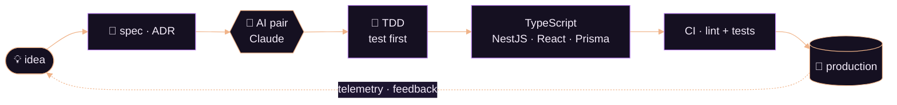

<!-- Eduardo Cornejo · Twilight Grove · generated by profile/build.mjs -->

&nbsp;
&nbsp;
&nbsp;

<b>Eduardo Cornejo</b> · Full Stack Developer — about me / sobre mí

Full Stack Developer specialized in <b>React, NestJS, Prisma and TypeScript</b>. I build web apps and REST / GraphQL APIs guided by Clean Code, SOLID, DRY and TDD, with a focus on system design, cloud architecture and developer experience.

<i>Desarrollador Full Stack especializado en React, NestJS, Prisma y TypeScript. Construyo aplicaciones web y APIs REST / GraphQL con Clean Code, SOLID, DRY y TDD.</i>

<b>Stack:</b> React · Redux · Next.js · NestJS · Node.js · Express · GraphQL · TypeScript · PostgreSQL · MongoDB · MySQL · Prisma · Jest · Storybook 
<a href="https://portfolio-livid-kappa-s1xb9fgcl6.vercel.app/">Portfolio</a> · <a href="https://www.linkedin.com/in/luis-eduardo-cornejo-rinc%C3%B3n-1467b81b8/">LinkedIn</a> · <a href="https://github.com/EdouardoCornejo?tab=repositories">Repositories</a>

<picture>
  <source media="(prefers-color-scheme: dark)" srcset="./profile-3d-contrib/profile-cyber-night.svg" />
  <source media="(prefers-color-scheme: light)" srcset="./profile-3d-contrib/profile-cyber-night-static.svg" />
  
</picture>

<picture>
    <source media="(prefers-color-scheme: dark)" srcset="https://raw.githubusercontent.com/EdouardoCornejo/EdouardoCornejo/output/pacman-contribution-graph-dark.svg">
    <source media="(prefers-color-scheme: light)" srcset="https://raw.githubusercontent.com/EdouardoCornejo/EdouardoCornejo/output/pacman-contribution-graph.svg">
    
</picture>

<!-- Juegos en banca (reactivar quitando este comentario):
<picture>
  <source media="(prefers-color-scheme: dark)" srcset="https://raw.githubusercontent.com/EdouardoCornejo/EdouardoCornejo/output/github-snake-dark.svg"/>
  
</picture>

-->

